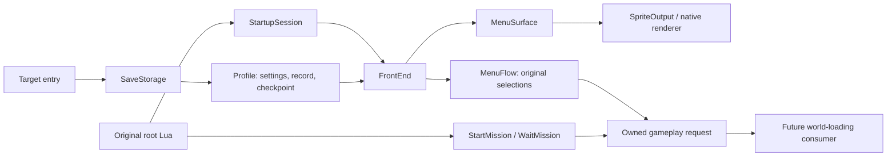

# Profile, menu and gameplay handoff

October 22, 2026. Reconstruction design and integration record. Implementation
and acceptance status are updated with each committed slice below.

## Ownership and sequence

The native entry chooses the writable profile directory independently of the
read-only game installation. `SaveStorage` owns bounded file I/O; `Profile`
interprets verified original fields and retains unknown bytes. `FrontEnd` borrows
both and owns the character-load/menu policies. `MenuSurface` owns decoded
images, font data and native texture lifetimes. `StartupSession` schedules these
policies under the existing original-root Exec/Wait contract.



The request must carry the original mission identifier, launch intent, difficulty
and costume. Continue retains checkpoint bytes rather than generating a new
snapshot. The receiver may inspect the request but cannot report a completed
mission before there is a world implementation. Selecting a menu entry is not
evidence that gameplay runs.

## Recovered boundaries

- `root.lub` functions `titlemenu`, `game`, `stage_select`, and `concept_mission`
  establish the routing. New game sets global slot 0 to stage 1; continue reads
  it; stage selection uses `_GetLatestStageSelectNo`, sets slot 2 to 1 and slot 6
  to the selected stage. Concept mode sets slot 3 to 1. Campaign missions are
  `st01_00` through `st06_00`; concept passes `concept`.
- `_StartMission` is followed by `_WaitMission`. The reconstruction captures
  the request at the first boundary and leaves the wait pending; later result,
  reward and checkpoint calls are not stubbed into success.
- Character-load `0x4a1240` reveals with 0.1 seconds and closes with zero-duration
  fade. It contains console/storage dialog branches as well as the PC path.
  PC `0x470e50` returns one and must not be confused with the real operation
  success accessor `0x470e30`.
- Title-menu `0x49b320` reveals with 0.5 seconds; pressed confirm/cancel and
  repeated navigation have separate masks. `0x49a690` distinguishes entry
  existence from availability. Details and nested policies are recorded in the
  menu reconstruction document rather than guessed from an asset inventory.

Evidence remains ignored under `research/evidence/startup/` and
`research/evidence/engine/`. Existing maps: [screens](ui-and-screen-tasks.md),
[saves](saves-and-progression.md), [input](input.md).

## Desktop storage adaptation

The writable directory belongs to this reconstruction, not the Steam install.
Missing files establish recovered defaults. Invalid or unreadable files do not
silently become a successful load: the user can retry or explicitly continue
without saving. That choice disables subsequent profile writes for the active
front end. Partial load failure retains the prior profile. Unknown checkpoint
object schemas remain opaque; this slice does not write gameplay checkpoints.

The compact desktop error dialog is a deliberate adaptation, not a claim of
reconstructing every console storage-device dialog and animation. Its strings
must remain distinct from evidence about original localized message IDs.

## Acceptance

The profile, menu and campaign-request composition is implemented. Strict build,
five CTest commands, fatal clang-tidy across 48 translation units, and repository
content checks pass. UBSan build, the same CTest suite and the provisioned
original-root integration also pass. CTest command count is not a count of behavioral test cases.
The existing original-root integration now selects costume 5, starts Normal
stage 1, retires textures, and reloads the saved profile through native file I/O.
Its media observations and renderer are controlled; it does not prove native
visual fidelity.

A separate native Mac run displayed the main menu, Options, difficulty, and
original/alternate costume preview sprites. Selecting costume 1 persisted a
72-byte System and 992-byte Record file, then produced an owned `st01_00` request
with difficulty 1, costume 1 and zero checkpoint bytes. The visual inspection
used a window after toggling out of fullscreen; fullscreen capture was black
and is not counted as visual menu acceptance. Prior fullscreen startup/title
acceptance remains separate. No screenshot comparison with the original game's
running menus has been performed.

Reproduction:

```sh
python3 scripts/check.py all
python3 research/tools/verify_startup_runtime.py \
  build/host-debug/startup-corpus /path/to/BulletWitch-Steam \
  --output research/evidence/reconstruction/frontend/original-root
build/host-debug/bw-startup --game /path/to/BulletWitch-Steam \
  --profile research/evidence/reconstruction/frontend/manual-profile
```

Native logs and verification summaries remain under ignored
`research/evidence/reconstruction/frontend/`. Save files never enter the game
installation. Full resource-corpus comparison after the Steam PNG extent fix
covers 6,625 archives, 25 catalogs and 29,996 records without errors; independent
CRC/RGBA comparison covers all 93 menu textures.

## Remaining boundaries

- Extra selection emits recovered native status 5, while the original root tests
  6 for concept missions. The mismatch remains explicit; no invented remapping.
- The app provides fresh achievement state. The policy can accept recovered
  difficulty/stage unlocks, but Steam achievement import and a local gameplay
  progression producer are not implemented.
- Options currently edit stored music/effects levels and costume. Audio gain,
  menu BGM/cues, other option screens, complete localization and original child
  animation/layout parity remain work.
- Continue validates and retains an opaque checkpoint. Original-game save
  round-trip compatibility and nested checkpoint object reconstruction are not
  established; the reconstruction does not write gameplay snapshots.
- The compact retry/continue-without-saving dialog is a desktop adaptation.
- The gameplay request is an ownership boundary for the future mission loader.
  World loading, rendering and simulation are not part of this slice.
