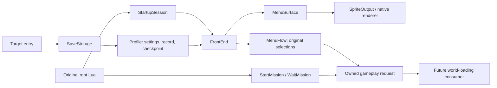

# Profile, menu and gameplay handoff

October 22, 2026. Reconstruction design and integration record. Implementation
and acceptance status are updated with each committed slice below.

## Ownership and sequence

The native entry chooses the writable profile directory independently of the
read-only game installation. `SaveStorage` owns bounded file I/O; `Profile`
interprets verified original fields and retains unknown bytes. `FrontEnd` borrows
both and owns the character-load/menu policies. `MenuSurface` owns decoded
images, font data and native texture lifetimes. `StartupSession` schedules these
policies under the existing original-root Exec/Wait contract.



The request must carry the original mission identifier, launch intent, difficulty
and costume. Continue retains checkpoint bytes rather than generating a new
snapshot. The receiver may inspect the request but cannot report a completed
mission before there is a world implementation. Selecting a menu entry is not
evidence that gameplay runs.

## Recovered boundaries

- `root.lub` functions `titlemenu`, `game`, `stage_select`, and `concept_mission`
  establish the routing. New game sets global slot 0 to stage 1; continue reads
  it; stage selection uses `_GetLatestStageSelectNo`, sets slot 2 to 1 and slot 6
  to the selected stage. Concept mode sets slot 3 to 1. Campaign missions are
  `st01_00` through `st06_00`; concept passes `concept`.
- `_StartMission` is followed by `_WaitMission`. The reconstruction captures
  the request at the first boundary and leaves the wait pending; later result,
  reward and checkpoint calls are not stubbed into success.
- Character-load `0x4a1240` reveals with 0.1 seconds and closes with zero-duration
  fade. It contains console/storage dialog branches as well as the PC path.
  PC `0x470e50` returns one and must not be confused with the real operation
  success accessor `0x470e30`.
- Title-menu `0x49b320` reveals with 0.5 seconds; pressed confirm/cancel and
  repeated navigation have separate masks. `0x49a690` distinguishes entry
  existence from availability. Details and nested policies are recorded in the
  menu reconstruction document rather than guessed from an asset inventory.

Evidence remains ignored under `research/evidence/startup/` and
`research/evidence/engine/`. Existing maps: [screens](ui-and-screen-tasks.md),
[saves](saves-and-progression.md), [input](input.md).

## Desktop storage ownership

The writable directory belongs to this reconstruction, not the Steam install.
CharacterLoad now uses the original desktop load/create/overwrite/autosave
sequence, common dialog animation, cues and purchased localized text. Invalid
files do not silently become successful loads. No retries storage lookup;
Yes explicitly authorizes replacement. All-zero original SaveData means no
checkpoint. Earlier reconstruction saves containing valid System/Record receive
only that absent-checkpoint sentinel without resetting progression. See
[profile load](frontend-profile-load.md) for source trace, persistence order and
failure behavior. The earlier authored retry/continue-without-saving adaptation
has been removed.

## Current entire-menu reconstruction

The original Lua still chooses native tasks. `FrontEnd` composes their policy
owners; it does not interpret Lua as a sprite description. Stage/Concept,
difficulty and costume selectors use original art, tracks, localized labels,
selection/scroll and confirmation lifetimes. Shared frontend Options supplies
its original ten rows and real controller, calibration, costume, Power Up and
Ranking child owners. Options holds System edits across children; Costume saves
only Record, while Options Exit decides its own persistence. Returning Power Up
releases its global conceal before the parent's sprite reveal.

See [feedback](frontend-feedback.md), [Options](frontend-options.md),
[Ranking](frontend-leaderboards.md), and [audio](frontend-audio.md). Original
Steam online rankings have no native service, so the real unavailable-provider
dialog returns without inventing scores. Expanded verification is recorded in
[the final menu report](frontend-verification.md); earlier verification below
belongs to the older snapshot.

## Earlier snapshot acceptance

The profile, menu and campaign-request composition is implemented. Strict build,
five CTest commands, fatal clang-tidy across 48 translation units, and repository
content checks pass. UBSan build, the same CTest suite and the provisioned
original-root integration also pass. CTest command count is not a count of behavioral test cases.
The existing original-root integration now selects costume 5, starts Normal
stage 1, retires textures, and reloads the saved profile through native file I/O.
Its media observations and renderer are controlled; it does not prove native
visual fidelity.

A separate native Mac run displayed the main menu, Options, difficulty, and
original/alternate costume preview sprites. Selecting costume 1 persisted a
72-byte System and 992-byte Record file, then produced an owned `st01_00` request
with difficulty 1, costume 1 and zero checkpoint bytes. The visual inspection
used a window after toggling out of fullscreen; fullscreen capture was black
and is not counted as visual menu acceptance. Prior fullscreen startup/title
acceptance remains separate. No screenshot comparison with the original game's
running menus has been performed.

Reproduction:

```sh
python3 scripts/check.py all
python3 research/tools/verify_startup_runtime.py \
  build/host-debug/startup-corpus /path/to/BulletWitch-Steam \
  --output research/evidence/reconstruction/frontend/original-root
build/host-debug/bw-startup --game /path/to/BulletWitch-Steam \
  --profile research/evidence/reconstruction/frontend/manual-profile
```

Native logs and verification summaries remain under ignored
`research/evidence/reconstruction/frontend/`. Save files never enter the game
installation. Full resource-corpus comparison after the Steam PNG extent fix
covers 6,625 archives, 25 catalogs and 29,996 records without errors; independent
CRC/RGBA comparison covers all 93 menu textures.

## Remaining boundaries

- Extra selection retains internal native status5; recovered accessor0x49a560
  maps it to API6, matching the original root. This former uncertainty is closed
  in [mission launch](mission-launch.md); load/setup readiness remains separate.
- The app provides fresh achievement state. The policy can accept recovered
  difficulty/stage unlocks, but Steam achievement import and a local gameplay
  progression producer are not implemented.
- Options edits source settings through the accepted pause/settings owners.
  Live audio gain is implemented; main-menu music/cues and main-shell feedback
  are accepted in the October 26 frontend walkthrough. Child labels and descriptions read
  purchased localization, and the original child animation/layout policies are
  implemented in this expanded snapshot. See
  [frontend audio](frontend-audio.md) and [frontend feedback](frontend-feedback.md).
- Continue validates and retains an opaque checkpoint. Original-game save
  round-trip compatibility and nested checkpoint object reconstruction are not
  established; the reconstruction does not write gameplay snapshots.
- The gameplay request is an ownership boundary for the future mission loader.
  World loading, rendering and simulation are not part of this slice.
