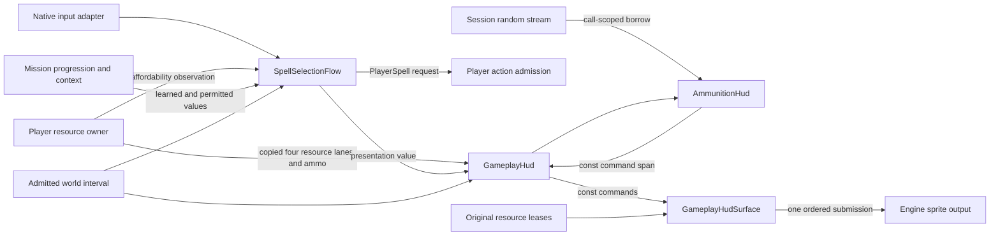

# Native gameplay HUD

Status: native HUD presentation implemented; integration and live acceptance are
tracked by the gameplay slice. This is the native
cockpit owner, not a Lua-generated bar overlay. The original scripts control
activation and visibility; native consumers read player resources and targeting
state. No lighting changes are included.

## Ownership and composition

The original coordinator at `0x4993b0` draws eight separately owned consumers
when activation and visibility permit it and the pause owner is inactive.
`0x499790` changes visibility only. The reconstruction separates an allocation-free
`GameplayHud` presentation owner from a `GameplayHudSurface` resource owner.
Presentation receives copied scalar observations and a supplied frame interval;
it cannot mutate player resources, progression, actor action state or clocks.
The surface borrows the resource service and sprite output, both outliving it,
and owns its resource interests and uploaded texture identities. It submits one
complete HUD command list. Pause presentation replaces that submission explicitly.

`PlayerCockpit` is the game-owned integration adapter between resource/targeting
observations and that presentation owner. It maps recharge receipts and selected
magazines, skips updates on control-only frames, and republishes retained HUD
commands when resume replaces pause. Explicit hidden activation clears the
sprite output. `PlayerInputRouting` owns neutral-button interpretation and ring
arbitration; framework and platform adapters do neither. The initial integration
misplaced those responsibilities; see
[the repair](gameplay-integration-boundaries.md) and
[fresh independent review](gameplay-hud-boundary-review.md).

| Native draw | Responsibility | Resource |
| --- | --- | --- |
| `0x4aac80` | Current/recoverable health and magic, drain trails, warning | `sprite.cockpit` |
| `0x4abc00` | Selected weapon background and silhouette | `sprite.cockpit` |
| `0x4a9870` / `0x4a8e70` | Ammunition symbols, count and weapon transition | `sprite.cockpit` |
| `0x4d1290` | Weapon/targeting reticle | `sprite.cockpit` |
| `0x48d960` | Mission destination marker | external mission target producer |
| `0x48e3c0` | Target marker | external target acquisition producer |
| `0x4cee70` | Directional damage indicator | external damage producer |
| `0x4d0520` | Magic selection ring | native selection/resource availability |

The four resource gauge inputs are distinct. `0x602b70` publishes current health
and recoverable health divided by maximum health; current magic and recoverable
magic use the original 100-point capacity. These are not duplicate delayed bars.
The native HUD separately owns visual depletion/recovery interpolation.

## Source art and layout

The health/magic background is sprite 6 at `(858,30)` on the source 1280×720
canvas. Its four fills use sprite 9, right-anchored at x=1173, y=60 and y=89;
full width is 302 and height is 16. Sprite 14 marks recoverable health/magic.
Weapon background 17 and silhouettes 18–21 are separate from the meter.
The ammunition digit atlas is 425 (with 426 for the native flash), while
427–430 are the individual weapon cartridge silhouettes. The source uses
weapon-specific cartridge capacity and spacing, not a generic progress bar.

## Evidence

Ignored source exports: `research/evidence/engine/pass-230-gameplay-hud`,
`pass-231-gameplay-hud-updates`, and `pass-232-gameplay-hud-state`.
Ignored literal-x86 command witness:
`research/evidence/reconstruction/gameplay-hud/draw_witness.py`.
The witness executes original draw code with controlled consumer state; only
texture lookup, renderer acquisition and final draw publication are intercepted.
It verifies input-to-command arithmetic, not original live gameplay.

## C++ design consultation

Retrieved Core Guidelines R.4 (`#rr-ref`) and F.16 (`#rf-in`) establish non-owning
output/service borrows and const input snapshots. Retrieved performance MEM.9
(`guidelines/memory/MEM.9-embedded-allocate-at-init.md`) places resource work in
prepare and bounds frame commands in fixed storage. Mutation authority is
limited explicitly; this consultation is not an automated ownership check.

## Implemented native consumers

`GameplayHud` reconstructs the resource gauges, weapon notice, ammunition owner
and ordinary/magic reticles. The resource snapshots remain independent of the
visual depletion trails. Health recovery and magic recovery each produce their
own source additive flash. Low-health warning uses the native 1.5-second sine
oscillator multiplied by its separate linear strength; the product is squared
before color interpolation. The three native scalar response modes retain their
original coefficients. The shared damped arithmetic lives in `bw/math/scalar.hpp`;
UI owners retain their own values and velocities, with no independent clock.

The weapon notice follows its arrival, bounce, hold, settling and departure
phases. `AmmunitionHud` separately owns the two weapon-transition children and
three cartridge banks per child. Recharge is an explicit committed gameplay
receipt, not inferred from equal ammunition counts. Its ejection draws borrow
the session random stream for the call. See [ammunition-hud.md](ammunition-hud.md)
for the independent source trace and executable comparison.

The ordinary reticle is sprite 39; aiming selects 40, 42, 37 or 38 by weapon,
and magic targeting selects 41. The source hit indication retains its red tint
for 0.35 seconds. Neutral, target and hit observations are distinct. Mission
objectives, directional damage, enemy markers, thunder target placement and
sniper view require their actual external producers; none is fabricated from
nearby objects or inferred from the HUD's own visibility.

## Native magic ring

`SpellSelectionFlow` consumes copied input edges and nine learned/permitted
observations. It publishes a `PlayerSpell` request; it cannot debit resources,
change player animation or create an effect. The action owner must still admit
that request with the real spell prerequisites. A displayed learned spell is
not evidence that its effect, targeting or world receiver is implemented.

Source `0x5fc3f0 → 0x613300 → 0x4d0d00/0x4d0d70` maps LB/RB to previous/next
ring input. The first shoulder opens page one without also cycling it. With the
ring active, Y selects cancel, B selects the right slot, A the lower slot and X
the left slot. These face slots are fixed in the native adapter rather than
following the ordinary remappable face actions. Right-stick aim input cancels
the ring. The native ring consumer clears weapon-switch, melee/crouch and reload
face commands; it preserves movement/look axes and fire-trigger value.

| Page | Right / B | Lower / A | Left / X |
| --- | --- | --- | --- |
| 1 | Ancient Wall | Elemental Shot | Rose Spear (native `rose_bomb`) |
| 2 | Sacrifice | Will Power | Raven's Panic |
| 3 | Tornado | Thunder | Meteor |

The original availability table checks learned state, magic affordability,
script masks and spell-specific context. These checks remain supplied
observations; the ring does not invent a target or treat an unavailable world
receiver as a successful cast. Opening and page changes consume their native
phase updates before accepting a choice. An admitted choice publishes once on
the following update, holds its selection highlight for 0.11 seconds, then
releases input ownership before its presentation finishes fading. Inactivity
expires after three seconds. Pause supplies no elapsed world time.

The ring uses original art from `sprite.magicring`: separate rotating rings,
four art quadrants, center art, flame panels, labels and selected additive flame.
Scale/rotation pivots use the original logical center `(640,360)` where the
native command requests that pivot. Sprite 100 is unused by this draw and is
not uploaded. No substitute text buttons or generated ring art are used.

The selected flame uses the original source-alpha/one blend. The source also
writes a uniform light term through `0x5647e0` into the submitted sprite. The
original embedded UI vertex shader at `0x8408b0` (pointer `0x96a038`) adds that
term to vertex color; the textured pixel shader at `0x840d58` (pointer
`0x96a040`) multiplies sampled RGBA by it. `0x568f20` binds the queued term to
vertex register c5. For these uniform-color quads, the reconstruction combines
the constant tint and light before submission, including the original ps_2_0
color-input saturation. This is constant arithmetic from the original shader,
not a new lighting response. Microsoft documents that input-color range in
[Pixel Shader Input Color Register](https://learn.microsoft.com/en-us/windows/win32/direct3dhlsl/dx9-graphics-reference-asm-ps-registers-input-color).

## Presentation and residency

`GameplayHudSurface` retains 21 cockpit images, 26 used ring images and one
original font atlas. It decodes/uploads during preparation and resolves bounded
commands during presentation. `sprite_text` emits from already prepared font
metrics and atlas into the caller's bounded array; both HUD diagnostics and the
existing menu surface use this helper. There is one final sprite submission,
so animation-review text cannot replace the HUD by submitting a second list.

Pause-specific menu residency excludes title and stage-select archives. The
actual-content coexistence probe retained 88 textures for HUD and pause/costume
presentation together, below the unchanged 128-texture output limit. Retained
native allocations use the existing `TextureAllocation` owner and device
budget. Ending both surfaces returned the texture and device-resource counts
to zero. The game data remained read-only.

## Verification and limits

The ignored `draw_witness.py` executes original `0x4aac80` with controlled
resource observations, capturing its seven ordinary gauge commands. The ignored
`ring_draw_witness.py` executes original `0x4d0520`, capturing its original art,
positions, explicit pivots, rotations and selected additive blend. The harness
intercepts texture identity lookup and final draw publication; it does not
replace the original command construction.

`ring_update_witness.py` executes original `0x4d0d70` and its update helpers for
65 frames through opening, idle, selection, publication, input expiry and fade.
Only external availability/audio service calls and the platform sine entry are
intercepted. Comparing ten presentation channels with the C++ owner produced
maximum absolute error below `2.5e-7` after initialization. It caught and removed
an early art reveal and an early closing transition; phase timing was corrected
from the executable, not tuned from screenshots. Initial invisible storage is
not compared as rendered output.

The independent input review added `ring_expiry_witness.py`: 285 literal original
updates covering combined-shoulder expiry during opening, idle and page change.
The input-active latch matches every frame and published scalar channels match
within 2.42e-7. `ring_lifecycle_witness.py` adds 1,175 updates covering timeout
followed immediately by a shoulder, timeout followed by an empty frame then a
shoulder, and right-stick withdrawal during those three visual phases. It
caught a one-frame counter-order defect: the source resets the inactivity
counter before adding the current update interval. Restoring that ordering
makes immediate input preserve the current page, while the intervening empty
frame causes fresh opening on page one. Published channels/pages then match
within 2.42e-7. Original initializer frames have no draw flag; retired invisible
storage is excluded from visual comparison. Right-stick cancellation withdraws
the action owner's keepalive; the raw HUD input bit alone is not a substitute
for that action ownership. These cases do not fabricate a successful spell,
world target, damage producer or save transition.

The in-process HUD contracts cover independent current/recoverable resource
lanes, original layout observations, retained depletion trails, zero-time pause,
invalid-snapshot rejection, learned/permitted admission, single publication,
first-shoulder behavior, ring teardown and original art/blend commands. These
are part of the existing runtime test target.

The ignored `presentation_probe.mm` prepares production HUD and pause surfaces
concurrently using actual archives, production DDS interpretation/mip generation,
`TextureAllocation` and the compiled production sprite shader. Six offscreen
captures cover ring, selected flame, pause, selected costume row and two costume
previews. Captures were inspected. This verifies the production presentation
commands and shader through a small offscreen output adapter; it is not a live
window/controller walkthrough or a claim that spell execution works.

Implementation consultation also retrieved Core SL.con.3 (`#rsl-bounds`) and
performance GPU.1 (`guidelines/gpu/GPU.1-keep-data-on-device.md`): bounded command
publication and retained resident textures. No per-frame parsing or uploads were
introduced. Full repository verification and visible acceptance remain the
integrating agent's responsibility; unresolved external producers above remain
explicit boundaries.
