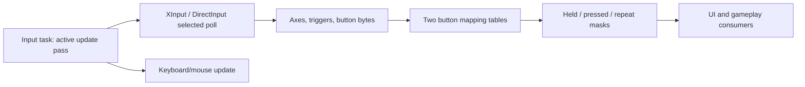

# Input acquisition and action masks

Updated October 22, 2026. [Architecture](../ARCHITECTURE.md).

## Registered service

**0x411f80 -> 0x4171c0** inserts the input task at **0xaeed60** through 0x40b670.
Its vtable begins at **0x6c2e64** (0x6c2e60 is the RTTI locator):
initialization +4 = **0x417220**, shutdown +0x10 = **0x417260**,
active update +0x14 = **0x417290**. Task lifecycle details are in
[bootstrap/tasks](bootstrap-and-tasks.md). This establishes actual task ownership,
rather than only the presence of input imports.

Initialization calls `DirectInput8Create` with version **0x800**, stores the
interface at **0xaeed58**, initializes controller probing and keyboard/mouse
services. Shutdown invokes their cleanup and COM Release on the interface.
Update 0x417290 calls **0x41d340** (selected controller poll function pointer at
**0x956814**) and the keyboard/mouse update **0x419e20**. Input sampling therefore
belongs to the task's active update pass; relative order against every other registered
task still depends on task list ordering.

## Controller selection and normalization

**0x41ca70** probes at most four XInput controller slots. Its counter retries after
**30 invocations**, not a guaranteed wall-clock interval. On a successful probe,
it records the slot and installs **0x41cda0** for polling and **0x41cb70** for
rumble. If no slot succeeds it tries the DirectInput path through **0x41c420**.
The PE imports XInput ordinal 2 for state-shaped reads, ordinal 3 for two-motor
writes and ordinal 5 for enable-shaped calls; these roles are supported by their
arguments, with original imports retained as ordinals in the evidence.

The active poll reads the expected packet/button/trigger/four-axis structure.
When application flags do not permit polling it clears state via **0x41bd00**.
Failed reads also clear state, accumulate elapsed time and eventually reset
probing; preserve that gate rather than treating stale state as live input.

For each signed stick axis **x**:

```text
x < -7864: (x + 7864) / 24903
-7864 <= x <= 7864: 0
x > 7864: (x - 7864) / 24903
```

The engine applies the same threshold to all four axes in this path. Triggers
scale by **1/255**, and digital trigger flags use a **0.5** threshold. Button bits
become 0x80/0 bytes before action remapping. Rumble passes two 16-bit motor values
through 0x41cb70.

## Held, pressed and repeat masks

**0x41cfd0** combines directional thresholds, remapped buttons and synthetic
navigation bits. It computes two mappings using tables at input state +0x140 and
+0x148. Each has held, newly pressed and repeating masks:

| Field | Meaning |
|---|---|
| +0xc / +0x18 | Held mask for each mapping |
| +0x10 / +0x1c | `~previousHeld & newHeld` |
| +0x14 / +0x20 | Newly pressed OR timed repeat |
| +0x154 / +0x1d4 | Per-bit repeat accumulators |

Held bits accumulate frame delta; after **0.5 seconds**, a repeat is emitted and
**0.125 seconds** is subtracted. Released bits reset their timer. This reproduces
the observed arithmetic, including behavior under a large timestep, without
assuming a fixed rendering rate.



Evidence: [service/poll exports](../../evidence/engine/pass-06f/status.tsv),
[task wrapper](../../evidence/engine/pass-06g/functions/00417290.c),
[action-mask update](../../evidence/engine/pass-06f/functions/0041cfd0.c), and
[import addresses](../../evidence/engine/pass-06/imports.json).
The keyboard/mouse updater 0x419e20 polls/acquires DirectInput devices and
reads 0x100-byte keyboard and 0x14-byte mouse states. Keyboard masks use eight
32-bit words for held/pressed/repeat state, with the same 0.5/0.125-second repeat
arithmetic. Mouse scaling divides by elapsed time under its timestep gate.

Remaining: complete mouse/DirectInput normalization, binding persistence,
per-gameplay-action consumers and exact task ordering across game modes.
