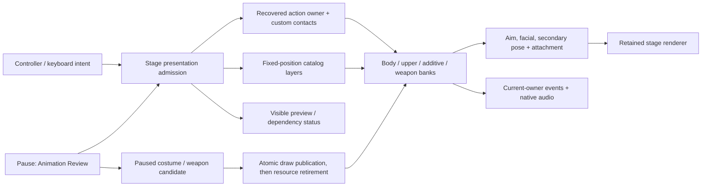

# Interactive animation review

The expanded animation slice was incorrectly called reviewable when its new
families were available only to accepted C++ requests and native probes. Live
player input and an explicit review interface are now part of completion. This
implementation now connects those controls and pause requests to the existing scene.
The previous checks remain evidence for their bounded paths; user visual/audio
acceptance is distinct from the native component checks below.

## Ownership

The host publishes physical intent and press/hold semantics. Original player
admission owns grounded/airborne state, current action, trigger/cooldown and
weapon policy. It selects existing action plans; it does not manufacture ammo,
projectiles, impacts or world effects. The recovered hardware map is kept in
its own input research report.

The existing pause flow gains Weapon Class and Animation Review. Review choices
are clearly labeled previews and submit fixed requests to the current stage.
They reuse the same actor, catalog, clocks, event receivers, secondary solver,
camera and renderer. They are not an alternate model viewer or independent
animation implementation. External events such as a hit or cinematic completion
are explicit user-selected preview inputs, never reported as actual gameplay.
A persistent status identifies preview ownership and waiting/unsupported states.

Source action families run through their real retained policies. Next phase
provides a manual synthetic observation only inside review mode. Stop preview
interrupts scoped presentation and restores its entry physical snapshot; no
health/save/world state is created. Raw clip/layer pages expose all prepared
publications, including unbound resources, at the current actor position, with
root movement explicitly excluded from that fixed-position clip inspection.
Those pages do not assert a source gameplay consumer for unbound clips.

Weapon selection occurs while paused. MissionLoading prepares a stable candidate;
actor/catalog/renderer preparation must succeed before promotion. Review switching
preserves costume, physical position and camera but resets incompatible animation
owners to neutral. It does not pretend that an old weapon clip belongs to the new
class. Failure keeps the old complete publication. Costume switching retains its
existing compatible-clock behavior.

## Reference and cost

This extends the already implemented pause/appearance lifecycle. The inspected
Unreal PlayerController SetPause/ProcessPlayerInput/TickActor contract and pinned
revision are recorded in [pause and costume switching](pause-and-costume-switching.md):
UI consumes its frame, simulation clocks are withheld, and resume does not replay
input. The weapon transaction follows that same source-reviewed borrower/publication
boundary. No new generic input framework, playback algorithm or scene rebuild is
introduced by review navigation.

Menu state, command requests and external-observation latches are fixed values;
catalog labels borrow prepared names. Asset/catalog allocations occur only in the
paused class transaction. Playback continues through the prepared frame path.
Both design corpora were consulted: I.1 and E.4 make preview/admission and failed
transaction invariants explicit; MEM.9 bounds the repeated update. Native review
must show actions and transitions, not merely successful request counters.

## Implemented review route

`StageInspection` owns one explicit review snapshot and fixed status buffer.
The host's RT/F, X/R, A/E and stick-click/T edges feed the source-backed cadence,
raised-state and melee selection policies. Melee and locomotion now share the
same processed movement function. Source first-trigger ordering is preserved:
shot admission observes the previous raised state; that frame's refresh occurs
later in the controller. Held fire waits for the upper owner to retire. Live horizontal look also feeds
raised idle-turn selection through the source sensitivity conversion, using the
initial field60 recovered from `4102d0`/`410750` (`SystemSetting` default word
`0x2f1e52`). The current host exposes normal horizontal look; persisted profile
inversion/sensitivity options are not silently inferred from that default word.
The PC stick-swap hook `6b0fe0` returns zero. This connects the existing turn
motions without treating camera angular velocity as a hardware axis. The
presentation adapter supplies a visibly accepted review observation instead of
pretending ammunition/resource admission exists. Missing action aliases are
reported, including partial class-0 discharge presentation.

Raw body/upper/additive/weapon requests select the actual prepared publication,
with body position fixed and root displacement intentionally unused. Adding an
upper/additive/weapon layer preserves the selected fixed body. Facial preview
holds the body clock so an idle facial event cannot overwrite the chosen face;
absent shape streams reject before disturbing the current preview. Source family
previews instead run the existing physical controller and exclusive action owner.
The scripted-flight initial upward velocity is explicitly supplied by the review
request, not inferred as a new hardware jump control.

Next phase supplies one synthetic observation to one physical substep. Thunder
first accepts a target, then accepts its five external cinematic segments. Meteor
uses two cinematic acknowledgements and its terminal world acknowledgement;
Tornado accepts the camera handoff then waits for motion completion. Common
spells finish through their recovered animation policy. Death stops at the
reported dynamic-body dependency. Stop interrupts the review and restores the
entry snapshot; it does not create a mission result or write a save.

B/Q uses a normal switch presentation transaction, separate from the menu's
explicit neutral Weapon Class preview. All four immutable weapon resources are
prepared during mission admission. Normal selection recreates only selected
model/playback state from retained resources; it does not pause advancement or
audio, consume a UI-only frame or rebase host deadlines.
The new selected weapon starts the source lowered/raised rest, then the upper
switch request uses the current standing/crouched direction variant. The next
idle update mirrors that upper action into the body at its sampled phase;
moving locomotion remains independent underneath. This is the original
`62ed80 -> 604370 -> 603900` selection followed by `62fb90/62e8e0` presentation.
The original inventory/ammunition eligibility remains outside this scene.

Renderer publication precedes no-throw adoption/retirement; failed preparation
or publication leaves the old actor/resources intact. The weapon clock owner
borrows its class catalog and the stable body owner's sink, and retires before
either. Body secondary velocities and facial banks also survive normal switching.
Per-class presentation cooldown survives deselection and advances without a
visible weapon model, matching `617a30`. The explicit menu class selector still
resets action presentation to neutral. Only actual paused menu loading rebases
deadlines; menus rebind borrowed catalog labels before another UI read. See
[weapon residency](weapon-selection-residency.md) for the resource/instance boundary. All six costumes
retain their separate compatible-clock transaction.

The actual-asset offscreen menu checks cover four pause roots, all review
categories, first/middle/final body pages, 11 death entries, eight spells, rejection
messages and the persistent status at 1280×720. Texture retirement is zero.
The production Stage/native Metal probe covers the four class transactions,
held-fire/reload inputs, three melee variants, twelve ordinary damage selections,
eleven weighted/crouched death selections, six scripted flights, eight spell
families and six facial selections. It also advances all 26 weapon publications across their owning classes and
the original all161-per-bank diagnostic. That diagnostic admitted incompatible
representations. Current source-bound admission is135 ordinary body/upper and17
additive resources;9 unresolved resources and incompatible bank entries remain
visible but disabled. See
[pose compatibility](animation-review-geometry.md). Both raised-turn directions
pass for each class, and all eight spell previews reach terminal presentation
status after their explicitly synthetic phase inputs. The source raw-vector
turn ordering correction is recorded in [raised aiming](raised-aim-posture.md).
Final native audio scheduling records 130 common cues, seven memory voices and
four streamed voices with the dummy device; audible mix quality remains a
separate listening check. The full check gate and original-root corpus pass. Captures show the actual source poses, not substituted
reference animations. Native shape close-up and source-chain evidence remain
linked from the parent acceptance report. These checks establish accessibility
and ownership, not original-game visual parity for every pose.

Reproduction and generated images/logs stay ignored under
`research/evidence/reconstruction/interactive-animation/` and
`research/evidence/reconstruction/pause/`. The user-facing sequence is
[the animation review guide](../../../docs/animation-review.md).

## Native review corrections

The reported movement exit is reproduced by a saturated analog vector whose
recomputed floating-point length exceeds one. The source stores its clamped
magnitude separately; that contract is now restored and checked with the exact
failing input, a legal-stick sweep, and actual-stage movement for all four
weapon classes. See [input scalar ownership](player-input-locomotion-policy.md).

Normal B/Q switching now has separate native acceptance from the neutral menu
selector. All four raised classes preserve body clock, player position, raised
state and camera at publication; then their original upper switch advances to
completion. Held movement, lowered switching and crouched switching also pass.
Inspected before/middle/completion frames visibly show the weapon/arm action.
The production probe and images are under the ignored interactive-animation
evidence directory as `switch-stage.log`, `live-switch*-*.png` and
`live-lowered-*.png`.

The aiming correction follows the full source consumer pipeline: raw facing
reference is separate from the displacement reference, and weapon activation
and common model rendering each contribute their own basis conversion. Steady
raised up/down views now show coherent hands and bore direction. The original
combined turning/firing sequence exposed a separate false support-loss branch:
a tiny positive root Y disabled grounded floor queries. Explicit contact modes
now preserve the source grounded path while retaining airborne ascent handling.
The exact combined sequence passes across all four classes; inspected held-fire
up/down side views remain grounded and track camera pitch. See
[the complete aiming contract](raised-aim-posture.md). The full automated gate
passes; user acceptance of the corrected executable remains pending.

The latest review lifecycle correction and native replay are recorded in
[review exits](animation-review-lifecycle.md): menu-created aim intent can be
released by live RS/T, complete model intervals preserve cancellation/events,
and the actual PauseFlow Stop path resumes movement. The separate user-reported
Stop reset failure remains unconfirmed rather than receiving a speculative reset.

The later right-thumbstick retest exposed omitted targeting ownership, not a
raised-animation expiry rule. [Player targeting](player-targeting.md) now separates
selected mode, active target calculation and camera context from raised posture.
Native GameController snapshot input exercises immediate second-click selection
exit and the original20°→44° context transition. Physical controller confirmation
remains pending; prior keyboard/expiry checks do not establish that result.
