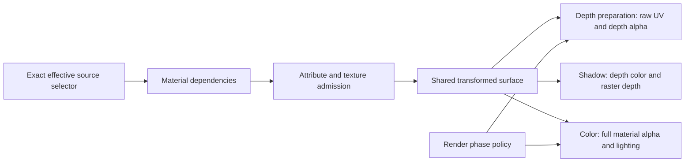

# Material and surface lighting redesign

## Contract before implementation

Material classification belongs to the shared render boundary. The game supplies
an effective source selector; the engine admits an audited exact program and
publishes its consumed inputs. Neither a scene-owner category nor the presence
of directional light determines local/specular, shadow or normal consumption.
An unsupported selector fails admission before replacing a native frame.

The implementation retains the complete 158-key audit scope: 130 earlier
admitted keys plus 28 source-selected static variants exposed when the obsolete
inspection mask is removed. Exact admission precedes dependency decoding. This
is a compatibility boundary, not a generalized shader generator for untraced
registry keys.

Three contracts remain separate:

- Geometry evaluates the original one/two/three/four-influence palette operation
  identically for positions, normals, tangents and all depth/color/shadow passes.
- Surface evaluation consumes the original feature dependencies, including
  local-only specular and normal maps and explicit shadow reception.
- Coverage preserves raw-UV material/base discard for depth, while the render
  phase controls its final output alpha test. Color evaluates the finished
  material/indirect/vertex/Fresnel alpha. Masked S tests its depth-valued alpha.

No source light values, material multipliers, fog or art parameters are tuned.

## Evidence and guidance

Primary evidence is the hash-bound original executable and authored input data,
as inventoried in [the full audit](lighting-source-fidelity-investigation.md).
The ignored `lighting-source-fidelity` evidence directory contains original
constant-table and vertex-address signatures for all admitted keys, 14 original
vertex-program replays and 78 distinct pixel-program replays. These establish
consumption and arithmetic under supplied inputs, not original live-frame or
native raster parity. The source three-influence programs accumulate the second,
first and third contributions without reading a fourth index or normalizing
stored byte weights.

Design and implementation consultations each retrieved C++ Core Guidelines I.1 and performance guidance
CDSA.32/GPU.4 in full. Their application is explicit dependency/coverage APIs,
setup-time retained classification, and draw-uniform GPU feature branches.
Consultation does not establish correctness; independent source and native
witnesses must check the implementation.

## Acceptance ledger

| Boundary | Required evidence | Status |
|---|---|---|
| Exact effective-key admission | all 158 audited keys; unknown key rejection | implemented; independent source/native witnesses below |
| Feature dependencies | independent original declarations and arithmetic | implemented; independent source/native witnesses below |
| Three-influence surface basis | original instructions and native transformed values | implemented; independent source/native witnesses below |
| Depth versus final-color coverage | offset/indirect/vertex/Fresnel counterexamples | implemented; independent source/native witnesses below |
| Native receiver publication | integrated renderer resource validation and packet upload | parent integration |
| S-before-T and raster correspondence | shared-owner replay and target raster witnesses | parent integration |

Other receiver, environment, shadow-owner, output-history and display findings
remain in the full redesign ledger; this boundary does not close them.

## Implemented surface boundary

`WorldMaterialRequirements` now admits an exact complete selector before decoding
its source dependencies. The whitelist contains the 158 independently audited
identities; arithmetic is shared, not duplicated for actor/background categories.
Unknown neighboring selectors and texture-layer variants stay unsupported.

The dependency graph now preserves local-only diffuse/specular, normal maps
used by local/SH/environment/alpha-Fresnel paths, and independently classified
shadow reception. Authored no-shadow directional programs remain unshadowed.
`normal_required` drives native attribute validation. Geometry decodes the full
two-bit influence field and accumulates second, first, third, then fourth only
when that input exists. Positions, normals and tangents share this operation;
color, preparation and shadow use the same transformed surface.

`depth_cutout` describes the original depth shader. Render-phase state separately
selects `color_alpha_test`. The surface fragment tests final alpha after texture
offsets and material/indirect/vertex/alpha-Fresnel operations. Preparation tests
both the raw-UV depth cutout and its finished depth-valued alpha. Preparation
returns depth in all four world-color channels; it does not silently disable
color writes. Clip z/w is retained as a perspective-interpolated pair.

Source shader depth bias and source raster depth bias occupy distinct pairs in
a pass-owned float4 at fragment buffer 3. Shader bias affects the depth color
result. Shadow raster bias writes a separate depth result using the documented
D3D9 normalized-depth expression and clamping. This avoids passing a normalized
D3D9 constant as a native Metal depth-unit count. Original D24 versus native
Depth32 precision remains a target difference. Main preparation receives the
source reset-zero bias. The integrated renderer owns scheduling, buffer
publication, caster admission and native attachment state.

## Target correspondence

Original masked world phases request GREATER_EQUAL with ALPHAREF 128 on
RGBA16F. The source/API trace does not establish the original device's comparison
quantization. For a concrete compatibility implementation, inspected DXVK v2.7,
commit `54e9c1baa2b57d848ec35089b93844550c6a6277`:

- [`D3D9DeviceEx::GetAlphaTestPrecision`](https://github.com/doitsujin/dxvk/blob/54e9c1baa2b57d848ec35089b93844550c6a6277/src/d3d9/d3d9_device.cpp)
  selects 15-bit comparison precision for A16B16G16R16F.
- [`DoFixedFunctionAlphaTest`](https://github.com/doitsujin/dxvk/blob/54e9c1baa2b57d848ec35089b93844550c6a6277/src/d3d9/d3d9_fixed_function.cpp)
  expands the 8-bit reference and rounds the scaled incoming alpha to nearest,
  ties to even. For this source state, the Metal helper compares
  `rint(alpha * 32767) >= 16448`.

This narrow D3D9 compatibility reference is more applicable than borrowing a
modern engine's art-facing opacity threshold. It is explicitly inferred target
translation, not proof of the original hardware's quantization. Microsoft's
[alpha-testing contract](https://learn.microsoft.com/en-us/windows/win32/direct3d9/alpha-testing-state)
establishes the requested API comparison; its
[depth-bias contract](https://learn.microsoft.com/en-us/windows/win32/direct3d9/depth-bias)
establishes the independent normalized constant-plus-maximum-slope expression.

The renderer's explicit integer-pixel-center policy shifts native geometry
sampling to the original D3D9 convention. Receiver-plane shadow correction then
uses the stored source sample at `i / N`, instead of adding a second half texel.
Native diagnostic mode retains `(i + 0.5) / N`. This changes sample correspondence,
not original authored UVs, light transforms or the existing documented
Unreal-informed receiver-footprint/guard inference.

## Verification performed

The in-process material test compares all 158 admitted keys against independently
recorded original declarations and palette-address counts, rejects unknown
neighbors/layer variants, and checks local-only reflection, authored unshadowed
directional lighting and explicit inspection energy suppression. These are
parameterized witness assertions, not 158 separate test implementations.

An ignored offscreen Metal harness compiles the actual production shader source.
Its wrappers supply declared inputs; they do not replace the surface equations.
The oracle interprets the original hash-bound SM3 instructions independently.

| Witness | Supplied input scope | Result |
|---|---|---|
| Color arithmetic | 158 keys / 78 original PS; ten seeds, zero through four local lights, lit/occluded samples | 3,160 cases, maximum absolute difference 0.000000149012, zero above 0.00003 |
| Consumed color vertex outputs | 14 original VS; thirty packed-input/palette cases each | 420 cases, maximum difference 0.000000298023 |
| Preparation and shadow geometry | ten original S VS; separate camera/light clip rows, thirty cases for each path | 600 cases, maximum difference 0.000000298023 |
| Final-alpha and depth coverage | actual RGBA16F target, threshold neighbors, UV-offset counterexamples, indirect/vertex/Fresnel alpha and preparation bias | 24 cases, expected coverage and exact representable outputs agree |

The vertex comparison round-trips actual SHORT4N, UBYTE4N and half-UV packed
inputs before executing the original oracle. It checks consumed RGB irradiance,
not the original unused constant fourth lane; the native wire carries RGB only.
Source VS variants retaining normals for an SH consumer use that admitted
consumer. Neither adjustment weakens a consumed-input numerical threshold.

An initial coverage diagnostic also recorded native RGBA16F storage of 0.7 as
0.69970703125, while NumPy's nearest-half conversion predicted 0.7001953125.
That observation is retained separately, not hidden by a widened arithmetic
tolerance. The coverage witness uses exactly representable depth/bias values to
isolate alpha admission. These tests do not establish original-device half-float
storage rounding, live-frame equality, filtering/derivative behavior on arbitrary
geometry or an artistic brightness match.

Evidence and reproduction live under ignored
`research/evidence/reconstruction/lighting-material-redesign/`: source manifest,
`generate_witness.py`, `depth_vertex_witness.py`, `coverage_witness.py`,
`native-witness.mm` and their JSON results. No proprietary bytes or generated
listings are tracked. Standalone C++ compilation and execution and Metal shader
compilation pass. Scoped fatal lint and the parent's integrated build/policy gate
are recorded separately; do not infer their completion from numerical witnesses.

Scoped fatal clang-tidy passed `world_material.cpp` and `world_material_test.cpp` with the pinned LLVM 21.1.8 toolchain. The integrated repository gate remains owned by the renderer integration task.

## Final owner-opacity ABI verification

After the owner-opacity implementation added the stream's final alpha-reference
word, the isolated native witness was updated from32 to33 unsigned words with
default reference128. Only layout/reference metadata changed; hashes in the
ignored `lighting-material-redesign/final-abi-manifest.json` establish identical
non-layout input and original expected-output content for every retained case.
The generator now emits that reference and the native witness rejects the old
layout instead of reading an omitted field.

The isolated runner was rebuilt and executed against the final production
`world_color.metal` (SHA256
`5a93f3fcca557a675fd642df3c5726ca6a7edea536ebe75e57588bb13e00c548`).
All3160 original pixel-equation cases pass, maximum absolute error1.49012e-7.
All420 T vertex and600 S/shadow vertex cases pass, each group maximum absolute
error2.98023e-7. All24 RGBA16F alpha/coverage cases pass with zero observed error.
No expected output or tolerance was changed. Final results are retained as
`final-native-results.json` and `final-coverage-depth-results.json` in the
ignored evidence directory. These are the same supplied-input arithmetic and
coverage boundaries described above, not a new claim of original live-frame
parity. No production source was changed for this verification.
