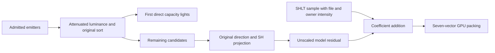

# Local-light overflow irradiance

The optional model-light overflow path now uses the original projection and
accumulation algorithm. Initialization still disables it. This is a reconstructed
capability, not an explanation for the current stage's missing ambient light.

## Ownership and coefficient contract

`LocalLights` publishes direct lights and an owned nine-RGB-coefficient
`residual_irradiance` value. With overflow enabled, the residual contains only
admitted candidates beyond the configured direct-light capacity. It includes
emitter diffuse intensity, receiver-radius attenuation and source projection
normalization. It has no SHLT file or owner intensity multiplier.

The model receiver adds this value to its already sampled/scaled SHLT
coefficients before packing the seven GPU vectors. Applying either SHLT
multiplier again would darken or amplify an independent source contribution.
The view/global selector returns zero residual: its original caller computes
then discards the temporary. Model selection and view selection share ranking,
not this publication policy. Disabled overflow returns zero without changing
which direct lights are selected.

## Original instruction evidence

The retained executable and hash inventory are described by
[the lighting source audit](lighting-source-fidelity-investigation.md).
The full disassembly remains ignored under the audit's output-lifecycle evidence.

| Function | Recovered responsibility |
|---|---|
| `5f6e80` | Model admission, receiver radius, configured direct capacity; conditional addition controlled by general owner offset `+70` |
| `5461f0` | Attenuated diffuse and luminance ranking, original descending comb sort, direct/residual partition and projection loop |
| `545610` | Clear the temporary coefficient set |
| `545800` / `5456d0` | Signed real SH basis from normalized direction, followed by source projection scale and attenuated RGBA multiplication |
| `545870` | Component-wise multiplication of all nine coefficient vectors |
| `545140` / `545150` | Ordered coefficient addition |
| `5f70f0` | View candidate rank with fixed capacity four; residual temporary is discarded |

The ranking attenuation is
`1 / (pow(max(distance - receiver_radius, 0), exponent) * scale + bias)`.
The projection loop visits the remaining candidates in sorted order. Its stored
emitter-to-receiver vector is negated by the projection helper, so the final
basis direction is receiver-to-emitter in world coordinates. Zero-length
vectors contribute nothing; they are not replaced with an arbitrary direction.
Specular color does not enter the residual.

For normalized direction `(x,y,z)`, the nine scalar basis terms are proportional
to `1, -y, z, -x, xy, -zy, 3zz-1, -xz, xx-yy`. The recovered float constants
are retained at source precision. The original helper multiplies each basis
term by `2.9567911624908447`, then by each attenuated color channel, then adds
it to the residual. This scalar is recovered data, not a brightness adjustment.
The implementation preserves that order, including the original distance
conversion through double-precision square root and back to float.

The original caller skips ranking entirely when no emitter is admitted. The
standalone source witness preserves that branch; it does not call the original
comb sort with an unsupported empty range.

## Design and implementation guidance

Both phases independently queried and retrieved Core Guidelines I.1
(`ri-explicit`) and performance MEM.9 (`embedded-allocate-at-init`). The output
contract names the residual's scaling and ownership. Prepared candidate storage
retains attenuation and direction from the rank operation; selection performs no
allocation or duplicate per-light `pow`. The existing source sort is retained.
The additional projection is linear in the overflow count with nine fixed
coefficients. The owner remains single-threaded, like its view-history scratch.
No generic replacement lighting algorithm or heuristic ambient approximation
was introduced; the original instructions resolve this boundary.

## Verification

The ignored `lighting-overflow-irradiance` evidence directory contains the native
probe, independent original execution driver and complete result records.

- 105 synthetic cases execute the complete original `5461f0` return path,
  including projection and accumulation, against the native implementation.
  Cases cover direct capacities zero through four, zero through eleven emitters,
  axis/oblique directions, coincidence, receiver movement/radius, attenuation
  exponents and admission rejection. Direct selections match and the maximum
  coefficient difference after decimal serialization is `4.88e-9`.
- The witness hooks only library `pow`, `sqrt` and aligned stack allocation.
  Model admission is the previously traced source equation in the driver;
  original `5f6e80` entity traversal is not executed by this witness.
- Tracked public-contract tests retain independently executed source coefficients
  for asymmetric six-light selections with two receiver poses and capacities.
  They check direct/residual partition, disabled policy, zero contribution after
  admission rejection, view discard, active-model publication and stable prepared
  storage under repeated queries. The standalone native test executable passes.
- The old test requiring overflow to throw is replaced by an empty-set zero
  residual contract. This is newly implemented source behavior, not a weakened
  expectation for an unsupported path.

Scoped fatal clang-tidy passes the new test and modified local-light translation
unit using pinned LLVM 21.1.8; owned-file formatting and whitespace checks pass.

Integrated SceneLighting addition and full repository verification are recorded
by the parent lighting redesign gate. Production initialization remains false;
no current-frame art or intensity tuning is part of this change.
