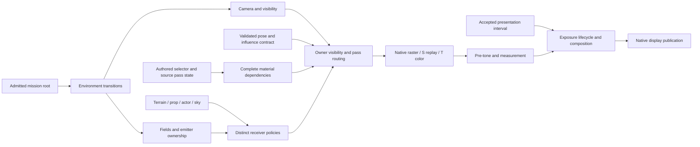

# Lighting redesign acceptance map

## User acceptance — October 25, 2026

The user accepted the current lighting implementation and authorized its commit.
Residual angle-dependent speckling and coarse shadows are accepted baseline
limitations. They may be consistent with limitations of the original renderer,
but no matched original-image correspondence was established. The explicit
native final-normal normalization and pixel-footprint specular filtering remain
documented departures from the recovered equation, not claims of original
behavior.

The latest reproduction references are the user's October 25 screenshots at
7:18:15 a.m. (cave) and 7:19:52 a.m. (outdoor school outfit). They preserve the
viewing contexts for the remaining angle-dependent appearance; the screenshots
and extracted data remain outside Git. No new visual investigation is required
for this accepted slice. Residual visual quality belongs to the later upgrade
pass unless a concrete new implementation defect is demonstrated.

Acceptance closes this represented lighting slice, not the named upstream
mission/event/weather/particle/settings producers or every original-device
evidence limit. The independent implementation review and passing verification
remain distinct from this user decision. Production code is unchanged since
the final passing full gate; this acceptance update is documentation only.

October 24, 2026. Design support for the lighting redesign after timing acceptance.
This file maps every row of the [full source audit](lighting-source-fidelity-investigation.md)
to an ownership contract and acceptance obligation. It is not implementation
completion, a new original-game capture, or an independent adversarial review.
The original audit remains the detailed provenance record; native addresses below
identify that evidence and do not prescribe production names.

The redesign is the reconstruction of the complete represented lighting pipeline,
including its inputs and output lifetime. Resolving skinning alone, making hair
brighter, or passing an isolated sampler comparison cannot close this work.
Source-supported values and algorithms remain constraints. Unreal informs a
bounded unresolved mechanism only after its concrete pinned implementation is
inspected; it does not replace known original material or pass behavior.

## Reading and closing the map

The 51 `L` identifiers correspond one-for-one, in order, to the audit's coverage
ledger. Each entry states the recovered boundary, required ownership/behavior,
and evidence needed for acceptance. Existing bounded verification is a regression
constraint, not proof of the integrated redesigned renderer.

- **Reconstruct** means a demonstrated mismatch or missing owner/consumer must
  be implemented and verified before that capability is called complete.
- **Preserve** means the bounded source result is already supported; preserve it
  through the redesign and test its real consumer, not merely its helper.
- **External evidence** means the precise original observation is unavailable.
  Keep that limitation attached to the relevant fidelity claim. It does not
  excuse a source-accessible defect or a known missing subsystem.
- **Owner dependency** means a named world/effect owner is not implemented.
  Specify the eventual producer, consumer and activation contract now. A future
  implementation disposition leaves the capability open; it is not an external
  evidence blocker and cannot count as whole-engine completion.

The current-disposition column is a bookkeeping snapshot of the uncommitted
redesign, checked against current production code and authored implementation
reports. It is not an independent adversarial review. Codes are **I** implemented,
**P** preserved, **D** remaining implementation, **O** upstream owner dependency,
**V** remaining integrated verification, and **E** external original evidence.
Multiple codes mean those obligations coexist. A helper test or earlier native
slice pass is not a completed final integration gate. The lead should update
implementation, automated/native evidence and remaining limits as work lands. A source comparison must retain
its original input provenance: synthetic matrices, installed asset definitions,
and original live frames answer different questions. Asset census counts are not
visible instance counts. Instruction interpretation is not GPU interpolation,
coverage, texture filtering or display correspondence.

## Environment publication and receiver ownership

| ID / audit boundary | Required preserved or reconstructed behavior and source evidence | Acceptance, remaining boundary and current disposition |
|---|---|---|
| L01 — Mission resource identities | **Preserve:** the mission/content owner resolves `cm01_00` to `st04_c`, `sky04_c` and the recovered character-light resources. Evidence: recovered mission load names and MissionLoading chain. Lighting consumes those identities; it does not choose replacement assets. | Actual-content loading verifies the same resources through scene publication. Genuine mission startup, entities and event writes remain owner dependencies; bounded traversal is not an original mission-frame capture.  **P / O / V:** Existing mission resource mapping and `StageInspection` publication retained. Genuine world/entity startup and event writes remain upstream; actual-content loading and native contract checks pass; current-scene visual review remains open. |
| L02 — Customization and AREA activation | **Preserve:** game compatibility maps `45ae00/45ff80 → 5f9c00` and `43f16e → 4829c0`; activation enables AREA despite the raw disabled byte. Environment owns retained transition state, first publication snaps, subsequent publications blend. | Test activation from actual AREA/STBL/FLAN through published render inputs, first-snap and subsequent transition. Existing original-x86 auxiliary defaults do not establish whole-game startup parity.  **P / V:** Existing activation/default composition and retained first-snap/transition path retained in `stage_environment` and `scene::Environment`. Recheck the integrated publication after new consumers; no new startup-parity claim. |
| L03 — Region/table selection | **Preserve:** `482590/482910` selects using the active camera; receiver SH/cube positions remain model-local observations. Initial actor and camera are both in region 1, but that coincidence must not conflate their queries. | Retain the 277 actual-box boundary/inside/outside witnesses; exercise a camera/receiver separation case through scene publication. Event camera switches require the event/world producer, not a controller-specific ambient override.  **P / V:** Camera AREA selection stays separate from model receiver sampling and new `ReflectionField`. Existing 277 geometry witnesses remain the reference; integrated separated-position behavior remains in verification. |
| L04 — AREA update cadence | **Preserve:** ordinary mode 7 uses root `43eea0/43fa0a`, one update per admitted root call. Mode-10 `475600` is not a second ordinary update. User pause suppresses the ordinary root path; script pause does not inherently suppress it. Smoothing is 1/32 per admitted call. | Check user pause/resume and source root phase admission without catch-up or duplicate smoothing. Future script pause must allow root environment publication while actor phases are withheld. Accepted timing does not claim that missing root/script integration is complete.  **P / O / V:** Accepted world-phase admission still drives environment updates; no new light clock. Ordinary pause/root cadence is retained. Genuine script/event root admission is an upstream owner dependency, not an implemented script subsystem. |
| L05 — Scalar channels, schema, interpolation | **Preserve and complete publication:** `4ac280/4829d0` supplies 186 lanes at version `0x108`, 165 destinations and 21 unused. Game compatibility owns channel meanings; receiving subsystems own state. Missing destinations are separately tracked below. | Account for every lane and conversion against `environment-destinations.json`; test transitions at actual consumers. Lanes 60/63–68 have no observed downstream rendering read in the bounded census: retain that result without inventing an ambient operation or claiming formal whole-program proof.  **P / D / O / V:** Existing channel schema retained; camera far, clear and shadow controls now have consumer routes. Unimplemented storm/event/composition destinations remain named dependencies under L47/L50; decoding all lanes is not their implementation. |
| L06 — Cave/exterior live values | **Preserve:** `4829d0` supplies cave character intensity .005, enemy 1, exterior .057/.1; uniform terrain ambient is zero and pre-tone mode is 2. These are source-produced values, not repair knobs. | Installed-data publication must retain these values after redesign. Compare resulting surfaces only after upstream deformation, receiver and material dependencies are correct. Matched original frame/camera is needed to attribute the observed darkness.  **P / V / E:** Authored cave/exterior intensities, ambient and pre-tone values retained unchanged. Their integrated visual effect is being checked; original-frame brightness attribution remains unavailable. |
| L07 — Field identity/intensity publication | **Preserve:** `5e4430/45eed4` identifies separate character/enemy field owners and intensities. Scene lighting owns field state; receivers and attachments supply their own bounds. | Verify independent identity/intensity updates and attachment packets through actual renderer publication. Alicia verification cannot certify enemy/effect receiver lifetimes; those producers remain explicit dependencies.  **P / O / V:** `SceneLighting` retains distinct fields/intensities and body/weapon observations. Enemy/effect receiver lifetimes require their own future owners; current body/attachment publication needs final integrated acceptance. |
| L08 — SH interpolation and polynomial packing | **Preserve:** blended field `567af0` and packing `5453a0` have original-instruction witnesses. Do not introduce an untraced π, normalization or intensity factor. | Retain independent sampled interpolation/packing comparisons and inspect native consumption of the resulting coefficients. Additional cells/degenerate boundaries exposed by new content require appropriate coverage; existing samples are not exhaustive live parity.  **P / V:** Actor blended interpolation and polynomial packing retained. Independent actor sampler evidence remains valid for supplied inputs. The newly corrected prop kernel is separate (L43), not a change to actor trilinear sampling. |
| L09 — SH coordinate basis | **Preserve:** original `42ffc0` keeps world axes after camera translation; sampling uses transformed model center with unscaled receiver radius. | Exercise translated/rotated models and cameras through packet publication and shading, with independent source expectations. Synthetic rotations isolate the basis but cannot certify an original live palette.  **P / V / E:** World-axis SH and transformed group-zero receiver center retained. Independent shader/pose witnesses cover supplied matrices; matched original live palette/basis remains external evidence. |
| L10 — Static/sky SH policy | **Preserve:** terrain `5e46d0` uses uniform authored ambient; sky `56b440` uses white SH. These are receiver policies, not universal defaults. | Verify terrain and sky packets separately and ensure props cannot accidentally inherit terrain's path. Props must satisfy L43; Alicia remains the blended field receiver.  **P / I / V:** Terrain ambient and sky-white policies retained; placed objects now have separate strict cached receivers. Confirm integrated per-family packets and visible output after all publication changes. |
| L11 — Directional producer | **Preserve:** `460660/546510/545ea0` directly copy authored colors, retain source Z +.001, normalize and negate direction. | Check original input-to-packet arithmetic and native material consumption with nontrivial direction/color. No speculative sRGB conversion or brightness multiplier. Feature-dependent shadow reception remains L31, not a directional producer decision.  **P / V:** Authored colors and source direction perturbation/normalize/negate retained. Material/native supplied-input witnesses exercise the consumer; no new gain or gamma conversion introduced. |
| L12 — Local emitter decoding and selection | **Preserve and expose correct ownership:** `5f70f0/5f6e80` distinguish scene-view candidates from receiver-sphere active lists, bounded ordering and attenuation. The scene owns emitters; a receiver query does not mutate global lighting policy. | Test nonempty lists, zero through four consumers, ordering and receiver/view separation using independent expected selections. Emission/destruction registration and live frustum/owner lifecycle remain world/effect dependencies; empty lists in one scene cannot validate omitted material loops.  **I / O / V:** Scene-view and receiver-sphere selection remain separate; corrected feature admission consumes nonempty packets. Current prepared scene/emitter policy is implemented; dynamic emission/destruction belongs to missing world/effect owners. |
| L13 — Local-light overflow SH | **Reconstruct before enabling:** `5f6e80 → 5461f0/545140` projects residual lights into SH when general +70 is enabled. The audit-time implementation rejected enable; initial source value remains zero. The reconstructed residual path now replaces that rejection (current disposition). | Verify the now-implemented direct/residual partition and accumulation without double counting, including enabled nonempty inputs. Record this as an open alternate configuration, not missing ambient in the current scene or external runtime uncertainty.  **I / V:** [Overflow irradiance](lighting-overflow-irradiance.md) replaces the old unsupported-enable rejection. Original/native 105 synthetic cases match direct selections and residual coefficients (max serialized difference 4.88e-9); `SceneLighting` adds residual SH. Source initial setting stays disabled. Full integration gate passes; visible scene review remains open. |

## Effective materials, deformation and textures

| ID / audit boundary | Required preserved or reconstructed behavior and source evidence | Acceptance, remaining boundary and current disposition |
|---|---|---|
| L14 — Local-light consumer admission | **Reconstruct:** original PS17/19/43/109/243/90/317/319 consume local lighting, with program-specific diffuse/specular dependencies. Material admission must request the resources actually consumed by the selected source program. | Compare dependencies independently for background and special static families; execute native draws with nonzero light packets and compare source arithmetic. Cover the 55 affected background draw definitions/21 model definitions as asset census, not asserted visible impact.  **I / V:** [Material redesign](lighting-material-redesign.md) independently admits local diffuse/specular dependencies and exercises zero through four supplied lights on production Metal shaders. Current-content submission/native inspection remains an integration check. |
| L15 — Effective static selector state | **Reconstruct:** `42f970`, feature-state setters and `460c60/56a640` resolve authored selectors against actual pass state. Remove the unconditional inspection disable mask `0x00e00000`; do not clear authored disabled bits. | Check source-enabled and source-disabled registry state, resolve the 4,101 static/sky definitions and admit all 28 newly selected exact keys before removing the restriction in the live path. The 3,198 changed keys are not live membership. Unknown variants fail explicitly; no nearest-supported fallback.  **I / V:** Exact 158-key registry includes all 28 newly required effective keys; inspection feature suppression is removed without clearing authored disabled bits. Corpus/live admission and final gate remain separate from the key-level witnesses. |
| L16 — Vertex declarations and units | **Preserve:** selected original declarations and `SOFS` use world FLOAT3, UBYTE4N illumination/modulation and SHORT4N directions, with source scale/offset handling. | Verify decoding through native vertex consumption for represented declarations and reject unsupported declarations. No blanket component swap, unit change or rescale. A layout-valid buffer alone does not establish correct shader input.  **P / V:** Source declaration formats/units retained; native witness round-trips actual packed SHORT4N, UBYTE4N and half-UV values. Current-content buffer/attribute publication remains part of integrated verification. |
| L17 — Joint influence decoding/accumulation | **Reconstruct:** selector field zero means four influences, `0x40000000` three, `0x80000000` two, `0xc0000000` one for admitted families. VS472/473 and VS480 establish the distinct paths; three-weight accumulation includes its third contribution and source order. | One contract must cover color, scene preparation and shadow; palette admission validates every used index. Use independent source shader input/output witnesses plus native animated PW0 hair/belt captures. The 19 affected definitions/989 vertices with discarded nonzero weights establish defect scope, not original live pose or visible pixel counts.  **I / V / E:** Complete influence-count decoding and source accumulation order now feed the shared color/preparation/shadow transform. Native comparisons cover 420 color-vertex and 600 depth/shadow cases. Actual animated hair/belt review and original live palette correspondence remain distinct. |
| L18 — Full pose/normal/tangent path | **Preserve downstream algebra:** all 14 original VS and `42ffc0` support existing weighted transform/declaration equations when supplied correct influence count. | Retain independent equation coverage, exercise native transform output and all three consumers after L17. Do not add inverse-transpose or normal-sign changes to hide bad influences. Full animated draw parity needs the matched original live pose/palette.  **P / I / V / E:** Existing normal/tangent algebra retained with corrected influence admission and shared transformed surface. Supplied-input native vertex comparisons pass; no unsupported inverse-transpose or sign repair was added. |
| L19 — Normal-map basis | **Preserve basis, reconstruct admission:** normalize interpolated normal/tangent, use `cross(tangent, normal)`, reconstruct `sqrt(abs(1-x*x-y*y))`; the recovered equation has no final normalization. The measured native adaptation below deliberately adds a unit-direction boundary. Non-SH PS317 must retain its normal sampler. | Native normal-mapped witnesses must exercise non-SH and SH material paths and asymmetric tangent-space samples. Source-instruction equations distinguish basis errors from missing resources; filtering/interpolation require native evidence.  **I / V:** Normal-sampler admission is explicit, including non-SH PS317; source tangent basis/reconstruction retained before the explicit native unit-direction and pixel-footprint specular adaptations. Actual-content same-primitive contributions, sixteen-sample HDR reference and small-motion comparisons support those native changes; historical original-program witnesses remain source-equation evidence, not equality claims for the adapted path. |
| L20 — Material constants and texture binding | **Preserve:** original `547e70/547370/401800/547120` uploads 1,062 constants from 417 actor/weapon blocks unchanged; 118 LENV records use slot 7/MAXMIPLEVEL 0. Unit modifiers are source-backed; no hidden gamma conversion. | Recheck actual-content bindings at reconstructed material publication; include material and indirect alpha when the real modifier owner changes them. Definition upload evidence does not cover live event overrides. PARF/FRSB are not represented pixel consumers; do not invent dependencies from unused records.  **P / I / O / V:** Original constants/UNORM bindings retained; receiver cube publication now preserves later authored material binding precedence. Event/material modifier producers remain upstream. Actual-content corpus and native binding checks pass; visual frame review remains open. |
| L21 — Hair pixel material | **Preserve arithmetic:** PS412 at `7f86a0` already has independent supplied-input SH/AO/local/directional/reflection/fog/final-alpha evidence. Hair is not a special brightness exception. | After L17/L23 and dependency changes, render hair with actual maps and native interpolation; retain intermediate input/output evidence. The original live samples/palette are required for pixel attribution. This regression must not become a costume-specific tuning path.  **P / I / V / E:** Hair uses the same corrected dependencies/influences and preserved PS412 algebra. Native supplied-input arithmetic is covered; no costume-specific brightness rule. Actual maps and animated whole-frame review are still required. |
| L22 — Feature/resource completeness | **Reconstruct complete admitted dependency contracts:** the 158 effective keys/78 pixel programs include the old 130 plus 28 source-correct static keys. Shadow reception, local diffuse/specular, reflection, normal maps and influence count cannot depend on accidental classifier overlap. | Regenerate independent dependency and instruction comparisons for the actual production selection; then native-exercise representative dependency combinations and actual corpus admission. Research-only dependency substitution yielding no arithmetic difference above .00003 is not a production or GPU pass. Preserve overlapping counts as counts of affected variants, not defects.  **I / V:** All 158 effective keys / 78 source PS now have explicit production dependencies. Independent production-Metal arithmetic witness: 3,160 cases, maximum difference 1.49012e-7, none above3e-5. This is supplied-input coverage, not scene/live-frame completion. |
| L23 — Color/depth alpha coverage | **Reconstruct separate contracts:** `460920 → 44e960 → 565520` tests final T material alpha with GE/reference 128. Depth PS1 has its own raw-UV cutout; masked S also fixed-tests depth-valued output alpha. | Native witnesses vary UV offset, material/indirect/vertex alpha and family alpha effects independently; observe color and depth/shadow masks. Exercise values around the 8-bit threshold. Exact D3D float/comparison quantization is external API evidence; it does not justify retaining the proven raw-alpha substitution.  **I / V / E:** Phase-owned final-alpha testing is separate from raw depth cutout and masked S depth-alpha. Twenty-four offscreen RGBA16F cases pass. Pinned DXVK15-bit alpha comparison is explicitly target inference; original-device quantization is still external. |
| L24 — Texture formats/color handling | **Preserve:** represented resources are UNORM; 260 source sampler sites contain no SRGBTEXTURE write and represented states have no SRGBWRITEENABLE/gamma-ramp producer. | Verify native format and sampler publication and retain authored values without extra shader gamma. L42 separately owns physical display transfer. Source absence in represented paths is not a guarantee about every future material.  **P / V / E:** Existing UNORM texture/surface contract retained without added gamma. Source-backed absence of represented sRGB writes remains bounded. Original/native physical display transfer is L42, not solved by shader arithmetic. |
| L25 — Texture filtering/mips | **Preserve source requests:** `451770/564f70/547120` specify surface wrap/linear/minimum anisotropy 4, environment clamp/linear 1 and LENV MAXMIPLEVEL 0. | **I / V / E:** `--texture-mips on\|off` captures the original launch option in immutable resource preparation policy, default off. World 2D/cube and front-end DDS construction retain source format metadata, full-base-per-level BOX/ordered dither and complete native level accounting. Raw icons and movie resources keep their distinct constructors. Direct original DLL replay: 189 bases, 517 generated face-levels, 98,632 components byte-identical; independently replayed with exact cardinality/extent checks. Initial NONE conversion verifies the active four-bit font and zero-padded odd dimensions. Native checks cover every level/face, accounting and failure rollback. This does not establish driver minification/seam precision or unsupported address 6 behavior. The Windows settings dialog/persistence remains an upstream producer; the explicit launch option represents this graphics capability. See [mip ownership](lighting-texture-mip-generation.md), [numerical filtering](texture-mip-filter.md) and [verification](lighting-redesign-verification.md). |
| L26 — Material animation | **Preserve:** source material binding/evaluation uses 30 fps float2 tracks and UV bindings for six current scene draws. Animation consumes accepted world time; it does not own another wall clock. | Exercise moving UVs, pause/resume and resumed state through visible shading. Gameplay mutations need their actual owner. Weather appearance alone is not evidence to add cloud scrolling or another track.  **P / V / O:** Material tracks still consume accepted world timing. Current UV animation/pause behavior requires the integrated walkthrough. Later gameplay mutation producers are upstream; no inferred weather animation was added. |

## Shadows, scene submission and coverage

| ID / audit boundary | Required preserved or reconstructed behavior and source evidence | Acceptance, remaining boundary and current disposition |
|---|---|---|
| L27 — Shadow projection/init | **Preserve:** `457620/452460/5f9c00` and six original machine-code witnesses establish effective 60/1/8/2 initialization and matrices. Keep native guard inset explicitly identified as a departure. | Recheck matrices and native caster/receiver coordinates together after L41. Do not tune projection/resolution/stabilization to improve appearance without source or measured target evidence. Owner eligibility remains L28.  **P / I / V / E:** Final source warp/init retained. New owner-selection volume is separately reconstructed and must not replace it. Existing matrix witnesses and documented native guard inference remain bounded; combined caster/receiver native verification continues. |
| L28 — Shadow caster ownership/coverage | **Reconstruct selection, preserve initial policy:** `5e2f80` uses registered owners, AREA 85 projected-size threshold and light-volume intersection. Static owner size returns 1. Initial BGOB construction does not enable casting. | Verify registration/eligibility independently from material reception, threshold boundary and volume rejection, cave .115/exterior .101625 publication, and complete native caster membership. Do not enable all props or replace projected size with distance. Future dynamic registration remains an owner dependency.  **I / O / V:** [Shadow-owner contract](lighting-shadow-owner-contract.md) implements static/model/placed queries and separate selection volume;14 original owner/plane cases plus two original selection fits pass. `StageInspection` now publishes static and independent body/weapon bounds and body action force state. Initial props stay ineligible. Dynamic registration/script flags remain upstream; final membership verification pending. |
| L29 — Shadow setup/cull policy | **Reconstruct:** `457620` consumes scene setup and cull controls. Current setup 1 / cull 0 matches only the current initial setting; unconditional view construction/no-cull is not the complete contract. | Exercise enable/disable and supported cull selectors through native pass admission and raster state, including transition publication. Verify that disabled setup does not manufacture another shadow-view update. Unsupported alternatives must remain explicit until implemented.  **I / V:** Typed setup/caster/cull publication is wired. Disabled setup retains prior map/projection; resume and cull branches have native fixtures in the existing scenario. Final integrated gate and actual-content corpus pass; visual acceptance remains open. |
| L30 — Shadow bias/depth format | **Reconstruct source shader/raster bias:** S programs consume c68 and `457620` publishes depth/slope bias. Current zero values cannot verify nonzero support. D24S8 versus native Depth32Float is a separate target representation choice. | Native known-slope witnesses verify nonzero shader and raster terms independently, then zero-current-scene regression. Quantify representation/precision limits; do not change authored bias to compensate for format or sample-center errors.  **I / V / E:** Distinct shader and normalized raster bias are implemented and published, with known-slope/native fixture coverage. Initial zero bias is retained. Original D24 versus native Depth32 precision is an explicit representation limit, not a reason to tune bias. |
| L31 — Shadow filtering and receivers | **Reconstruct independent reception:** source pixel loops and `547a50/457090` define shadow sampling separately from directional light, cubemap-shadow response and caster eligibility. Retain explicitly inferred cleared guard/receiver-plane policy from pinned Unreal. | Test directional-without-shadow, shadow-capable and reflection-related combinations on native shaders, plus border/footprint behavior. Original RNG history and address 6 driver state remain unproven; do not label the inferred policy byte-identical source output.  **I / V / E:** Reception is independently admitted from directional light, reflection and casting. Supplied-input shader shadow combinations pass; integrated border/receiver-plane cases remain required. Guard/footprint inference, original RNG history and address6 limits remain explicit. |
| L32 — Sky/cloud content and transform | **Preserve static sky:** `44fc40/56b440`, VS448/PS363 support no skeleton/MTAB, white SH, yaw/camera translation and no geometry scale change. Separate `4d9700` storm owner is not static sky. | Actual sky transform/material validation remains separate from storm activation. Additional cloud geometry requires its source owner and script/state activation; AREA storm parameters alone do not prove it belongs in the initial frame.  **P / O / V:** Static sky policy/transform retained. Storm geometry, flash and activation remain missing owner work (L47); static-sky success does not close those. Current sky/native frame check ongoing. |
| L33 — Surface/sky fog | **Preserve:** `460300/425160` and selected PS distinguish surface/sky enable defaults. Only sky distance/height coordinates have .01 factors; geometry and density are not globally rescaled. | Validate native surface/sky depths and fog separately. Existing nonfinite c40.xy canonicalization is valid only for audited consumers using zw; new shader admission must check actual consumption before inheriting it.  **P / V:** Surface/sky fog separation and source sky-only coordinate factors retained across admitted materials. Shader arithmetic witnesses preserve these inputs; actual depth/height/fog presentation remains in native verification. |
| L34 — Scene phases, cull, depth and blend | **Reconstruct enabled shared-owner S-before-T replay:** `4614e0/460920/461170/56a640/545db0` establish execution. R32F bind/clear and world-target restore happen before S geometry; S writes depth-valued color to restored RGBA16F and hardware depth with COLORWRITE 15. Aliased owner links are not sorting. | Verify actual pass/attachment/state order, shared draw identity and native S/T coverage. Main +24/+28 are enabled; Trans replay is unconditional. S/T opaque/masked use GE and write depth; late main disables depth writes; retain BTNO blend policy. Shadow tail restores CCW, COLORWRITE 15 and zero bias before sky/main. Any surviving S-only color needs a measured witness, not an asserted global brightness effect.  **I / D / O / V:** Renderer now replays opaque S then masked S before T on restored HDR/depth, retaining draw identities and source gates. Existing native scenario has S-only survival and ordering counterexamples. Complete owner-opacity Trans routing and its native verification are recorded in L49; native chunk phases alone are not a substitute. |

The existing `draw_depth` verification API has a different depth convention and
is not evidence that L34 is implemented. The source's restored-world-target order
must be represented directly; a conventional separate depth-only prepass would
be an unsupported redesign of behavior. Likewise, native model chunk 2 and
source owner-opacity Trans are different categories (L49).

## Output lifetime, spatial state and outstanding owners

| ID / audit boundary | Required preserved or reconstructed behavior and source evidence | Acceptance, remaining boundary and current disposition |
|---|---|---|
| L35 — Scene clear and pre-tone gates | **Reconstruct clear publication, preserve actual gates:** `463b40/461f00/463a80` consume clear RGB and named effects. Current cave/exterior clear is black; AfterImage strength 0, DOF/optional gates 0 and initial mist disabled rule out those branches as an assumed baseline multiplier. | Verify nonblack clear reaches the target and actual current gates remain unchanged. Disabled paths are not implemented effects; activation requires L47/L50 owners and their algorithms.  **I / O / V:** Authored RGB clear reaches `WorldPostprocess::begin_scene`; nonblack native fixture passed in the output slice. Initial effect gates retained. Disabled DOF/AfterImage/mist paths are not implemented active effects; see L47/L50. |
| L36 — Pre-tone RGB operation | **Preserve:** `56f880`/private PS17 applies clamped-nonnegative authored multiplier without output saturation, preserves alpha, and passes half-float output to metering. | Native intermediate capture verifies operation/order/format before metering and bloom. Never adjust authored tint/gamma to hide L17/L22/L43 input-energy defects.  **P / V:** Existing source RGB multiplier/order/half-float target retained. Output-slice native checks passed; integrated scene HDR input changes require renewed capture rather than modifying this operation. |
| L37 — Metering targets/sampling | **Preserve:** `56e990/56d6a0/579620/579770/578950/585d90` establish 512 color/log, 256 split, 64/16/4/1 R32 reduction, destination-normalized taps and fullscreen pixel+.25 correspondence. | Compare original shader-derived reductions against native readbacks with documented format tolerances. Replaying captured native HDR validates downstream processing, not correctness of its upstream scene. L41 must not alter this separate fullscreen convention.  **P / V / E:** Existing source reduction chain and fullscreen quarter-pixel correspondence retained, independent of geometry viewport shift. Prior native output verification remains regression evidence; current HDR replay is downstream-only validation. |
| L38 — Temporal adaptation | **Preserve accepted presentation clock and ring/slew arithmetic; reconstruct lifecycle:** `5712f0/461f00/40f920` adapt from the preceding completed luminance image. Tone disable skips adaptation without clearing process-static history/accumulator. Event reset `571180` clears ring/index/full/adapted value but preserves history length and external sample clock. | Native sequences cover pause, tone disable/re-enable, explicit event reset, sample gate/remainder, bounds and preceding-frame ordering. Retain step-2 zero/30/60Hz supplied-time witness. First original predecessor read is unconditional; original allocated surface bytes/front-end history require runtime evidence. No fake luminance seed, silent universal stage reset or current-measurement parity claim.  **I / O / V / E:** [Output lifecycle](output-lifecycle-redesign.md) separates tone toggle, event history reset, scene target release and lifetime reset. CPU and native memory-scenario checks passed before full redesign integration. Actual reset-event production remains upstream; original first-surface bytes are external. Current-GPU first-use is pinned-reference inference. |
| L39 — Bloom | **Preserve:** original private shaders/builders establish separate `exp(log+.001)`, threshold/soft knee, two radial stages and unnormalized 15-tap Gaussian chain. | Retain independently derived stage expectations and native intermediate capture; separate upstream HDR energy from bloom arithmetic. No whole-frame parity follows from same-input bloom agreement.  **P / V:** Existing bloom arithmetic/order retained, with prior native intermediate evidence. Corrected scene energy must be carried through integrated output verification; no new bloom tuning or whole-frame parity claim. |
| L40 — Final exposure/gamma | **Preserve:** original final shader uses `pow(abs(scene*key/(exp(log)+.001)), 1/gamma)` then adds bloom. No filmic curve was recovered. | Validate native final shader on independent HDR/key/log/gamma inputs, including clipping range. Matched original HDR/output are required to attribute appearance. A modern tone curve is an upgrade, not a way to close this source reconstruction.  **P / V / E:** Existing exposure/gamma/additive bloom equation retained. Native same-input evidence remains bounded; original HDR/backbuffer values and appearance correspondence remain external. |
| L41 — Geometry raster sample convention | **Reconstruct target correspondence:** original `40a5b0/42ffc0/408f80` and 14 VS supply unshifted geometry to integer-origin D3D9 viewports. Metal samples at half-integers. Portable projection stays source-backed; target raster boundary owns the conversion. | Native geometry/edge and interpolation witnesses must verify the intended correspondence, caster/receiver agreement and viewport sizes. Preserve fullscreen quarter-pixel path L37. Do not move gameplay camera, tune shadow bias or attribute hair darkness before measurement.  **I / V / E:** Geometry integer-center policy is now native viewport state; shadow receiver footprint follows the same convention while fullscreen sampling is unchanged. Production HDR edge fixture exists. Final integrated native execution and original precision limits remain separate. |
| L42 — Native display transfer | **External evidence:** `4125b6/4125dd/463040` establish 8-bit UNORM tone intermediate, windowed UNKNOWN physical format and fullscreen enumerated format, without found source sRGB/gamma-ramp writes. | Record actual selected original backbuffer and OS/display profile and native CAMetalLayer/format transfer before claiming display parity. Source-only gamma searches or arbitrary shader correction cannot close this. Record current native output configuration explicitly.  **E / V:** No new original backbuffer/OS transfer capture. Native output format/layer configuration must accompany current captures; physical display parity remains unverified and no compensating shader transform is introduced. |
| L43 — Placed-prop ambient/local/cube receiver | **Reconstruct distinct receiver policy:** `455e60/5efe10/5f0eb0/567d90` sample control-point-zero translation from the prepared direct world pose (first placement-matrix translation on query failure), strict first-containing field with the separately recovered five-point X/Z grid kernel at fixed Y, per-call local lights and position-based cube. Retained SH/cube update when squared change of `(XYZ, 10*ownerIntensity)` is at least .25 for finite inputs; max-finite cache initialization forces first update. | Independent strict-versus-blended field overlap witnesses, first publication, below/at/above invalidation boundary and intensity-only changes; the source comparison includes equality; local lights must still update on cache hit. The audit-time zero prop SH has been replaced; the independent sampler matches coefficients at three supplied authored matrix translations. Those positions are not claimed to be recovered live control-point positions. Render visible props after material dependencies; verify that two instances of one model retain independent receiver packets rather than a model/draw broadcast. Do not share Alicia's sample or terrain policy.  **I / V:** Strict first-containing zone now uses the source five-point X/Z kernel at fixed Y, not actor trilinear/exclusions. Three supplied authored matrix translations match all 81 RGB coefficients (max printed-decimal difference <5e-12). The separate [placed control-point implementation](placed-lighting-control-point.md) matches six original query cases and passes the actual-content corpus; supplied sampler positions alone do not validate this producer. Per-instance retained cache includes intensity and threshold equality; local lights refresh independently. Native instance isolation passed; integrated actual prop output remains under verification. |
| L44 — Receiver cubemap selection | **Preserve current fallback, complete receiver selector for admitting other stages:** `4407b0/4828f0` require slot 0. `st04_c` has slots 4/5 only and correctly selects opaque black. | Exercise missing-slot 0 fallback plus a valid table with receiver movement/selection, independently of camera AREA. Future-stage cube support cannot be inferred from a successful black fallback.  **I / V:** [ReflectionField](lighting-reflection-field.md) now handles valid slot-zero banks, receiver regions/table order and explicit black fallback;185 original/native synthetic selector cases match. Stage receiver publication and authored material precedence are wired. Distinct native receiver/authored/black readback and the final integrated gate pass. |
| L45 — Baked irradiance/AO inputs | **Preserve:** COLOR2 decodes `exp2(alpha*255-128)*rgb`; spatial fields have nine RGB SH coefficients; AMOC R attenuates ambient/SH and G reflection. Hair has an actual AO map. `samplerDestLightMapDepth` is the dynamic shadow target. | Native asymmetric baked/AO inputs verify channels and combination; retain asset binding census. No separate color-lightmap consumer exists in the represented 158 keys / 78 PS; this bounded negative result does not rule out future stages/effects or justify recoloring source assets.  **P / V:** Source baked irradiance/AO channel algebra and bindings retained; production material witnesses include these inputs. Actual asset/native inspection remains in the integrated gate. No additional unobserved color-lightmap consumer is claimed. |
| L46 — Region camera far publication | **Reconstruct owner route:** AREA 149 through `61a850/45e130` publishes cave 2000 / exterior 1000 to active camera/view, frustum and later DOF inputs. Camera owns projection; lighting does not patch clip coordinates or controller state. | Verify region transition updates projection and visibility consistently in native scene. Auxiliary near = 0 in the isolated witness is not an original near-plane value. No visible impact is assumed before measurement.  **I / V:** AREA149 now publishes through camera-owned far-distance setter and composed fixed/interactive view into projection/visibility. Cave/exterior values retained. Final region-crossing/native frustum check remains verification work. |
| L47 — Event/storm/particle lighting producers | **Owner dependencies:** `6a3f50/6a41c0` disable/restore AREA around events; `4d9700/4da030` advance and submit storm geometry, `4d9c50/4da2f0` flash/restore or mutate scene diffuse; `4571e0/5367a0` publish separate particle SH/directional/color/fog. | Define typed publication and save/restore ownership now, retain full activation/algorithm work as explicitly open until implemented. Active-path acceptance needs original script/controller state and native effect output. Do not pretend these are missing unknown ambient scalars or insert particles into Alicia's receiver packet.  **D / O:** Event AREA save/restore, storm controller/geometry/flash and particle-specific lighting are not implemented by this redesign code. They require actual producers, activation, lifetimes and native consumers. Explicit capability boundaries and implementation disposition are required; these are not external-evidence blockers. |
| L48 — Shadow sampler13/14 address 6 | **External evidence:** `451cc9/451cd8/451d31/451d40` directly submit unsupported enum 6 and discard HRESULT; no wrapper/remapping/fallback is present. | Obtain original D3D HRESULT and before/after sampler state to close actual runtime behavior. Keep the native guard policy as a pinned-reference inference meanwhile. Another source search cannot determine a driver result.  **E:** No original D3D HRESULT or before/after sampler-state observation was added. Unsupported address6 behavior remains unknown at the original driver boundary; native documented guard inference remains bounded. |
| L49 — Owner-opacity fade routing | **Reconstruct owner state and routing:** `56a520/461170/457020` routes full-opacity owners to Main and partial-opacity to Trans; Trans enables source-alpha blending and depth test/write. It is not the native model chunk 2 phase. | Verify opacity transitions route complete owners, shared S/T replay and depth/blend state together. No chunk 2 draws in the represented census says nothing about future owner fades. Definition data alone cannot establish live opacity; actual owner publication remains required.  **I / O / V:** Explicit owner opacity now replaces indirect alpha once, routes Main/Trans/omitted owners, replays shared S/T lists, and publishes source floor(opacity*128) alpha reference with recovered depth/blend state. The existing native HDR memory scenario passes partial/full/zero routing, S/T masked reference, Main-before-Trans ordering, omitted-update retention and atomic rejection. Zero-color-opacity caster membership remains independent. Nine original-executable setter/conversion/state cases support the contract. Missing gameplay fade producers remain an upstream owner dependency; native contract success is not matched original live-frame evidence. See [owner-opacity implementation and verification](lighting-owner-opacity.md). |
| L50 — Optional screen composition/filter | **Owner dependencies and optional setting:** `498920/498bb0/4b5e70` mist/world composite and `463600` elemental effects begin disabled; `410ba4` maps saved setting bit index 2 (mask `0x04`) to renderer mask `0x40` for final `461db0` edge filtering. | Reconstruct active effect controllers/composition before admission. Trace saved setting through final filter and compare enabled/disabled native output. Original screenshot matching requires the selected setting. Do not assume a permanent hidden darkening pass.  **I / D / O / V:** The [final edge algorithm](lighting-final-edge-filter.md), tone intermediate and native enabled/disabled paths are implemented. Original pixel-program and executor witnesses plus native readback pass. The actual saved-setting producer and active mist/elemental/world composite owners remain open. The represented setting defaults off; no hidden darkening pass is assumed. |
| L51 — Whole-frame visual correspondence | **External evidence and integrated acceptance:** no matched original stage/costume/camera/frame/output capture exists in this audit. Source defects can still be fixed conclusively, but appearance attribution remains bounded. | Capture reconstructed PW0/PW5, scene/prop/sky and paused/moving transitions under recorded inputs, resolution, region, exposure history and settings. Compare matched original evidence when available and retain unmatched-footage limits. User walkthrough validates observed behavior, not every unobserved source path.  **V / E:** The represented lighting slice is accepted; named upstream owners remain future work. Integrated native contract checks and actual-content corpus pass. The subsequent user walkthrough reported stippling and pinpricks. Actual-content contribution isolation and a reference-backed native surface filter now address demonstrated normal/specular sampling mechanisms; the user has accepted the updated baseline with residual angle-dependent roughness. No matched original frame/camera/palette/output capture was produced; original correspondence remains separately bounded. |

## Cross-boundary design obligations

The architecture must make these separate mutation authorities visible before
implementation. This is an evidence-derived division of responsibility, not a
new set of invented Cavia class names:

1. Game compatibility interprets source assets, channel meanings, activation and
   material selectors. It supplies intent and source policy, not renderer internals.
2. Environment retains region transitions; scene lighting retains fields, emitters
   and receiver state. Terrain, prop, actor and sky receiver policies stay distinct.
3. Camera/view ownership consumes far-plane settings and publishes projection and
   frusta. Visibility/caster ownership applies registration, projected-size and
   light-volume policy. Neither concern belongs in Alicia's controller.
4. Material preparation resolves complete effective source identity and immutable
   dependencies; deformation validates and applies palette influences consistently
   across passes. Unknown dependencies are rejected before live publication.
5. Render submission owns shared-owner preparation/color routing, coverage and
   state order. Native backend owns target formats, raster convention and device
   execution. Model chunk classification is not interchangeable with owner opacity.
6. Output owns completed measurements, exposure lifecycle, composition and display
   publication. It consumes accepted presentation time; world/animation clocks
   remain independent authorities with their accepted roles.
7. Future events/storm/particles publish through their named owners. An omitted
   owner gets an explicit integration contract and open implementation disposition,
   not a silent default or replacement gain in generic lighting.

Engine consumers should receive immutable observations and the minimum command
capability needed. A lighting redesign must not undo timing's stable owner identity,
pause authority or callback lifetime restrictions. Header design/implementation
still require their own two-corpus MCP consultations; this evidence map does not
substitute for either consultation or API enforcement.

## Verification order and honest completion

Output-owner progress: [output lifecycle redesign](output-lifecycle-redesign.md)
implements L35's RGB clear and L38's tone/event/scene lifetime separation, with
passing CPU and full native memory-scenario cases. Event production remains a
world-owner dependency; original first-surface bytes and physical display transfer
remain external evidence. Existing first-use current-GPU initialization is now
explicitly bounded against pinned Unreal view-state initialization. The complete
redesign integration gate passes; whole-frame acceptance remains pending. The native
scenario also verifies L43 per-instance receiver isolation through device pixels.

Shadow-owner progress: [source owner contract](lighting-shadow-owner-contract.md)
closes the callback/bound/selection-camera trace for L28 and supplies reusable
static, model and placed-owner queries. Independent original execution verifies
the five-plane and projected-size boundaries and two selection-camera fits.
Stage composition now publishes static admission and independent body/weapon
projected and group0 bounds, including source-backed body action force state.
Final native membership verification remains open; future dynamic/script owners
remain dependencies. The generic query does not implement those owners.

First establish architecture/header contracts and dispositions for all 51 rows.
Then replace effective admission/deformation/receiver ownership before accepting
integrated material results; implement source pass and raster correspondence
before attributing whole-frame energy or coverage. Output lifecycle can be
implemented independently against the accepted time boundary, then verified
against the integrated scene. The ordering is dependency-driven, not permission
to omit later findings after an early improvement.

For implementation acceptance, link each changed contract to independent source
evidence, its meaningful in-process tests where appropriate, actual-content
admission, and native execution/readback or visible witness for GPU behavior.
Run the repository's required complete C++ checks and applicable existing corpus
regressions; do not invent dozens of mirrored tests or extra integration flows
to satisfy a checklist count. Record tests separately from assertions.

A release of this redesign may describe a bounded implemented scope while named
world/effect dependencies remain open, but it must not silently call those owners
implemented or advertise complete original lighting parity. Any deliberate
exclusion from the currently authorized redesign must be visible to the lead and
user; it is not resolved by renaming it a future improvement. External capture
limitations likewise remain visible without blocking source-accessible work.

The L43 equality predicate was additionally checked in the retained `5f0eb0`
instruction listing: the threshold comparison admits equal finite squared
deltas. Its source accumulation order is Y² + X² + Z² + intensity-delta².
The new per-instance isolation check follows the lead's identified model/draw
broadcast integration hazard; it is an acceptance requirement, not a claim
that the source audit already exercised reconstructed instance updates.

This map's bookkeeping update changed no production code and launched no game.
It records the implementation and bounded witnesses in the linked reports,
including original-executable tests on supplied inputs; those are not new
original live gameplay captures. All51 audit rows have a current disposition.
Raw original listings/assets remain under the existing ignored evidence policy.

## Remaining work and the acceptance decision

The source-accessible defects in the represented static scene, body/weapon,
material, receiver, pass and output paths now have implementations. That is a
code-disposition statement, not the final verification result. One additional
source finding was resolved during implementation: strict props use the
five-point X/Z kernel, while actor blended sampling remains trilinear/exclusion
based. The earlier receiver report's “configured cubemap selector unimplemented”
sentence is superseded by the later ReflectionField implementation/report and
current Stage/native publication. It must not be carried forward as an open
selector defect.

**Implementation still required outside this graphics completion pass:** the original
saved-setting producer for the implemented final edge filter and active optional
composition algorithms (L50). The user explicitly authorized the graphics mip
path and ownership review without adding new gameplay/weather producers; L25
now has full launch/resource/native implementation. These are known paths that
can be implemented. Initial disabled settings or absence in current census do
not turn them into external blockers. For a bounded current-scene acceptance,
their supported/unsupported activation boundary must be explicit; they cannot
silently accept an enabled request and render a replacement/default path.

**Upstream owner work still required:** genuine mission/entity/event startup,
AREA override save/restore, storm geometry and flash controller, particle-specific
lighting, and active mist/elemental/effect lifetimes (L01/L04/L07/L12/L20/L32/L35/
L38/L47/L50). The core lighting APIs do not create those producers. They need
actual source-driven activation, command publication, lifecycle and restoration;
input decoding or a disabled flag is not their implementation. Future script
visibility, gameplay fade publication into implemented Main/Trans routing (L49),
and dynamic shadow registration likewise remain owner obligations.

**Verification completed for implemented current paths:** the combined strict
build, all six CTest suites, 184 fatal clang-tidy commands and content policy pass.
Final hash-bound actual-content corpus passes with mips off and on, in 123.00
and 185.91 seconds respectively, using one frozen binary. Existing
native scenarios exercise per-instance receiver/caster publication, S/T and
Main/Trans replay, raster/shadow state, reflection precedence and output lifetime.
See [final verification](lighting-redesign-verification.md) for exact evidence
and scope. These are reconstructed consumer checks, not original live frames.

**Visual acceptance still required:** record reconstructed PW0/PW5 and
scene/prop/sky frames with camera, region, settings and exposure history, then
obtain the user walkthrough. The announced launch failed the known native
fullscreen transition before scene presentation, so it supplied no visual check.

**External evidence still missing:** original live pose/palette/material inputs,
matched original frame/output/camera, original predecessor-surface initialization,
physical backbuffer/display transfer, original-device alpha/depth/half-float
precision and invalid sampler-address behavior. Preserve each limit at its
claim; none blocks implementation of a known source algorithm above.

The current authorized pass completes the graphics mip capability and independent
ownership review. The named gameplay/effects/settings producers stay open in
their owning slices; they are not claimed as complete by this renderer work.
Current-scene acceptance is complete by the user decision above. The full 51-row engine audit is not closed by this
bounded graphics implementation.

## Native sampling adaptation after visual rejection

The user-visible noise reopened acceptance even though numerical source-equation
and ownership checks passed. The recovered equation leaves its combined mapped
normal unnormalized. Actual captures demonstrate nonunit directions and
minified normal variation amplified by high-power specular lighting. The native
consumer now normalizes that direction (pinned Unreal
`TransformTangentNormalToWorld`) and estimates pixel-footprint normal moments
for the published Toksvig power/energy correction. This is an explicit measured
native adaptation, not a newly claimed Cavia equation or a per-costume setting.

Authored light/material values, source mip/edge defaults, receiver publication,
shadow policies and output history are unchanged. The implementation adds no
retained resource, clock or mutation capability. All source audit boundaries
remain recorded; these native sampling changes have their own actual-content
reference and temporal verification. See [surface filtering](lighting-surface-filtering.md)
and the independent review. User visual acceptance is still separate from
implementation and device checks; an original matched live frame is not a
prerequisite for this demonstrated repair.
