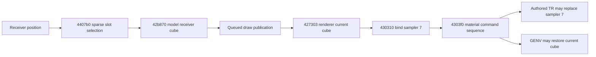

# Receiver reflection selection

`ReflectionField` reconstructs the original receiver-position selection for a
configured stage's sparse cubemap bank. The scene owns immutable prepared region
geometry, two copied section-table columns and sixteen residency flags. Queries
return a source slot number or an explicit opaque-black fallback; native resource
handles remain outside this spatial selection component.

## Source selection contract

The retained original functions establish the complete decision sequence:

1. `4407b0` first checks stage slot zero. If it is absent, return the original
   opaque-black cube immediately, even when other slots are resident.
2. `4828f0 → 482910 → 482590` queries the receiver's world position. Missing or
   negative region identifiers become zero.
3. `482910` scans section zero in authored row order, comparing integer column
   zero. The first matching row wins. No match returns row zero, which need not
   itself have identifier zero.
4. `4828f0 → 475d80` reads integer column two from that row. The original getter
   returns zero for a missing cell or column.
5. `4407b0` interprets the result as an unsigned slot and accepts only 0–15 with
   a resident resource. A negative index, out-of-range index or absent selected
   map returns opaque black; it does not substitute resident slot zero.

This is independent of the active camera's AREA/environment channels. Prop
receivers and Alicia supply their own sampled world positions. The current
One Shot Kill stage has slots four and five but lacks mandatory slot zero, so
its source result remains black. The configured selector is still required for
other valid stage banks; sparse current content is not a reason to hard-code it.

A configured `ReflectionField` requires section zero and a first row. The
original getter does not bound a row access once a table exists; empty/malformed
configured tables therefore do not establish a safe source fallback contract.
Construction rejects these instead of guessing. Missing cells/columns within a
valid row preserve the demonstrated zero-valued behavior. A stage adapter that
has no reflection table at all owns its explicit default publication policy.

## Binding precedence

Receiver selection supplies the current/default cube; explicit material
bindings can replace it. The source command sequence is:

`5f0eb0` invokes the selector and passes its non-null resource to `42b870`, which
stores the model's receiver cube at offset `+2f0`. The queued draw builders copy
that handle into draw state `+530` (for example instruction `421e7a`). At
`427303`, a non-null queued handle replaces renderer current cube `+28`.

`430310` binds that current cube to sampler seven before calling the chunk
interpreter `4303f0`. The interpreter executes authored material controls through
`547e70`; TR executor `5470c0` issues a later `SetTexture` for its resolved slot
and material resource. LENV resolves to seven. A GENV command in `4303f0`
explicitly binds the current receiver cube again. SSSM executor `547120` only
sets sampler state and is not a competing texture-resource publication.

Consequently the reconstructed renderer must preserve the effective authored
material binding when present and use the receiver cube for its default binding.
An explicit black receiver result is not permission to erase an authored LENV
map. A receiver with no new publication also must not be confused with an
explicit black publication. Native integration and cache ownership remain with
the scene/renderer publication boundary.

## Prepared API and lifetime

Construction takes `AreaRegions` by value, a borrowed `SectionTable` for the load
step, residency by value and an allocation domain. It copies only the first
section's region and slot integers into owned contiguous records. Region order,
row order and duplicate-key first-match semantics are retained. Original table
and definition bytes can expire after construction.

`slot_at(receiver_position) const` validates finite input, returns an optional
source slot and never changes shared state. Queries cost O(regions + rows), with
no allocation. Two receivers can query independently; camera movement does not
rewrite their result. Resource residency changes require a new published field,
so callers do not observe partially changed native-resource maps.

Header design and implementation separately queried both C++ MCP corpora and
retrieved Core I.1 (`ri-explicit`) and performance CDSA.32 in full. The former
makes black/default outcomes and ownership explicit. The latter prepares only
the table shape consumed by this immutable selector once at scene load.

## Verification

Ignored evidence is organized under `lighting-reflection-field`:

- 185 source/native selector cases execute original `4407b0`, `4828f0`,
  `482910`, `475e20` and `475d80` against synthetic resident banks and tables.
  They cover missing slot zero, selected residency, negative/unmatched/matching
  region identifiers, duplicate rows, missing cells/columns and signed/upper
  slot bounds. All source/native slots match exactly. The original slot-zero
  short circuit is verified by counting region-query calls.
- The witness hooks only the region-query result at `482590`; the existing
  original AREA geometry witness covers that component independently. It does
  not claim original live resource loading or a captured frame.
- Public in-process tests construct actual synthetic AREA and STBL definitions,
  then query after their backing bytes expire. They check strict box faces,
  negative identifiers, row fallback/duplicates, resident gates, missing cells,
  invalid configuration/input and fixed prepared storage. Standalone native tests
  pass.
- The command precedence above is instruction/call-order evidence. The integrated
  renderer's distinct authored/receiver/black cube readback is covered by the
  native publication checks below, separately from this selector test.

Scoped fatal clang-tidy passes the implementation and test translation units
with pinned LLVM 21.1.8. Owned-file formatting and whitespace checks pass.

## Native publication readback

The existing `world_surface_contract` in `memory-tests` now exercises receiver
publication through completed native Metal pixels, without a window or new
scenario. Both initial submissions and retained lighting updates transition
from default black to a selected cube and back to explicit black. An omitted
cube update retains the selected resource. Wrong-shape and unknown handles
reject atomically, including a batch with a valid earlier mutation.

Two visible instances of one model retain different receiver maps and update
independently. A late absent instance leaves both pixels unchanged. An authored
LENV map remains visible over explicitly black receiver publication, proving
source binding precedence through the native encoder.

The same scenario also exercises optional caster membership and instance
visibility using a visible caster beside its receiver. Disabling casting lights
the receiver without changing the caster's color. Hiding/revealing only the
caster preserves omitted shadow membership. A late invalid visibility instance
rolls back both proposed color visibility and caster membership; reenabling
casting restores the receiver's shadow. Final teardown retains the existing
zero-device-charge assertions.

The focused native `memory` test passes after these additions. Scoped fatal
clang-tidy passes the entire modified Objective-C++ test translation unit with
the actual CMake compile flags. No diagnostics were suppressed or assertions
relaxed. Native build/run/tidy logs are retained in the ignored evidence folder.
These are synthetic binding/ownership witnesses, not original captured frames.
