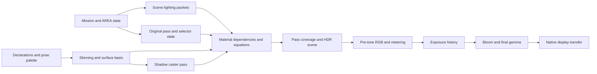

# Lighting source fidelity investigation

October 24, 2026. Full pipeline audit against accepted baseline `7fc3ca9`.
The coverage ledger is an accounting of checked and still-unresolved boundaries,
not certification that every original path has been reconstructed.
No production lighting or material values are changed by this investigation.
The user reports that the scene differs from the original game's dark, cloudy
appearance and that default Alicia's signature green hair is too dark. These
are separate observations; one successful helper comparison cannot close either.

The audit follows all represented producers and consumers. A demonstrated
upstream defect does not close downstream checks. Recovered instructions and
asset data are primary evidence; Unreal may inform a bounded unknown engine
mechanism, but cannot establish Bullet Witch's original art or shader behavior.

## Findings

### Three-joint shader selectors are incorrectly admitted as one joint

**Confirmed source/implementation discrepancy; visible impact not yet measured.**
The actual PW0 hair material uses stored selector `0x40000411`, base texture
`PW0_hair_m1_game_psd` and occlusion texture `PW0_hair_g_game_psd`. Adding the
ordinary fog/SH features resolves registry key `40800611100`, which selects
color VS472 and PS412. Original VS472 transforms and weights three distinct
joint indices for both position and normal, in second/first/third order.

`src/render/world_material.cpp` instead tests bit `0x40000000` as
`kSingleJoint` and returns one influence. The Metal `skin_value` then returns
the first joint transform without weights. The packed selector field is not
an independent single-joint flag: combined `0xc0000000` selects one joint
(VS480), `0x80000000` selects two, and `0x40000000` selects three. Zero selects
four for these admitted skinned families.

This affects the input surface positions/normals before lighting, including
hair shadow casting and receiving. It is not evidence that all scene darkness
comes from hair deformation. The material shader and whole-frame output still
require independent checks. A correction must preserve the source count and
accumulation order in color, depth and shadow consumers, admit all used palette
indices, and cover the three-influence case explicitly. Merely changing the
count is insufficient: current `skin_value` falls through from count two to
four and has no return after its third contribution.

Primary anchors: shader registry `0x954420`, VS472 at `0x8183f0`, VS480 at
`0x81aa30`, PS412 at `0x7f86a0`; installed PW0 model/header and vertex buffers.
Existing ignored `actor/alicia-census.log` records the hair draw declarations
and palettes; `character-light/brightness/pw0-baseline/run.log` names its texture
bindings. Fresh evidence belongs in `lighting-source-fidelity/`.

A fresh read-only Python traversal of the installed PW0 CPR/header and vertex
buffers finds 19 affected draw definitions, containing 3,025 vertex references;
989 have nonzero second/third weights. Seventeen are hair draws (798 such
vertices), and two are belt/normal-mapped draws. These are asset references,
not screen-visible pixel counts or an independently recovered live pose.
`model_audit.py` and `pw0-material-transform-audit.json` retain the traversal,
asset hash, material/texture identities, weights and original shader hashes.

### Background feature admission drops original local-light consumers

**Confirmed independent shader-feature discrepancy.** The background-only
branch in `world_material_requirements` never sets `local_lights`. Original
PS17, PS19, PS43, PS109 and PS243 contain the bounded point-light loop. The
reconstructed scene already supplies a direct-light packet, but those material
branches do not consume it. Other background selectors happen to enter the
earlier actor branch and therefore do consume it; this accidental overlap does
not make the background family consistent.

The retained background definition census contains 55 affected material draw
entries across 21 model definitions, before instance group masks and view
selection. Examples include the lantern's reflective material, extinguishers,
containers and wooden boxes. This does not establish nonzero light at every
instance: selection may legitimately return no lights. The missing consumer
is established independently of that selection. `feature_audit.py` and
`background-local-light-discrepancies.json` retain exact keys and programs.

### Ordinary static admission still forces the early inspection feature mask

**Confirmed obsolete policy in production; exact original live-frame membership remains unobserved.**
`StageInspection::append_model` still ORs `0x00e00000` into ordinary static
material selectors. The early renderer report explicitly describes this as
selection of no-shadow/no-local inspection programs. Original `42f970` instead
adds `0x400000` and `0x200000` only when corresponding registry feature bytes
are disabled; `460c60` writes both enabled values to main-pass setup buckets.
Original authored disabled bits remain valid and must not be cleared.

The source main builder `45e130` invokes `460c60` after main-list initialization;
its instruction listing writes enabled values for the common registry at the
setup buckets rooted at list offsets `0x14`, `0xdc`, `0x1b8` and `0x398`.
The normal source model commands use that registry. This is upstream of
individual material equations and cannot be repaired by a light multiplier.

The ordinary static-world and sky subset of the retained material census has
4,101 draw definitions (4,100 world and one sky). Another 51 behavior-owned
draw definitions are excluded from this static-owner comparison explicitly.
Resolving the traced enabled main-state keys instead of the inspection mask
changes 3,198 keys; 1,666 original draw definitions select a local-light
consumer, and 2,846 select a shadow consumer. These counts are census scope,
not visibility or a completed original frame. The alternate raw programs are
retained in `static_selector_audit.py` / `static-selector-audit.json`.

There is also an independent downstream conflation: the common Metal shader
calls `directional_visibility` whenever directional lighting is enabled.
Many selected original static programs explicitly have no shadow sampler.
Consequently some source-authored unshadowed directional terms receive shadows
in our shader, while actual shadow-capable source families are represented by
an inspection-family identity. Shadow reception needs its own source-derived
material feature, separate from directional illumination, cubemap-shadow
response and caster eligibility. The special layered PS90 and local PS319
branches also keep their original program identities but omit their original
local-light loops; the latter currently disables reflection entirely even
though its original local-light specular path exists.

The smallest correction boundary is full original effective-key resolution
followed by faithful feature/equation admission. Removing the inspection mask
alone will expose unsupported genuine variants and is not a complete fix.

### Initial placed props not casting shadows is not a new discrepancy

The suspected blanket prop exclusion was checked against the existing original
BGOB chain: `44a260 → 455e60/5f0460 → 5f0080` does not call `4ea2a0`, which
enables prop shadow submission. Thus frozen initial props receiving but not
casting shadows is supported for this initial state. Later native/script state
changes are not reconstructed. Do not enable all prop casters as an appearance
fix. See [shadow presentation](stage-shadow-presentation.md).

### The admitted material feature census finds additional omissions

The independent resource/influence census covers all 130 exact registry keys in
the previously admitted-family list, representing 61 distinct color pixel
programs. Original constant tables and actual vertex address-register masks are
read from the hash-bound executable. They are compared with current feature
selection, rather than generating an expected shader from our shader.

| Feature discrepancy | Exact admitted variants | Meaning |
|---|---:|---|
| Shadow reception | 32 | Our directional path samples shadows where the selected original program has no depth-map consumer |
| Local lighting | 26 | Original `lightsListL` consumer omitted, spanning background and special static families |
| Joint influences | 10 | Three-influence original programs admitted as one |
| Reflection | 4 | PS317/319 local specular/reflection path disabled |
| Normal mapping | 2 | Non-SH PS317 variants disable a normal sampler consumed by the original |

Counts overlap and are not counts of independent defects, actual instances or
visible pixels. No other mismatch was found in this census's **resource and
influence signatures**: base/secondary/normal/environment/occlusion resources,
directional/SH/local/reflection/Fresnel dependencies, vertex illumination/color,
alpha Fresnel and influence count.
This does not prove equation, interpolator, output alpha, execution ordering or
full-frame parity. The original constant name `samplerEnviroment` is misspelled;
the diagnostic recognizes that literal spelling rather than inventing an absent
resource. Evidence: `admitted_feature_matrix.py`, `admitted-feature-matrix.json`.

### Color coverage is still an inspection approximation

**Confirmed algorithm boundary difference; current-content pixel impact is
unmeasured.** Source main setup `460920` queues `44e960` for the masked color
phase. Its allocator `44f3c0` installs vtable `8407c0`, whose executor is
`565520`: enable fixed-function alpha test, comparison GREATER_EQUAL, reference
128. That test consumes the final pixel-shader alpha. Original PS412, for
example, publishes texture alpha multiplied by material and indirect alpha.
Other families also have vertex modulation or alpha Fresnel.

Current `world_color_fragment` instead performs an early raw-UV
`baseAlpha * materialAlpha < 0.5` discard, copied from the original depth-mask
program, and never tests its final `base.a`. Its own comment calls this a
“direct inspection pass.” The original separate depth pass and masked color
alpha test have been collapsed into one rule. Material UV offsets, indirect
alpha and family-specific alpha can therefore disagree with color coverage.
The original depth mask remains the appropriate evidence for **depth/shadow**
coverage; it does not justify substituting it for color alpha testing.

This is not a claim that the current PW0 hair has nonunit indirect alpha or
that 128/255 versus 0.5 alone causes its appearance. Microsoft documents an 8-bit ALPHAREF compared against incoming pixel alpha
([render-state contract](https://learn.microsoft.com/en-us/windows/win32/direct3d9/d3drenderstatetype)).
That establishes the reference width, not this device's float-to-comparison
rounding; exact quantization still needs a device/API correspondence witness. The current stage census's masked
materials all also carry the alpha selector, so no separate chunk/selector
mismatch was found there. The required correction boundary is explicit source
pass coverage and final-alpha policy, with original depth and color semantics
kept separate. Evidence: `alpha-state-vtables.json`, engine pass 178 and pass
27 state executors, and the original depth PS1/color program pairs.

### Optional local-light overflow into SH is not implemented

Original `5f6e80 → 5461f0` can project residual local-light contribution into
SH, with accumulation through `545140` when general setting `+70` is enabled.
The actual initialized general setup has this byte zero and maximum direct
lights four. Current `LocalLights` explicitly rejects enabled overflow
irradiance. This is a known unsupported alternate configuration, not silently
lost ambient in the current scene and not grounds to add local light twice.
The existing [character-light sampling trace](character-light-sampling.md)
and fresh read of `general-effective.bin` establish that scope.

### Output timing and lifecycle are not original-frame parity

**Independent-clock discrepancy corrected in step 2; native renderer-to-HDR
forwarding validated. First-frame/history correspondence remains unresolved.**
The original `5712f0` reads its elapsed interval from global `a0b7b8`.
`461f00` invokes adaptation before queuing current tone commands, so it consumes
the preceding completed luminance image. The retained CPU ring/slew algorithm
follows that source, including the 1/30 sample gate, discarded interval
remainder, output-only bounds and history-length reset.

The audited baseline derived elapsed time inside the Metal owner from a separate
`steady_clock`/`previous_time`. The step-2 change now passes engine `FrameTiming`
from the framework through the host, `WorldRenderer::prepare_presentation` and
`WorldPostprocess::prepare_output`; adaptation consumes `presentation_seconds`.
The target-local timer is removed. The [timing source trace](world-timing-source.md)
connects `a0b7b8` to renderer `40f920`, which caps measured elapsed at .1 seconds,
before the game-speed multiplication in `460010`. It is the presentation delta,
including during paused gameplay, rather than a zeroed world-simulation interval.
Framework/host forwarding was inspected in code. The implementation agent reports
the full check passing. The native offscreen witness then exercised the real
`WorldRenderer::prepare_presentation` to HDR/exposure path with explicit supplied
intervals while world time stayed paused at zero. Zero deltas left history empty
or unchanged; 60 Hz and 30 Hz deltas advanced the authored 64-entry history;
changing world scale did not alter presentation adaptation. The inspected
`world-timing/native/HDR-TIMING.md` and `hdr-trace.csv` retain 87 completed
observations under ignored reconstruction evidence. This validates that native
consumer path; it is not an interactive host run, new lighting-equation proof,
or original-game image comparison.

First submission still uses the current GPU measurement because there is no
completed predecessor. The follow-up below establishes that original first-use
control flow and tone-toggle/event history lifecycle differ. Exact original
first-surface pixel contents remain unavailable. No repeated first-frame
brightness constant is justified. Equations and preceding-measurement ordering
were not changed by this correction. All other audit findings remain open.

### Unimplemented source paths remain visible in the audit

The original caster shader and raster setup both consume depth/slope bias.
The live Metal world-shadow path does not publish/apply those source
shader/raster terms. The separate depth inspection shader implements bias, but
it is not the live `world_shadow_fragment` path. Current `st04_c` effective values are zero,
so this is an unsupported nonzero contract, not evidence for changing the
current scene's bias. Initial prop caster exclusion was separately ruled out
as a defect above. Authored shadow cull selector is also decoded and animated,
but the live caster pass always selects no culling. The scene setup-enable byte
is decoded but not consulted when constructing/updating its shadow view. Initial
activation and current scene values support setup enabled and cull none; that
does not implement the source's alternate states. These are separate omitted
publication/state contracts, not proposed changes to the present defaults.

Original scene execution includes depth preparation, per-owner visibility and
command-list state, dynamic emitters/effect owners, and optional postprocess
branches. Our retained inspection scene does not reconstruct that entire world
execution. The original current cave/exterior post-effect gate witnesses rule
out several disabled branches as a cause of the present observation, but cannot
turn those omitted branches into implemented engine behavior. The ledger keeps
their scope and next evidence explicit.

### Original pixel arithmetic beyond feature signatures

The follow-up `pixel-equation-audit.json` executes the original Shader Model 3
pixel instructions, with their actual declarations, constant tables and loop
control. It covers all 130 previously admitted exact variants (61 distinct pixel
programs), using 60 synthetic inputs per variant: nontrivial material and lighting
values, zero through four local lights, and lit/occluded shadow cases. Constant
texture samples deliberately isolate arithmetic from filtering and coordinates.
The current Metal equations are separately transcribed for this diagnostic;
the original instructions supply the expected result.

58 variants disagree with current dependency admission. Substituting only the
already identified original dependencies leaves **zero** differences above
0.00003 across these cases. This independently exercises diffuse, SH, local
attenuation/specular, normal mapping, Fresnel, secondary-layer composition,
reflection alpha/color, environment reflection, fog and final alpha arithmetic.
It narrows the outstanding issue in these families to inputs/dependencies and
coverage rather than supplying a new lighting formula. It does not certify GPU
rounding, interpolation, texture filtering, live material overrides or variants
that the current classifier does not admit. A hypothetical dependency correction
in a research probe is not an implementation or a fix.

### Material bindings and vertex equations checked independently

The raw installed PW0–PW5 and WG0–WG7 corpus contains 417 material-command
blocks. `material-binding-witness.json` executes original resolver/dispatch
`547e70/547370` after original modifier initialization `401800`, intercepting
only D3D uploads and skipping the separately traced render-state executor.
All 1,062 authored constant records arrive unchanged at their original registers;
there is no hidden gamma, intensity multiplier or color rearrangement in this
binding path. Semantic registers agree with the reconstruction's material fields.
The other authored constants in these models (PARF and FRSB) are not consumed by
the represented selected pixel programs. Runtime per-instance modifier changes
are a separate owner, not established by this definition-upload witness.

The 118 sampler-state records all resolve LENV to slot 7 and original executor
`547120` always sends MAXMIPLEVEL=0, even when other raw record words differ.
The current default minimum level agrees. Reading those other words as a live
LOD setting would create an invented discrepancy. All six actor/weapon render
state records are BTNO, as are the retained stage/prop records; they resolve
through the fixed blend decoder. No represented material enables sRGB writes.

`vertex-equation-audit.json` separately executes all 14 distinct original vertex
programs represented by the 130-variant corpus. Thirty synthetic input/matrix
sets per program exercise declaration semantics, relative palette addressing,
original weighted accumulation order, position scale/offset, normal/tangent
transforms, UV offsets, vertex color and encoded illumination. Supplying the
original influence count leaves no discrepancy above 0.00003 in the common
transform equations. This establishes the downstream algebraic boundary and
independently confirms that the three-influence omission is not evidence for
an inverse-transpose or normal-sign patch. It does not establish the source's
live animation selection, final pose matrices or GPU raster interpolation. The
28 additional source-correct static keys use VS448/454/456/458, already included
in this 14-program replay; they introduce no unaudited vertex program.

### Output state and lifecycle follow-up

A fresh whole-image API-call census and read-only source export are retained in
`output-lifecycle/`. The final tone intermediate is A8R8G8B8/8-bit UNORM
(`463040 → 56e990`). The physical backbuffer is separately selected: windowed
`4125b6` requests UNKNOWN; fullscreen `4125dd` copies the selected enumerated
format. No source-wide assertion that the physical display is always BGRA8 is
justified. All 260 actual D3D sampler call sites use state types 1–10, with no
SRGBTEXTURE write. Queued render-state builders and the represented material
census contain no SRGBWRITEENABLE producer. No device gamma-ramp call was found.
The remaining display-transfer uncertainty is external runtime/display state,
not an unfinished search for a shader gamma decode.

**Confirmed lifecycle discrepancy:** original `461f00` skips its adaptation
block while tone mapping is disabled, preserving the process-static history and
sample accumulator. Current `WorldPostprocess::configure` resets history,
accumulator and completed predecessor on enable changes. Original explicit
reset `571180` is reached by event/cinematic preparation
`StartEvent 47ce50 → 43cb10 → 48bb10 → 48bb70 → 48af90`; it clears the ring,
index/full flag and adapted value while preserving history length and the
external sample clock. It is not a universal stage-transition reset. The native
reset clears more state and the event producer is not reconstructed. These are
independent of the already corrected presentation-delta forwarding.

Process initialization `402be0` starts an empty ring with length 64 and no
measured luminance seed. Target allocator `56e990` creates the 1×1 luminance
surface without an initial upload/clear. Original `5712f0` unconditionally reads
that predecessor before current reduction is queued; it has no native-style
first-submission branch using the current measurement. Source control flow is
now established. The actual initial pixels, and whether preceding front-end or
event frames already populated them, genuinely require original runtime evidence.

Sampler13/14 ADDRESSU/V=6 is sent directly to D3D at
`451cc9/451cd8/451d31/451d40`; the HRESULT is discarded, without remapping,
retry or fallback. No D3D wrapper is installed with the game. The public enum
contains only values 1–5. Thus the engine request is closed; its driver/runtime
result is an external blocker requiring captured HRESULT and before/after state.
The existing native border/guard choice remains an inference, not recovered
original API behavior or a reason to tune shadow appearance.

### World geometry has an unhandled API sample-center difference

**Confirmed coordinate-contract discrepancy; image impact unmeasured.** Literal
original `40a5b0` execution reproduces the rigid reversed-depth projection, with
no half-pixel term. `42ffc0` and the 14 original vertex programs pass the resulting
clip coordinates without a raster-center correction. Original viewport executor
`408f80` forwards its integer-origin D3DVIEWPORT9. The native common transform
uses the same projection equations and its world target uses Metal's default
full-target viewport, without a vertex or viewport correction.

[Direct3D 9 rasterization](https://learn.microsoft.com/en-us/windows/win32/direct3d9/rasterization-rules)
places sample centers at integer coordinates;
[Metal's documented render coordinate system](https://developer.apple.com/library/archive/documentation/Miscellaneous/Conceptual/MetalProgrammingGuide/Render-Ctx/Render-Ctx.html)
places them at integer plus 0.5. Thus identical projected world coordinates do
not interpolate/cover identical sample positions. The ignored
`projection-sample-witness.json` retains original matrix output and the derived
half-pixel difference. The correction belongs at the target raster boundary,
with shared caster/receiver conventions checked together. It is independent of
camera placement, authored lighting and shadow-bias values. The already verified
fullscreen postprocess quarter-pixel conversion is a separate path and must not
be changed on this finding alone. A native geometry/edge witness is still needed
before implementation acceptance; this source/API discrepancy is not evidence
that it explains dark hair or requires shifting the gameplay camera.

### Placed props use the wrong receiver policy

**Confirmed independent input-owner discrepancy.** The current shared
`append_model`/`static_lighting_updates_` path assigns placed BGOB props the same
uniform stage-ambient SH and global view-light list as terrain. Original
`455e60 → 5e5670` constructs a different receiver: vtable `850ea4`, lighting
slot `+18 = 5efe10`. That callback queries bone-zero's current transform through
`428640`, falling back to object translation only when that query fails. It
performs per-object local selection `5f6e80`, then calls `5f0eb0`.

`5f0eb0` obtains the character field through `440790` (context `+93f8`) and
calls **strict first-containing-zone sampler `567d90 → 567810`**. This differs
from terrain's `5e46d0` constant ambient and Alicia's blended-zone `567af0`.
The existing reusable field API exposes only the blended policy. Prop publication
also has a source cache: compare the squared change of
`(sampleXYZ, 10 * ownerIntensity)` with 0.25; update retained SH/cubemap only when
that threshold is met. `5f1760` initializes all four cached components to maximum
finite float, forcing the first update. Direct-light selection remains per-call.
This is a distinct receiver policy and invalidation contract, not permission to
sample Alicia's field once and reuse her result for all props.

The literal-original `placed-receiver-witness.json` samples the installed
character field at the retained root matrices of actual lantern placements
0, 1 and 120. With the cave multiplier 0.005, their first SH RGB coefficients
are approximately `(0.0520, 0.0423, 0.0394)`, `(0.0460, 0.0353, 0.0307)` and
`(0.0435, 0.0364, 0.0337)`. Current terrain ambient is zero. These are coefficient
values, not suggested output colors or tuning factors. The source receiver
would receive nonzero baked spatial light, while the reconstruction supplies
zero ambient SH. Whether an individual lantern pixel changes still depends on
its visible group/material and the independently deficient material features.
The point matrices are retained authored placement evidence, not a captured
original animation frame.

The same prop update selects an environment cube by receiver position through
`4407b0/4828f0`. Alicia's observer also invokes this selector. Current `st04_c`
has cube slots 4 and 5 but lacks required slot 0, so the original selector returns
its opaque-black fallback; the native fallback is correct for this scene.
That negative finding does not justify applying camera AREA selection as a
replacement receiver-cubemap policy when future stages contain slot 0.

### Section ambient and baked lighting coverage

The actual `st04_c` AREA file has one axis-aligned region and a default row.
A fresh literal `482590` witness covers 277 actual-box points, including all six
face neighborhoods and random inside/outside positions; the retained native
selection algorithm agrees. Both the initial camera and initial actor positions
are inside region 1. Original gameplay callers `43fa0a` and `47563f` pass the
active camera's world translation, while receiver observers separately query
model/root positions for spatial fields. This distinguishes region-wide settings
from local baked irradiance, rather than confusing a camera lookup with a probe
lookup. The two effective rows both publish zero uniform terrain ambient; the
character field multiplier differs. Source activation, initial snap and later
transition are already implemented; zero here is not evidence that ambient data
was accidentally omitted.

The stored lighting is not only uniform ambient. Terrain COLOR2 carries encoded
baked vertex irradiance; the original vertex program decodes
`exp2(alpha * 255 - 128) * rgb`. Character fields contain nine RGB SH coefficients
per sample, spatial interpolation and an authored file intensity. AMOC red
attenuates ambient plus SH, while green separately attenuates reflection.
Default hair actually binds `PW0_hair_g_game_psd`; it is not an absent white-mask
fallback. These channels and their combinations have independent original
instruction evidence. Base textures may also contain art-authored shading;
recovering the original offline bake recipe is outside the installed runtime
and does not license recoloring them.

The fresh material/program census covers 158 exact variants and 78 distinct
pixel programs: the prior 130 plus all 28 additionally selected static variants.
It finds only base/secondary, normal, AO, environment, jitter and dynamic shadow
depth samplers. The retained stage raw bindings contain BTX0/NMAP/BTX1/LENV;
actor bindings add AMOC. Thus no independent baked irradiance lightmap texture
is missing **from these represented paths**. The named
`samplerDestLightMapDepth` is the dynamic directional shadow target, not a color
lightmap. This does not establish absence of lightmap-like resources in every
unimplemented effect or stage. `region-baked-audit.json` retains this bounded
negative inventory. Source prepass and later composition remain independently
accounted for; material arithmetic alone cannot rule out a missing later pass.

### All AREA publication destinations enumerated

`environment-destinations.json` executes the original `4829d0` stores, casts and
boolean operations for each of its 186 channel lanes. Only the scalar sampler,
region/table lookup and version query are intercepted; the probe supplies zero
then a single value of two at version `0x108`, with immediate publication enabled.
165 lanes publish a destination; 21 do not in that version. This is a synthetic
schema witness, separate from the existing actual cave/exterior data witness.

The additional destinations include clear RGB (channels 57–59), particle lighting
and fog packets (70–71, 131–146), optional postprocess controls, processing-owner
values and an auxiliary renderer parameter. They must not silently become
unidentified brightness scalars. Source `45e130` passes environment clear RGB to
`463b40`; the current renderer always clears black. The measured current cave and
exterior clear RGB are zero, so this is an alternate-state contract omission,
not a demonstrated cause of the present image. Source `4571e0` separately builds
particle SH/directional/color state and calls `5367a0` with the particle fog pair;
this belongs to particle rendering, not Alicia's surface-lighting packet.

Original event construction `6a3f50` temporarily disables AREA publication and
`6a41c0` restores its saved enable state. Current inspection gameplay does not
execute this event owner. Event-controlled lighting therefore remains an
unimplemented producer, even when ordinary camera-region updates are correct.
The full destination list is retained so unexplained channels can be traced to
consumers instead of omitted from the audit.

### AREA cadence belongs to the active mission root

A constructor trace corrects an overbroad attribution in the earlier brightness
report: `475600` is not the normal callback for every game mode. Mission startup
`43eea0` requests mode 7 (`43f138..43f13f`); task `40b670` records it, and
`43b701 → 43a6c0` constructs the base game using `44fde0`. Its normal service
callback `45f070` has no additional AREA update. The separate mode-10 constructor
installs `475600`. There is therefore no evidence for applying two smoothing
updates per ordinary mission frame merely because both call sites exist.

For the ordinary mission, `43eea0`'s active tail calls AREA at `43fa0a` using the
camera. User pause suppresses this path, apart from explicit transition cases.
Scripted pause does not itself suppress the root callback even when normal
actors are withheld. Current Stage user-pause freezing is supported, while future
script-pause/root integration must preserve this separate publication phase.
The 1/32 smoothing step is per admitted call, not a delta-scaled interpolation.
`area-cadence.json`, retained instructions and the timing audit's derived-vtable
witness preserve the distinction; no guessed cadence change was made.

### Region camera and shadow-selection settings are omitted

**Confirmed publication discrepancies.** AREA channel 149 writes the far-plane
lane of `witch/general/camera` (binding `619db0`, getter `61a840`). Camera setup
`61a850` publishes near/far to camera `+f0/+f4`; main builder `45e130` refreshes
far from that setting each frame. This affects projection, frustum membership
and later DOF inputs. Current `player_camera.cpp` retains its startup far value;
`stage_environment.cpp` does not publish channel 149. The fresh original
`area-camera-shadow-witness.json` uses the actual AREA/STBL/FLAN and records
**2,000 in initial cave region 1, 1,000 outside**. Current retained far is 1,000.
The probe's auxiliary near slot starts zero because it tests AREA publication,
not camera initialization; zero is not a claimed original near plane.

Channel 85 updates shadow caster projected-size threshold at stage `+104`.
`457620` supplies it to `5e2f80`, which evaluates registered owners using inverse
camera and `near * 2 / (top - bottom)`, rejects sizes below the threshold, then
checks light-volume intersection. Actual cave threshold is approximately 0.115;
exterior is 0.101625, replacing constructor 0.15. Native omits this setting and
owner-selection stage. Original static owner's size callback returns 1, so the
omission does not demonstrate missing initial terrain shadows. It matters for
source owner admission and must not become an arbitrary distance cutoff.

### Remaining environment lanes have identified owners

Channels 153–177 and 185 publish `witch/magic/stormcloud/stage`, bound by
`45b180` into `1397b34`. This is a stormcloud gameplay owner, not generic
postprocessing. `4d9700` supplies cloud lighting and advances two angles;
`4da030` places and submits cloud geometry relative to the camera. `4d9c50`
saves/restores scene diffuse and AREA enable around timed flashes; `4da2f0`
spawns effects and can write ordinary scene diffuse. These producers are not
reconstructed. Their activation and owner state determine whether they belong
in a particular original frame; merely finding storm parameters in AREA does
not prove the initial sky should render an additional cloud layer.

Channels 60 and 63–68 publish stage `+18` and `+88..9c`, respectively. A full
census of 267 direct stage-global references, 36 containing functions, uncovered
instruction spans and known pointer-forwarding helpers found no downstream
rendering reads of those lanes. They remain unnamed, published fields with a
bounded negative consumer result. They are not demonstrated missing lights or
runtime/driver blockers. This is source coverage, not formal whole-program
alias proof. The evidence and remaining effect owners are retained under
`output-lifecycle/area-consumers/`.

### Depth preparation and later composition are accounted for

The full original registry has 766 variants; every S pixel program is depth
(594 PS0) or masked depth (172 PS1). `4614e0` constructs those preparation lists;
`460920/461170` build subsequent color phases. Neither S program integrates
ambient or baked light. Both main `460920` and trans `461170` construct an integrated shared-owner
S/T replay. Literal original builders, command factories, intrusive-list links
and state executors close its execution order. `4564e0` aliases the same owner
into two positions; it does not sort geometry. Main opaque/masked replay is
enabled by general settings `+24/+28`, both 1 in the retained actual scene.
Trans replay is unconditional.

**Confirmed missing enabled phase:** the native renderer does not perform that
S replay before T color. Its `WorldRenderer::draw_depth` is a separate unused
verification API, with a different depth convention. It is not this source
phase. The exact source target order matters: R32F bind/clear and world-target
restore execute in one setup list **before** S geometry. S therefore writes
projected depth into the restored world color target as well as hardware depth;
COLORWRITE remains 15. It is not an isolated R32F geometry pass. The original
world attachments are RGBA16F/D24S8, versus native RGBA16F/Depth32Float.

S opaque/masked and T opaque/masked use depth test/write with GREATER_EQUAL.
Masked S also enables fixed alpha GREATER_EQUAL/reference 128, in addition to
S1's base-alpha shader cutout; its fixed test sees the depth-valued output
alpha. Masked T applies that fixed test to T's final material alpha. Main late
lists turn depth writes off; represented chunk-3 draws use authored/inherited
source-alpha BTNO blending. S depth-valued color can survive only where its
own shader/fixed-alpha/depth tests pass and later T does not overwrite it.
No current surviving pixel or global brightness effect is established.

The enabled shadow tail explicitly restores cull CCW, COLORWRITE 15 and both
bias states to zero before SkySphere/Main (`4585f5/45862d/45865e/45868b`).
Represented native sky depth-off, main early/late depth policy, BTNO blending
and cull policy agree at this bounded state boundary. No local executor or
list-order uncertainty remains for those represented paths.

**Known omitted owner state:** `56a520` routes full-opacity owners to Main and
partial-opacity owners to Trans. In Trans opaque/masked color, `457020` turns
source-alpha blending and depth test/write on, overriding earlier setup.
This source Trans section is not native `WorldColorPhase::translucent`, which
names model chunk 2. No chunk-2 draw occurs in the 14 actor/weapon definitions
or retained static/prop/sky census; that says nothing about later runtime owner
fades. Native has no recovered owner-opacity route. The final source-state
mapping and three literal witnesses are retained in
`output-lifecycle/area-consumers/pipeline/states/`.

The misleading `samplerDestLightMapDepth` name is closed by its producer:
`4632d0` allocates the shadow R32F target, `4630f0` aliases it to the sampled
slot, and `460920 → 44eaa0 → 565590` binds it at sampler 13. Its shader compares
projected depth using jittered shadow samples. It is not a baked color lightmap. Together with
the represented material census, no omitted independent baked-lightmap or
deferred ambient pass is demonstrated in these paths.

AfterImage is driven by AREA channels 11/12 through `45e130 → 463a80`.
Its strength is zero in all three retained actual cave/exterior snapshots, so
`461f00` skips it. DOF and the other optional general-setting gates are likewise
disabled in those snapshots. They remain missing optional effect families,
not untraced baseline correction factors.

The former opaque `4b5e70` screen branch is a mist/world composite. Its shader
combines mist and copied world color using the owner's coefficient. However,
owner `43c8a0` starts in state 5 (`498920`), which makes `461f00` skip that
branch. `498b50/498bb0` select explicit effect controllers; the sampled AREA
activation is zero. The separate `463600` controller starts disabled and has
concrete writers including `4969f0` and settings from
`witch/magic/elemental_shot/filter_*`. These are identifiable gameplay effects.
Their complete active algorithms remain reconstruction work; their existence
cannot justify multiplying ordinary scene brightness by a constructor default.

**Known omitted optional operation:** final `461db0` edge filtering is enabled
by renderer bit 0x40, derived from saved SystemSetting mask 0x04 (bit index 2) through the settings
dialog `410750/410ba4`. The native final copy lacks this option. Matching an
original screenshot requires its selected setting, rather than assuming the
filter is always enabled or calling this a missing light source. Detailed source
chains and effective gate evidence are in `PIPELINE-FINDINGS.md` under the ignored
output/AREA evidence directory.

## Coverage ledger

**Verified** means the named bounded contract agrees with original evidence;
it never means the complete image matches. **Discrepancy** means a demonstrated
producer/consumer or algorithm difference. **Unresolved** is neither a cleared
path nor an invented explanation. Confidence refers to the stated result,
not the fraction of an observed screenshot it explains.

| Boundary | Original anchor / our owner | Result, affected consumers and confidence | Remaining evidence or correction boundary |
|---|---|---|---|
| Mission resource identities | `cm01_00` load names; content stage/MissionLoading | **Verified, high:** `st04_c`, `sky04_c`, character-light stage identity agree with recovered mission Lua | Complete mission startup/entity/event producers are not executed; trace script/native state writes before treating current startup as an original frame |
| Customization and AREA activation | `45ae00/45ff80 → 5f9c00`, `43f16e → 4829c0`; formats/game environment | **Verified, high:** activation enables AREA despite raw disabled byte; first publication snaps; later updates blend | Existing original-x86 witness uses actual AREA/STBL/FLAN and effective general setup; its explicit auxiliary defaults are not a whole game startup replay |
| Region/table selection | `482590/482910`, callers `43fa0a/47563f`; AreaRegions/Environment | **Verified, bounded high:** 277 actual-box samples including six face neighborhoods agree; initial camera and actor both inside region 1; source selects with active camera | Event camera switches need complete world/event execution; receiver positions remain separate from AREA selection |
| AREA update cadence | `43eea0/43fa0a`, mode request `43f13f → 43a6c0`; StageInspection | **Verified ordinary source route, high:** mission mode 7 uses root AREA once per admitted root update, not mode 10 callback 475600; user pause suppression supported | Future script-pause/root binding must preserve separate AREA publication while actors paused; no duplicate-smoothing adjustment justified |
| Scalar channels, schema, interpolation | `4ac280/4829d0`; ScalarAnimation/game adapter | **Verified schema trace, high:** all 186 version 108 lanes executed, 165 destinations/21 unused; represented smoothing and conversion agree | Missing far, shadow threshold, clear and named effect-owner publications are recorded separately; 60/63–68 have no observed downstream reader, not invented effects |
| Cave/exterior live values | `4829d0`; effective StageEnvironment | **Verified, high:** cave character intensity .005, enemy 1; exterior .057/.1; cave ambient RGB zero; pre-tone RGB mode 2 in both | Do not brighten these source-produced inputs to compensate for a downstream defect; full original frame/camera still needed for visual attribution |
| Field identity/intensity publication | `5e4430`, `45eed4`; stage lighting adapter/SceneLighting | **Verified, bounded high:** separate character/enemy field owners and intensity update; attachments use their own receiver bounds | Dynamic receiver ownership for future enemies/effects is not covered by Alicia evidence |
| SH interpolation and polynomial packing | `567af0`, `5453a0`; IrradianceField/packing | **Verified, bounded high:** existing literal original sampler witnesses support interpolation/packing; no inferred π or normalization factor is warranted | Expand to every spatial cell/degenerate boundary if new content exposes one; current tests are not a complete live game proof |
| SH coordinate basis | `42ffc0`; scene lighting and world matrices | **Verified, high:** original command keeps world axes after camera translation; transformed model center, unscaled receiver radius | Prior witness uses synthetic rotations to isolate this contract. It does not certify the original live Alicia pose/palette |
| Static/sky SH policy | `5e46d0/56b440`; SceneLighting | **Verified for terrain/sky, high:** uniform authored terrain ambient and sky white | Do not extend this result to placed BGOB; their receiver policy differs as below |
| Directional producer | `460660`, `546510`, `545ea0`; SceneLighting | **Verified, high:** authored colors directly copied; source Z +.001 and normalized/negated direction retained | Global timing/AREA publication can change packet; no arbitrary intensity or sRGB conversion supported |
| Local emitter decoding and selection | `5f70f0`, `5f6e80`; LocalLights/SceneLighting | **Verified, bounded high:** scene-wide view selection differs from active receiver sphere selection; original bounded list/attenuation retained | Live emitted/destroyed lights and source frustum/owner lifecycle remain incomplete; trace complete registration/event chain before gameplay effects |
| Local-light overflow SH | `5f6e80/5461f0/545140`; LocalLights | **Known unsupported alternate setting, high:** current initialized general +70 is zero; native explicitly rejects enabled overflow | Original residual-to-SH path must be implemented before enabling that configuration; no current missing ambient contribution demonstrated |
| Local-light consumer admission | original PS17/19/43/109/243/90/317/319; material classifier | **Discrepancy, high:** branches omit local diffuse and sometimes specular despite packets being available | Use original effective-key admission and exact branch dependencies; empty current packets do not erase the missing algorithm |
| Effective static selector state | `42f970`, `42ff30/40`, `460c60`, `56a640`; StageInspection | **Discrepancy, high:** old inspection disable mask overrides enabled main-state selection | Restore source state resolution, then implement/audit newly selected variants; current frame membership needs original queue witness |
| Vertex declarations and units | original selected VS and material `SOFS` resolver; model/Metal | **Verified, bounded high:** selected world FLOAT3, UBYTE4N illumination/modulation, SHORT4N directions; no blanket channel swap/scale warranted | Unsupported declaration/scale-offset variants must remain explicit rather than silently accepted |
| Joint influence decoding/accumulation | VS472/473 versus VS480; classifier/Metal skinning | **Discrepancy, high:** three influences treated as one; three-term accumulation absent; palette validation underchecks | Correct color/depth/shadow together using independent original shader input/output witness, not only a current palette fixture |
| Full pose/normal/tangent path | 14 original VS, `42ffc0`; animation/native renderer | **Verified downstream algebra, bounded high:** literal VS execution checks weighted position/normal/tangent and declaration conversion for 30 synthetic sets per program; count decoding remains defective | A matched original live palette is needed to certify a whole animated draw; no evidence supports a normal-sign or inverse-transpose patch |
| Normal-map basis | selected original PS; world_color | **Verified, bounded high:** normalize interpolated normal/tangent, cross(tangent, normal), reconstruct sqrt(abs(1-x²-y²)); no final renormalization inferred | PS317 non-SH admission drops normal map (**discrepancy**); newly selected variants have bounded instruction-replay coverage, not production admission |
| Material constants and texture binding | `547e70/547370/401800/547120`; model adapter | **Verified definition uploads, bounded high:** 417 actor/weapon blocks, 1,062 constants and 118 sampler records traced; no hidden gamma/intensity conversion; unit modifiers original-backed | Active effect/event indirect-color writers require those owners, not a compensating material multiplier; original live-state capture needed for a specific frame |
| Hair pixel material | PS412 `7f86a0`; world_color | **Verified supplied-input arithmetic, bounded high:** literal bytecode replay includes hair SH, AO R/G, local/directional/reflection/fog/final alpha | Three-influence input and color coverage defects prevent draw parity; same original live texture samples/palette needed for pixel attribution |
| Feature/resource completeness | 158 registry keys / 78 PS; material classifier | **Discrepancies, high:** original dependency signatures and literal arithmetic identify listed omissions; corrected dependencies in research-only probe remove arithmetic differences above .00003 | Includes 28 source-correct static keys outside current admission; hypothetical probe corrections are not production fixes or GPU filtering proof |
| Color/depth alpha coverage | `460920 → 44e960 → 565520`, depth PS1; world_color/native phases | **Discrepancy, high at algorithm boundary:** final color alpha test replaced by raw-UV depth cutout | Recover exact D3D alpha comparison quantization, preserve separate pass policies; measure current material alpha/UV cases |
| Texture formats/color handling | resource constructors, all D3D state sites/material commands; texture/Metal | **Verified source policy, bounded high:** UNORM; all 260 sampler calls types 1–10, no SRGBTEXTURE; no represented SRGBWRITEENABLE or gamma-ramp producer | External D3D/display/CAMetalLayer transfer remains below; no extra shader gamma is supported |
| Texture filtering/mips | `451770/564f70/547120`; native samplers | **Verified source requests, bounded high:** surface wrap/linear and minimum anisotropy 4, environment clamp/linear 1; authored LENV records all execute MAXMIPLEVEL 0 | Optional box/dither mip generation is omitted; driver filtering precision and unsupported address 6 require API witness |
| Material animation | source material track bind/evaluate; StageInspection | **Verified, bounded high:** source 30 fps two float2 tracks/UV bindings for six scene draws | Unexecuted gameplay material mutations remain outside initial snapshot; cloud scrolling cannot be invented from general weather appearance |
| Shadow projection/init | `457620`, `452460`, `5f9c00`; shadow/game adapter | **Verified, bounded high:** effective 60/1/8/2 initialization and six original machine-code matrix witnesses | Platform guard inset is explicit departure; visibility/caster registration complete-frame contract remains below |
| Shadow caster ownership/coverage | `5e2f80`, static/BGOB methods; StageInspection | **Verified initial eligibility, high; selection discrepancy:** BGOB starts noncasting, static size returns 1; AREA 85 projected-size/light-volume selection absent | Implement registered-owner threshold/intersection policy before dynamic casters; three-influence error independently affects depth |
| Shadow setup/cull policy | `457620`, scene +0x111/+0xe8; StageInspection/native shadow | **Discrepancy, high:** decoded setup/cull controls are not consumed; live pass always constructs a shadow view and uses no culling | Current effective setup1/cull0 agrees; trace and implement alternate state publication before accepting other settings |
| Shadow bias/depth format | source S programs c68 and `457620`; native shadow | **Discrepancy/target difference, high:** nonzero shader/raster bias not applied; D24S8 replaced by Depth32Float | Current effective bias zero; implement source nonzero contract before admission. Quantify precision without tuning current scene |
| Shadow filtering and receivers | original PS loop, `547a50`, `457090`; shadow/Metal | **Discrepancy, high:** reception wrongly tied to directional illumination. **Explicit inference:** cleared guard/receiver plane correction from pinned Unreal | Preserve separate reception feature. Original RNG history and D3D address 6 behavior unresolved; these cannot be declared byte-identical original output |
| Sky/cloud content and transform | `44fc40/56b440`, VS448/PS363, storm `4d9700`; StageInspection | **Verified static sky, bounded high:** no skeleton/MTAB; white SH, yaw/camera translation, no geometry rescale. **Missing separate stormcloud owner** | Trace activation for a particular mission/spell frame; do not infer additional baseline clouds from AREA settings alone |
| Surface/sky fog | `460300`, `425160`, active PS; StageInspection/world_color | **Verified, bounded high:** separate enable defaults and authored values; only sky distance/height coordinate factors .01, not geometry/density | Original c40.xy can become nonfinite but the audited represented PS use zw only; zero canonicalization is bounded to those consumers, not arbitrary new shaders |
| Scene phases, cull, depth and blend | `4614e0/460920/461170/56a640/545db0`; world_renderer | **State trace closed, high; missing enabled S replay:** original list factories/executors establish S-before-T, target restore before geometry, COLORWRITE 15; native sky/main/BTNO/cull policy agrees where represented | Implement shared-owner S replay and separate alpha contracts; actual-frame membership/interleaving and pixel survival need corresponding input/state, not another unknown list mechanism |
| Scene clear and pre-tone gates | `463b40/461f00/463a80`; world renderer/postprocess | **Discrepancy for alternate clear values; verified current gates:** current clear RGB 0 and mode 2; AfterImage strength 0; DOF/optional gates 0; mist initialized disabled | Reconstruct named gameplay effects on their actual activation; no unknown baseline screen-darkening multiplier remains in these branches |
| Pre-tone RGB operation | `56f880`/private pool PS17; world_output | **Verified, high:** clamped-nonnegative authored multiplier, no output saturation, unchanged alpha, half-float intermediate before metering | Correct input geometry/material energy remains independent; gamma/tint must not be used to compensate |
| Metering targets/sampling | `56e990`, `56d6a0`, `579620/770`, `578950`, `585d90`; postprocess | **Verified, bounded high:** 512 color/log, 256 split, 64/16/4/1 R32, destination-normalized taps, original pixel+.25 correspondence | Same-input replay validates downstream of captured current HDR, not correctness of that HDR; GPU arithmetic/format rounding limited tolerance |
| Temporal adaptation | `5712f0/461f00/40f920`; ExposureController/postprocess | **Timing correction verified:** supplied presentation delta drives native HDR while world paused; ring/slew equations supported | **Lifecycle discrepancy:** native toggle/reset clears more than original; original first predecessor read is unconditional. Actual first surface bytes/front-end history require original runtime |
| Bloom | source private shader pool/builders; world_output/postprocess | **Verified, bounded high:** separate exp(log+.001), threshold/soft knee, two radial stages and unnormalized 15-tap Gaussian chain | Independent original shader/target evidence supports formulas; no original whole-frame comparison. Upstream energy errors propagate to bloom |
| Final exposure/gamma | original final shader; world_output | **Verified, bounded high:** pow(abs(scene*key/(exp(log)+.001)),1/gamma), bloom added afterward, no filmic curve | Clipping alone is not proof of an omitted tone curve; matched original HDR/output required for attribution |
| Geometry raster sample convention | `40a5b0/42ffc0/408f80`, original VS; Metal raster | **Discrepancy, high at API contract:** same unshifted projection but D3D9 integer versus Metal half-integer samples | Native geometry/edge witness required for correction acceptance; treat caster/receiver jointly, preserve separate fullscreen quarter-pixel path |
| Native display transfer | `4125b6/4125dd/463040`, D3D state census; CAMetalLayer | **Source traced, external result unresolved:** tone intermediate 8-bit UNORM, physical windowed UNKNOWN/fullscreen enumerated format; no found source sRGB/gamma ramp | Requires actual selected backbuffer format and OS/display profile/CAMetalLayer transfer; cannot be closed by another material constant or source gamma search |
| Placed-prop ambient/local/cube receiver | `455e60/5efe10/5f0eb0/567d90`; StageInspection/SceneLighting | **Discrepancy, high:** props receive terrain uniform SH/view lights instead of strict first-containing spatial field and per-root selection; actual lantern samples are nonzero | Add source receiver policy and four-lane cache invalidation; retain per-call local selection, do not substitute Alicia's blended sampler |
| Receiver cubemap selection | `4407b0/4828f0`; SceneLighting | **Verified current fallback, high:** st04_c slots 4/5 without mandatory slot 0 produce source opaque black | Future stages with slot 0 need actual receiver-position table selection; camera AREA is not replacement |
| Baked irradiance/AO inputs | selected VS/PS, SHLT, raw material corpus; world shaders | **Verified represented encodings, high:** COLOR2 exponent irradiance, nine RGB SH coefficients, AMOC red ambient/SH and green reflection; hair AO binding present | Wrong prop receiver and influence/features remain independent defects; no omitted separate baked-color texture consumer found in 158 keys/78 PS |
| Region camera far publication | AREA 149, `61a850/45e130`; player camera | **Discrepancy, high:** original cave 2,000/exterior 1,000, native retained 1,000 | Publish region far to active view/frustum/DOF through camera owner; no image attribution inferred |
| Event/storm/particle lighting producers | `6a3f50/6a41c0/4d9700/4d9c50/4da2f0/4571e0`; world/effects absent | **Known omitted owners, high:** event AREA override, storm geometry/flashes, particle SH/directional/fog packets | Full active effect algorithms are unimplemented subsystem work; specific-frame activation requires script/controller state, not unknown ambient gain |
| Shadow sampler13/14 address 6 | `451cc9/451cd8/451d31/451d40`; native guard policy | **Source request traced, runtime unresolved:** literal unsupported enum 6 sent directly, discarded HRESULT, no wrapper/remapping | Original API HRESULT and before/after sampler state required; native guard remains documented inference |
| Owner-opacity fade routing | `56a520/461170/457020`; native world submission | **Known omitted owner state, high:** partial opacity selects source Trans with blending and depth writes on; native chunk-2 phase is a different concept | Recover owner opacity publication and routing before fades; initial definition census does not establish live opacity |
| Optional screen composition/filter | `498920/498bb0/4b5e70/463600/410ba4`; native postprocess | **Known omitted owners/options, high:** mist and elemental effect controllers start disabled; final spatial filter is saved-setting controlled | Active effect playback needs owner reconstruction; matching final edge filter requires original selected setting. No demonstrated always-active baked-light pass |
| Whole-frame visual correspondence | original footage/live PC image versus native host | **Unresolved:** no matched original stage/costume/camera/frame/output capture in this investigation | Source-boundary corrections plus matched evidence; footage alone cannot isolate vertex, lighting, exposure or display error |

## Consequences for implementation

The findings are several independent contracts, not a suggested green-hair
multiplier. Correct effective shader admission and influence decoding first,
while carrying all downstream findings forward. The renderer must represent
shadow reception, local-light and local-specular consumption independently;
color/depth coverage and shared-owner S replay need their original separate
contracts. Updated
selector admission must fail explicitly for unaudited variants rather than
choosing a nearby supported shader. Existing inspection restrictions should not
silently become the engine's general policy.

Placed props need their own source receiver policy and invalidation contract,
while terrain and Alicia retain their distinct policies. Region camera far and
shadow owner thresholds belong to their actual camera/visibility owners.
Exposure enable/reset semantics and target raster correspondence need separate
corrections, not material changes. Optional effects and final filter settings
remain explicit unsupported features until reconstructed.

The lighting owner should continue to publish source-derived packets. It is not
the place to repair missing material branches, deforming normals or exposure
lifecycle. The documented source cave intensity, tint, fog and gamma should stay
as evidence until their own producer chain is disproven. Original behavior has
priority over a modern reference; pinned Unreal is relevant only to explicitly
unresolved target mechanisms such as the existing shadow border/footprint policy.



## Evidence limits and reproduction

The executable SHA-256 is
`bdaff1746d3092215699b09eab11315c6adf8fb71eaa8f46c280b11b3cd448fd`.
Generated shader listings carry each program's executable address and SHA-256.
`manifest.json` records inspected implementation, input census and result hashes;
the ongoing timing slice may independently change shared composition files.
New raw evidence stays ignored beneath
`research/evidence/reconstruction/lighting-source-fidelity/`; the report is
written in our own words. No game files or production behavior were modified.
Existing witnesses were inspected as bounded source evidence, not relabeled as
fresh original-game runs. No interactive game or footage capture was performed.

From the repository root, the ignored Python probes regenerate evidence without
writing into the installed game. They depend on the hash-bound installed data
and retained research corpus; they are not distributable asset-free tests:

```sh
python3 research/evidence/reconstruction/lighting-source-fidelity/model_audit.py
python3 research/evidence/reconstruction/lighting-source-fidelity/feature_audit.py
python3 research/evidence/reconstruction/lighting-source-fidelity/static_selector_audit.py
python3 research/evidence/reconstruction/lighting-source-fidelity/admitted_feature_matrix.py
python3 research/evidence/reconstruction/lighting-source-fidelity/material_census.py
python3 research/evidence/reconstruction/lighting-source-fidelity/material_binding_witness.py
python3 research/evidence/reconstruction/lighting-source-fidelity/pixel_equation_audit.py
python3 research/evidence/reconstruction/lighting-source-fidelity/expanded_pixel_equation_audit.py
python3 research/evidence/reconstruction/lighting-source-fidelity/vertex_equation_audit.py
python3 research/evidence/reconstruction/lighting-source-fidelity/environment_destination_audit.py
python3 research/evidence/reconstruction/lighting-source-fidelity/region_baked_audit.py
python3 research/evidence/reconstruction/lighting-source-fidelity/placed_receiver_witness.py
python3 research/evidence/reconstruction/lighting-source-fidelity/area_camera_shadow_witness.py
python3 research/evidence/reconstruction/lighting-source-fidelity/projection_sample_witness.py
```

The model/material probes read actual installed definitions and original registry
programs. Instruction interpreters execute recovered SM3 arithmetic; Unicorn
witnesses execute the hash-bound original x86. Synthetic inputs isolate bounded
contracts and are labeled accordingly. Read-only Ghidra/API census and raw
instruction evidence are organized under `output-lifecycle/`, including its
AREA consumer and pipeline trace. They are research probes, not production
regression tests or a substitute for original live-frame evidence.

Original Xbox/PC footage must match stage, costume, camera and output conditions
before supporting visual attribution. Numerical witnesses name actual input
provenance: synthetic matrices and reconstructed poses are not an original live
frame. An exact selected-program or postprocess comparison cannot certify that
the original selected the same program or received the same inputs. The source
AREA correction and its stale integration-test expectations remain separate
from these newly demonstrated discrepancies.

This audit accounts for every requested pipeline stage, identifies the source-
accessible discrepancies above, and distinguishes known unimplemented owners
from external runtime evidence still needed. It does **not** claim that every
original path has now been traced or that these are necessarily the final defects. Every unresolved row above needs
its named evidence before a full lighting-parity claim can be closed.
