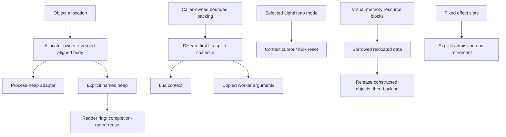

# Bullet Witch memory management: PC executable evidence

October 22, 2026. This is a static map of the **32-bit Windows Steam build**,
not a claim about the Xbox 360 executable or its physical memory allocation.
The unpacked analysis image has SHA-256
`bdaff1746d3092215699b09eab11315c6adf8fb71eaa8f46c280b11b3cd448fd`.
Addresses are preferred virtual addresses in that image. Names in backticks
that occur in diagnostics/RTTI are original compatibility evidence; descriptive
names elsewhere describe observed responsibilities.

The executable has several allocation mechanisms, selected by owner and lifetime:
a common allocator interface over Windows heaps, an aligned render-command ring,
a coalescing block allocator used by scripts and background work, fixed effect
pools, and separately owned virtual-memory resource blocks. It is **not one
universal arena**, and its ordinary allocating wrapper ultimately has a process
heap fallback. These distinctions are useful for a faithful port before any
allocator redesign.

## How this was traced

1. Read existing platform, resource, execution, actor and particle subsystem
   maps and their Ghidra exports.
2. Follow allocation call sites into `0x404bd0` / `0x404a60`; resolve the
   allocator vtables, constructor, owner prefix and corresponding free path.
3. Follow the image's `GetProcessHeap`, `HeapCreate`, `HeapAlloc`, `HeapFree`,
   `HeapSize`, `VirtualAlloc` and `VirtualFree` IAT references; compare arguments
   against the instruction exports rather than accepting inferred prototypes.
4. Export focused functions with **Ghidra 12.1.4**, using the established
   `ExportEngineSlice.java` script and existing analysis project with
   `-noanalysis`. Both exact commands, seed lists, status tables, decompiler text
   and x86 instruction witnesses are retained under
   `research/evidence/reconstruction/memory/export/` and `export-followup/`.
   Both export invocations completed with exit code 0. Interior-address seeds
   that did not denote function entries were followed to the actual containing
   functions; the export status table remains the record of those cases.
5. Use `research/tools/engine_image.py` for hash-checked raw vtable, string and
   IAT reads. RTTI provides original names such as `cgl::MemoryAllocator`,
   `cgl::HeapBase`, `cgl::DHeap` and heap specializations. Names corroborate the
   traced code; a name alone does not prove an allocation policy.

All generated material remains in ignored research evidence. No production
source, game installation, executable or asset was changed. No runtime memory
profile, allocator stress test or original-game execution is claimed.

## 1. Ordinary allocation carries its allocator identity

**Verified:** `0x404bd0` obtains the default allocator through `0x404d00`, then
calls `0x404ab0`. `0x404a60` accepts an explicit allocator and enters the same
helper. Both wrappers throw a C++ allocation exception when the helper returns
null; this is distinct from lower-level functions that return null.

`0x404d00` lazily creates an adapter through `0x404980`; the latter calls
`GetProcessHeap` and installs vtable `0x6c14dc`. Its name method `0x404e50`
returns the literal **`ProcessHeap`**. Ordinary object allocation therefore
passes through engine bookkeeping even when its backing is the Windows process
heap. `0x499ba0`, for example, allocates the title component through `0x404bd0`.

The instruction sequence in **`0x404ab0`** establishes this contract:

- Derive a power-of-two alignment from requested size, capped at 64 bytes.
  The bit helper `0x4048c0` searches the highest set bit of size minus one.
  This describes ordinary positive-size requests; zero/overflow edge cases
  require their own validation before translating the arithmetic.
- Invoke allocator virtual `+0xc` with `(requested_size, alignment, 4)`.
  The last argument reserves a prefix before the caller-visible aligned body.
- Zero `requested_size + 4` bytes starting at the allocator's returned pointer.
- Store the allocator pointer in the first four bytes and return pointer +4.

**`0x404c40`** accepts null; otherwise it loads the allocator from user pointer
minus four and invokes that allocator's virtual `+8` on pointer minus four.
The default adapter's `+8` forwards to the concrete free slot `+4`.
Thus free does not rely on whichever allocator happens to be current later.
The prefix is a native 32-bit ownership implementation, not a portable file ABI.

**Preserve:** allocator identity through destruction, the observed zero-filled
allocation semantics at these call sites, aligned user storage, and the
separation between throwing convenience allocation and nullable lower layers.
Do not replace the zeroing wrapper with uninitialized storage merely because a
C++ constructor also runs; existing consumers may depend on the zeroes.

## 2. Heap adapters, labels and real startup sizes

The concrete heap allocator **`0x40edd0`** receives size, alignment and prefix
size. It uses at least four-byte alignment, allocates requested bytes plus
`max(alignment, prefix+4)`, aligns the eventual body, and retains the underlying
`HeapAlloc` pointer immediately before its returned prefix area. The higher
wrapper adds its allocator-identity word after that saved raw pointer.

`HeapAlloc` is called with flags zero. The allocator tracks a byte counter at
`+0x14` and an optional limit at `+0x18`; zero means the limit comparison is
bypassed. `0x40ef80` obtains `HeapSize`, subtracts it from that counter, then
calls `HeapFree` with the saved raw pointer. Allocation adds its requested
backing byte count while free subtracts `HeapSize`; those are the actual
operations, **not proof that its counter always exactly matches residency**.
There is no explicit engine lock around those counter updates in these methods.
Flags zero preserve Windows heap serialization (`HEAP_NO_SERIALIZE` is not
set), but that does not protect the surrounding engine counters or lazy singleton
initialization from arbitrary concurrent calls. The wrapper zeroes explicitly;
it does not request `HEAP_ZERO_MEMORY`. [Microsoft HeapAlloc contract](https://learn.microsoft.com/en-us/windows/win32/api/heapapi/nf-heapapi-heapalloc).

`0x40eee0` destroys a prior heap and calls `HeapCreate(0,0,0)`, then records the
supplied software limit. The limit is **not an upfront reserve of that size**
and is not passed as the Windows heap's maximum-size argument. Under the API
contract, initial size zero commits one page, maximum size zero makes the heap
growable, and options zero preserve serialized heap access. [Microsoft HeapCreate
contract](https://learn.microsoft.com/en-us/windows/win32/api/heapapi/nf-heapapi-heapcreate).
The engine limit check uses unsigned 32-bit subtraction (`used <= limit - bytes`);
oversized/overflow requests are not proven safe, so this is a nominal budget,
not a verified hard cap for arbitrary input. `0x40efc0`
destroys and clears a heap; `0x40ec70` instead adopts an existing heap handle,
as used for `GetProcessHeap`.

| Startup field set by `0x43a490` | Verified consumer and meaning |
| --- | --- |
| application `+0x12c = 0x800000` (8 MiB) | `0x411f80` passes this to `0x40eee0` for heap object `0xa0b814`: a real software allocation limit |
| `+0x134 = 0x400000` (4 MiB) | `0x411f80` calls render initializer `0x40fe10(size,16,8)`: real command-ring backing allocation from `0xa0b814` |
| `+0x130 = 0x1c00000` (28 MiB) | Passed to `0x414db0`, whose inspected PC body only prints `size >> 1` and registers CPR handlers; **no 28 MiB arena is allocated there** |

The image contains heap labels `cgl general heap`, `cgl tool heap`,
`collisionHeap`, `cgl actor heap`, `physics heap`, `TEwitch heap`,
`kz_shader_heap`, and AI heap labels. RTTI also contains heap specializations.
These support distinct allocation owners; this pass does not establish a
complete budget table for every label or assume every label has live allocations
in the startup route. The physics heap object `0x1b65d8c` is directly connected
below. Context-owned actor allocation is separately mapped below.

**Preserve:** explicit owner/domain selection and budgeting boundaries. Do not
turn the legacy 28 MiB configuration field into an invented PC resource arena.
Native structure sizes and pointer prefixes will change on a 64-bit port;
capacity decisions must distinguish byte budgets from fixed logical counts.

## 3. Render commands use an aligned ring with completion gating

**`0x40fe10`** waits on render completion, selects at least two segments, rounds
each segment size down to its alignment, and allocates the resulting total
through the explicit allocator wrapper. The startup call chooses **4 MiB,
16-byte alignment and eight segments**, giving **512 KiB per segment**.
`0x40f890` constructs separate current/submitted list positions in that backing.

**`0x40f7f0`** rounds each command allocation up to the configured alignment and
advances a cursor. Crossing a segment boundary advances/wraps the ring; if it
would meet the submitted position, the code waits for the completion event.
**`0x40f920`** waits for the previous submission, publishes the current list,
signals work, advances the producer and starts the next list. The render worker
`0x40fbe0` consumes and signals completion. This is a ring/linear allocation
path with bulk reuse, unlike the free-list heap below.

The independently mapped sprite manager has **four CPU submission buffers** and
an observed **511-entry admission limit** (`0x569620`/`0x569170`). Four sprite
buffers are not the same thing as the renderer's eight allocation segments.
Neither count alone permits reuse before the consumer is finished.

**Preserve:** producer/consumer ownership, alignment, stable command lifetime and
completion-gated reuse. A target GPU's actual retirement mechanism remains a
native backend responsibility; translating the original ring is not permission
to assume a fixed number of frames makes GPU resources safe to free.

## 4. `DHeap` is a coalescing block allocator, not a bump arena

`0x564a20` constructs an internal Windows critical section. Vtable `0x840644`
resolves lock/unlock to `0x415e50` / `0x4163e0`. Both allocate and free lock
around their block-list mutations.

**Initialization `0x564dd0`:** accepts caller-owned backing, byte size and a
name. It aligns the base to 16 bytes; if adjustment is needed it subtracts
16 from the supplied size. It initializes a circular doubly linked list with
an in-object sentinel and one free block. Passing null disables the allocator;
it does not allocate replacement backing.

Each block has a **16-byte header**:

| Header offset | Observed field |
| --- | --- |
| `+0` | 16-bit marker `0xbeef` |
| `+2` | allocated/free byte |
| `+3` | byte offset to returned body |
| `+4` | block extent in bytes |
| `+8`, `+0xc` | previous/next physical-list nodes |

**Allocation `0x564b90`:** walk the list from its beginning and choose the
first free block large enough for the aligned body and rounded extent. Requested
alignment is used in a power-of-two mask; call sites must supply a compatible
alignment. The extent is rounded to 16 bytes. Split a trailing free block when
more than a header remains. When alignment creates a leading gap, split that
prefix and ensure an allocated header sits immediately before the body;
small leading fragments may be merged into the preceding block. On exhaustion,
`0x564ce0` prints the heap name/request and a used/free block dump, then allocation
returns null. No fallback to an unbounded heap is visible here.

**Free `0x564b10`:** resolve the header through `0x564d70`, merge an adjacent
free predecessor and successor, clear allocation/body-offset bytes, and unlock.
The inspected header lookup checks the marker at **body minus 16**; malformed
headers only print a diagnostic and can lead to a null dereference in the caller.
Do not describe these diagnostics as robust validation of arbitrary pointers.

The background resource worker uses this allocator over embedded **16 KiB**
backing (`0x475990`), named `bgthread`. Copied jobs allocate with **64-byte
alignment** (`0x475a90`), and the worker releases owned argument memory after the
callback (`0x475880`). Its **128 queue slots**, outer queue critical section and
inner allocator critical section are distinct mechanisms. Callback execution
is outside the queue lock; argument lifetime spans publication through callback
completion. Known full-slot lock and copied-argument failure hazards remain in
[the worker map](background-resource-worker.md), not silently reclassified as
safe behavior.

**Preserve:** caller-owned bounded backing, first-fit split/coalesce behavior
where allocation behavior matters, alignment, and post-callback ownership.
A modern implementation should reject corruption/overflow safely rather than
reproduce an unsafe exceptional path; such fixes should be documented separately
from normal-path fidelity.

## 5. Lua uses context-owned memory, with two explicit modes

`0x560d00` initializes a `script`-named `DHeap` over supplied storage, sets a
current-context pointer at `0x1b59938`, and creates the Lua state through
`0x5745b0`. Lua allocation helper **`0x57d850`** routes through **`0x585f10`**;
free routes through **`0x585ec0`**. These search a **16-entry context registry**
by parent state or coroutine, then use the current-context pointer as fallback.
Only when no context is resolved do they call CRT `realloc`/`free`.

In **`0x560ea0`** the context mode byte at `+0xc` selects:

- Zero: `DHeap` allocation with **16-byte alignment**, copy
  `min(old_size,new_size)` bytes, then free the old block.
- Nonzero: return the current cursor and advance it rounded to **four bytes**;
  free becomes a no-op through `0x560ba0`. This is the actual linear
  `LightHeap` branch. Reaching/passing the end prints `LightHeap:MemoryOver!`
  but the inspected code still proceeds; it is not a safe bounds check.

Concrete supplied capacities include the root driver's **64 KiB** region
(`0x43fc90`), mission driver's **256 KiB** region (`0x43eea0`), and a
**384 KiB** region in the inspected AI construction path (`0x5025e0`). These
are call-site allocations, not one shared global Lua budget. The use of global
current-context state is also not evidence of concurrent Lua allocator safety.
Which contexts select the linear mode, their full constructor/reset lifetimes,
and failure behavior under exhaustion remain to be closed.

**Preserve:** allocator binding per Lua context, state/coroutine association,
explicit reallocation-copy semantics, context reset lifetime and meaningful
limits. Using an unbounded stock Lua allocator would discard verified native
ownership. Do not infer that every script uses the linear mode.

## 6. Effects, actors and middleware retain separate lifetimes

**Effects:** existing admission mapping (`0x510b50`) limits active effects to
**512**, with an optional per-group limit of **16** and guarded eviction.
`0x511110` moves a node from the free list to the active list; an empty free
list falls back to the active tail, making admission checks essential.
`0x5145c0` returns a node to the free chain. Part backing initialization
`0x53ee70` uses **0xcc0-byte units**, alignment capped at **64**, and a maximum
of **8192 units**. Its hierarchical bitset helpers are visible but their complete
allocation/fragmentation behavior is not translated by this pass; it would be
premature to label them a particular buddy-allocator implementation.
See [particle lifetime contracts](particle-runtime-contracts.md).

**Actors:** pending destruction is delayed through three retirement buckets in
`0x561470`; storage is freed on the third later maintenance call after admission
to the final bucket, not necessarily three presented frames. `0x5611d0`
restores the captured allocator context at object `+0x4c` while recursively
destroying children. See [actor lifetime and allocator ownership](actor-lifecycle.md).

**PhysX:** `0x4fb2c0` supplies a custom allocator object to
`NxCreatePhysicsSDK(0x02060400,...)`. Constructor `0x4ff5f0` installs vtable
`0x8384a0`. Allocation `0x4ff6c0` obtains bytes from explicit heap
`0x1b65d8c`, adds an eight-byte header containing marker `0xdeadbabe` and size,
and tracks live/peak bytes and allocation counters. Free `0x4ff650` checks the
marker, updates counters, and calls the engine owner-aware free under the
optional supplied lock. The reallocation-shaped method `0x4ff780` has unusual
size-branch behavior; its exact PhysX contract/use remains unresolved and must
not be replaced from its decompiler name alone.

**GPU/audio/movie middleware:** CPR handlers own COM GPU objects and release
them before backing sections. DirectShow has separately owned decode/texture
resources. XACT/XAudio/COM internals are external allocations; this executable
mapping does not establish that they all use an engine allocator. The current
port's FFmpeg and Metal allocations likewise require separate accounting rather
than being hidden inside an asserted universal engine budget.

## 7. Resource payloads retain bulk backing until dependent teardown

The RAT loader **`0x414f30`** allocates an ordinary 0x90-byte catalog owner,
separate 12-byte runtime-entry arrays, and file-sized `VirtualAlloc` backing.
The CPR reader **`0x41b4a0`** independently allocates the metadata/data block and
optional auxiliary block with `VirtualAlloc(nullptr,size,0x1000,4)`, then fixes
references into them. Those fixed-up references borrow the bulk blocks.

Unload **`0x415550` → `0x41b080` → `0x41b270`** operates by file tag and
publication identity. It invokes constructed-resource release callbacks first,
then `VirtualFree(...,0,0x8000)` for the sections and frees the archive owner.
A resource request/worker completion does not mean every publication succeeded;
[resource dispatch](resource-dispatch.md) records retry/failure distinctions.

**Preserve:** one backing owner for each relocated resource block; borrowed views
cannot outlive it. Destroy constructed GPU/mesh/other objects before releasing
bytes they reference. Keep tag interest, availability and load success separate.
No single contiguous 28 MiB streaming pool is established for this PC path.

## Faithful-port implementation priorities and unresolved work

Start by reproducing these **different owners and lifetimes** behind portable
contracts, with target backing providers. The first implementation need not
replace the observed Windows heap adapter with a speculative universal allocator.
It should make its default path explicit, recover the engine's zeroing and
alignment rules, supply the bounded script/worker heaps, and preserve render and
actor retirement contracts. Only then compare measured behavior before changing
budgets, pooling strategy, fragmentation behavior or parallel allocation.

Still unresolved: complete heap-object/budget inventory; every caller's alignment
and failure assumptions; accounting correctness; oversized ring allocations;
all effect bitset allocation/free transitions; linear Lua mode selection and
reset; exceptional streaming cancellation; cross-thread heap-counter use; and
native middleware peak residency. Xbox 360 memory layout, allocators and budgets
require separate evidence from that target. None of these unknowns prevents
implementing the verified PC ownership contracts first.

## Root-context follow-up

The [Lua reconstruction record](lua-memory-implementation.md) adds the recovered
constructor mode initialization, root backing size and GC call witnesses. The
root uses reclaiming mode and collection when preparing a coroutine; no whole
heap reset occurs beneath pending calls. One AI construction path selects linear
mode, whose consumer/reset implementation remains future work. The native root
passes at its recovered 64 KiB capacity; that measurement is not an AI or mission
heap guarantee.
