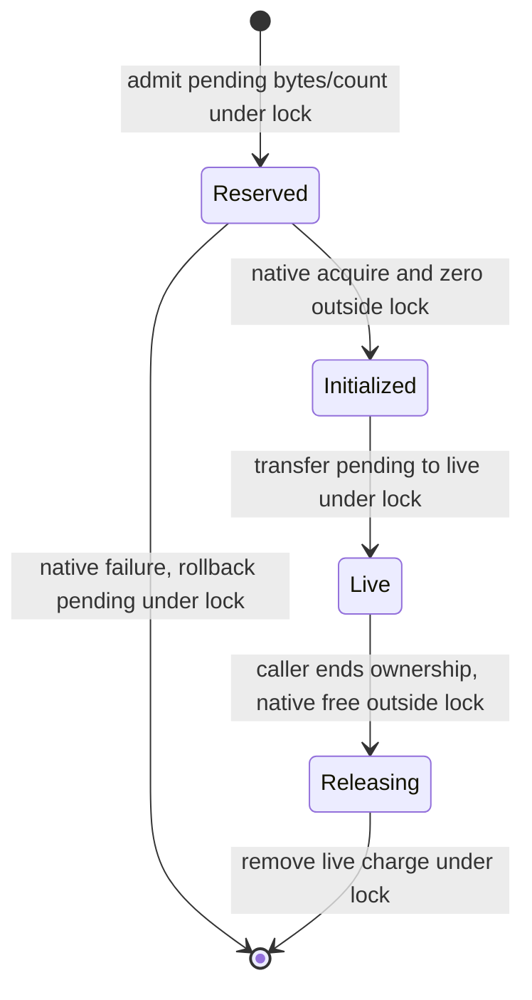

# Memory concurrency refinement

October 23, 2026. This follows the review of the
[current memory migration](memory-migration-completion.md). The approved changes
shorten CPU domain critical sections and remove synchronization from the
single-owner Lua heap. They preserve allocation, lifetime and failure behavior.

## Source comparison and design

Reinspected Unreal revision `f45729c0b6f097038e72b52d366a62baeca3275b`,
`MallocBinned2.cpp`, `MallocExternalSmall` and `MallocExternalLarge`, and
`UnrealMemory.cpp` allocator initialization. Small requests can use per-thread
free lists before taking a shared pool lock; allocator initialization adds a
thread-safe proxy only if required. The large backing path does still lock.
These sources establish selective synchronization, not a claim that Unreal
never calls a native allocator under a lock. Pins and links are in
[the Unreal source study](memory-unreal-reference.md).

Our domain owns admission counters, not the native provider's heap structures.
The existing Mac provider delegates concurrent allocation/free to native
libmalloc. Holding the domain lock during those calls serializes unrelated
requests without protecting additional domain state. The existing portable
DeviceBudget also separates reservations from native acquisition; its transaction
pattern is applicable without copying GPU semantics into CPU allocation.

The CPU domain reserves payload bytes, requested backing bytes and one
allocation under its mutex. Pending reservations participate in both limits,
preventing concurrent requests from oversubscribing the domain. Native acquire,
metadata construction and zeroing happen outside that mutex. Success converts
pending counters to live counters atomically; failure removes the reservation
and increments rejection. Successful peaks exclude failed reservations.
Snapshots expose pending values separately. During native release the existing
live charge remains admitted until release returns; only then is it removed.
This prevents another acquisition spending budget while old backing is still
being released. Provider callbacks may observe domain snapshots; all calls to
the provider may overlap within one domain as well as across domains.

CoalescingHeap requires exclusive caller ownership for every operation,
including snapshot and destruction. Independent contexts may run concurrently
and share the synchronized backing domain. A quiescent heap can transfer between
threads with an external happens-before handoff; there is no creator-thread
restriction. Its mutex is removed without changing first-fit, split/coalesce or
allocate-copy-free behavior. No speculative synchronized heap wrapper is needed
for the present Lua caller.

Design consulted both C++ corpora, reading CP.43 (short critical sections),
CP.22 (no unknown calls under a lock) and MEM.6 (injected allocation capability)
in full. Implementation separately queried both corpora for reservation, rollback and
provider-call lock scope; the same full rules apply to the concrete changes.

## Verification

Deterministic gated-provider checks pass for progress while another native call
is blocked, same-domain snapshots from inside native callbacks, payload/backing
admission including pending requests, isolated native failure rollback, and
retaining budget through blocked native free. The fixtures use semaphore
handoffs rather than sleeps or throughput thresholds. Existing independent
concurrent Lua contexts, coalescing and cross-thread owner-release tests pass.
Final `python3 scripts/check.py all` passes: pinned formatting, strict builds,
all six CTest entries, fatal clang-tidy on 60 authored translation units, and
repository policy. Rebuilt UBSan passes all six entries. Debug and UBSan runs of
the existing actual-root integration pass, with all pending/live payload,
backing and allocation counts zero at teardown. Root Lua remains at 65,536
bytes capacity and 27,456 peak occupied bytes with zero rejected requests.
The combined migrated-domain fixture records 39,158,163 peak payload bytes and
43,030,611 peak requested backing bytes in both runs. This is the same controlled
front-end workload described in the migration report, not total process or GPU
memory. No measured contention improvement or lock-free allocator claim is
made.

A common-memory ThreadSanitizer binary was compiled with the selected Xcode
`clang++`, `-std=c++20 -O1 -g -fsanitize=thread -fno-omit-frame-pointer -pthread`,
using domain/device-budget sources and the common memory/device tests. Native
Metal/AudioQueue checks were excluded from that diagnostic build. Execution
terminated with signal 11 and no test output. A separate minimal TSan program
with only an `entered main` diagnostic also terminated with signal 11 before
printing it. Therefore TSan coverage is **unavailable on this host**, not passed;
this failure is reproducible without engine code. UBSan is not a race detector.
Generated probe sources, binaries and logs remain ignored under
`research/evidence/reconstruction/memory/` (`concurrency-tsan-*` and
`tsan-startup-probe.*`).

## Accounting state transitions

`Releasing` remains part of the live accounting category until the release
transaction completes. Snapshot fields `pending_bytes`, `pending_backing_bytes`
and `pending_allocations` expose in-flight acquisition without describing it as
successful live storage. No public pointer is returned before initialization and
commit. Backing here is requested storage, not physical residency.

Final gate logs are `concurrency-all.log`, `concurrency-ubsan-build.log`,
`concurrency-ubsan-tests.log`, `concurrency-root-debug.log` and
`concurrency-root-ubsan.log` in that ignored evidence directory. No application
window was opened and no changes were committed.
