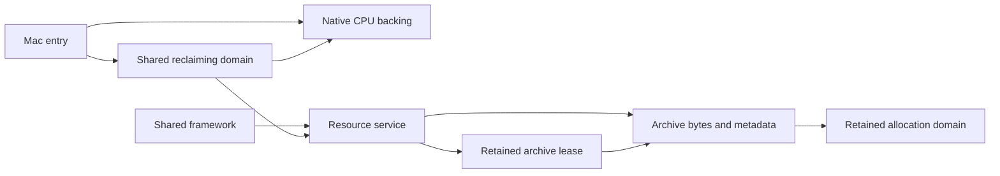

# Memory foundation: general allocation and resource ownership

October 23, 2026. Implementation and verification complete for this slice.
This is the first integrated slice of the approved
[faithful-first direction](memory-management-research.md), not completion of
every memory family in the architecture.

## Design and evidence

The recovered ordinary allocation wrapper selects a backing allocator, clears
storage and retains the allocator identity for release. Resource storage survives
until its consumers release it. These are the contracts adopted here; the script
and worker coalescing heaps belong to their later caller migrations. See the
[native evidence](memory-bullet-witch-evidence.md).

The pinned [Unreal study](memory-unreal-reference.md) provides the concrete
separation of `FMemory`/`FMalloc`, platform `BaseAllocator` selection and bootstrap
storage. In this slice, explicit injection replaces Unreal's global selection:
the target entry constructs the provider, while the shared framework receives a
domain. `FMemory_GCreateMalloc_ThreadUnsafe`,
`FMacPlatformMemory::BaseAllocator` and `FUseSystemMallocForNew` were inspected.
No Unreal implementation is copied into this project.

The common domain uses a reclaiming CPU backing capability. Allocation retains
its domain owner, tracks requested and requested-backing bytes, validates
alignment/size arithmetic, reserves admission before backing acquisition, and
rolls admission back on failure. Its PMR interface allows existing standard
containers to participate. Private allocator metadata is adapted to the native
pointer size; it is not an on-disk game structure.

An owning standard allocator also retains the domain across container copies,
moves and empty states. Its default construction exists only for the explicit
legacy parser/tool migration path; construction with a domain rejects null.
Failure in a selected domain never falls back to that legacy path.

Domain/provider creation and their shared ownership bookkeeping bootstrap outside
the tracked payload domain. This is an explicit, bounded scope exception; it is
not a fallback after domain exhaustion. Actual heap residency and allocator
internal overhead remain separate from requested-backing accounting.

Each allocation retains its domain to allow owner-aware free after composition
releases its reference. Aggregate owners also retain the domain so empty
containers never hold a dangling PMR resource. Domain synchronization covers
admission/accounting, not concurrent mutation of consumer objects. The native
backing contract must support the thread access exposed by the domain.

## Migration boundary

The first resource migration covers archive bytes and owned archive metadata,
resource-service containers and traversal scratch, and shared archive ownership.
Native file reads acquire the final archive storage directly. Retained archive
leases must survive tag removal and service destruction.

Catalog/RAT metadata, filesystem paths and runtime error objects, Lua, media,
image decoding and native device allocations remain distinct migration work.
Compatibility entry points used by tools and existing fixtures must identify
their default-allocation behavior rather than imply engine-wide interception.

CPU backing and device allocation remain separate. This slice implements neither
GPU placement nor a virtual-address reservation API with unused fields. Later
target-specific strategies can specialize allocation under the common ownership
contract. There is no fabricated historical resource cap: application policy
must choose a budget explicitly rather than copying the unrelated 8/28 MiB
constants from the executable.

## Guidance and verification plan

Design and implementation consult both required MCP corpora. Composition applies
Core Guidelines R.1 (`rr-raii`) for lifetime and unwinding and performance MEM.6
(`guidelines/memory/MEM.6-inject-allocators-behind-one-interface.md`) for explicit
allocation injection.
Individual implementation files record their retrieved applicable rules.

Required checks: alignment/zeroing, rejection and rollback, owner-aware release,
cross-thread accounting, resource lease survival, nested allocation routing and
partial-construction cleanup. Run strict build/format/clang-tidy, repository
policy, UBSan and the existing real-resource/root integration where applicable.
Do not turn allocation assertion counts into separate test counts. No new
interactive run is required for this ownership-only slice; native backing itself
must be exercised on Mac.

## Outcome

Implemented common contracts in `include/bw/memory/{cpu_backing,domain,allocator}.hpp`,
shared policy in `src/memory/domain.cpp`, and the native provider in
`src/platform/macos/cpu_backing.*`. Mac entry/framework composition injects a
domain into resource services. The [resource migration](resource-memory-migration.md)
and [Mac backing record](memory-macos-backing.md) describe their exact coverage.
Native allocation uses the selected Apple malloc-zone API; the domain owns
zeroing, owner metadata and synchronized admission/accounting. No private
size-class allocator or automatic compaction is introduced.

Verification:

- Strict host build and six registered CTest commands pass, including the
  final zero-budget resource request case. These are suite/command counts, not
  six individual assertions or six new integration scenarios.
- Full UBSan build and its six CTest commands pass with halt-on-error enabled.
- Debug and UBSan original-root/menu integration pass with the native CPU
  provider and direct archive reads. The resource domain peaks at **23,917,064
  payload bytes** and **23,924,168 requested backing bytes**, and returns to
  **zero live payload, backing and allocations** after teardown. This controlled
  scenario decodes original menu/costume assets using a synthetic renderer;
  it is not an interactive graphics acceptance run or total process measurement.
- Independent corpus comparison passes for **6,625 archives and 25 catalogs**,
  including decoded metadata and resource interpretation. That inspector still
  exercises the explicit compatibility allocation route; the original-root
  integration above exercises native domain routing.

- `python3 scripts/check.py all` passes Google formatting, the strict host
  build/tests, fatal clang-tidy across all 52 authored translation units, and
  repository content checks. The final resource-budget assertion was also
  rebuilt and rerun in the debug and UBSan suites.

Generated logs remain under ignored `research/evidence/reconstruction/memory/`; no assets,
native source snapshots or diagnostics are added to tracked content.

Next work is catalog/RAT ownership and context-bound Lua allocation, with the
recovered coalescing/linear mode and reset questions closed before implementing
that caller. Device allocation, wider memory telemetry and target optimization
retain their documented separate boundaries.

The subsequent [current-runtime migration](memory-migration-completion.md)
extends this initial foundation through catalogs, Lua, tasks, media,
presentation and native device ownership. Measurements above describe the first
slice, not the later combined migrated-domain workload.

The [concurrency refinement](memory-concurrency-refinement.md) subsequently moves
native acquire/release outside domain accounting locks and exposes pending
reservations separately. Earlier transaction descriptions above are historical;
limits now cover pending plus live charges while successful peaks cover live
allocations. Lua heap synchronization is a separate exclusive-owner contract.
