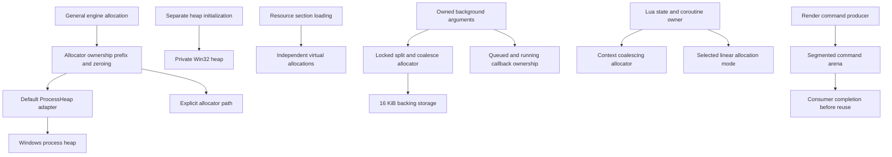

# Memory management: recovered behavior and reconstruction direction

Research date: October 22, 2026. **Faithful-first direction approved October 23,
2026; general/resource foundation implemented.** Approval establishes the direction, not every
allocator detail or unresolved contract below. This investigation changes no
engine code. Subsequent implementation and verification are recorded in the
[foundation implementation record](memory-foundation-implementation.md); it does
not complete every family described below.

Start with Bullet Witch's recovered allocation and ownership contracts, using
native backing on each target. Unreal is a useful reference for how to separate
those responsibilities and observe them. Its full allocator machinery is not a
prerequisite for the faithful port.

The approved direction retains recovered split/coalesce behavior and leaves
broader fragmentation management open as reconstruction reveals allocation
patterns and teardown. Coalescing adjacent free blocks does not compact live
objects. Any later relocation or bulk cleanup must establish that pointers,
callbacks and device consumers permit it; more reconstruction should provide
evidence, but does not guarantee that the original engine solved every case.

## Read the evidence

- [Bullet Witch evidence](memory-bullet-witch-evidence.md): executable identity,
  allocation/free paths, storage domains, sizes, instruction witnesses and gaps.
- [Unreal reference](memory-unreal-reference.md): pinned source revision,
  platform allocator selection, temporary storage, tracking and retirement.
- [Modern references](memory-modern-references.md): primary documentation and
  source for current allocator designs and CPU/GPU lifetime practices.
- [Existing reconstruction contract](../../../docs/architecture/memory-and-residency.md):
  the broader proposed memory architecture. This research helps sequence that
  work; it does not mark its unimplemented components complete.

The Bullet Witch evidence is static analysis of the **2018 Steam x86 executable**.
It does not establish the original Xbox 360 allocator implementation or measured
runtime peaks. Recovered addresses, constants and call paths are stronger evidence
than names inferred by a decompiler. The reviewed Cavia CEDEC material establishes
engine provenance, but supplies no allocator specification.

## What Bullet Witch actually does

It has several allocation mechanisms, with explicit ownership and different
release conditions. It is not one giant arena, and general allocations still
ultimately use operating-system heap services.

| Domain | Recovered behavior | Consequence for reconstruction |
|---|---|---|
| General engine allocation | Wrapper selects an allocator; the default adapter is named `ProcessHeap`. A prefix records the allocator that must free the block; the shared allocation path clears its storage. | Preserve allocator/free pairing, required zero initialization and failure behavior. A native backend can supply backing storage. |
| Additional private heap | A separate growable Win32 heap is created with `HeapCreate(0,0,0)`. An 8 MiB value is stored as an engine software limit, not an OS reservation or fixed maximum. | Preserve its distinction from the process heap and its admission policy; validate arithmetic rather than assuming the original limit check safely handles every request. |
| Resource sections | Catalog/resource section storage uses independent `VirtualAlloc` allocations and explicit release paths. | Resource leases and dependents determine release; a mission transition alone does not authorize resetting every allocation. |
| Render command storage | A 4 MiB arena, 16-byte alignment and eight segments appear in the recovered render path. | Reconstruct command storage ownership and consumer completion before reusing storage. The constant is evidence, not a measured modern-target requirement. |
| Background job arguments | A 16 KiB region uses a locked first-fit allocator with splitting/coalescing and 16-byte block headers. Owned job submission requests 64-byte alignment. The queue has 128 slots. | This is individually reclaimable argument storage, not a frame bump allocator. Arguments survive until their callback finishes. |
| Lua contexts | State/coroutine lookup routes allocations to context-owned storage. One mode uses the coalescing allocator; another advances a linear cursor with no-op free. Observed root, mission and AI backing sizes are 64, 256 and 384 KiB respectively. | Bind allocation to the owning context. The root mode is now verified as reclaiming with GC on coroutine preparation; AI linear-mode reset remains separate. See the linked implementation follow-up; stock unbounded Lua allocation loses verified ownership. |
| Effects and actor retirement | Fixed effect admission/pools and delayed actor destruction are separate from general heap allocation. Actor destruction restores its captured allocator context. | Preserve logical admission and destruction ordering; do not equate retirement maintenance calls with presented frames. |
| Resource configuration | A 28 MiB setting reaches resource initialization, but the examined PC function registers handlers and reports a derived size; it does not allocate a corresponding arena. | Do not manufacture a 28 MiB resource arena from a configuration field. |

These findings and the exact function addresses are documented in the
[Bullet Witch evidence report](memory-bullet-witch-evidence.md). Domain names above
describe roles; they are not claims that the original source used those names.

This is a domain map, not a claim that every domain is routed through the same
general allocation wrapper. The evidence report retains unresolved connections.

An operating-system heap is a valid backing implementation for an engine-owned
allocator. Whether a source expression says `new` is not the architectural test:
ownership, allocation routing, alignment, lifetime and failure policy are. Our
current containers largely still use their default allocator; wrapping a few
top-level allocations would leave nested allocations outside engine accounting.

## What Unreal contributes

The inspected reference is a pinned Unreal checkout, not an assertion about all
Unreal versions or configurations. Its [source report](memory-unreal-reference.md)
records the revision and the relevant functions.

Unreal separates the general allocation interface from platform/configuration
selection of its allocator. Binned allocators optimize small allocation classes
and contention; their implementation is one backend choice. The inspected Mac
selection also includes mimalloc for particular build configurations. Therefore
“use Unreal's Mac allocator” is not a sufficiently precise design decision.

Other useful separations are independent of which allocator is selected:

- Scoped temporary storage has a restricted lifetime. A mark/reset mechanism
  cannot safely own a coroutine's suspended state or a queued operation.
- Allocation tracking describes who holds storage and where it came from.
  Tracking alone does not enforce a budget or provide rollback on failure.
- UObject garbage collection manages object reachability; it does not replace
  raw allocation or free CPU memory still referenced by the GPU.
- GPU resource retirement follows device completion, which may occur after the
  CPU has finished preparing a frame.

Epic's Memory Insights adds allocation/free events, call stacks and lifetime
queries to aggregate totals. The transferable lesson is to measure allocations
across a scenario, including survivors after teardown, rather than relying only
on a peak counter. [Epic: Memory Insights](https://dev.epicgames.com/documentation/en-us/unreal-engine/memory-insights-in-unreal-engine).

## Faithful first: what should match

The initial subsystem should preserve observable allocation contracts and
lifetimes. It should not reproduce incidental 32-bit storage layouts as a native
64-bit ABI, nor preserve an unsafe path solely because it exists in the binary.

| Preserve or establish now | Adapt for the target | Improve after the faithful baseline |
|---|---|---|
| Correct owner/free pairing and required zero initialization | Pointer-sized metadata and safe alignment calculations | Small-allocation bins or a different general allocator where profiling warrants it |
| Stable resource storage while any consumer retains it | Native virtual-memory allocation, page size and release API | Streaming eviction, asset layout and compression changes |
| Queue argument ownership through callback completion | Synchronization that enforces the recovered contract without reproducing races | Thread-local caches, remote-free queues and broader job-system tuning |
| Render command retention through consumer completion | Metal/native device allocation and completion | GPU heaps, aliasing and more aggressive frames in flight |
| Correct Lua reallocation/error semantics and state lifetime | Adapter for the actual pinned Lua version | VM allocation policy changes after script behavior is validated |
| Bounded diagnostics, explicit exhaustion handling and accurate accounting | 64-bit overhead and native framework allocations | Tighter budgets based on measured mission workloads |

Known exceptional queue branches deserve particular care: the static mapping
contains lock/ownership hazards. A faithful implementation must preserve successful
behavior while implementing safe failure and publication rules. See
[background worker](background-resource-worker.md); static evidence does not prove
those branches execute in normal play.

Treat historical capacities as evidence to carry into compatibility diagnostics,
not arbitrary caps on every target. A 64-bit pointer graph or decoded host texture
can require more memory without representing a gameplay enhancement. Where a
capacity controls observable acceptance or failure, record that behavior separately
from the bytes needed to implement it.

Likewise, distinguish requested live bytes, allocator overhead, reserved address
space, committed memory and resident memory. Win32 `HeapCreate` distinguishes
initial size from maximum size; a zero maximum denotes a growable heap. A size
argument alone does not prove a hard cap.
[Microsoft: HeapCreate](https://learn.microsoft.com/en-us/windows/win32/api/heapapi/nf-heapapi-heapcreate).
Virtual-memory reservation and commitment are also different operations, and
commitment does not mean every page is immediately physically resident.
[Microsoft: VirtualAlloc](https://learn.microsoft.com/en-us/windows/win32/api/memoryapi/nf-memoryapi-virtualalloc).

## Where this fits the engine we have

This is one engine subsystem integrated into existing owners. It should not become
another standalone experiment or require every future allocator family at once.
The following inspection identifies concrete migration boundaries, not completed
allocation coverage:

| Current code | Memory boundary to address |
|---|---|
| `include/bw/formats/common.hpp`, resource archives/catalogs and `src/resources/service.cpp` | `Bytes`, nested vectors/strings/maps and shared ownership metadata need consistent allocator propagation. Archive leases must outlive tag removal while consumers still hold them. |
| `src/tasks/task_lifecycle_scheduler.cpp` | The per-pass ordering snapshot is a candidate for scoped scratch. Task state and suspended work are not. |
| `src/script/context.cpp`, pinned Lua 5.0.2 `lmem.c` | Lua uses its historical `luaM_realloc` path, including state creation before a normal initialized state is available. Do not assume a later Lua allocator-constructor API. Registry-anchored coroutines and bindings survive yields. |
| `src/video/ffmpeg/decoder.cpp`, `src/video/pcm_buffer.cpp` | Frame/PCM storage, queued compressed data and in-flight decoder work have different lifetimes. The preallocated PCM ring is bounded, but that alone does not route its storage through engine allocation. Third-party internal allocations require separately stated coverage. |
| `src/platform/macos/startup_host.mm` | CPU staging, Metal textures and native framework allocations need separate ownership/accounting. GPU reuse must follow completion. A CPU frame boundary is insufficient. |

The current front-end is already a useful lifecycle workload: boot, logos,
cinematic, title, menu transitions, profile/checkpoint use and shutdown. It cannot
establish gameplay/mission high-water requirements by itself.

## Recommended implementation sequence

1. **Record the compatibility contract.** Carry forward verified zeroing,
   alignment, allocation/free ownership, queue lifetime and resource retention.
   Resolve only unknowns that affect the next migrated caller. Keep unknown
   original budgets and allocation-failure behavior explicit.
2. **Introduce engine-owned allocation and native backing.** Begin with a
   reclaiming general domain and resource/operation ownership, plus bounded
   accounting. Make allocator propagation real in one existing vertical slice,
   including nested storage and error paths. Establish system shutdown order
   before moving asynchronously owned allocations.
3. **Add the specialized mechanisms their callers require.** Lua is an existing
   caller: migrate its context-owned allocation with the pinned-version adapter,
   and close mode/reset questions before selecting its linear path. Reconstruct
   the worker's reclaimable argument storage and render submission storage when
   those native subsystems need them. Use scoped scratch only for proven local
   temporaries. Do not implement a world of empty pools to satisfy a diagram.
4. **Validate the faithful baseline.** Exercise transitions, cancellation,
   exhaustion and teardown. Check retained resources, queued/running work and
   decoder/device completion. Compare steady-state survivors and high-water
   behavior; separate engine-owned, third-party and device memory coverage.
5. **Optimize from evidence.** Select bins, slabs, TLSF, mimalloc, GPU heaps or
   other techniques for demonstrated allocation size/lifetime/contention
   patterns. Keep gameplay and script contracts unchanged during allocator
   experiments so changes remain attributable.

This narrows the first implementation without weakening the existing
[ownership and residency requirements](../../../docs/architecture/memory-and-residency.md).
The [modern reference survey](memory-modern-references.md) explains where each
technique fits and what it does not solve. The recommended starting point is a
small, explicit implementation of Bullet Witch's actual contracts, supported by
modern diagnostics; a wholesale Unreal-style allocator implementation can wait.

## Remaining evidence gaps

- Original Xbox 360 allocator internals and differences from the Steam port.
- Runtime allocation distributions, fragmentation, contention and mission peaks.
- Complete mapping of every explicit allocator caller and private-heap client.
- Full third-party allocation coverage and failure behavior at each boundary.
- Exact capacity-dependent behavior under exhaustion in the original game.
- Device memory residency and asynchronous retirement outside the statically
  established consumer paths.

These gaps constrain claims and later implementation choices. They do not prevent
starting the concrete general-allocation and resource-lifetime work above.

## Implementation follow-up (October 23, 2026)

The [current-runtime migration](memory-migration-completion.md) implements and
verifies the first four steps for the existing startup owners. The
[Lua follow-up](lua-memory-implementation.md) closes the root mode/collection
question: reclaiming allocation, GC when preparing a new coroutine, close before
backing release, and unchanged 64 KiB capacity passing on the 64-bit host. AI
linear storage and future worker/world consumers retain their own unresolved
reset and retirement contracts. The allocation-site table above records the
pre-migration baseline; use the completion record for current coverage.
