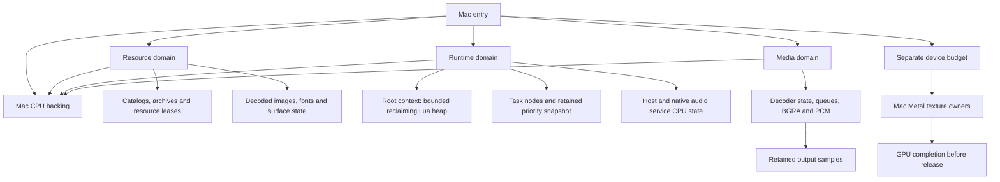

# Memory migration across the current runtime

October 23, 2026. Uncommitted for user review. This continues
the [general/resource foundation](memory-foundation-implementation.md) through
the remaining currently implemented engine owners. It does not invent world
pools or background workers for systems whose consumers do not exist yet.

## Design

Target composition selects CPU backing once and creates separate resource,
runtime and media domains. Shared framework code receives those capabilities;
it does not select a Mac default. Device allocation/accounting remains a separate
capability in the native rendering path. Retained containers and sample buffers
carry their owners until the final use ends.

Catalog storage follows archive storage, including decoded nested metadata and
lookup containers. The native path reads directly into its final owned bytes.
Filesystem/standard-stream internals remain an explicit native/library boundary.

Lua requires its pinned 5.0.2 allocator boundary, not the later Lua API. The
recovered context-owned coalescing policy is reconstructed with bounded backing;
the root's recovered mode is reclaiming and the existing original-root integration
passes at its recovered 64 KiB capacity on this 64-bit host. Allocation
failure must leave old realloc storage valid. Context bootstrap and coroutines
must preserve allocator association without a mutable global current allocator.

The single-threaded task scheduler receives an owning allocator for its map and
priority snapshot. A private retained vector is sufficient for this one typed
snapshot: it is cleared after each pass, keeps capacity for reuse, and cannot
escape. This preserves the existing snapshot/order algorithm and leaves callbacks
and suspended task state alive. It does not reset an arena under continuations.
The Unreal `FMemStack`/`FMemMark` source reviewed at the pinned revision in
[the source study](memory-unreal-reference.md) establishes the local-lifetime
requirement; a generic stack allocator adds no useful mechanism for this one
typed owner. Callback `std::function` internals remain an explicit library
boundary until a concrete allocator-aware callback type is warranted.

Media allocation belongs to the operation/session. Worker-owned packet
descriptors, decoded output, PCM storage and queues retain a domain until joined
shutdown. Samples may outlive a decoder. FFmpeg internal packet/codec allocation
and native audio framework allocation are separately reported; no universal
interception is claimed. Existing timing and callback behavior is preserved.

For device resources, the pinned Unreal `FMetalTempAllocator::Cleanup` source
demonstrates that reuse follows completion. This host already waits for every
submitted command buffer to finish; preserve that proof rather than invent a
frame-count retirement delay. Native resource allocation and accounting must
rollback on failure and release their charges only with their resource owners.
CPU and device metrics must not be summed as independent physical RAM.

The subsequent [concurrency refinement](memory-concurrency-refinement.md)
separates pending CPU admission from unlocked native calls and makes the Lua
heap explicitly single-owner. Its verification record supersedes the initial
locking behavior; allocation algorithms and lifetime rules are preserved.

## Implemented ownership map



Arrows denote capability provision or retention, not additional physical memory.
Domain accounting counts the Lua backing region once; Lua's internal occupancy
is a separate diagnostic view and must not be added to domain bytes. Likewise
CPU and Metal observations are not independent physical RAM totals.

| Owner | Implemented storage and lifetime | Detailed record |
|---|---|---|
| Resources | Native catalog/archive/package bytes, nested metadata, indexes, service maps and retained leases | [Resource migration](resource-memory-migration.md), [package ownership](memory-package-ownership.md) |
| Root Lua | Explicit per-state allocator patch, fixed first-fit heap, split/coalesce, protected host calls, context-owned wrapper metadata | [Lua implementation](lua-memory-implementation.md) |
| Tasks | Allocator-bearing task map and high-water priority snapshot; suspended callbacks survive ticks | This record |
| Media | Decoder/Player state, queue descriptors, converted BGRA/PCM, fixed audio ring and native audio state; workers join before teardown | [Media ownership](memory-media-ownership.md) |
| Presentation | Image pixels, font/glyph tables, title/menu state, fixed commands, retained resource-derived labels | [Image/presentation ownership](memory-image-presentation.md) |
| Device | Portable admission/reconciliation tokens; Mac texture ownership, rollback and completion-based release | [Device ownership](device-memory-ownership.md) |

## Deliberate boundaries and remaining reconstruction

This completes the selected migration across current startup engine owners; it
is not a claim that the process never uses the default allocator. Native
provider/domain bootstrap, small decoder interface shells, filesystem/path and
stream internals, diagnostics, public Lua value/reply types, callable captures,
profile/save compatibility buffers and C++ thread infrastructure remain explicit
boundaries. libpng/zlib and FFmpeg internals, Cocoa/AudioQueue, Metal command and
pipeline objects, drawables and driver storage remain externally managed. Current
resource/runtime/media and device aggregate budgets are explicitly uncapped;
existing decoder queue and sprite limits remain in force. Representative
workload measurements must establish future aggregate admission policy.

Only the root reclaiming Lua mode has an implemented caller. The recovered AI
linear mode, world pools, worker scratch and native virtual-page capabilities
await their consumers and reset/retirement contracts. The task snapshot is a
retained typed vector, not an invented general arena. Metal remains synchronous;
future frames in flight need explicit completion-retired owners. No relocating
compaction, guessed heap geometry, or universal GPU suballocator was added.

## Verification and results

The authoritative generated logs are under ignored
`research/evidence/reconstruction/memory/`. Acceptance results:

- `scripts/check.py all` passes: pinned Google formatting, strict build, all
  six CTest entries, fatal clang-tidy across **60 authored translation units**,
  and repository content-policy checks. The rebuilt UBSan configuration also
  passes all six entries. Counts identify suites and compilation units; assertions are not separate tests.

- Debug and UBSan runs of the existing original-root integration pass. Root
  heap capacity is **65,536 bytes**, peak occupied **27,456**, free payload
  **39,120**, largest free payload range **38,384**, and rejected requests **0**.
  Bounded failure, adjacent coalescing and retained coroutine ownership are
  exercised separately. No capacity adaptation or heap fallback was needed.
- The same integration deliberately shares one native CPU domain across its
  migrated resource/runtime/presentation owners to observe complete teardown:
  peak payload **39,158,227 bytes**, peak requested backing **43,030,675 bytes**,
  final live payload/backing/allocation count **0**. Production composition
  separates those domains. This fixture uses controlled media and a synthetic
  renderer; these figures are not total process memory or native playback peaks.
- The independent corpus comparison passes **6,625 archives, 25 catalogs and
  74 named-file packages**. The reviewed summary records input/source hashes;
  original game execution equivalence is not inferred.
- Silent native decoding of all four startup movies matches prior independent
  video and PCM SHA-256 results exactly. Retained samples, primed cancellation
  and failed-open teardown return tracked storage to zero.
- Headless Metal upload/readback, admission rejection, token rollback and
  completion-before-release pass without opening a window.

These checks do not establish new visual playback acceptance or gameplay
behavior. No commits or pushes were made; all authored changes remain reviewable
in the working-tree diff.

Reproduce from the repository root with the read-only game path provisioned:

```sh
python3 scripts/check.py all
cmake --preset host-ubsan
cmake --build --preset host-ubsan --parallel 2
ctest --preset host-ubsan
build/host-debug/startup-corpus "$BULLET_WITCH_GAME_DIR"
UBSAN_OPTIONS=halt_on_error=1:print_stacktrace=1 build/host-ubsan/startup-corpus "$BULLET_WITCH_GAME_DIR"
python3 research/tools/verify_resource_foundation.py build/host-debug/bw-resource "$BULLET_WITCH_GAME_DIR"
```

Native media comparison details and headless device evidence are linked above.
ASan remains unavailable due to the previously recorded pre-main startup hang;
only Mac native/debug/UBSan behavior is verified, not Windows or Xbox backends.
