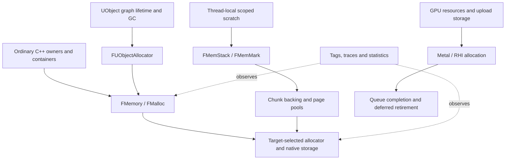

# Unreal memory reference

## Scope and provenance

This is a source study for Bullet Witch's memory subsystem, not an implementation
proposal or a performance result. The reference is Epic's Unreal Engine checkout
at commit `f45729c0b6f097038e72b52d366a62baeca3275b`. Its recorded
`Build.version` is 5.8.4; the commit identifies the inspected source. This is not
a claim about the latest Unreal release or every Unreal platform configuration.

The authorized checkout is under ignored `research/references/UnrealEngine`.
Selected source snapshots are under ignored
`research/evidence/reconstruction/memory/unreal/`. This document contains authored
analysis; no Unreal implementation is incorporated into project code. The source
links below require Epic repository access. All paths are relative to
`Engine/Source/Runtime/` at that revision.

## Allocation is layered

`FMemory` provides the common allocation interface. Its initialization obtains
an `FMalloc` from `FPlatformMemory::BaseAllocator()`, installs enabled diagnostics,
and adds a thread-safe proxy only when the selected allocator needs one.
`GCreateMalloc()` uses function-local static initialization to serialize lazy
creation, including the Mac case where allocation may start on multiple threads.
Fixed-allocator builds have different constraints on wrappers. This is a
portable contract with target-selected backing, not a separate heap automatically
created for every engine subsystem.

`FMalloc` itself uses system allocation to bootstrap its allocator object without
recursively invoking the allocator being created. Unreal's module boilerplate
also redirects ordinary C++ `new`/`delete` to engine allocation. Consequently,
the presence of `new` does not establish that storage bypasses engine policy.
Construction/destruction and allocation/deallocation remain distinct concerns.
Inspected: `FMemory_GCreateMalloc_ThreadUnsafe`, `FMemory::GCreateMalloc`, external
allocation delegates, `FMalloc`, `FUseSystemMallocForNew`, and module replacement
operators. Sources: [UnrealMemory.cpp][memory], [MemoryBase.h][base],
[ModuleBoilerplate.h][operators].

## Mac selection and general allocation

`FMacPlatformMemory::BaseAllocator()` selects ANSI when forced; otherwise it
prefers mimalloc for editor/program/instrumented builds when compiled in, then
TBB for eligible editor/program builds, then Binned2 or Binned3 according to
build flags, with legacy Binned as the fallback. Supported command-line or
environment overrides can change selection; ThreadSanitizer forces ANSI.
Therefore “Unreal on Mac uses Binned3” is not a valid general assumption.
The function also registers native memory-pressure notifications. Those signals
do not by themselves define an asset eviction policy. Source:
[MacPlatformMemory.cpp][mac].

Binned2 maps suitable small requests to size classes. Per-thread free lists and
a shared recycler serve the fast paths; replenishment can acquire a pool lock
and allocate backing pages. Large or unsuitable requests take a separate path.
Binned3 reserves virtual address ranges for small size classes and commits
backing as needed, with separate large-allocation handling. Reserved address
space is not the same quantity as committed or live memory. Both implementations
declare internal thread safety; this does not make their clients' objects or
scratch arenas thread-safe. TLS caches and pooled pages retain memory until
explicit cache/trim mechanisms reclaim it. These are not universally lock-free
allocators.

Inspected: Binned2 `Malloc`, `MallocExternalSmall`, `MallocExternalLarge`, `Free`,
`FreeBundles`, `Trim`; Binned3 constructor, `Commit`, large allocation and metadata
allocation; common free-list/recycler support. Sources:
[MallocBinned2.cpp][binned2], [MallocBinned3.cpp][binned3],
[MallocBinnedCommon.h][binned-common]. Their configuration sizes and complexity
are not a justified starting budget for this game.

## Scratch and object lifetimes

`FMemStackBase::Alloc` is an aligned bump allocation over chunks. `FMemStack` is
thread-local. `FMemMark` records the current top/chunk and restores them on `Pop`
or destruction, checking nesting order. Releasing this raw storage does not
traverse objects and call their destructors. `TMemStackAllocator` permits
appropriate containers to use this storage, while backing pages have their own
pooling. The useful contract is scoped temporary storage with no escaping users,
not “all temporary memory can be reset at the next frame.” Worker tasks and GPU
commands can outlive a frame boundary. Sources: [MemStack.h][memstack],
[MemStack.cpp][memstack-impl].

UObject garbage collection sits above raw allocation. `FUObjectAllocator` can
allocate objects through `FMemory` or a configured persistent linear pool.
Garbage collection discovers unreachable reflected objects and runs their
destruction protocol before releasing eligible storage. It does not collect
every C++ allocation. Inspected: `AllocateUObject`, `FreeUObject`, and the
incremental purge/destruction path in `GarbageCollection.cpp`. Sources:
[UObjectAllocator.cpp][uobject], [GarbageCollection.cpp][gc]. This supplies no
reason to introduce Unreal's reflected object model or GC into Bullet Witch;
the game's object and Lua lifetime evidence must determine those contracts.

## Accounting and failure

LLM distinguishes platform allocations obtained from the kernel from logical
allocations observed through engine allocation. Scoped tags attribute work;
per-thread tracking state and synchronized aggregation produce statistics.
`FLowLevelMemTracker::OnLowLevelAlloc/Free`, tag push/pop and
`UpdateStatsPerFrame` are accounting mechanisms. A tag is not an arena, an owner,
a budget enforcement mechanism, or permission to free tagged objects together.
Memory tracing and allocator verification/poisoning are additional mechanisms.
Sources: [LowLevelMemTracker.h][llm-header], [LLM.cpp][llm],
[UnrealMemory.cpp][memory].

Failure policy must be explicit. The inspected Binned2 large-allocation path
calls a fatal out-of-memory handler. Generic `OnOutOfMemory` gathers diagnostics,
releases an emergency pool, invokes notification delegates, and terminates.
Although `FMalloc` exposes `TryMalloc`/`TryRealloc`, their base implementations
delegate to `Malloc`/`Realloc`; the names alone do not guarantee recovery.
Sources: [MallocBinned2.cpp][binned2], [GenericPlatformMemory.cpp][oom],
[MemoryBase.cpp][base-impl]. A game-level streaming budget can reject optional
work before such failure, but that is a separate contract.

## GPU storage has its own retirement rules

The RHI transient allocator associates ranges with resource lifetimes, aliasing
overlaps and acquisition/discard fences. Its allocator decides whether another
resource can reuse a region under the submitted scheduling constraints. This is
different from reclaiming ordinary CPU storage. Inspected:
`FRHITransientHeapAllocator::Allocate/Deallocate` and
`FRHITransientHeap::DeallocateMemoryInternal`. Sources:
[RHITransientResourceAllocator.h][transient-header],
[RHICoreTransientResourceAllocator.cpp][transient].

On Metal, `FMetalTempAllocator::Allocate` suballocates aligned ranges from shared
Metal buffers under a lock. `Cleanup` removes used buffers from the active pool
and queues their reuse/release through `DeferredDelete`; it does not immediately
make submitted storage available again. `DeferredDelete` queues work under its
own lock and checks its calling-thread constraint. Metal submission tracks
per-queue completion values and command-buffer completion. `RHIProcessDeleteQueue`
drains the pending objects through `EnqueueEndOfPipeTask`, which creates GPU/CPU
sync points for each queue and makes the deletion task depend on them. Shared physical RAM
does not eliminate asynchronous device ownership. Sources:
[MetalTempAllocator.cpp][metal-temp], [MetalDynamicRHI.h][metal-rhi],
[MetalSubmission.cpp][metal-submit], [MetalRHI.cpp][metal-retirement]. The platform backend must provide that
completion contract rather than exposing Metal types in the common allocator.

## Application to the faithful port

These are reference-derived recommendations, pending the Bullet Witch allocator
mapping and design decision:

- Establish one explicit allocation contract covering alignment, ownership,
  failure, bootstrap/shutdown and thread access. Keep native backing replaceable.
  Route C++ owners and containers deliberately; a syntax ban on `new` is not a
  memory architecture.
- Preserve the game's recovered persistent, session, mission and resource
  lifetimes. Use scoped scratch only where users provably finish before reset.
  Introduce size-class pools because measured allocation patterns warrant them,
  not because Unreal has them.
- Account for requested/live bytes, retained backing, committed/reserved memory,
  allocator overhead, and external/device allocations separately. Tags can make
  ownership visible without forcing one physical heap per tag. Avoid adding
  overlapping CPU/GPU totals as if they were distinct physical RAM on Mac.
- Keep device/upload storage and completion retirement explicit. A thread-safe
  allocator and a frame counter cannot establish safe GPU reuse.
- Separate recoverable budget rejection from fatal inability to allocate.
  Capture useful diagnostics without depending on successful normal allocation
  during the failure itself.

No Unreal executable was built or benchmarked. This study does not establish
which allocator is fastest for Bullet Witch, exact target budgets, Xbox native
allocation behavior, or compatibility of third-party allocation hooks. The
underlying Apple virtual-memory implementation and every diagnostic proxy were
not audited. The source references establish mechanisms and contracts; native
measurements remain required after an approved design is implemented.

[memory]: https://github.com/EpicGames/UnrealEngine/blob/f45729c0b6f097038e72b52d366a62baeca3275b/Engine/Source/Runtime/Core/Private/HAL/UnrealMemory.cpp
[base]: https://github.com/EpicGames/UnrealEngine/blob/f45729c0b6f097038e72b52d366a62baeca3275b/Engine/Source/Runtime/Core/Public/HAL/MemoryBase.h
[base-impl]: https://github.com/EpicGames/UnrealEngine/blob/f45729c0b6f097038e72b52d366a62baeca3275b/Engine/Source/Runtime/Core/Private/HAL/MemoryBase.cpp
[operators]: https://github.com/EpicGames/UnrealEngine/blob/f45729c0b6f097038e72b52d366a62baeca3275b/Engine/Source/Runtime/Core/Public/Modules/Boilerplate/ModuleBoilerplate.h
[mac]: https://github.com/EpicGames/UnrealEngine/blob/f45729c0b6f097038e72b52d366a62baeca3275b/Engine/Source/Runtime/Core/Private/Mac/MacPlatformMemory.cpp
[binned2]: https://github.com/EpicGames/UnrealEngine/blob/f45729c0b6f097038e72b52d366a62baeca3275b/Engine/Source/Runtime/Core/Private/HAL/MallocBinned2.cpp
[binned3]: https://github.com/EpicGames/UnrealEngine/blob/f45729c0b6f097038e72b52d366a62baeca3275b/Engine/Source/Runtime/Core/Private/HAL/MallocBinned3.cpp
[binned-common]: https://github.com/EpicGames/UnrealEngine/blob/f45729c0b6f097038e72b52d366a62baeca3275b/Engine/Source/Runtime/Core/Public/HAL/MallocBinnedCommon.h
[memstack]: https://github.com/EpicGames/UnrealEngine/blob/f45729c0b6f097038e72b52d366a62baeca3275b/Engine/Source/Runtime/Core/Public/Misc/MemStack.h
[memstack-impl]: https://github.com/EpicGames/UnrealEngine/blob/f45729c0b6f097038e72b52d366a62baeca3275b/Engine/Source/Runtime/Core/Private/Misc/MemStack.cpp
[uobject]: https://github.com/EpicGames/UnrealEngine/blob/f45729c0b6f097038e72b52d366a62baeca3275b/Engine/Source/Runtime/CoreUObject/Private/UObject/UObjectAllocator.cpp
[gc]: https://github.com/EpicGames/UnrealEngine/blob/f45729c0b6f097038e72b52d366a62baeca3275b/Engine/Source/Runtime/CoreUObject/Private/UObject/GarbageCollection.cpp
[llm-header]: https://github.com/EpicGames/UnrealEngine/blob/f45729c0b6f097038e72b52d366a62baeca3275b/Engine/Source/Runtime/Core/Public/HAL/LowLevelMemTracker.h
[llm]: https://github.com/EpicGames/UnrealEngine/blob/f45729c0b6f097038e72b52d366a62baeca3275b/Engine/Source/Runtime/Core/Private/HAL/LLM/LLM.cpp
[oom]: https://github.com/EpicGames/UnrealEngine/blob/f45729c0b6f097038e72b52d366a62baeca3275b/Engine/Source/Runtime/Core/Private/GenericPlatform/GenericPlatformMemory.cpp
[transient-header]: https://github.com/EpicGames/UnrealEngine/blob/f45729c0b6f097038e72b52d366a62baeca3275b/Engine/Source/Runtime/RHI/Public/RHITransientResourceAllocator.h
[transient]: https://github.com/EpicGames/UnrealEngine/blob/f45729c0b6f097038e72b52d366a62baeca3275b/Engine/Source/Runtime/RHICore/Private/RHICoreTransientResourceAllocator.cpp
[metal-temp]: https://github.com/EpicGames/UnrealEngine/blob/f45729c0b6f097038e72b52d366a62baeca3275b/Engine/Source/Runtime/Apple/MetalRHI/Private/MetalTempAllocator.cpp
[metal-rhi]: https://github.com/EpicGames/UnrealEngine/blob/f45729c0b6f097038e72b52d366a62baeca3275b/Engine/Source/Runtime/Apple/MetalRHI/Private/MetalDynamicRHI.h
[metal-submit]: https://github.com/EpicGames/UnrealEngine/blob/f45729c0b6f097038e72b52d366a62baeca3275b/Engine/Source/Runtime/Apple/MetalRHI/Private/MetalSubmission.cpp
[metal-retirement]: https://github.com/EpicGames/UnrealEngine/blob/f45729c0b6f097038e72b52d366a62baeca3275b/Engine/Source/Runtime/Apple/MetalRHI/Private/MetalRHI.cpp
