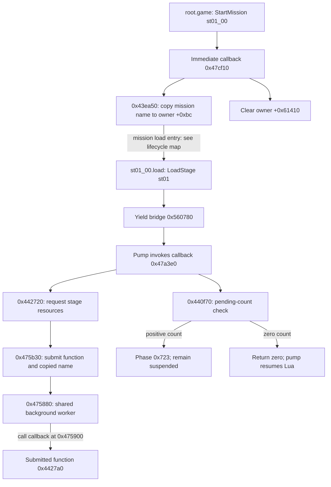

# Mission and stage loading

[Architecture](../ARCHITECTURE.md) · First mapping pass: October 22, 2026

Status: mission selection, status polling, stage submission, worker dispatch and
resource-handler routing are statically traced. Exact error propagation, ownership
and unload behavior remain partial. Addresses refer to the hash-identified image.

## Script-to-native route

The verified root Lua requests `_StartMission("st01_00")` for stage 1 and then
calls `_WaitMission()`. The stage's verified `load()` function calls
`_LoadStage("st01")` among its other resource requests. These names represent a
mission script and a stage-resource prefix respectively.

Sources: [root Lua](../../extracted/scripts-recovered/root.lub--42c4bebad62b.lua),
[stage 1 Lua](../../extracted/scripts-recovered/st01_00.lub--7273735c5735.lua),
[adapter index](../../evidence/script-corpus/native-api-index.json).

Worker execution is now connected. Pending count includes all occupied slots in
this shared worker, including its running callback; it is not stage-specific.
See [background worker](background-resource-worker.md) and
[mission lifecycle](mission-lifecycle.md).

## Native contracts and field anchors

| API / helper | Static behavior | Evidence |
|---|---|---|
| `_StartMission`: adapter `0x476640`, callback `0x47cf10` | Reads string argument, selects mission via `0x43ea50`, clears owner `+0x61410` | [Callback](../../evidence/native-decompilation/functions/0047cf10.c) |
| `0x43ea50` | Clears root-name first byte at `+0x7c`, copies mission name to `+0xbc`, clears `+0x114` | [Selector](../../evidence/native-decompilation/functions/0043ea50.c) |
| `_WaitMission`: adapter `0x476660`, callback `0x47d4c0` | Phase 0 becomes `0x42c` and returns pending; later polls owner `+0x61410`, returning zero when nonzero | [Wait callback](../../evidence/native-decompilation/functions/0047d4c0.c) |
| `_LoadStage`: adapter `0x476d60`, callback `0x47a3e0` | Yielding API; phase 0 requests stage; pending work selects phase `0x723`; zero pending returns completion | [Load callback](../../evidence/native-decompilation/functions/0047a3e0.c) |
| `0x442720` | Uses stage-name digits when length permits, submits callback/name, copies name to resource-owner `+0x8108` | [Request helper](../../evidence/native-decompilation/functions/00442720.c) |
| `0x440f70` | Calls job-manager count path `0x475870`; returns whether count is positive | [Pending helper](../../evidence/native-decompilation/functions/00440f70.c) |

The request helper's arithmetic on name characters 2 and 3 yields stage number 1
for `st01`. It writes the result at resource-owner `+0x8128`. This interpretation
is specific to the observed arithmetic; complete naming rules remain open.
The orchestration and resource-owner getters are distinct: `0x432130` and
`0x432220`. They use cached pointers at `0xb1b198` and `0xb7c690` respectively.
These are role labels, not original recovered class names.

## Stage work submission and execution

`0x442720` passes callback `0x4427a0` and a copied stage-name argument through
`0x475b30`. Worker `0x475880` invokes it at `0x475900`, then clears the slot and
releases its owned argument. The queue, synchronization and failure boundaries
are detailed in [background resource worker](background-resource-worker.md).

## Full stage job

The [complete job](../../evidence/engine/pass-02/functions/004427a0.c) now shows:

1. Enumerate the logical `model` namespace; select names matching the stage prefix,
   filter dummy/special names, and deduplicate the primary list. Up to 80 names
   occupy 32-byte slots at resource owner `+0x8930`, counted at `+0x9330`.
2. Request each primary model through `0x444580`, which constructs `model.<name>`
   suffixes `.hit`, `.chit`, `.ehit`, `.vfx.default`, `.matanim.list.nocompress`.
3. Replace the first two prefix characters with `gm`, select up to 64 entries into
   `+0x812c`, count at `+0x892c`, and request through `0x443640`. The exact meaning
   of this second model category remains open.
4. Request sixteen `texture.<stage>_cubemap_%02d` resources; store available handles
   starting at `+0x93b8`.
5. Request `areadata.<stage>.` followed by `areadata.bin`, `areadata.settbl`,
   `areadata.filani`, `effect.emt`; resolve handles into `+0x941c..+0x9428`.
   Pass the first three to `0x482970`, and copy the fourth into `+0x9410`.
6. For stage number 6, enumerate additional names and submit callback `0x441070`
   with copied arguments to the same worker. The additional payload role is open.

Several request groups call `0x4151b0(0x6e)`. That helper's file/phase passes now
connect to CPR loading and named CALL handlers; see
[resource dispatch](resource-dispatch.md). Its return is not a reliable per-resource
success contract. The stage job sets global byte `0xd478ce` when it returns nonzero;
that byte's full role is unresolved.

[Stage instructions](../../evidence/engine/pass-02/instructions/004427a0.txt) ·
[Model request helper](../../evidence/engine/pass-02/functions/00444580.c) ·
[Area-name table](../../evidence/engine/pass-02/table-witnesses.json).

## Local unresolved work

- RES-01: namespace enumeration, full stage body and native CPR/CALL path are
  mapped; complete RAT ingestion and all stage-specific consumers remain.
- RES-02: worker dispatch and normal argument cleanup resolved; cancellation and
  exceptional-path ownership remain.
- RES-03: shared queue scope and critical-section targets resolved.
- RES-04: follow failed resource state and submission errors back to script-visible
  behavior. Pending count alone communicates execution completion.
- RES-05: trace phase-3 teardown, reference ownership, cancellation and release.
- EXEC-02: load/start/status routing mapped in [mission lifecycle](mission-lifecycle.md);
  event producers, modal interactions and complete restart semantics remain.
