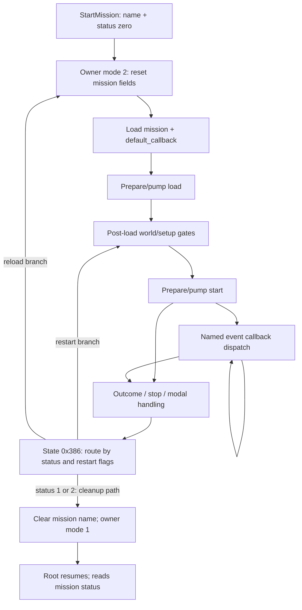

# Mission lifecycle and outcomes

October 22, 2026. [Architecture](../ARCHITECTURE.md) ·
[Execution](execution-and-scripts.md) · [Stage requests](mission-and-stage-loading.md).

## Driver states and entry points

Owner update `0x43ecf0` is gated by byte `+0x74`, then switches on owner `+0x78`:
0 advances toward root/mission selection; 1 runs the root driver and detects a
selected mission name; 2 initializes mission fields; 3 runs mission driver
`0x43eea0`; 4 runs the separate cleanup/state path `0x43edb0`.

`0x43c670` resets mission-driver state `+0x110` and status `+0x61410`, and initializes
names at `+0x61415` and `+0x61435` to **load** and **start**. These are mutable entry
names, not hardcoded calls in every later state.
[Initializer](../../evidence/native-decompilation/functions/0043c670.c) ·
[Driver](../../evidence/engine/pass-02e/functions/0043eea0.c).

The standard path in `0x43eea0` is:

| Driver state | Observed work / transition |
|---|---|
| 0 | Prepare mission Lua context/API table; request selected mission and `default_callback`, unless supplied inline source exists |
| 0x214 | Wait for shared background work, then load the two script buffers |
| 0x222–0x225, 0x233 | Initialization transitions and another pending-work gate |
| 0x250 | Pump the prepared `load` entry while pending |
| 0x258–0x25b | Post-load transitions; reset status and several flags; enqueue another task |
| 0x26e, 0x27a, 0x27b, 0x289, 0x291 | Actor/world/setup gates before preparing `start` |
| 0x30e | Pump `start`; react to task/modal and mission-status changes |
| 0x35d, 0x354 | Retrieve named event callbacks, prepare/pump them; continue dispatching |
| 0x372 through 0x386 | Stop/cleanup and outcome routing, with intermediate states |
| 0x3f6–0x3f9 | After selected cleanup paths, clear mission name and return owner mode to 1 |

The table groups related states for navigation. It is not a claim that each range
is a continuous path, that every branch is mapped, or that one transition equals
one rendered frame. Several source-level fallthroughs occur within an invocation.

Dependencies inside the post-load gates, event-queue producers, and every reload
branch still need focused traces. They are kept local rather than blocking this map.

## Mission status is not a completion boolean

| Value | Evidence-supported meaning |
|---|---|
| 0 | Running/reset state; set by selection and mission setup |
| 1 | Clear outcome: `default_callback.clear()` sets it; root shows newspaper/results and advances the stage |
| 2 | Return-to-root/menu outcome: root sets mode 1; also assigned by native exit paths |
| 3 | Internal restart route: native driver sets restart flag and returns toward post-load setup |

`_WaitMission` only polls whether this value is nonzero after its initial phase.
It does not itself certify that all native teardown has finished. Scheduling and
outcome routing must be considered alongside that API when preserving behavior.

Visible constant-offset writers in the inspected executable include:

- `0x43c67f`, `0x43f112`, `0x47cf37`: zero/reset.
- `0x47c38d`: `_SetMissionStatus` writes the supplied value.
- `0x43f035`: writes 2 when the exit-related flag path is taken.
- `0x4a4760` / `0x4a4771`: the task method containing these sites writes 3 or 2
  according to a menu/state result. Exact user-facing choice labels remain unresolved.

[Status setter](../../evidence/native-decompilation/functions/0047c370.c) ·
[Task branch](../../evidence/engine/pass-02c/functions/004a4380.c) ·
[Default callback](../../extracted/scripts-recovered/default_callback.lub--f66c0f177c72.lua) ·
[Root routing](../../extracted/scripts-recovered/root.lub--42c4bebad62b.lua).

The writer inventory searches literal offsets in disassembly; aliases, copied
objects or computed addressing can escape it. It is not a proof of all writes.
