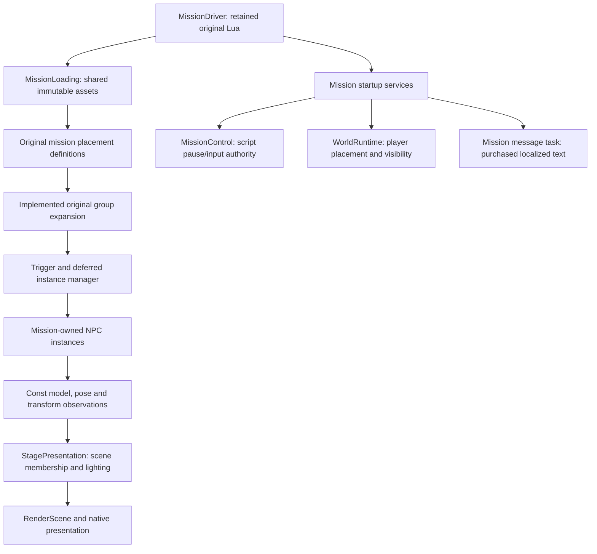

# Script-driven mission startup

October 26, 2026. Implementation and verification record for script-driven
mission startup. The user accepted the repaired slice and authorized its commit
on October 27, 2026. The original binary, unchanged
mission chunk, placement records and native consumers define admission. See
[the source trace](mission-startup-source-trace.md).

## Source correction and observable scope

The earlier admission report incorrectly described `0x600ff0` as live actor
construction. The setup traversal prepares deduplicated character support.
The sixteen `chara` records are archetypes, not sixteen positioned actors.
One Shot Kill has 58 authored group rows and 39 population triggers. Its fresh
player position lies in none of the enemy table's trigger shapes. Consequently
startup must initially show no NPCs; walking into authored regions creates the
corresponding population. Eagerly placing every archetype would be incorrect.

This slice executes genuine initial mission setup and unchanged `start()`,
including its mandatory instruction message, pause/input gates and a typed
initial checkpoint observation. It retains authored deferred definitions instead of acknowledging
AI/combat completion. NPC decision-making, attacks, damage, effects and dynamic
prop simulation remain later owners. Initialization that requires one of those
owners is reported explicitly; it is not silently interpreted as success.

## Ownership and algorithm

- Original compatibility decoding belongs in `game/content/original`; payload
  strings borrow the retained mission tables. Decoding validates before publish.
- Mutable trigger-fired state, authored instances and mission generation belong
  to `game/world`; definition views cannot mutate or trigger them.
- Spawn expansion consumes an explicit source-compatible 15-bit random input;
  this is distinct from the existing session custom RNG. It preserves original
  group order and cell partition/shuffle. Ground projection uses the existing scenery query with the traced 2D/3D
  bounds; absent query capability is not a hit miss.
- Shared immutable geometry, texture and animation support remains
  `MissionLoading`-owned. Each spawned actor owns transform, pose and future
  behavior state; instances do not duplicate resource uploads.
- Original script bridges validate copied arguments and call narrow receivers.
  The VM survives load/setup/start. Pending work keeps its actual receiver;
  cancellation destroys callbacks before their borrowed owners disappear.
- The world owns authoritative simulation. Presentation borrows const actor
  observations and supplies the original common character lighting field; it
  cannot alter actor transforms. The controller does not perform lighting work.
- Restart retires draws and actors before load owners, then reconstructs fresh
  mission-local startup/trigger state. Existing session selection and permanent
  progression remain with their accepted owners.

The architecture is based on the concrete original setup/placement and actor
ownership routes recorded in the linked trace and `actor-lifecycle.md`. No new
scheduler, ECS, camera, allocator or generic engine algorithm is introduced.
Any unresolved standard mechanism must be compared against a concrete pinned
Unreal source implementation before its body is written.

## Verification obligations

Exercise actual original tables and binary Lua; distinguish archetypes, group
records, live instances and stored/deferred instances. Check the empty initial
population and the first authored activation, including group order and source
transforms. Verify live native rendering and restart lifetime, asset reuse and
retirement. A metadata census or fixture receiver is not native parity. Run the
full repository gate after C++ integration, then leave the uncommitted slice for
user review. Preserve the separately accepted hair research unchanged.

## Implemented opening boundary

`MissionScriptRuntime` receives original native calls. Source `_SetBgObj` stages the
background admission; the first `_SetPlayerPosition` commits world construction
at its supplied transform before any frame is admitted. This batches source
setup within the same coroutine execution, rather than simulating an actor at a
guessed origin. It supports first placement only: later live teleports reject
until the full actor pose-message receiver exists. Original native placement
mutates an existing actor; this construction-time batching is an explicit
reconstruction boundary, not a claim that the original recreated Alicia.

The source opening's `_DispWindowMessage2(0)` displays all three purchased
English pages, original color markup and active-device confirmation glyphs.
The acknowledgment task retains simulation/input pause until its closing
transition finishes. No timer pretends the user acknowledged the modal.
Screen fade and script waits observe the sole published world/control interval.
Music resolves the original two-stage index mapping, uses segmented playback
and the original one-second opening fade. Reentering the front end reselects
its music identity after the shared device has played a mission track. The
verified mission track contains 9,449,472 decoded samples, exceeding the former
8,000,000 frontend-only guard. The segmented-track metadata census finds a maximum 12,125,184 samples;
checkpoint track 3 uses 11,781,120. The independent music decode admission
ceiling is 16,000,000 samples (64 MB of float PCM), covering this corpus without
per-track fitted allowances. Cue-bank residency retains its separate
60,000,000-sample mixer allowance. The mapped filenames do not imply every track format
has been validated; the mission route exercises segmented tracks 7, 3 and 16. Other container
layouts remain explicit decoder boundaries.

Checkpoint capture records implemented player resources/levels, physical pose,
immutable background baseline, living active actors, deferred spawn records and
the NPC trigger-fired table. The original serializer copies the trigger table,
not Lua callback/timer state. Each authored checkpoint replaces this typed
observation. It is **not** the native binary checkpoint codec, complete mutable
physics-world serialization, or permission to claim Continue works. Dynamic
background mutations and full restoration remain their future owners.

## Live population integration

`WorldRuntime` now owns a `WorldPopulation` lifetime. It prepares each authored
archetype from retained mission resources, consumes the session's original CRT
random stream, and connects the source trigger/deferred manager to scenery
projection and actual actor admission. The manager retires/adopts at most one
actor each frame before scanning traps; newly triggered candidates wait until
the following admitted world frame. Pause admits no population or animation
step. Source row identities, distribution, distances, life and retirement delay
remain distinct from shared archetype definitions.

Each live `NpcActor` owns its original initial animation controller and palette
storage. Human owners use the reconstructed actor-to-shared-motion mapper;
enemy bodies use their own target skeleton with the EA motion owner. The four
enemy weapons retain their actual slot-zero `defaultmotion` when the subsequent
lowered request is absent. All initial common body/weapon receivers use the
source character lighting field. Their appearance masks and alias-aware texture
replacement follow original factory/model consumers. See
[native initial motion](npc-shared-motion.md) and
[appearance](npc-appearance.md).

Scene admission is transactional across an actor's body and attachment.
Instance-scoped palettes, shape buffers and texture overrides share immutable
geometry/textures. The rigid weapon path publishes its completed attachment
model transform separately from skinned palettes. Ten exact previously unadmitted
NPC material programs were compared against original vertex/pixel bytecode and
match the existing shader equations. Their exact selectors are admitted;
familiar feature bits alone do not authorize a new program. See
[instance publication](animated-instance-publication.md).

The purchased-content population replay passes all 58 authored group rows,
including source ground projection, deferred admission, private palettes,
appearance, pause and teardown. Seven candidates remain outside their authored
camera-distance threshold at the test trigger centers and are checked as
deferred records. The unused archetype declaration 110 is prepared without
inventing a placement. All 667 draws across thirteen original models pass native
offscreen declaration/selector admission using neutral textures and identity
palettes. That checks native compatibility, not gameplay visual parity.
The full purchased-content traversal passes, including restart, preserved
costume/progression and complete tracked CPU teardown. The repository gate
also passes: pinned format, host build, six CTest groups, all 263 fatal
clang-tidy commands and content policy.

Original goal presentation now renders the original distance, near-goal,
bearing and pulse sprites through the existing HUD surface. See
[goal presentation](mission-goal-hud.md). Retained trap/timer callback
execution now preserves source priority, one-shot/repeating/entry modes and
serial dispatch. Nonmodal checkpoint text retains original English pages and
page timing, with control-time opacity independent of simulation pause. The engine now supports individually retained Lua coroutine
handles sharing one VM; original mission callbacks are dispatched serially,
not concurrently merely because the engine can retain multiple handles.
See [callback source and ownership](mission-script-callbacks.md). Reaching the
mission-clear callback enters an explicit `awaiting_gameplay` boundary, retaining
world and pause interaction without pretending enemies were removed or a result
was earned. Combat and mission-clear production remain the next gameplay scope.

Background render/collision/light instances are present. AI decisions, damage,
dynamic PhysX, weapons/spells/effects and combat audio remain outside this
initialization slice. Verified initial controller playback does not claim that
the authored behavior tree would leave an actor idle indefinitely. Real
StateStart ground misses remain explicitly unsupported until their source
receiver is implemented; they are never silently forced to a grounded pose.

The initial verification below did not include a visible native walkthrough.
The subsequent user review observed loaded characters and reopened music
continuity. The user accepted the repaired slice on October 27, 2026; that
acceptance does not expand the recorded source/native verification coverage.

## Verification record

`python3 scripts/check.py all` and the full purchased-content `startup-corpus`
completed successfully on the integrated source. No diagnostic family was
disabled. The ordinary build retains developer views OFF.

- Original group expansion: all 68 candidate positions compared with the native
  placement implementation.
- Initial shared motion: 2,208 source samples, maximum difference 2.19e-7;
  thirteen body/weapon pairs checked at four times.
- Ten additional exact NPC material selectors: original vertex/pixel bytecode
  comparisons, maximum differences 1.20e-7 / 2.39e-7. Native offscreen coverage
  executes 667 surfaces across nine body and four weapon model families.
- Source system-message timing: 690 frames with matching active state; maximum
  printed-float difference 4.9e-11. Native sprite append checks ordered output
  and failure rollback, including overlay texture retirement.
- Real-content population replay: all 58 authored group rows, without changing
  their source trigger shapes or admission thresholds. Actual resident assertions
  cover EA0/EA1/EA2/HM0/HW0/HW1 and WG1/WG5/WG7. HM1/HM2/HW2 candidates remain
  distance-gated at the test trigger centers. WG2 belongs to the unused
  archetype110 declaration. Their model/animation contracts are covered
  separately, not described as live actor admission.
- Full `startup-corpus` passes with original Lua and purchased files: modal
  acknowledgment, balanced pause, initial checkpoint, original CP610/620 trap
  containment, serial callbacks, music7→3→frontend16, explicit goal boundary,
  restart preserving costume/progression, and zero tracked CPU bytes after
  teardown. Its presentation/audio observations use fixture outputs; the native
  rendering checks above provide the separate platform evidence.

Ignored local evidence is organized under
`research/evidence/reconstruction/mission-startup/`: group source comparisons,
`shared-motion/`, `callbacks/`, `system-message/`, and `render-instances/`.
The full traversal log is `render-instances/population-full-final.log`; the
repository gate log is `recovery-full-gate.log`. No generated source, extracted
assets, videos or diagnostic binaries are included in this change set.

## Live review reopening: music and authority

The initial handoff's ownership review was implementer inspection of borrowed
lifetimes, const observations and clock use plus source/component tests. It was
not an independent whole-change review, and fixture audio did not prove native
continuity. Live review found music stopping unexpectedly. The new independent
review identified competing frontend/mission music envelopes and overly broad
script pause/world capabilities. Those owners are now repaired. The independent
reviewer inspected the final source and closed all three findings, with no
further demonstrated ownership defect. The updated full gate passes, including
all 264 fatal clang-tidy commands. The focused original-Lua mission/restart
corpus, original x86 music-service comparison and separate native PCM checks
also pass. The user accepted this repaired slice on October 27, 2026. See
[music ownership and native evidence](mission-music-ownership.md).

The persistent owner is named `MissionScriptRuntime` and implements
`MissionScriptServices`; only original Lua entry points retain `start()`. Script
callbacks borrow restricted `ScriptPauseControl`, `ScriptWorldControl` and
`MusicCommands`, while the existing authorities retain mutation/time ownership.
Shared math consolidation is recorded in [shared math](shared-math.md).
The final gate and native music evidence are under ignored
`research/evidence/reconstruction/mission-startup/music-review/`; the independent
scope and limits are in [ownership review](mission-startup-ownership-review.md).
