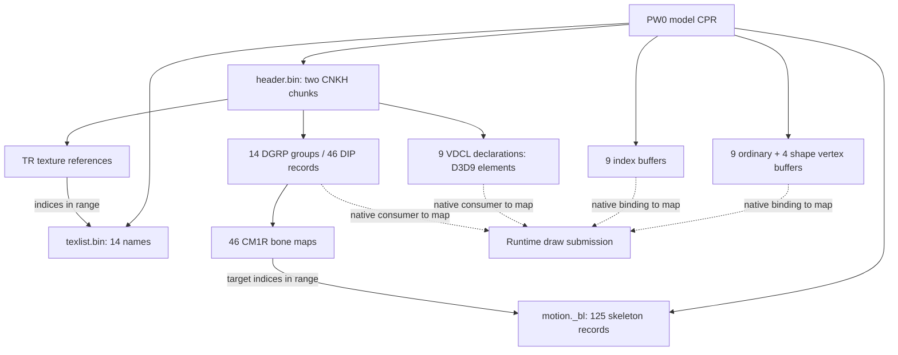

# Model data: first PC layout map

Updated October 22, 2026. [Architecture](../ARCHITECTURE.md) ·
[Research report](../../reports/2026-10-22-cavia-community-research.md).

## Evidence and scope

The Noesis Bullet Witch source supplies console-era format interpretations.
Our [bounded comparison](../../evidence/community-research/pw0-noesis-comparison.json)
checks the Steam PW0 model and identifies PC-specific declaration encoding.
Counts and file containment are verified; runtime consumers and rendered behavior
remain to be connected.

## PC vertex declarations

VDCL has a four-byte prefix followed by eight-byte records matching
[Microsoft's D3DVERTEXELEMENT9](https://learn.microsoft.com/en-us/windows/win32/direct3d9/d3dvertexelement9).
All nine declarations terminate with `(255, 0, 17, 0, 0, 0)` and preserve remaining
padding in the evidence. The console source's twelve-byte element interpretation
is not valid for this PC member.

First declaration, ordinary vertex buffer 0, stride 40 bytes:

| Byte offset | D3D type | Usage/index as stored |
|---|---|---|
| 0 | FLOAT3 | POSITION / 0 |
| 12 | SHORT4N | NORMAL / 0 |
| 20 | SHORT4N | TANGENT / 0 |
| 28 | FLOAT16_2 | TEXCOORD / 1 |
| 32 | UBYTE4 | BLENDWEIGHT / 0 |
| 36 | UBYTE4N | BLENDWEIGHT / 1 |

Types follow [D3DDECLTYPE](https://learn.microsoft.com/en-us/windows/win32/direct3d9/d3ddecltype).
The last two usage labels are preserved exactly; the console reader interprets
corresponding byte vectors as bone indices and weights. Confirm PC shader usage
before assigning that semantic meaning conclusively.

## Other recovered metadata

- VFX2/CNKH framing and nested group lengths remain useful across versions.
  Little-endian integer FourCCs reverse many on-disk labels (`LCDV`, `PRGD`);
  not every magic/name follows the same string convention.
- `motion._bl` retains `_BLB`, count, and 104-byte bone records. Parent indices
  are checked. The console source describes relative and absolute quaternion /
  translation / scale data; transforms still need PC rendering verification.
- TLST has fourteen 36-byte records following its eight-byte header. Texture
  references include BTX0, NMAP and AMOC. The console importer assigns BTX0 to
  base texture and NMAP to normal texture; AMOC's PC shader role remains open.
- DIP records contain six integers; retain raw fields until index ranges and
  base-vertex behavior are verified against the associated buffers.
- Noesis contains no native `_ba` motion decoder. Procedural test animation is
  separate from recovering the game's animation format.

Next: follow the native consumer connection below through index/vertex associations,
actor ownership, animation sampling and skinning contracts. PW0 rendering is deferred.

## Native consumer connection — engine pass 02

[Resource dispatch](resource-dispatch.md) now resolves `vfx2.mesh.create` to
`0x419320` and `vfx.motion.create` to `0x418900`. The mesh handler constructs
runtime skeleton transforms and attaches vertex/index/shape references. Motion
loading reaches pointer-fixup routine `0x41d570`. Continue documenting drawing,
actor ownership and sampling before the separate rendering milestone.

## Runtime consumers — engine passes 04 and 05

The [actor lifecycle](actor-lifecycle.md#model-pose-and-weapon-attachments) connects
model **0x5e37f0** to motion advancement, controller preparation and **0x5e5220**,
which invokes pose evaluation **0x423d20** and finished-track cleanup **0x423b40**.
A weapon child **0x56b610** reads the resulting bone transform through **0x56ab10**.
The parent-before-child hierarchy walk establishes the order for this actor/model
branch. Motion-event channels are a separate consumer after pose evaluation.

[Model particles](particle-runtime-contracts.md#animated-model-particles-and-the-shared-engine)
share the pose evaluator. Exact codecs at **0x429fe0 / 0x4299b0**, blend arithmetic,
additional pose passes and buffer/material/draw ownership remain open. Mapping
these consumers does not yet establish rendered output or visual equivalence.
