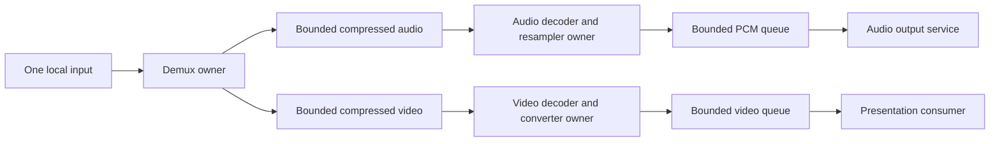

# Movie demux and decode design study

Status: the decoder/PCM transport below is implemented; native audiovisual
acceptance remains a separate gate. The prior mixed decoded FIFO is replaced
by independent demux/codec owners and timestamped PCM transport. See the
[complete player redesign](../../../docs/video-player-redesign.md) and the
[implemented decoder contract](../../../docs/video-decoder.md).

## Established implementations

The primary algorithm reference is [FFmpeg ffplay, tag n7.1.1](https://github.com/FFmpeg/FFmpeg/blob/n7.1.1/fftools/ffplay.c).
The locally inspected source SHA-256 is
`c1df35454edb188735acb5c63217284dd9949f822f0b206aea9eb163ac207b6f`.
This is source-level algorithm study; no reference implementation source is
being copied into the engine.

| Source functions | Observed contract | Proposed adoption |
| --- | --- | --- |
| `read_thread`, `packet_queue_put`, `packet_queue_get` | One demux owner routes reference-owned compressed packets into independent stream queues. Queue publication transfers ownership. | One input context, separate compressed audio/video queues; preserve packet order within each stream. |
| `audio_thread`, `video_thread`, `decoder_decode_frame` | Independent codec workers drain receive output before obtaining more packets. One slow decoder does not execute on the other decoder's thread. | Separate audio/video decode owners, with separate frames and conversion contexts. No decode or demux work on render or audio device callback. |
| `frame_queue_peek_writable`, `frame_queue_push` | Bounded decoded queues independently stop their producers; default video queue is three slots, audio nine slots. | Small independent decoded queues; retain interleave in compressed form. Capacity must also account for bytes and in-flight storage. |
| `stream_has_enough_packets`, `read_thread` | Demux throttles when all streams have enough packets, or aggregate compressed queue size exceeds 15 MiB. Enough means more than 25 packets and either unknown duration or more than one second. | A stream's healthy queue alone must not stop demux while another stream needs input, unless the actual resource budget is exhausted. |
| `packet_queue_put_nullpacket`, `decoder_decode_frame` | Demux EOF places a drain marker after each stream's queued packets. Decoder completion is distinct from demux EOF; decoded queues can remain nonempty afterward. | Separate demux EOF, per-codec drain, converter drain and consumer completion. |
| `packet_queue_abort`, `decoder_abort`, `stream_close` | Abort wakes queue waiters; decoder owners are joined before queues/contexts are destroyed. | Cancellation reaches every wait; joining is part of synchronous owner destruction. |

The 15 MiB ffplay value is a **soft demux watermark**, not a hard total-memory
bound: the check precedes the next packet read, its packet FIFO auto-grows, and
codec/reference frames, decoded queues and output storage lie outside it. Copying
that constant does not establish bounded engine allocation.

A second inspected reference is Unreal Engine commit
`f45729c0b6f097038e72b52d366a62baeca3275b`:

- `Engine/Source/Runtime/MediaUtils/Private/MediaSamples.cpp`,
  `FMediaSamples` constructor and `FetchAudio`: distinct stream queues and
  time-range-aware consumption.
- `Engine/Source/Runtime/MediaUtils/Public/MediaSampleQueue.h`,
  `TMediaSampleQueue::Enqueue`: a locked producer operation checks its queue's
  configured sample limit and returns failure without pushing when full.
- `Engine/Source/Runtime/MediaUtils/Public/MediaSamples.h`: defaults of four
  queued video and four audio samples, with independent `CanReceive*` methods.

These support the same separation and explicit admission boundary. Their exact
sample limits and clock policy are not automatically suitable for this engine.
The private source checkout stays ignored; no Unreal code is reproduced here.

## Independent packet evidence

An independent system `ffprobe` read-only trace, separate from the authored
Decoder, inspected every packet of four purchased assets. Command shape:

```sh
ffprobe -v error -show_packets -show_streams \
  -show_entries packet=stream_index,pts_time,dts_time,duration_time,size,pos:stream=index,codec_type,codec_name,time_base,start_time,duration,width,height \
  -of json "$MOVIE_PATH"
```

Ignored raw traces, asset hashes, tool version, analyzer and full summary live in
`research/evidence/reconstruction/native-startup/packet-interleave/`.
The actual company playlist is `marvelousLogo.ssu`, then `xeedLogo.ssu`.
The other two assets extend the observation corpus; they are not that playlist.

| Asset | Video packets before first audio | Their compressed payload | Last prefix video PTS | Largest consecutive video run by count | Largest consecutive video run by payload |
| --- | ---: | ---: | ---: | ---: | ---: |
| marvelousLogo | 45 | 145,504 B | 1.835 s | 45 | 145,504 B |
| xeedLogo | 50 | 75,450 B | 1.633 s | 50 | 75,450 B |
| witchLOGO | 32 | 381,319 B | 1.033 s | 32 | 381,319 B |
| advertise | 41 | 6,682 B | 1.333 s | 67 | 3,104,359 B |

Advertise's largest byte run contains eleven packets; its largest count run has
67 packets but only 125,689 bytes. The largest single packet in this corpus is
459,918 bytes. Byte and descriptor-count limits solve different problems.

These are compressed packet-order measurements, **not** decoded-frame queue
peaks, exact PCM coverage, packet-to-frame cardinality, or playback verification.
In particular WMAPro produces multiple sample frames from a packet and carries
sparse timestamps; packet PTS differences must not create PCM silence. See the
separate ignored `audio-timeline/` evidence. Maximum consecutive runs also do not
bound the total compressed backlog: the consumer rate and playback clock affect
how many earlier runs remain queued.

The initial prefixes directly explain the old failure: asking one mixed decoder
for enough audio first materializes dozens of future BGRA frames. The bounded
video FIFO then stops the only worker that could reach more audio. Compressed
routing keeps those prefixes small without increasing decoded-frame capacity.

## Proposed boundary and ownership



A session owns the demux worker and its two stream workers; an absent audio stream
has no worker. Demux alone uses the input context. Each codec context, scratch
frame and converter belongs to exactly one stream worker. Queues transfer owned
packet/sample leases. Metadata needed by the workers is copied or otherwise made
immutable before they start. FFmpeg types remain private.

The portable surface exposes independent nonblocking video/PCM reads and
stream status, not a single next-variant FIFO. Results distinguish `pending`,
`sample`, `end`, `failed` and `cancelled`. End is stable and is visible only after
that stream's queued output has been consumed. Failure and cancellation are
terminal states, never aliases for EOF. Native audio service consumes PCM
independently of game/render tick. A single worker selecting `next(video)` or
`next(audio)` is rejected: long video decode would still delay PCM production.

Each stream receives one ordered end marker after demux EOF. It consumes all its
packets, sends the codec's drain input once, receives until codec EOF, and drains
its converter. Audio completion includes the resampler tail. None of these events
means the audio device finished playing or the final video frame was presented.
That final completion belongs to the player/output contract.

## Hard bounds and progress

Resource policy must name, independently:

- Compressed payload bytes and packet descriptors, per stream and in aggregate.
  Account packet side data, descriptor storage and one admitted demux staging
  packet; a payload-only counter is not a total memory counter.
- Single-packet admission maximum; reject a packet that cannot fit the configured
  budget rather than allocating beyond it.
- Decoded video slot/byte limits, PCM frame/byte limits, and each worker's one
  in-flight conversion result. Reserving output capacity precedes conversion.
- Codec reference/scratch memory, resampler/converter working storage, native
  audio buffers and GPU-retained samples. FFmpeg's internal allocations remain
  explicitly external until a real allocator adapter exists.

Use ffplay's separation and throttle rule, but depart from its growing FIFO with
fixed descriptor storage and hard accounting. A reviewed resource profile may
start from its 15 MiB compressed watermark; this study does not certify that
number or choose per-stream/count limits from logo sizes.

Normal pressure blocks only the affected producer. Demux can continue routing
while a stream has output backpressure **if compressed capacity remains**. It
must never discard compressed reference packets merely to reach the other stream.
No general finite bound can support arbitrarily non-interleaved input without
rejecting, dropping, spilling or seeking. The initial implementation should
explicitly reject excessive interleave, with queue/budget diagnostics, rather
than silently selecting the other policies.

Priming and rebuffering need an explicit progress check in the reviewed player
state machine. If the clock is held, a required stream lacks its start/resume
coverage, demux is blocked on the other stream's exhausted capacity, and that
stream's decoder cannot release capacity because its output is full, waiting
cannot repair the condition. Once no in-flight operation can change it, report
`interleave_budget_exhausted` and cancel all workers. A timeout is not the proof
of this cycle. During ordinary playback capacity pressure can wait while device
consumption advances; if playback enters rebuffering, reevaluate the same cycle.
Short input that reaches EOF below the nominal prebuffer target must start with
its available samples or end cleanly, not wait for an unreachable threshold.

Cancellation wakes packet and decoded-output waiters. Join demux and codec owners
before releasing the queues and context storage; no detached workers. File-I/O
interruption and in-flight codec duration limit stop latency and must be reported
honestly rather than claiming immediate cancellation.

## Design guidance and acceptance

Design-phase MCP consultation read Core Guidelines `CP.26` in full: scoped joined
workers own their resources through cancellation. Performance `COPY.2`
(`guidelines/copy-move/COPY.2-mark-move-constructors-noexcept.md`) was read in full:
packet/sample ownership moves must be honestly nonthrowing, with no implicit
payload copies on queue transfer. The search also returned `WASM.9`; its full
rule reinforces bounded streaming, but its browser-specific platform arguments
are not being adopted as native requirements. Implementation-phase consultations also read CP.42/CP.43 and performance
CONC.5/MEM.9 in full: cancellable predicate waits, short queue locks, fixed PCM
capacity and single-producer/single-consumer index publication.

Review with the complete player architecture before implementation. Acceptance
must show both actual company movies, continuous complete audio, the visible
final frame and correct device drain. Queue byte/count peaks, underflow events,
clock progression, stop latency and codec timings should be measured on that run.
Exercise a bounded pathological interleave rejection and cancellation during
backpressure in process. Those checks complement actual playback; they cannot
substitute for it.


## Implemented PCM handoff and timestamp decision

The callback path uses a fixed PCM ring plus fixed timestamp-segment descriptors.
The concrete additional reference is [Godot 4.5 AudioRBResampler](https://github.com/godotengine/godot/blob/4.5-stable/servers/audio/audio_rb_resampler.h),
`get_writer_space`, `get_reader_space` and `write`: separate read/write positions,
fixed PCM storage and bounded producer writes. Our helper is narrower: conversion
already belongs to the worker's swresample context, so importing another engine's
resampler/type dependencies would duplicate that responsibility. It uses the
same SPSC ownership algorithm with explicit acquire/release batch publication.
PCM read stops at a timestamp segment boundary and never frees sample objects.

Audio timestamps now follow ffplay's explicit-frame-PTS/sample-fallback rule,
rather than normalizing every sample to a globally linear origin. Ring segments
preserve the source timestamp changes while PCM waveform samples stay consecutive.
No corpus-derived offset is fitted. This supersedes the earlier continuous-origin
recommendation in ignored audio-timeline research. Exact limits, failure policy,
callback lifetime and numerical verification are in the implemented decoder
contract linked above. No backend unit or headless result proves native playback.
