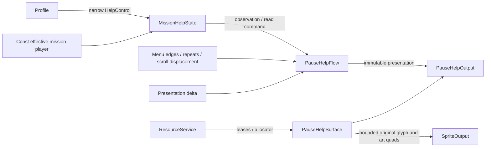

# Native gameplay Help

Help is an original native pause child, not a Lua-authored screen or a developer
controls overlay. Its art and all 33 localized entries come from the purchased
Steam data. This reconstruction retains learned-topic admission, unread markers,
list selection, explicit reading, paragraph scrolling and entry/exit animation.

## Source and assets

The hash-bound unpacked Steam executable provides the evidence. Analysis uses
existing Ghidra exports, `research/tools/native_trace.py` for instruction checks,
and `engine_image.py` for constant tables. No raw decompiler output or extracted
text is copied into tracked files.

| Original boundary | Reconstructed responsibility |
| --- | --- |
| `4dc650` | Request `sprite.help` and `sprite.text.hlp2` |
| `4dc700` | Enumerate topic IDs 0–32; topic zero always admitted, other entries require learned bits |
| `4ddea0` | Menu input, list/read states, supplied presentation delta and independent presentation channels |
| `4de6c0` | Select body and compute scroll limit: `max(lines − 12, 0) × 40` |
| `4de7b0` | Mark the original topic ID read |
| `4dc9e0` | Original panel tracks, category plates, topic text, unread art and paragraph line fades |
| `572430` / `572660` | Source scalar channel setup and update; shared damped-response math |

`Record` bytes `0x1c–0x23` hold learned flags; bytes `0x24–0x2b` hold read flags.
The two words cover the 33-topic range. The existing profile owner retains every
unrelated byte and persists through its normal save path. Ordinary saved
concept entry uses those exact flags. The explicit
development-completed entry needs a separate effective Help context, described
below; it does not alter permanent learned flags.

The Help CPR contains images 65–76, 449 and 450: comment panel/backgrounds,
scrollbar pieces, list plates and unread/category art. Image 400 is the original
system footer. Font metrics and packed-channel coverage come from `sprite.font`.
`hlp2` stores topic records with separate title and description groups, each with
language children; English has language ID 200. It uses full-width Latin,
punctuation and Greek glyphs, color tags and inline controller-icon tags.

The existing validated `formats::TextTable` traverses that tree. The surface
prepares Unicode glyph quads and inline icons once, retaining the original
strings through resource leases. It fails on unsupported tags or missing glyphs
instead of replacing content with an authored help page. Default Xbox icons are
resolved from the original input icon pack: movement/camera sticks, buttons,
triggers and the LB-plus-RB magic chord. Logical `<kico>` markers resolve copied active input bindings; literal `<ico>`
markers retain authored controller artwork. The full source trace below records
the corrected keyboard/remapping boundary.

## Ownership and timing

`HelpControl` can copy availability/read state and mark an already available
topic read. It cannot unlock topics, purchase upgrades, load/save files, change
settings or mutate world state. The mission Help owner composes its observation
with the explicit entry context. Profile and the player remain stable and
outlive that owner, which in turn outlives the flow. The
coordinator receives only `PauseHelpOutput`; the application retains surface
resource acquisition and release authority.

Entry and exit consume input until the longest original sprite track finishes
at 1.15 seconds. List navigation uses original repeated up/down and page keys,
with page steps of five. Confirm enters reading and marks the topic read. Either
confirm or cancel returns from reading to the list; cancel from the list exits.

List translation, description scroll and reading focus retain independent
source presentation channels. Their damping durations are 0.075, 0.16 and 0.04
seconds. Highlight and selection intensity retain the source periodic/linear
responses. Paragraph scroll accepts a supplied displacement: original input
multiplies its pad component by 16 before adding to the target. The flow neither
samples wall time nor advances world time. Description content retains 40-pixel
line spacing and the source 20-pixel fade at the visible boundaries.

## Verification

An in-process test exercises the real Profile owner with in-memory storage:
only topic zero on a fresh profile, unavailable read rejection, filtering across
the second flag word, original navigation and reading states, bounded scrolling,
read-marker persistence, repeat-read idempotence and invalid-input atomicity.
Compile-time contracts exclude unrelated mutation through HelpControl.

A read-only installed-content probe prepared every original English title and
body, including every markup/icon/glyph, then submitted each topic at every
20-pixel scroll position with all 33 topics available. Original bodies range
from four to 53 lines. The measured peak was 403 sprites, below the existing 511
command bound, with 30 resident textures. End released all acquired textures.
This verifies content decoding and bounded submission, not native visual parity;
the normal pause walkthrough remains the visual acceptance check. Probe source
and output remain ignored under `research/evidence/native-pause-help/`.

Both header and implementation design consulted Core I.1 and C.9 (explicit
interfaces and restricted access), and performance MEM.9 (allocate at setup).
The surface uses the resource service memory domain; preparation handles Unicode
and resources, while per-frame emission uses retained quads and fixed storage.

A subsequent non-visible resource switch probe retained the real HUD surface
through root, Help, Options, costume and back. Texture counts were respectively
62, 78, 71, 88 and 62; closing pause returned to the HUD's 48, then closing HUD
returned to zero. This used the existing Steam costume catalogs and original
resource owners, without launching the host.

The existing `startup-corpus` scenario now also drives the production mission
coordinator through those native children, checks frozen world state and
bounded residency, then exercises genuine Retire and only reports completed
teardown to the original root script after scene/audio/resource scopes end.
That scenario compiled during this subtask; its full integrated run belongs to
the parent verification gate and is not claimed by the probes above.

## Concept-entry Help eligibility repair

The one-topic walkthrough result came from mixing two profile contexts. The
host creates effective acquired weapon/spell levels for its explicit
`development-completed` concept entry, but Help received the fresh permanent
Profile directly. `4dc700` correctly filtered that fresh learned bitset down to
topic 0. There is no original concept-mode bypass in the Help task. Changing the
menu to display every topic would hide this ownership error.

The original `_SetHelpFlag` binding (`47c240`) sets learned bits. Campaign scripts
supply startup topics 0–4, 6 and 7; stage 1 completion adds 5, 8, 21, 23–25 and 30; stage 2
completion adds 19, 20, 22 and 26; stage 3 completion adds 27–29 and 31; stage 6 grants 32.
Story acquisition scripts grant 15–17 alongside their corresponding spells.
Stage startup and native first spell purchase (`4d74f0`, table 9621ac) grant 9–14
only for acquired optional spells. The inspected grant corpus and native table
do not grant 18; the development fixture therefore does not invent that topic.
These are source-derived inputs to the existing authored development context,
not a claim that every possible completed save has identical flags.

`MissionHelpState` is the mission owner for that effective context. It borrows
the stable player state as const and the restricted permanent `HelpControl`.
Each observation reads Profile again, preserving future script-learning
visibility, then merges campaign fixture topics and acquired-ability topics
only for `ProgressionOrigin::development_completed`. Ordinary saved/campaign
contexts expose exactly the saved learned flags. Read commands delegate to
Profile for genuinely learned topics; reads of inherited-only topics remain in
a fixed mission-local array. Nothing unlocks or persists the development
fixture. PauseHelp receives only this owner's observation/read interface.

The source list/reading interaction remains unchanged: Up/Down selects a topic
in list mode, Confirm opens it, and Confirm or Back returns to the list. In
reading mode the fixed UI stick/wheel axis scrolls paragraphs. The UI is not
replaced with a new navigation design to compensate for missing eligibility.

Regression verification exercises the production Help flow with a fresh saved
profile and effective completed mission: 32 source-granted topics, topic 18
still unavailable, read-to-list return and continued selection, no saved Record
byte changes, and live ownership transfer when a topic is later genuinely
learned. Saved-profile entry retains its exact learned flags. The runtime
contract suite and scoped fatal clang-tidy passed after this repair; the parent
integration gate and native walkthrough remain separate checks.

## Full original content chain

The source pause constructor `4cc800` creates Help through `4dc540` and retains
that child at owner field `+0x144`. Pause update `4cd020` selects state 1000 for
row zero and starts this child through its task interface. Lua does not build
these Help rows, panels or paragraphs. Its role here is supplying learned flags
through `_SetHelpFlag`; the native child owns presentation and input.

`4dc650` requests `sprite.help`, then `sprite.text.hlp2`. The installed stable
catalog resolves these to `sprite/help/help.cpr` and `sprite/text/hlp2.cpr`.
The text archive contains one `USER` payload, `hlp2.bin` (165,440 bytes), with
an `STMANAGE` tree. It contains 37 numbered entries (0–36), each with title/body
groups and language children. This is distinct from the native Help task's
33-topic admission range: `4dc700` intentionally enumerates only 0–32.
The reconstruction likewise ignores 33–36 for this menu; those extra strings
do not justify adding rows absent from the native task.

`4dc9e0` resolves each admitted title using `412000(0, topic * 2)` and selected
body with `412000(0, topic * 2 + 1)`. `412000` indexes the active language in a
six-language pointer table. `4de6c0` calls `4bb470` to count the original body's
newline separators, then applies the twelve-line visible window. Body drawing
splits the same original text at newlines, passes each line to the native text
renderer, and applies paragraph position/edge alpha. Title drawing uses the
same renderer with centered positioning and shadow. The reconstructed English
path resolves language ID 200 from the retained asset tree; it does not contain
substitute topic titles or descriptions.

The Help art archive has an ID payload and 14 images: comment backgrounds,
list backgrounds, default/focused/selected/category/unread plates, and three
scrollbar pieces. The words of each paragraph are not baked into those images.
`PauseHelpSurface` acquires this art, `sprite.font`, the Help localization, and
system localization for Confirm/Back. Its `english` lookup retains views into
resource leases; `shape` turns the original words into purchased font glyphs.
`MissionPauseSurface` prepares that real surface and supplies its line counts;
`MissionInteraction` starts `PauseHelpFlow` from the effective mission Help
owner and publishes the selected original topic ID back to the same surface.
The full coordinator corpus now exercises this chain with completed-context
eligibility and inherited-topic reading/navigation. Passing source review or a
helper test does not establish that the native walkthrough has passed.

### Demonstrated inline-icon boundary

The text parser `4ba9a0` distinguishes literal `<ico key_...>` artwork from
logical `<kico ...>` actions. Logical actions select an action descriptor;
`4ba3e0` draws it through `472650` and `472270` using mode zero. `472dd0` rebuilds
the actual keyboard/controller icon bindings. Thus remapped controls and the
active keyboard/pad device can change logical icons without changing words.
The earlier surface incorrectly shaped logical tags to default Xbox icons at
preparation. `HelpInputIcons` now resolves the six logical actions present in
the active corpus from the same copied settings/device observation used by
game input. Framework snapshots settings once; MissionInput and the Help
presentation carry values only. The surface prepares semantic markers once,
substitutes each bounded icon run during emission, adjusts following glyphs by
the original measured advance, and resets displacement at each newline. It
does not reshape or allocate per frame. Unsupported logical tags fail; literal
controller-art tags remain unchanged.

`input_icon` shares the existing controller-surface physical-code lookup and
149-icon atlas packing. Each surface uploads one icon atlas during preparation
and owns its release. The Help view therefore does not consume 149 renderer
texture slots. Native draw pitch preserves the scale-pivot transform separately
from text measurement: at Help size 32, rectangle scale is 0.933333993/3 and the
pivot stride is 64×0.933333993; keyboard text advance remains 128/3 per icon plus
32/15 trailing space. Remapped keyboard runs deduplicate keys and omit the
original unassigned code. The installed Help archive has only six logical
actions among active topics; no guessed support is added for other tags.

Read-only evidence is organized under passes 258–261 and the ignored
`native-pause/help-content-inventory.json`. That inventory records IDs, group
names, byte/line counts, markup tags and the archive hash without copying the
localized paragraphs into tracked documentation.

Inline-icon regression coverage checks default keyboard and pad observations,
remapped fire bindings, keyboard deduplication/unassigned bindings, and malformed
copied runs. The purchased-content coordinator fixture changes only its copied
logical binding snapshot while Help stays resident: topic zero's W/S/A/D run
adds three quads over the single pad movement icon, without texture uploads or
resource switching. This fixture also retains the completed-context and
read/back/navigation checks above. Runtime tests and scoped fatal clang-tidy
passed; the newly strengthened full corpus is left to the parent integration
gate, and actual native rendering remains a separate acceptance check.
