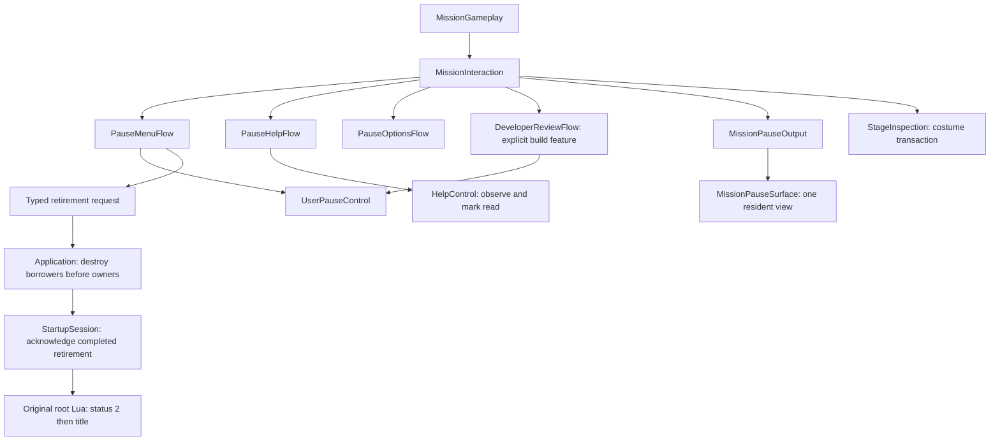

# Native gameplay pause menu

Status: accepted after the native pause, Help, settings and mission-reentry
walkthrough, including the final live-costume retention check. The HUD was
accepted separately. Post-result Power Up is included in the commit as WIP,
not accepted behavior. Future debug UI remains design only.

The captured native failure is `Invalid sprite geometry or color`. Opening a
restart/Return confirmation publishes dialog progress zero before any mission
command. The shared authored expansion then has equal top and bottom bounds;
Pause and Options submitted that zero-height fill to an output that requires
positive-area rectangles. Their surfaces now omit the collapsed fill, matching
the controller-dialog adapter, while retaining the original expansion and
renderer validation. This is a presentation-contract failure before teardown,
not evidence of a failed world reload. The original-content fixture now rejects
nonpositive destination areas; the subsequent native walkthrough confirmed
reload and pause. The standalone unaccepted Power Up dialog has the
same submission omission and remains outside this pause repair.

After the dialog, mission Help context and logical-icon repairs, the complete
repository gate and original-content corpus pass. The corpus now rejects
nonpositive sprite areas and exercises the real mission coordinator/Help
surface with inherited topics, read/list navigation and copied keyboard/pad
icon changes. Logs are `native-pause/help-final-check-all.log` and
`native-pause/help-final-corpus.log` under reconstruction evidence. These remain
controlled-output checks. The user subsequently confirmed native Stage Start,
Return and Help, then confirmed outfit retention across reentry.

## Source boundary

The native pause task is constructed at `4cc800`, activated at `4cc9b0`, updated
at `4cd020`, and drawn at `4cca40`. Its six authored entries are Help, Options,
Return (checkpoint), Stage Start, Retire, and Exit (resume). The sprite identities
and original positions come from the executable table at `836cc8`; the original
art is in `sprite.pauseMenu`. The task uses supplied renderer elapsed time while
the world remains paused. Opening lasts through 1.4 seconds; exit animation uses
0.6 seconds. Navigation and highlight animation belong to this task.

Help is the native topic task (`4dc700`, `4ddea0`, `4dc9e0`), not a replacement
controller cheat sheet. The original always admits topic zero, and reads the
remaining 32 topic unlocks from learned-topic flags. In-mission Options calls
`4d6560(1)` and restricts navigation to rows 1–7: subtitles, BGM, SFX/voice,
controller configuration, brightness, autosave, and Exit. The earlier approved
costume switch remains an intentional addition inside Options.

The checkpoint/restart/retire commands are distinct. Confirmations `sys.0005`,
`sys.0006`, and `sys.0007` precede setting root command bytes through `43c500`,
`43c510`, and `43c4f0`. Root `43eea0` consumes these commands only after mission
teardown. A real checkpoint and world restart cannot be reconstructed by moving
Alicia to the existing placement shim. Their absence must be visible, not a
successful callback or silently enabled inert row.

Retire is implementable independently: after actual mission resource teardown,
the root observes status 2. Its unchanged `concept_mission` Lua route waits,
stops music, unloads the concept mission, reads status, and returns to title.
Status 1 (mission success) is never synthesized for this route.

Raw exports remain ignored under `research/evidence/engine/pass-105-pause-menu/`,
`pass-menu-03/`, and the earlier progression/profile source exports. New witness
data belongs in `research/evidence/reconstruction/native-pause/`.

## Ownership contract

- `PauseMenuFlow` owns normal pause navigation, animation phase, confirmations,
  and typed operation requests. It receives only `UserPauseControl`, supplied
  presentation seconds, and copied operation availability. It cannot mutate
  world time, progression, resource values, or script-pause state.
- `PauseMenuSurface` retains original root artwork and submits copied transforms.
  It owns no action policy and never opens files or uploads during ordinary draw.
- Native child owners handle Help and Options. Existing costume replacement
  remains the explicit transactional mission operation, without a profile write.
- `MissionInteraction` arbitrates normal pause, child operations, and an explicitly
  separate developer view. `MissionGameplay` supplies presentation timing and
  publishes the chosen output after the admitted simulation frame completes.
- Application composition retires resources in borrower-before-owner order and
  reports completed mission retirement to the root service. It does not interpret
  menu row numbers, select spell behavior, or mutate the HUD.

The established pause/input reference remains Unreal revision
`f45729c0b6f097038e72b52d366a62baeca3275b`,
`PlayerController.cpp::SetPause`, `ProcessPlayerInput`, and `TickActor`, inspected
for the earlier pause ownership implementation. Native recovered behavior takes
precedence over importing Unreal's networking/GameMode machinery.

## Developer build boundary

Normal builds expose only gameplay pause. `BW_DEVELOPER_VIEWS` retains the
explicit build-time diagnostic separation; capture mode is not a feature flag.
The initial debug-system design is recorded separately in
`docs/architecture/developer-tools.md`. Detailed UI and activation controls have
not been approved; this slice implements no debug interface.
The speculative F1 entry and automatic status overlay have been removed from
active code. Existing diagnostic controllers remain preserved for that design;
the exact held interface patch is ignored research evidence, outside pause
acceptance. No new shortcut or developer menu is part of this slice.

## Verification contract

Check normal pause/open/close timing, confirmation cancellation, rejected missing
world operations, resource/pause retention, costume transaction, actual retire
and title re-entry. Verify original artwork on the native renderer and make
developer-build/normal-build differences explicit. Full repository checks and
independent responsibility/ownership review precede delivery. Passing synthetic
navigation tests alone does not establish original presentation or real routes.

Both C++ corpora were queried during design. Core I.1/C.9/I.11 require explicit
operation requests and narrow borrowed authority; E.4 preserves owner invariants
on rejection. Performance MEM.9 confines texture/label construction to bounded
activation and uses fixed steady-state menu storage. Implementation consultation and the current operation inventory
are recorded below.

## Accepted operation inventory and remaining gameplay boundaries

| Operation | Current implementation | Remaining boundary |
| --- | --- | --- |
| Pause / Exit | Authored root, entry/exit motion, shared native UI cues, one user-pause authority | Native walkthrough accepted |
| Help | Original 33 topics, learned/read flags, controller icons, markup and scrolling | Read flags remain dirty Record data until the original broader save boundary; closing Help does not save |
| Options | Live settings through Profile/DeviceOptions capabilities, entry rollback and original save/discard prompts | File failures preserve edits and offer the original retry dialog |
| BGM / SFX | Live music and effects/voice gains on the prepared audio runtime; movie gain follows BGM | Actual mixed PCM verifies scalar and pause domains; future unadmitted DSP tails remain outside current corpus |
| Controls | Original keyboard/gamepad/camera children; physical capture, duplicate swaps, default restore, inversion and source sensitivity | Vibration producer belongs to future gameplay force-feedback events; no fabricated rumble |
| Subtitles / Autosave | Original System flags, settings persistence, autosave-driven Options save admission | Current scene has no dialogue/subtitle producer or real world checkpoint writer; these future consumers must read the same authority |
| Brightness | Original calibration artwork and return | The source is a calibration card, not a renderer exposure slider |
| Costume | Approved addition; transactional replacement, existing costume retained on failure; committed appearance carried across reentry | Not an original in-mission entry or permanent profile change; a new title-menu mission still uses its front-end selection |
| Retire | Default-No confirmation; full borrower/resource teardown before root status 2 and title | Current concept route skips original campaign retirement checkpoint save |
| Stage Start | Full mission teardown and fresh composition, root wait remains suspended | Future mission entities/callbacks must participate in the same lifecycle |
| Return | Current checkpoint-zero scene performs the source fresh-entry path with full teardown | Imported/nonzero world checkpoint restoration remains unavailable until actual capture/restore owners exist; no placement-only reset |

The original common yes/no task is reconstructed once as `MenuDialog`. Root,
Options and controller settings share its input gate, selection, close timing,
UI sounds and panel geometry. Operation policy stays in each caller. Options
captures the original System bytes and device settings at entry; horizontal edits
are live, Back asks to discard (default No), Exit saves or asks according to the
original autosave flag. Start follows that same exit/save route from any row;
ordinary Confirm remains row-specific. Navigation precedes horizontal editing,
reset, Confirm, Start and Back as in the original receiver. Reset applies only
to subtitle/music/effects rows. System-only saving never flushes unrelated Record data.
A restore after a partially successful save marks System dirty again rather than
forgetting the discrepancy between live and persisted bytes.

Supporting source and verification details:
- [Menu audio](native-pause/menu-audio.md)
- [Controller configuration](native-pause/controller-options.md)
- [Mission reentry](native-pause/mission-reentry.md)

## Presentation and resource lifetime

`MissionPauseSurface` owns the native root, Help, Options and controller surfaces and borrows
the existing costume/developer surface. It activates one view at a time, retires
its prior submission before releasing textures, and prepares the next view at an
explicit resource transition. That transition reports a host-clock rebase instead
of charging synchronous setup to world simulation. No resource publication or
file access occurs in ordinary presentation calls.

Measured actual archive residency with the retained HUD is 62 textures for root,
78 for Help and 88 for costume; Options adds the original dialog button,
and controller artwork is packed into a bounded atlas. Expanded controller preparation
measured 80 textures with retained HUD/root; Options with current prompts and
acknowledgment buttons measured 90, below the 128-slot native table.
Closing pause leaves the HUD's 48 textures; retiring HUD leaves zero. Help's full
English corpus peaks at 403 submitted sprites under the existing 511 limit.
These measurements establish bounded residency, not end-to-end native gameplay
acceptance.

## Verification record

The final full repository gate passes: six CTest targets, 223 fatal clang-tidy
compile commands, Google formatting and the content guard. The last shared
prompt correction was rebuilt and all six targets rerun successfully; its
resolver and tests also passed focused fatal lint. Normal build configuration
is explicitly `BW_DEVELOPER_VIEWS=OFF`.

The full existing original-content startup corpus passes, including native
pause Help/Options/costume/Resume, world freeze, resource retirement and the
original root's return to title after Retire. Its renderer and service terminals
are controlled fixtures; this is not native playback or image equivalence.
All migrated CPU allocations retire to zero after the corpus teardown.

Fresh independent review traced the complete input/settings/audio/transition
ownership paths. It found and closed Start/Confirm policy, reset applicability
and prompt scale-pivot errors. See [the review](native-pause/independent-review.md).
The corrected native controller footer is inspected. Actual original-art probes
cover 33 controller rows and 242 transition frames with zero retained resources;
real mixed PCM checks verify live gains and world/presentation pause domains.

The user completed the native walkthrough and accepted the pause slice,
including Help/navigation, Options, Stage Start/Return and retained live costume.
The complete repository gate also passes after the costume handoff correction
(`native-pause/costume-reentry-check-all.log`). The genuine future gameplay
boundaries above remain explicit; acceptance does not manufacture their owners.

Implementation consulted both corpora separately: Core E.4/E.6 protects checked
transitions and teardown, I.1 keeps observations and operation capabilities
explicit, and performance MEM.9 retains fixed frame state. Provenance and logs
remain under ignored `research/evidence/reconstruction/native-pause/`.
