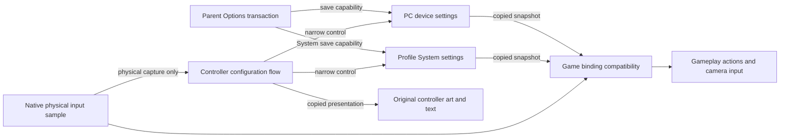

# Native controller configuration

## Original behavior and reconstructed ownership

The PC Options controller child is `TaskKeyConfig`, constructed by `4dfbc0`,
prepared by `4dfde0`, activated by `4dfec0`, updated by `4e15c0`, and drawn by
`4dff10`. The neighboring `4df570` child is brightness calibration; it is not
controller configuration. The controller child requests `sprite.keyconfig`.
The reconstruction follows this native task rather than a Lua menu.

The five original tabs are keyboard/mouse, gamepad, miscellaneous, defaults,
and exit. Keyboard has 17 action rows, gamepad 11, and miscellaneous five:
vertical inversion, horizontal inversion, vibration, mouse bias and turn speed.
Navigation wraps. Selecting a binding waits for release of the activating input,
captures a physical input, swaps the displaced binding into the first duplicate
slot, then waits for release before returning to navigation. Disconnected
controllers cannot enter capture. Default and discard use the shared original
`MenuDialog` task; both initially select No. Back inside a category returns to
the tabs. Back at the tabs asks to discard changed settings. Exit retains edits
for the parent Options save/discard transaction.

`ControllerOptionsFlow` owns only navigation, capture state and entry snapshots.
`Profile::SettingsControl` is the sole authority over the original System fields.
`DeviceOptionsControl` owns the three separate PC configuration fields.
`DeviceOptionsSaveControl` can save but cannot edit; the controller child does
not receive persistence authority. Parent Options coordinates retention,
rollback and saves. All flows run on the game control thread and consume the
existing presentation interval; none reads a clock.

## Persistent compatibility

System is 72 bytes. The controller compatibility module writes only these
original fields and preserves every other byte, including unknown flag bits:

| System offset | Meaning |
|---|---|
| `0x0c` | bit 0 vertical inversion; bit 1 horizontal inversion |
| `0x10` | controller identity |
| `0x14` | 16 physical-button mapping bytes |
| `0x24` | 17 little-endian keyboard scan codes |

Identity zero uses the current device's defaults. The reconstructed native
standard gamepad uses the original XInput identity `0x028e045e` and table
`827eb0`; editing a foreign/zero identity first initializes that device map.
Unedited foreign mappings remain preserved. The original gamepad edit-slot
order comes from `83795c`, not from a new action order.

Vibration and sensitivities are **not System fields**. The PC executable stores
a 36-byte `SystemSetting` file containing window/renderer configuration too.
`410750` translates its bits into the live global configuration: vibration bit9,
mouse bias bits10–16 and turn speed bits18–24. The UI bounds both sensitivities
at 1–100 and resets them to 60; vibration defaults on.

The native port stores only these three known settings in the explicitly named
`BulletWitchDeviceOptions` sidecar through the existing atomic `SaveStorage`.
Its eight bytes are a BWIO/version1 header followed by vibration, mouse bias,
and turn speed. This is a documented native format, not an invented encoding of
unknown PC settings or unused original System bytes. Failed writes preserve dirty
state; malformed loads preserve the last accepted snapshot. The installation
remains read-only.

## Live input consumers

macOS samples neutral USB keyboard positions, mouse buttons/relative motion,
wheel direction, and positional standard-gamepad controls. It does not read
Profile or select game actions. `controller_input` translates original PC scan
codes and the saved pad map into game intentions. Menu navigation remains a
separate fixed stream so rebinding gameplay does not make the menu unusable.
The previous platform F/E/Q/T/IJKL gameplay interpretation has been removed;
the native sample leaves gameplay intentions neutral, and the game mapper is
their sole producer. The same neutral GameController button sampler is exercised
by the native snapshot regression, which then routes RS through the real game
mapper and targeting owner. Digital trigger presses use the original half-range
threshold; analog trigger magnitude remains separate.

Original keyboard defaults are W/S/A/D movement, left mouse fire, right mouse
attack, R reload, Space evade, Shift crouch, E aim toggle, middle mouse magic,
wheel down/up forward/back weapon cycling, Z/X/C spell X/A/B, and Escape pause.
Wheel impulses also publish the original fixed UI navigation masks, independently
of gameplay bindings; see the [direct source trace](menu-prompts.md#fixed-ui-wheel-input).
Keyboard magic activation and reverse cycling remain distinct intentions;
reverse cycling is not aliased to forward cycling. While the magic ring is open,
the keyboard cycle inputs navigate pages rather than also cycling weapons.
Gamepad mapping uses the original eleven remappable rows and retains analog
fire magnitude when the mapped input is a trigger.

Source `5fc3f0` multiplies stick look by `(turn_speed + 25) * .02` before the
camera's authored angular rates. Default 60 therefore supplies a 1.7 gain that
the previous reconstruction omitted. Relative mouse observations use divisor
`101 - mouse_bias`. The source suppresses minor perpendicular mouse movement
below 20 counts when the dominant axis reaches 31 counts. Source `419e20`
attenuates samples longer than 1/60 second by `(1/60) / sampling_seconds`.
The existing frame clock supplies the sampling interval; no new clock or timer
owner was introduced. Inversion is applied once in the game mapping boundary.
The camera and raised-motion consumer receive copied sensitivity observations.

## Authored presentation

The surface prepares `sprite.keyconfig`, the original Options background,
System footer/dialog artwork, the font and `sprite.text.sys`. Menu labels and
help descriptions come from `data/menu/9952`, English column; binding icons
come from `data/menu/9900` and lookup table `82da80`. The original 149 icons are
packed unchanged into one atlas to fit the existing sprite residency budget.
This changes storage, not artwork. UTF-8 arrow glyphs use the shared strict BMP
font decoder; unsupported glyphs fail instead of corrupting text.

Original descriptor tables `963190`, `963340`, `9633e0`, `963480` and `9634a8`
supply the panel positions, entry/exit times and curve types. The left title and
footer use linear tracks. The main entry panels use the source eased tangent
response with shape1; exit uses the source quintic track. Main and right-panel
reverse durations remain separate. Options fades to black over .25s before
starting the child; the child reveals over .25s. On exit it starts black fade
at .45s, completes the .25s fade at .7s, and hands back to Options for another
.25s reveal. These copied opacities are composed by the existing host draw
boundary, never by a separate wall clock. The source update epilogue advances
description and periodic curves even during child fades; the reconstructed
Options owner does the same while blocking navigation. The common dialog owns
timing and geometry.
Fixed UI prompts consume the shared source mode 2 snapshot. Keyboard confirm
is left mouse/Space and back is right mouse/left Shift; Return/Escape retain the
original keyboard augmentation. Native Start publishes bit `0x10` independently
from ordinary Confirm `0x1000`; keyboard/mouse confirmation never synthesizes
Start. The controller child itself deliberately accepts either (`4e15c0`),
while parent Options uses Start for its original Exit/save path. The reset action is fixed gamepad north/Y,
independent of gameplay rebinding. The complete original keyboard augmentation
has no reset alias, so none is invented. The source advances a scale pivot by 64 units around a fixed rectangle; at
one-third scale this becomes 42.6667 canvas pixels. The shared prompt resolver
publishes this effective pitch with the original 87.4667 two-icon text advance,
leaving 2.1333 pixels of clearance. Independent review caught the earlier mistake
of treating the pivot step as a direct canvas translation; it was not an
original overlap defect.
See [menu prompts](menu-prompts.md).

Physical capture replaces the PC executable's Win32 dialog resource 101 with an
engine-rendered prompt; it does not create a native OS dialog over fullscreen.

## Vibration boundary

The setting is decoded, editable, rolled back and persisted. Actual motor output
is not yet reconstructed. This is a gameplay boundary, not evidence that the
setting works physically: frame builder `45e130` checks configuration bit0x200,
active mission state and a per-frame effect flag; samples `5fb080`; clamps two
effect channels at .003/.005; scales to two 16-bit motor strengths; dispatches
through `41c920` and selected backend `41cb70` to XInput ordinal3; then clears
the frame flag. The current native mission has neither that effect accumulator
nor a haptic output backend. Do not invent fixed firing pulses as a substitute.
A later effect reconstruction must consume the existing device-setting snapshot
and stop outstanding output on disable, pause/focus loss and disconnection.

## Verification and evidence

Source exports are retained privately under engine passes249–254. They include
controller flow, mapping arrays, PC storage, live consumers, mouse normalization
and haptic dispatch. New public documentation contains findings in original
wording, not decompiler output.

Scoped Profile, macOS input host, game and startup presentation builds passed.
An ignored offscreen Metal witness rendered all three controller categories and
the dialog from actual assets with the production sprite shader. Settled views
used 278, 202 and 167 sprites. The keyboard footer used 169 sprites in the misc
view; the default dialog used 209. All 33 editable rows and 242 entry/exit frames
passed the production sprite color/UV/geometry contract, with maximum marker
color 1. Combined HUD/root/controller residency was 80 textures and teardown
returned all texture/device resources to zero. This
checks the actual asset/font path but does not claim a live controller walkthrough.
Public in-process contracts cover original-byte preservation, duplicate swaps,
validated device storage/retry, live mappings, fixed UI aliases, release-gated
capture/discard, controller fade ownership and camera sensitivity endpoints.
The full runtime suite passed after integrating the physical-map cleanup,
source gains, shared dialogs, fixed prompts and opacity transitions. The later
source-backed Options curve-epilogue adjustment is covered by the parent final
gate. Scoped controller/input lint results are retained with the ignored probe
logs; the final slice gate remains the authoritative combined check.
Final integration lint/tests are reported by the parent slice verification.

### Sprite marker color compatibility

`5647e0` sets the per-sprite light vector. The embedded vertex shader at8408b0
adds this vector to vertex COLOR; the textured pixel shader at840d58 multiplies
that color by the texture. `569400` compiles the pair as vs_2_0/ps_2_0. Microsoft
documents that those pixel-shader COLOR inputs saturate to [0,1] before use:
[Direct3D 9 shader inputs](https://learn.microsoft.com/en-us/windows/win32/direct3dhlsl/dx-graphics-hlsl-writing-shaders-9).
`original_sprite_tint` reproduces that exact arithmetic before ordinary Metal
texture modulation. Both Options and controller markers use it. It neither
loosens the sprite output contract nor substitutes framebuffer additive blending.
The source's positive pulse added to an already white vertex color saturates;
that apparently ineffective highlight is retained faithfully.
