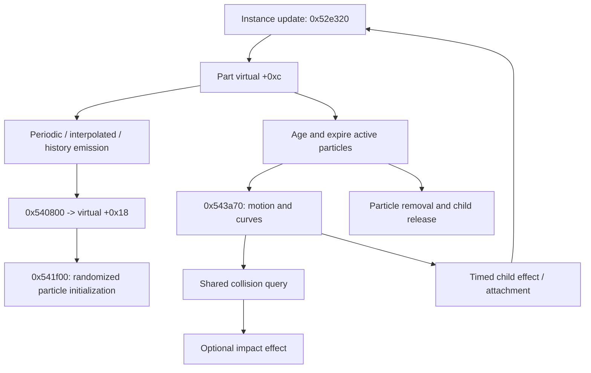
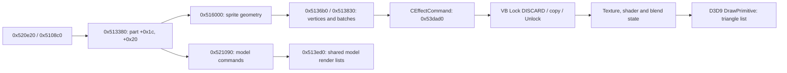
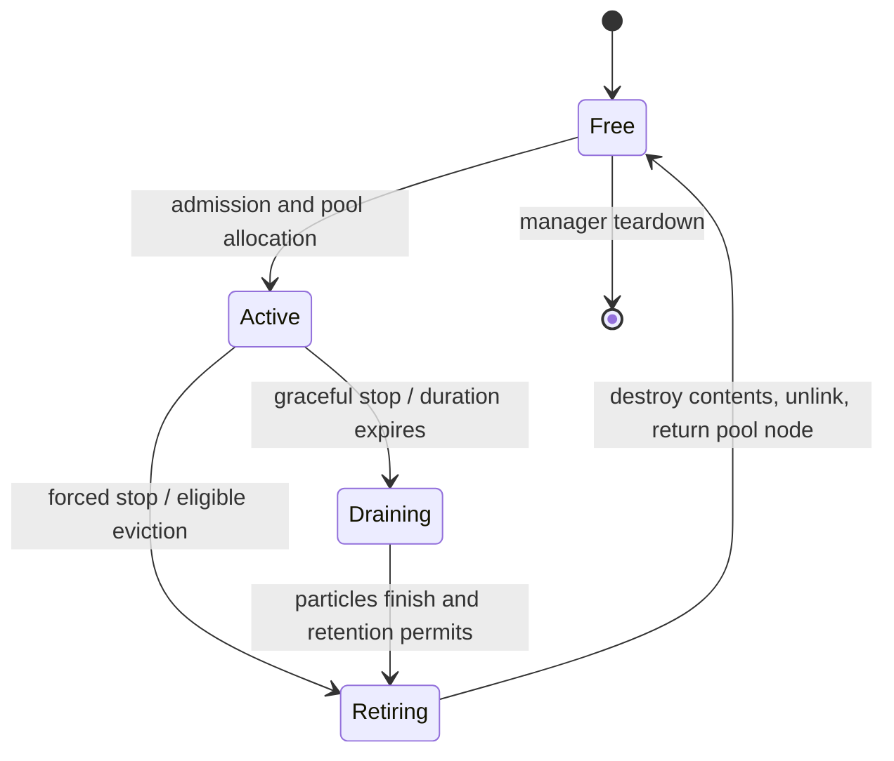

# Particle runtime contracts

Updated October 22, 2026. Parent: [particles and effects](particles-and-effects.md).

The particle mapping pass now connects authored packs, emission, simulation,
children, geometry, GPU submission and retirement. This is a static behavioral
map, supported by native code and original data. It is not a completed replacement
renderer or a claim of visual equivalence. Descriptive field names below are our
interpretations; original names are preserved where RTTI supplies them.

## Reproduction and evidence

Run `python3 research/tools/particle_contract_audit.py` from the project directory.
The [tool](../../tools/particle_contract_audit.py) verifies the unpacked image hash,
reads original CPR payloads without changing them, validates curve references,
decodes stage entry names/metadata, models binding order and hashes shader programs.
Its [audit](../../evidence/engine/pass-04/contract-audit.json) includes constants,
all scalar records, definition references, stage entries, duplicate-ID sequences,
x86 D3D9 method offsets and a cgl class/method catalog. The
[shader manifest](../../evidence/engine/pass-04/shader-manifest.json) records bounded
SM3 token streams through END, their byte counts and SHA-256s.

Native exports [04a](../../evidence/engine/pass-04a/status.tsv) and
[04b](../../evidence/engine/pass-04b/status.tsv) retain pseudocode, instruction
listings, references and exact Ghidra commands. The [function index](../../evidence/engine/pass-04/FUNCTIONS.md)
links the contracts below to their exports. Instruction listings take precedence
when inferred C signatures lose register arguments or alias stack temporaries.

D3D names are decoded against Wine's primary-source [device interface](https://raw.githubusercontent.com/wine-mirror/wine/master/include/d3d9.h)
and [enum declarations](https://raw.githubusercontent.com/wine-mirror/wine/master/include/d3d9types.h).
The exact downloaded headers and hashes are retained in
[provenance](../../vendor/d3d9-reference/provenance.json). This identifies the ABI;
it does not imply the game uses Wine.

## Pack binding and curve tables

`0x50ebe0` receives its owner in ECX, followed by stack arguments archive, slot and
ID adjustment. The owner saved from ECX explains Ghidra's misleading `local_8`.
`0x6084f0` attempts com, com2, com3, boss1 in that order, skipping absent resources.
`0x50eb30` writes the ID table successively. With all four available and adjustment
zero, ID **7** changes from com entry 7 to com3 entry 30; **12000** changes from
com3 entry 78 to entry 90. Later writes win. Additional loads can change bindings;
retain pack and entry identity when documenting resources.

| Pack | Scalar records, 0x84 bytes | Vector records, 0x180 bytes |
|---|---:|---:|
| effect_com | 120 | 74 |
| effect_com2 | 88 | 54 |
| effect_com3 | 313 | 142 |
| effect_boss1 | 102 | 57 |
| Total | 623 | 327 |

Section 3 contains a signed mode/key-count word and 32 floats per scalar record.
Section 4 contains 32 xyz samples per vector record. All 833 definitions' signed
references at `+0xa4` (vector), `+0xa8` and `+0xac` (scalar) are negative or in bounds.
Section 5 is absent in these four packs. Section 6 supplies nested sequence data;
stage `.emt` files alone do not enumerate all sequence use.

Scalar evaluator **0x52ec80** takes integer sample position k and fraction f. For
k > 30 it returns float word 32. With mode <= 0 it interpolates words k+1 and k+2.
Positive mode selects paired time/value keys using normalized `(k+f)/31`. The
observed positive counts are 3, 5 and 6. The terminal branch returns float word
`mode`, an unusual index that must be preserved pending a targeted runtime check;
do not silently replace it with an assumed last-value rule.

Part binder **0x541ad0** establishes these runtime offsets:

| Runtime part offset | Meaning established by use |
|---|---|
| +0x24 / +0x28 | Authored part / primitive definition pointers |
| +0x2c / +0x44 | Parent instance / pack slot |
| +0x30 | Scalar table base |
| +0x34 / +0x38 / +0x3c | Resolved vector / scalar / scalar references above |
| +0x19 | New-emission enable flag |
| +0x1c / +0x20 | Age / scheduled emission time |
| +0x15 | Collision enabled from authored part +0x178 |

## Randomness and emission

Helper **0x52ef50** and inline callers share state at **0x969100**, whose image
initializer is 1. Each draw advances unsigned 32-bit state:

```text
state = (state * 0x41c64e6d + 0x3039) mod 2^32
r = (state >> 16) & 0x7fff
float draw(lo, hi) = lo + r * (hi - lo) * float32(1 / 32767)
```

The extracted scaling constant is 0.000030518509447574615. Call ordering is part
of behavior. Some minimum-guard branches consume one draw for the comparison and
a second for the assigned value; replacing them with one clamped sample changes
all subsequent randomness. Integer counts use the same generator with modulo.

For the smallest sprite specialization, **0x52b8a0** ages and expires particles,
advances the emitter, then handles new emission. A positive authored duration at
part `+8` stops emission after delay plus duration. Definition `+0x50 == 0` selects
periodic emission. When the scheduled time is positive, behind the current age,
and emission is enabled, the schedule advances by interval `part+0x28` plus
jitter from `part+0x2c`, with a 0.0001 minimum branch. Authored flag `+0x30`
enables catch-up interpolation: truncated elapsed/interval count is capped at
**16**; counts below two use the single-emission path. **0x530310** interpolates
the previous/current 4x4 transform for the catch-up emissions.

The nonzero definition `+0x50` path uses a 34-position history and cubic
interpolation, with count/range fields `+0x54/+0x58` and initial particle age
adjustment. This is a separate path, not a second spelling of periodic emission.

**0x540800** chooses an authored count `part+0x1c` with integer jitter
`part+0x20`, optionally scales/truncates it through the scalar curve selected at
`part+0x1a0`, and calls the part's virtual **+0x18** for each particle. A nonnegative
`part+0x1f0` instead selects nested EVMT transforms for distributed spawning.
The smallest sprite spawn **0x512ec0** rejects emission when its count reaches
**9**; otherwise it allocates through `0x511610` and initializes via **0x541f00**.
Other specializations have separately exported methods in the audit catalog.

Initialization randomizes authored position, velocity and orientation fields.
Particle `+0x64` receives life based on abs(authored part `+0x10`) and jitter
`+0x14`, with a 0.01 minimum branch; `+0x68` receives 31/life and `+0x60` receives
min(initial age, life). `+0x80` is a random 15-bit value, `+0x82` flags and `+0x7c`
an initially empty child pointer. Constants of 60 scale several authored rates;
this does not establish that the application always runs at 60 FPS.

## Motion, collision and children

Shared motion **0x543a70** uses normalized particle age, curve samples, local/world
mode from definition `+0xc`, velocity times dt and authored rate terms. If collision
is enabled and global query owner `0x1ad177c` exists, it constructs an old-to-new
segment (`0x548440`), configures the query (`0x54a680`, mask 0x40/type 8), and asks
**0x54b1d0** to test candidates through their virtual methods. Hit helpers
`0x54bd00/0x54bd80` expose hit data/owner. This reaches the shared collision
interface; its concrete physics backend belongs to the physics map.

Authored part fields `+0x178/+0x17c/+0x180` affect hit offset, attenuation and
angular perturbation. A nonnegative `+0x184` spawns an impact effect through
`0x510ac0`; `+0x188` can adjust remaining life.

Definition `+0x88` is a child ID, `+0x90/+0x94` interval/jitter and `+0x98` an
attachment mode. Unattached children use `0x510ac0`; attached creation uses
`0x510b50`, retains the child at particle `+0x7c`, records the parent at child
`+0x348`, and updates transforms through `0x4bc030/0x50f8c0`. Child flag `+0x3d1`
controls retention. Stop methods such as **0x53cb10** disable emission and stop
attached children through graceful or forced helpers, clearing retention/pointers.



The graph describes the mapped common/sprite path and connected interfaces, not
an assertion that every template specialization has identical equations.

## Animated model particles and the shared engine

`CMotionModelParticle` spawn **0x5301b0** selects the model descriptor's motion
list at `+0x1c`, retains it at particle `+0x1790`, and attaches motion through
`0x428520 -> 0x41f2f0 -> 0x425400`. Model-part update **0x521800** calls
`0x42bb10/0x42aec0`, then model-particle virtual **+0x14**. The base uses no-op
`0x436ab0`; the motion specialization **0x53cb80** invokes **0x423d20** pose
evaluation and **0x423b40** finished-track cleanup.

The shared evaluator iterates 32 controller slots and linked motion records,
samples through **0x429fe0/0x4299b0**, and applies pose/parent relationships through
**0x417bb0**. Those samplers expose key-interval search plus raw/compressed paths.
Their remaining numeric codec details are MODEL-03 work, now attached to concrete
consumers in [actors and animation](actors-and-animation.md).

Model-particle rendering **0x521090** invokes shared model command builders
`0x422330/0x421e90`, then **0x513ed0** queues four model render lists. Model particles
therefore share the engine mesh renderer; they are not all drawn by the sprite
triangle buffer described next.

## Geometry to GPU

`0x5108c0` creates four batch commands through `0x50cb90(1)` and queues them via
`0x40f1a0`. `CEffectCommand` has vtable **0x83cae8**, executor **0x53dad0**.
**0x513380** visits active instances and sixteen part slots, applies active/delay/
visibility gates, calls virtual **+0x1c** for sorting/fade preparation and virtual
**+0x20** for geometry. The smallest sprite's +0x20 is **0x516000**, which appends
through `0x5136b0/0x513830`.



The executor locks the vertex buffer with **D3DLOCK_DISCARD (0x2000)**, copies
produced data and unlocks. Device calls select stream 0 with **64-byte stride**,
set the vertex declaration, and consume **8-byte batch records**. A failed Lock
skips drawing. Each batch selects a shader, a texture using pack-slot*0x200+index,
and blend mode, then calls **DrawPrimitive(TRIANGLELIST, startVertex, count)**.
Start vertex advances by count*3. The executor clears shaders/stream and restores
selected state afterward; it is not a complete isolated device-state snapshot.

Decoded x86 device offsets: +0xe4 SetRenderState, +0x144 DrawPrimitive,
+0x15c SetVertexDeclaration, +0x170 SetVertexShader, +0x178 SetVertexShaderConstantF,
+0x190 SetStreamSource, +0x1ac SetPixelShader. Setup **0x536b20** disables culling,
enables all color channels, sets less-equal depth comparison, wrap addressing and
linear min/mag filtering for samplers 0/1, and point min/mag filtering for sampler 2.

**0x5367e0** sets alpha blending and alpha test (GREATER) for all six modes:

| Mode | Blend operation | Source | Destination | Z write | Alpha reference | VS c4 source |
|---|---|---|---|---:|---:|---|
| 0 | ADD | SRCALPHA | INVSRCALPHA | 1 | 4 | owner+0x140 |
| 1 | ADD | SRCALPHA | INVSRCALPHA | 0 | 2 | owner+0x140 |
| 2 | ADD | SRCALPHA | ONE | 0 | 2 | owner+0x150 |
| 3 | REVSUBTRACT | SRCALPHA | ONE | 0 | 2 | owner+0x150 |
| 4 | ADD | ZERO | ONE | 1 | 8 | No write in this branch |
| 5 | SUBTRACT | ONE | SRCALPHA | 0 | 2 | owner+0x150 |

Mode 4 still writes depth under applicable state. Its early return leaves c4
unchanged; replacing it with a generic blend preset can change behavior.

Initialization **0x52fbe0** creates seven VS/PS pairs, selected by **0x53ad10**:

| Variant | Vertex program VA / bytes | Pixel program VA / bytes |
|---|---|---|
| 0 | 0x83aab8 / 572 | 0x83acf8 / 200 |
| 1 | 0x83adc0 / 836 | 0x83b108 / 804 |
| 2 | 0x83b430 / 596 | 0x83b688 / 516 |
| 3 | 0x83b890 / 640 | 0x83bb10 / 608 |
| 4 | 0x83bd70 / 664 | 0x83c008 / 836 |
| 5 | 0x83c350 / 572 | 0x83c590 / 236 |
| 6 | 0x83c680 / 596 | 0x83c8d8 / 452 |

All version tokens are shader model 3.0. VS 5 matches VS 0 byte-for-byte; VS 6
matches VS 2. Binding sets VS c0..3 from a matrix, c4 via the blend selector,
c5/c6 from owner +0x134/+0x138. Conditional PS c0..6 upload uses **0x5453a0**;
variants 0, 2, 5, 6 bypass that block. PS c7 comes from owner +0x160. Program
translation and pixel comparison remain renderer implementation work.

## Admission, stop and release

**0x510b50** checks enabled state, ID range <0x4000, a valid binding, optional
per-group limit **16**, and global active limit **512**. At 512, only the eligible
effect class/priority field `effect+0x74 == 2` attempts eviction through
**0x536430**. Eviction skips retained (+0x3d1) and protected (+0x3d8) instances,
force-stops a candidate, destroys it, then returns its pool node. If no candidate
qualifies, creation fails.

Pool helper **0x511110** removes a free node, links it into the active chain and
increments the count. Its free-empty fallback returns the current active tail;
the admission checks are essential and must not be removed in a translation.
Arena initializer **0x53ee70** aligns storage and sizes 0xcc0-byte allocation
units, capped at **8192**. Part destructors return storage through their captured
allocator at +0x10, virtual +4. Exact fragmentation/failure behavior of the bitset
helpers `0x53dee0/0x53e720` remains a narrowly scoped allocator question.

| Operation | Native path | Effect |
|---|---|---|
| Graceful stop | 0x4dbfe0 | Reset fade age; part virtual +0x10 with 0 |
| Forced stop | 0x4dc020 | Part virtual +0x10 with 1; 0x534b40 sets instance +0x340 to 4 only if currently negative |
| Destroy contents | 0x534960 | Guard +0x3e0; release auxiliary +0x310, destruct 16 parts, unlink classification, clear active state |
| Return instance | 0x535bd0 -> 0x5145c0 | Unlink active node, return to free chain, decrement count |
| Manager teardown | 0x608840 -> 0x5349e0 | Destroy instances; release buffers, shaders and resource references; return arena via 0x440780 |



This is a behavioral state summary, not an enum recovered from the executable.

## EVMT sequence boundary

All five stage members have version words [1,2]. Their **25** names begin
`GrpEffect`; per-entry metadata is `[1, effectID, instanceIndex]`. **0x50c5a0**
loads metadata for versions >0x101 into descriptor +0x18/+0x1c and sets the
sampling-rate field at +0x10 to **30.0**. The decoded IDs are:

| Stage | Entries | Effect IDs |
|---|---:|---|
| 03_b | 4 | 1759 x4 |
| 04_a | 16 | 692 x3, 693 x3, 694 x2, 695 x3, 696 x3, 697 x2 |
| 04_c | 3 | 1758 x1, 1761 x2 |
| 05_a | 1 | 1719 |
| 05_b | 1 | 1720 |

All resolve in the pack inventory. **0x4ca9c0** distinguishes leading G (kind 0)
and S (kind 1), then parses up to eight underscore-delimited integers. G routes
to embedded +0xb0, vtable 0x837770, **0x4dbee0 -> 0x510b50**. S routes to
embedded +0x110, vtable 0x837780, **0x4dc130 -> 0x44c840(type 5, ...)** and the
shared service path. None of these five stage files uses S. Its final service
classification is retained as unresolved in the audio/service map.

Transform sampler **0x50b780** uses channel reader **0x50a7f0**: translation
channels at offsets 0/4/8, rotation channels at 0xc/0x10/0x14, further transform
channels at 0x18/0x1c/0x20, and an activation gate at 0x24. It interpolates
adjacent sampled values and constructs rotations through trigonometry and a
quaternion helper. The decompiler aliases temporary arrays heavily here; final
axis/scale interpretation and every channel encoding remain unresolved rather
than inferred from variable names. Authored part +0x1ec/+0x1f0 connect nested
EVMT sampling and emission distribution to particles.

## Handoff and exact remaining questions

The particle pass is complete at the connected subsystem-map scope. Retained
local questions do not reopen feasibility or hold up the engine map:

- Exhaustive names/units for remaining authored words and specialization-specific
  math, especially native cross/two-point modes absent from these packs.
- The scalar terminal index, exact floating-point/RNG ordering and EVMT channel
  encodings need targeted behavioral checks when implementing their consumers.
- Arena fragmentation/error behavior needs instruction-level allocator analysis.
- Shared collision backend, model render commands and animation codecs continue
  under physics, rendering and MODEL-03. The S service branch continues there too.
- No game execution or rendered-image comparison has validated this static map.

Next engine work follows concrete actor factories and shared pose evaluation,
with these particle interfaces available as consumers and ownership witnesses.
