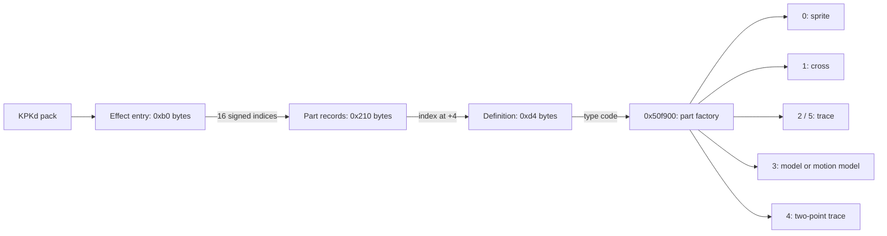
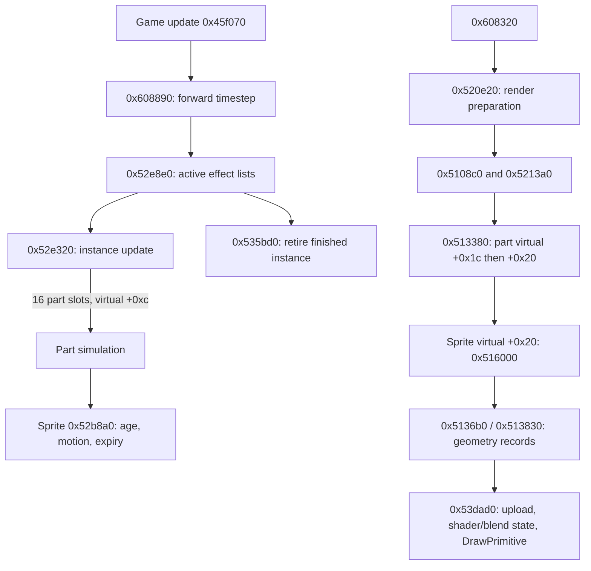

# Particles and effects

Updated October 22, 2026. Return to [architecture](../ARCHITECTURE.md).

**Static confirmed:** the executable contains a substantial effect/particle
implementation in the original `cgl` namespace. Its RTTI names identify sprite,
cross, trace, two-point trace and model effect parts, including animated model
particles. The native factory, pack binding, simulation, GPU submission and retirement paths
are connected. The completed mapping pass is detailed in
[particle runtime contracts](particle-runtime-contracts.md), including curves,
randomness, children, model animation, shader/blend state and lifetime limits.
The namespace's expanded name and historical tool/editor name remain unknown.

## Evidence and reproduction

- [RTTI survey](../../evidence/engine/pass-03/particle-rtti.json): original mangled
  names, type descriptors, candidate vtables and method addresses.
- [Asset metadata](../../evidence/engine/pass-03/effect-assets.json): read-only scan
  of all 6,625 CPRs; selection by effect directory, `.emt` extension or particle name.
- [Pack inventory](../../evidence/engine/pass-03/effect-pack-inventory.json): hashes,
  counts, all effect IDs and part references, type codes and model-name fields.
- [Byte witnesses](../../evidence/engine/pass-03/native-witnesses.json), reproduced by
  [engine_pass03_witness.py](../../tools/engine_pass03_witness.py): direct calls and
  selected virtual dispatch checked against the image bytes.
- [Native tables](../../evidence/engine/pass-03/native-tables.json): initial pack
  names and stage-effect method pointers.
- Native exports [03a](../../evidence/engine/pass-03a/status.tsv),
  [03b](../../evidence/engine/pass-03b/status.tsv) and
  [03c](../../evidence/engine/pass-03c/status.tsv) include instructions and incoming
  references beside pseudocode; exact commands/environment are retained there.
- Reproduce with `python3 research/tools/particle_survey.py` followed by
  `python3 research/tools/effect_pack_inventory.py` from the project directory.
  Tools are [survey](../../tools/particle_survey.py) and
  [inventory](../../tools/effect_pack_inventory.py). They write only under research.

The image hash and preferred-VA convention are in the architecture. Ghidra
signatures are inferred; pointer-like values printed as floats and omitted `this`
arguments require instruction review. This is a static map, not a visual match test.

## Pack representation and coverage

Four archives each contain `effect_pack.bin` with magic `KPKd`, seven section
slots and field `+8 = 0x9e`, which the native binder at `0x50ed10` checks. The
binder interprets offsets at `+0xc` onward relative to the pack base. Its first
three sections have a 16-byte header and count at section `+8`.

| Pack | Effect entries, stride 0xb0 | Part records, stride 0x210 | Definitions, stride 0xd4 |
|---|---:|---:|---:|
| effect_com | 255 | 780 | 356 |
| effect_com2 | 206 | 511 | 240 |
| effect_com3 | 103 | 308 | 206 |
| effect_boss1 | 21 | 41 | 31 |
| Total | 585 | 1,640 | 833 |

These role names describe native use. An effect entry has its stored ID at `+0`
and sixteen signed part indices at `+4`; negative indices are empty. A part
record's `+4` selects a definition. The first word of the definition selects the
factory branch. All bounds and both sets of nonnegative indices passed validation
against the four original payloads, using the existing CPR parser independently
of the metadata survey. Complete payload/archive SHA-256s are retained.

There are **583 distinct stored IDs**: 7 and 12000 occur in multiple entries.
`0x50eb30` builds an ID-to-pack/index table, applies an incoming ID adjustment and
writes successive entries. Preserve pack, entry index and stored ID together;
the [binding audit](particle-runtime-contracts.md#pack-binding-and-curve-tables)
now establishes later-write precedence, including IDs 7 and 12000.

The 872 selected CPR members are a metadata search result, not 872 effects. They
include textures, buffers and callback records. The RTTI search found 51 matching
descriptors and 41 with candidate tables; these are not 51 independent systems.

Model definition names include `glass01`, `Rose`, `M1M16`, `inazuma_main`,
`katamari_01`, `hebi01` and `skull1`. These are original name fields, not confirmed
on-screen descriptions. `0x50ef00` consumes the 16-byte definition name field and
prepares model-related entries. The [model-particle path](particle-runtime-contracts.md#animated-model-particles-and-the-shared-engine)
now connects motion attachment, shared pose evaluation and model render commands.

## Factory types

`0x510b50` accepts an effect ID, checks initialization and ID range (`< 0x4000`),
consults the ID table and obtains an instance. `0x50f900` binds its effect entry,
visits sixteen part slots, chooses a class and stores the result at instance
`+0x390 + slot*4`. Part descriptor pointers are at `+0x350 + slot*4`.

| Code | Original class family selected | Definitions in these packs |
|---|---|---:|
| 0 | `CEffectSpriteParts` | 703 |
| 1 | `CEffectCrossParts` | 0 |
| 2 | `CEffectTraceParts` | 1 |
| 3 | `CEffectModelParts`, using `CModelParticle` or `CMotionModelParticle` | 122 |
| 4 | `CEffectTwoPointTraceParts` | 0 |
| 5 | `CEffectTraceParts`, sharing the code-2 factory branch | 7 |

Codes 2 and 5 sharing construction does not establish identical behavior.
The code-0 branch compares part `+0x24` against 9, 32 and 128, selecting fixed
specializations; the largest sprite specialization has the RTTI encoding for 320.
The values are capacity-related selection thresholds. The smallest specialization rejects emission at count 9;
instance/arena limits and retained allocator questions are in the runtime contracts. Cross/two-point classes exist even though the inspected pack
primitive definitions contain no type-1 or type-4 entries.

Representative vtables: sprite `0x83cbf8`, cross `0x83ccd8`, trace `0x83cd50`,
model parts `0x83cf10`, motion-model parts `0x83cea0`, two-point trace `0x83d228`.
Names originate in RTTI, and factory constructor writes corroborate these families.

This diagram represents data layout and factory selection, not a class-inheritance
tree. Class templates also include shared `CEffectParts` bases.

## Loading, memory and mission integration

`_LoadAddedEffect` adapter `0x476dc0` invokes callback `0x4797e0`; its initial
phase submits the copied pack name through `0x440f90` to worker `0x440fe0`.
That worker formats `effect.%s.effect_pack`, requests it through `0x4152f0`
and loads with `0x4151b0(0x6e)`. The script callback polls the shared queue;
completion alone does not prove successful resource loading.

Initialization `0x45b990 -> 0x6084f0` visits the original four-name table at
`0x976ca4` in this order: `effect_com`, `effect_com2`, `effect_com3`, `effect_boss1`.
Each `0x50eca0(name, slot, 0, -1)` looks up the logical resource and binds it only
if available. Thus the fourth name's presence does not prove the boss archive
is always loaded. `0x50ebe0` binds pack data through `0x50ed10` and reads texture
resource information. Ghidra's `local_8` owner in this function is a recovery
artifact: instruction review confirms ECX owner and stack arguments archive,
slot and ID adjustment. Preserve that convention in a typed reimplementation.

`_SetEffectWorkSize` callback `0x47bb10` writes `value << 20` to mission owner
`+0x6148c`. Defaults are `0x800000` (8 MiB); seven recovered script occurrences
request 16. `0x6084f0` reads that byte count, obtains memory via `0x4405a0` with
alignment argument 16, retains the pointer at its owner `+0xc`, and passes the
size/pointer to `0x52fbe0` on global effect state **0x1901780**. That initializer
calls arena setup `0x53ee70` and creates graphics resources. Teardown wrapper
`0x608840` calls `0x5349e0` then returns the retained memory through `0x440780`.

## Simulation and render preparation

The simulation connection is direct: `0x52e8e0` visits the list at manager
`+0x1ad500`, invokes `0x52e320`, and retires a finished instance when its retention
flag permits. Instance `+0x3f0` is the next link; `+0x3d0` suppresses the timestep.
Instance update scales time, handles delay/loop/fade fields, calls each non-null
part at vtable `+0xc`, and tracks completion. These are observed control paths;
field names are descriptive rather than original declarations.

For the smallest sprite specialization, `+0xc` resolves to `0x52b8a0`. Its
active particle list is at part `+0x700`; particle `+0x90` is the next pointer,
`+0x60` accumulates age and is compared with `+0x64`. It calls `0x543a70` on an
applicable motion path and `0x536170` when retiring particles. Other flags alter
these branches; the periodic, catch-up and history paths are recorded in
[emission contracts](particle-runtime-contracts.md#randomness-and-emission).

`0x516000` derives geometry attributes and calls `0x5136b0`/`0x513830`, which
append records to bounded buffers and batch metadata. `0x539ec0` computes
camera-relative squared distances and associated sorting/fade values. `0x533040`
normalizes orientation vectors. The [GPU map](particle-runtime-contracts.md#geometry-to-gpu)
connects the command executor to D3D9 triangle drawing, six blend modes and seven
shader pairs. Exact visual appearance still requires a rendered comparison.

## Stage effect sequences

Five `effect.emt` members have magic `EVMT`: stage areas 03_b, 04_a, 04_c, 05_a
and 05_b. `0x50c520` reads **field-relative**, not file-base-relative, offsets at
`+8`, `+0x10`, `+0x18`, `+0x20`. The count at the second resolved block is consumed
by `0x50aa60`. Counts are respectively **4, 16, 3, 1, 1**: 25 entries total.
These are sequence entries, not a global particle or emitter count.

The stage loader retains `effect.emt` at resource owner `+0x9410`. Mission
`0x43eea0` passes it to `0x4962c0`, which allocates 0x170-byte runtime entries and
binds them using `0x4ca3f0`. `0x496720` starts entries; mission update reaches
`0x496620 -> 0x4ca580`, then the applicable sequence update.

A concrete effect path is now connected: entry constructor `0x4ca310` constructs
an embedded object at `+0xb0` using `0x4dbeb0`, with vtable `0x837770`.
`0x4ca5d0` updates that object through `0x4dbd10`; its virtual slot 0 resolves to
`0x4dbee0`, which invokes **0x510b50** on the global particle manager. See the
[creation instructions](../../evidence/engine/pass-03/stage-effect-create.txt).
The second embedded path at `+0x110` is selected by S names and reaches the
type-5 service route through `0x4dc130 -> 0x44c840`. All 25 stage names use G.
Decoded IDs, metadata and remaining channel details are in the
[EVMT contract](particle-runtime-contracts.md#evmt-sequence-boundary).

## Mapping-pass completion and handoff

The connected particle-system mapping pass is complete; its detailed findings and
precise residual questions are in [runtime contracts](particle-runtime-contracts.md).
The next active engine work is [actors and animation](actors-and-animation.md).
Shared model rendering, collision backend, animation codecs, EVMT channel details
and allocator edge behavior retain explicit owners in the worklist. Static mapping
has not yet been corroborated by game execution or visual comparison.
