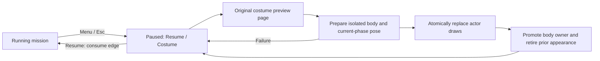

# Pause and in-mission costume switching

The reconstruction adds a normal Costume choice while paused. The user explicitly
approved this baseline improvement. Original in-mission Options excludes costume
selection; this difference belongs in architecture documentation, not UI labels.

## Original evidence

`TaskPauseMenu` constructor `0x4cc800`, update `0x4cd020`, and draw `0x4cca40`
are native tasks, rather than a Lua pause-menu script. Its Options child receives
`0x4d6560(1)`, setting context bit 4. `0x4d4c10` then navigates rows 1–7, with
7 returning. Front-end context permits rows 1–10; row 9 opens costume singleton
`0x4d3190` (update `0x4e36f0`). English `data/menu/9952` row 9 describes changing
Alicia's costume and row 82 names Change Costume. Reproducible exports are under
ignored `research/evidence/engine/pass-105-pause-menu/` and `pass-menu-02/`.
Original pause artwork lives in `sprite.pauseMenu`; the bounded current UI uses
existing menu typography and costume preview assets. Full power-up, checkpoint
restart and mission-exit policies remain separate game systems.

## Ownership and clocks

The game pause policy consumes pause/menu edges before gameplay. Menu drawing
and native event pumping continue; mission Lua, actor/controller, camera,
secondary animation and material clocks stop. Entering and leaving pause consume
the entire input frame, so the same confirmation cannot trigger gameplay. Held
movement can resume normally; evade must be released before rearming after pause.
The wall-clock sample continues each frame, preventing a resume time jump.

Inspected Unreal revision `f45729c0b6f097038e72b52d366a62baeca3275b`,
`Engine/Source/Runtime/Engine/Private/PlayerController.cpp`, `SetPause`,
`ProcessPlayerInput`, and `TickActor`: pause is explicit game state, while the
pause tick still processes input with a paused flag. Adopt this separation,
without its networking/GameMode framework. The current single-thread owner also
retains the previously inspected Doom loading resource/frame ownership model.

## Transactional appearance change

MissionLoading retains a stable-address current body owner and, only during an
explicit selection, a separate candidate. Candidate decode/upload failure leaves
the current actor and resources intact. Shared motion resources and weapon stay
resident. Candidate model and control-point views borrow the candidate until
rollback, or the promoted current owner until its later replacement.

PlayerActor keeps its stable address because the controller borrows it. A
candidate appearance validates named skeleton compatibility and rebuilds prepared
clip bindings against the new skeleton's missing-track defaults. Preserve current
motion/blend clocks, movement, world transform and camera; do not reuse a prepared
clip whose defaults belong to another costume. Reset new secondary state from
its own authored constraints and the current clean pose, without advancing the
game clock. Publish the replacement actor draws/palettes before retiring the old
body resources. Commit is nonthrowing; failure before publication rolls back.
No mission reload, spawn reset, checkpoint mutation or profile write is implied.

Costs are confined to a user-requested paused load: one additional body definition,
texture/geometry residency and prepared appearance, released after commit or
failure. Ordinary pause/navigation uses fixed storage and retained textures.
Both C++ corpora consulted for design and implementation: Core I.1 explicit
interfaces, R.1/E.6 owned cleanup and C.83 nonthrowing commit; performance MEM.9
bounds allocations to preparation rather than normal frame updates.

Implementation ownership: mission resource candidates and pause/framework/menu
composition are separate from PlayerActor/StageInspection appearance publication.
Verification must cover failed candidates, repeated switches, retained position
and camera, frozen clocks, consumed input edges, all six authored costumes and
native resume. Passing CPU checks alone is not visual outfit acceptance.

The bounded current menu exposes Resume and Costume. It deliberately does not
advertise unimplemented restart, power-up or mission-exit actions. Costume choice
returns to the pause page after publication; resuming preserves the exact camera
and authoritative movement state. The full original pause task animation and
additional actions remain future reconstruction work, separate from this usable
pause/appearance boundary.

Actual-content verification now covers all six live replacements during a frozen
walking pose and resumed native movement, with unchanged body/camera state and
balanced teardown. See [retained draw replacement](model-draw-replacement.md) for
its transaction, retirement correction and native evidence. The original-root
corpus additionally injects publication failure and checks rollback before the
all-costume round trip. Physical-controller review now confirms the pause menu works. Remaining outfit
intersections are tracked separately; this ownership transaction does not prove
intersection-free garment simulation.

## Offscreen presentation acceptance

The bounded native visual witness now renders production `PauseFlow` and
`StartupMenuSurface` with original archives and the compiled production sprite
shader into a 1280×720 Metal target. Its diagnostic output adapter mirrors the
host's straight-alpha sprite submission; no window, GUI input or game installation
write is involved. All four captures were inspected: Resume selected, Costume
selected, Special Costume 5 and Original. Text, selection tint, controls and
authored previews are visible without clipping. Pause pages submit 50 sprites;
costume pages submit 122. The surface retains 93 textures and releases all of
them at teardown. Probe, build command, log and images are ignored under
`research/evidence/reconstruction/pause/`. This closes menu-asset visibility;
physical-controller/end-to-end application review remains distinct.

The user subsequently confirmed that pause works and observed the current
Resume/Costume scope. Remaining dress intersections and original-release review
context are tracked separately in
[secondary motion verification](secondary-motion-native-verification.md#original-release-clipping-reports-and-current-review).

## Weapon review replacement

The authorized animation-review selector may replace the selected weapon class
without restarting the mission. MissionLoading retains all four wa0..3 models,
support and device residency from admission. Candidate selection borrows one
stable retained owner without new reads, decode or upload.
The active owner remains borrowed until the actor prepares its class-specific
catalog/pose and the renderer accepts replacement draws; only then is promotion
nonthrowing and the previous selected instance retired; immutable resources
remain mission-owned. Candidate failure/discard preserves
the active weapon, body, world position and camera. Same-class preparation is a
no-op. Body and weapon candidates cannot overlap. This resource seam does not
accept ammunition, attacks, damage or combat weapon changes.

Inspected pinned Unreal `f45729c0b6f097038e72b52d366a62baeca3275b`,
`Components/SkeletalMeshComponent.cpp::SetSkeletalMesh`: identical assets return
early, outstanding animation evaluation is synchronized before replacement,
render state is recreated around the change, and asset-specific bone/morph
state is refreshed. We retain the same-before-change and borrower/publication
ordering principles. Our current single-owner paused route needs no parallel
evaluation wait; unlike immediate destructive replacement, its existing
candidate transaction keeps old resources usable if preparation fails. Source
603900/615900 still controls selected-weapon activation/rest semantics in the
game adapter. Ownership implementation applies Core E.6 and performance COPY.5
from both MCP corpora; immutable definitions/support and unique device handles
stay inside stable mission RAII owners. Ordinary B/Q selection now uses these
resources without global pause or host-clock reset; see
[weapon selection residency](weapon-selection-residency.md).

## In-scene animation review menu

The approved review extension adds Weapon Class and Animation Review beside
Resume and Costume. This is an explicit reconstruction review facility, not a
claim about the original pause menu. It keeps the existing pinned Unreal
pause/input separation above: navigation runs while the game is paused, and
accepting a preview consumes the UI frame before resuming gameplay.

PauseFlow borrows immutable body/weapon catalogs. Catalog pages display twelve
names plus previous/next navigation; labels are bounded to thirty characters to
fit the existing font command budget, while payloads retain the complete catalog
index. After an atomic resource replacement, refresh the binding before navigation or
presentation reads the old catalog labels; no menu operation overlaps that
transaction.
Sparse face and scripted-jump choices retain their original payload values;
unavailable requests are validated by the Stage owner and remain paused with an
owned error message. A menu choice does not imply a shot, damage, spell effect,
resource expenditure or successful combat action.

The live status overlay publishes only text in the lower corner through the
already prepared font and fixed sprite array. It adds no menu background, device
resources or separate scene. Its bounded text limit is 120 characters. Native
visual acceptance of the combined interactive route remains distinct from menu
transaction unit tests and host compilation.

The resource transaction's actual-content corpus passes injected upload failure,
candidate discard, same-class no-op, body/weapon candidate exclusion and the
1→2→3→0 round trip. Definitions/support retain stable addresses across promotion,
body owners remain identical, and teardown returns to the existing stage's
resource counts. Scoped fatal lint passes for the mission loading implementation
and corpus. Actor/renderer integration and interactive review remain separately
verified; resource checks alone do not prove a visible weapon replacement.

Weapon review uses a separate `PlayerAppearanceChange::weapon` candidate. It
shares the unchanged body catalog, prepares the selected weapon catalog and new
neutral motion owners, and retains the exact currently displayed body matrices
for paused publication. Weapon attachment/palettes are evaluated from that frozen
body. The next consumed update evaluates neutral body playback; no old-class
weapon clip or root interval crosses the replacement. Camera and authoritative
physical state remain the controller's responsibility. Facial clocks are copied
at zero time for the paused image; secondary state is initialized from the frozen
pose. The review UI identifies its intentional action reset.

The existing stable audio environment references the persistent actor address.
Candidate construction cannot reset or dispatch its events. During nonthrowing
adoption, old motion owners clear scoped events, the retained audio owner moves
to the new playback and its sinks are rebound; voice stops with the explicit
review reset. Old catalogs remain alive until their old playback borrowers retire.
A costume-only change continues sharing the original playback/audio owner and
preserves its clocks. Native renderer replacement remains one selected weapon
model publication; it does not require a partially committed body/weapon pair.

The expanded original-root corpus also constructs a real PlayerActor in a frozen
walking pose, prepares and adopts all four weapon classes, verifies identical
body world matrices before publication, checks unchanged current clocks during
preparation and zero retained movement in the new neutral owner, then resumes
pose/event publication after each commit. All four authored cadence/scale values
are checked through the production customization parser. The corpus passes and
reports zero retained domain bytes at teardown. These are actual-asset CPU and
synthetic-device observations; the real Metal review route remains a separate
acceptance step.

### Offscreen review presentation acceptance

The existing native pause-menu probe now loads the actual PW0 catalog (161
prepared clips) and WA0 catalog (six resources), then renders the production
PauseFlow and StartupMenuSurface through the compiled Metal sprite pipeline at
1280×720. The four root entries, weapon classes, scrolled category list,
first/middle/final catalog pages, face/death/spell choices, rejection message and
lower-corner PREVIEW status were captured and visually inspected. The final body
page preserves payload 156 rather than its displayed row number. Empty status
clears the glyphs, and all prepared menu textures retire at teardown.

Reproduction lives in ignored
`research/evidence/reconstruction/pause/review_menu_probe.mm`, with its exact
link arguments in `review-build-command.json`, results in `review-probe.log`, and
`review-*.png` captures alongside it. Run the resulting probe with the read-only
game root, compiled `movie.metallib`, and an evidence output directory. It creates
no application window, sends no input and changes no game state. The status
capture uses a plain diagnostic clear color to isolate typography; live scene
contrast and physical controller navigation remain interactive acceptance.

Framework composition now binds/rebinds catalogs after successful paused
resource transactions, consumes the confirmation frame before resuming a
preview, and forwards the captured action input to Stage. The B/Q class cycle
uses the same paused transaction, reports a failed grounded admission visibly,
and rebases wall time after resource work. These controls are documented in the
README and `docs/animation-review.md`; they do not authorize combat outcomes.
