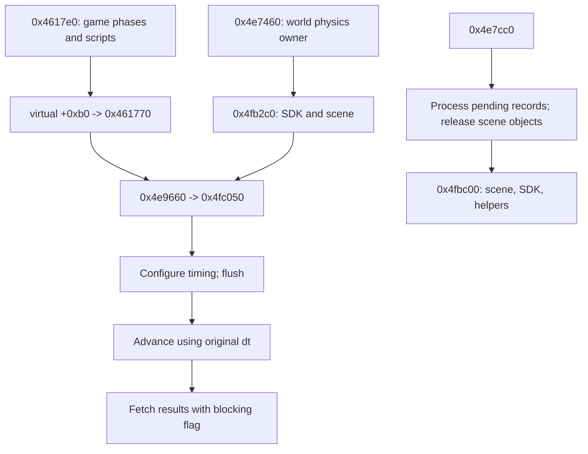

# Physics scene and collision integration

Updated October 22, 2026. [Architecture](../ARCHITECTURE.md).

The PC engine owns a concrete PhysX SDK/scene, calls its step interface from the
game update, and releases scene contents before releasing the SDK. Actor-pair
separation is an additional engine mechanism documented in [actor lifecycle](actor-lifecycle.md).

## Ownership and initialization

Mission/world owner **+0x97788** points to a **0x54-byte** physics service allocated
by **0x4e7460** and constructed by **0x4e70f0**. Service vtable **0x837c70** has six
observed entries before adjacent string data; do not extend it into those strings.

| Service offset | Meaning |
|---|---|
| +4 / +8 | Allocator interface / critical section |
| +0x20 / +0x24 | SDK / scene |
| +0x2c | Bounds used by scene descriptor |
| +0x44 | Callback interface |
| +0x48 / +0x4c | Allocator/helper objects |
| +0x50 | Step/lifecycle gate |

**0x4fb2c0** calls imported `NxCreatePhysicsSDK(0x02060400, allocator, 0, descriptor, 0)`.
On success it sets SDK parameters through virtual +8, prepares a scene descriptor,
and stores the result of SDK virtual **+0x10** at service +0x24. This is distinct
from the temporary startup availability check. **0x4fbf80** configures the default
material-like interface and thirteen table-driven scene settings.

## Step order and timestep

Game update **0x4617e0** invokes virtual +0xa0 (selected actor/effect pass), +0xa8,
+0xac, the root/mission driver, then **+0xb0**. In all nine mapped game vtables,
+b0 resolves to **0x461770**. It forwards game **+0x414c** timestep through
**0x4e9660** to physics service virtual +8 = **0x4fc050**.

The exact scene call sequence in 0x4fc050 is:

| Scene slot | Arguments observed in x86 | Interpretation |
|---|---|---|
| +0xe0 | `min(dt, 0.06666667f), 4, 0` | Timing configuration |
| +0xdc | none | Command-stream flush |
| +0x1a0 | **original dt**, not the clamped value | Simulation advance |
| +0x1a8 | `1, 1, 0` | Blocking result fetch, status 1, no error output |

The wrapper runs only with a scene and a nonzero gate byte at service +0x50.
**Instruction correction:** Ghidra's C export loses the floating-point argument
at +0x1a0 and displays a misleading zero temporary. The instructions explicitly
reload the original stack timestep before that call. Do not implement the
pseudocode's apparent argument.

The slot sequence and arguments are static facts. API names are strongly supported
by their signatures and historical PhysX semantics. The retrieved
[AGEIA/NVIDIA 2.8.1 headers](../../sources/physx-2.8.1-reference/provenance.json)
are a third-party redistribution of original headers and have different slot
offsets; they are **not** proof of the game's exact requested 2.6.4 ABI.
For historical context, NVIDIA's [2008 presentation](https://www.nvidia.com/content/nvision2008/tech_presentations/Game_Developer_Track/NVISION08-The_New_X_Factor-PhysX.pdf)
identifies simulate/fetchResults as simulation boundaries. Exact 2.6.4 header or
loaded-runtime confirmation remains recorded separately.

Service virtual +0x10 = **0x4f7640** calls scene +0x1a4 with `(1,0)`, consistent
with a nonblocking results check. Service +0xc = **0x4fa030** merely normalizes the
gate byte in this build; it is not a hidden blocking wait. Hide/trace worker events
are separate services and their completion guarantees must not be inferred from
this physics fetch call.

## Creation, queued mutations and removal

**0x4e7900** uses authored name prefixes to choose collision behavior. `wa_` and
`de_` return without creating the object in this route; `pw_`, `pc_`, `np_`, `nc_`
and `ne_` set different engine flags. Other branches build a shape through
**0x4f7ac0**, attach it to an existing object, or create an object through
**0x4f7bd0**. The latter reaches scene virtual +0x18 with an actor descriptor.
These are concrete asset-to-physics edges; prefix names are retained without
inventing full gameplay descriptions.

**0x4f3ff0** processes variable-length queued records for an existing scene/SDK.
The first byte is record size; the second selects cases 1–7. Concrete handlers
include 0x4f4280, 0x4f4110, 0x4f41b0, 0x4f44c0, 0x4f42e0, 0x4f43f0 and 0x4f4530.
It then resets the queue cursor/count. **0x45eff0 -> 0x4e7c80** processes this
queue and world update masks in the game +0xac phase, before the later scene step.
Exact payload schemas remain beside these handler addresses in the worklist.

**0x4e7cc0** processes pending work, releases registered scene contents, then
calls **0x4fbc00**. The latter uses **0x4fbc80** to enumerate/release scene object
categories, flushes, releases the scene via SDK +0x14, releases SDK via +4, and
releases helper allocators. The owner then deletes the critical section, frees
the service and clears +0x97788. The teardown sequence is established; exceptional
allocation/release behavior and all external callback effects remain local.

## Evidence and remaining contracts

[06c](../../evidence/engine/pass-06c/status.tsv),
[06e](../../evidence/engine/pass-06e/status.tsv),
[06f](../../evidence/engine/pass-06f/status.tsv) and
[06h](../../evidence/engine/pass-06h/status.tsv) hold exports. Critical timestep
witness: [0x4fc050 instructions](../../evidence/engine/pass-06e/instructions/004fc050.txt).
The [prior game dispatcher](../../evidence/engine/pass-02/functions/004617e0.c)
connects frame phases. A research-created fragment at 0x461785 was removed and the
true wrapper 0x461770 exported; [repair log](../../evidence/engine/pass-06/boundary-repair/console.log)
records this analysis-only correction.

Remaining: movement-component receiver equations, queued record schemas, collision
filter meaning, mesh cooking/resource ownership, exact middleware ABI and dynamic
results. The owned scene's creation, frame step and teardown are now connected.
