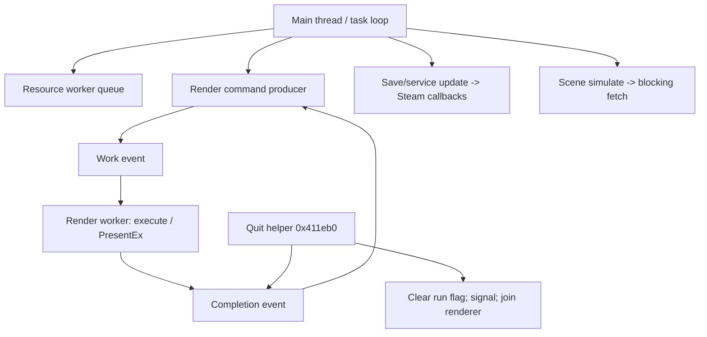

# Platform services and external boundaries

October 22, 2026. [Architecture](../ARCHITECTURE.md). Scope: the recovered
32-bit Windows Steam executable. This is an implementation-boundary map, not a
claim that any compatibility environment has run the game successfully.

## Boundary inventory

| Service | Concrete path | Responsibility / remaining contract |
|---|---|---|
| Windows application | 0x411aa0 → 0x411ee0 → 0x4121d0 | Configuration, HWND/message dispatch, task loop and quit |
| Memory | 0x40eee0; CPR/RAT allocators | Win32 private heap; VirtualAlloc/VirtualFree data blocks; aligned engine arenas |
| Worker threads | 0x4166e0 → CreateThread(0x416660) | Wrapper sets running flag, invokes object slot +8, clears flag |
| Synchronization | 0x410070 / 0x4100c0; worker-specific events | Critical sections, work/completion events and thread joins |
| Timing | 0x40eab0; render worker 0x40fbe0 | QueryPerformanceCounter/Frequency; pacing and Sleep |
| Graphics | D3D9Ex device; render worker | Queued commands, resources, presentation; reset details remain local |
| Physics | NxCreatePhysicsSDK(0x02060400) | Availability probe, later owned scene and blocking fetch |
| Sound | XACT 3.7, XAudio2 2.7, X3DAudio | Banks, cues, streaming handles, spatial calculation |
| Movies | COM / DirectShow | Source decoding, custom texture renderer, event completion |
| Input | DirectInput8 / XInput ordinals | Keyboard/mouse/controller acquisition, action masks and repeat |
| Files | CRT fopen/fread/fwrite/fseek; Win32 streaming handle | RAT/CPR loading, saves, audio streams and movies |
| Steam | steam_api.dll | Startup, context creation, stats/leaderboard work, callbacks and shutdown |

[Complete import/caller manifest](../../evidence/engine/pass-06/platform-import-callers.json)
records every PE import and recognized references. Missing references in that
snapshot do not prove an import is unused. Imports name DLL boundaries; exact
DLL binaries loaded by COM, DirectShow or PhysX require runtime observation.

## Steam responsibilities

Startup requires SteamAPI_Init and returns early on failure. Context setup
**0x410d40** obtains SteamClient017 and a collection of interfaces, including
SteamUser019, SteamFriends015, SteamUtils009, SteamUserStats011, SteamApps008,
RemoteStorage014 and others. This is a generic context-acquisition sequence;
acquiring Matchmaking/Networking/UGC interfaces does not establish use of those
features in Bullet Witch gameplay.

The context's **+0x14 is UserStats**. Update wrapper 0x4c2830 reaches
0x4c2b80, which services stats-state bits and tail-calls SteamAPI_RunCallbacks.
The save/service dispatcher 0x4711c0 calls that wrapper each update. This
connects callback pumping to a concrete engine task.

0x4c29e0 formats `BID%02d`, obtains/caches a 64-bit handle using UserStats
slot +0x58, and registers a call result. 0x4c2c00 calls UserStats +0x7c with
that handle and a score-like argument, then replaces/registers its pending
call-result subscription. These signatures correspond to leaderboard lookup /
upload operations; the names are an interpretation of the calls and Valve's
[UserStats API](https://partner.steamgames.com/doc/api/ISteamUserStats), not a
claim that the current SDK's vtable layout is identical to interface version 011.
The native offsets and arguments remain the evidence for this build.

The observed CRT save path is separate from these stats operations. RemoteStorage
interface acquisition alone does not establish executable-managed cloud writes.
Valve documents the callback mechanism in
[steam_api.h](https://partner.steamgames.com/doc/api/steam_api); observed engine
callers are recorded independently in the native exports.

## Startup and shutdown ownership

The [bootstrap map](bootstrap-and-tasks.md) now includes the CRT-installed game
application, concrete resource/startup hooks and task routing. Quit helper
**0x411eb0** changes app state from 0 to 1, waits for render completion, clears
the render run flag, signals its work event and joins through 0x416710 before
returning. The game application post-loop hook 0x43a280 → 0x472ce0 releases
menu texture objects. Top-level cleanup restores accessibility settings, frees
language/configuration allocations, shuts Steam down and releases the mutex.

Subsystem teardown is separately owned: task lifecycle methods, actor retirement,
resource tag unload, physics service destruction, audio shutdown and movie COM
release. A universal reverse-order destructor list has not been established;
early startup failures also have their own exit paths. Do not infer that every
normal cleanup action runs on every failure exit.

Configuration helper 0x410180 writes a 36-byte `SystemSetting` file when its
dirty flag is set. This is separate from the three `savedata` files. Resource
paths use Windows separators and engine `GAME:` / `concept:` prefixes resolved
by the catalog loader.

## Portability contracts retained for implementation

The map relies on 32-bit little-endian pointers, relocated file offsets, x86
calling conventions, SIMD register arguments, COM ownership and Windows event
semantics. Recovered pseudocode is analysis material, not portable source.
A future implementation needs explicit adapters for these boundaries; exact
thread timing, failure behavior, device reset and loaded codec/middleware
versions still need targeted runtime witnesses.

[Steam context](../../evidence/engine/pass-06q/functions/00410d40.c) ·
[Callback pump](../../evidence/engine/pass-06o/functions/004c2b80.c) ·
[Leaderboard request](../../evidence/engine/pass-06q/functions/004c29e0.c) ·
[Thread entry](../../evidence/engine/pass-06q/functions/00416660.c) ·
[Quit/join path](../../evidence/engine/pass-06q/functions/00411eb0.c).
