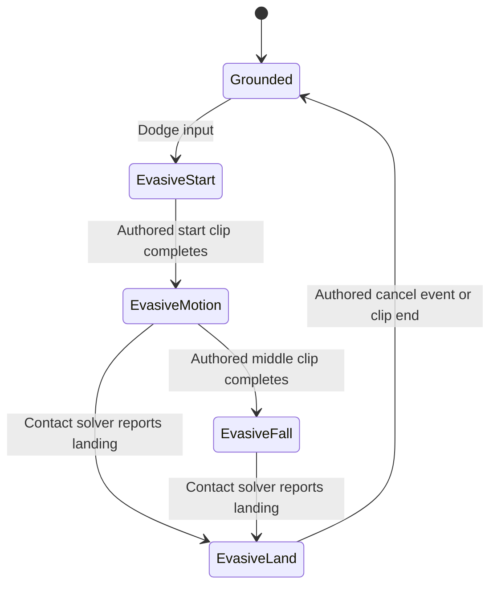

# Alicia's original player-controlled evasive leap

The physical controller action is not the generic Runner jump previously used
by the traversal host. The original default controller maps A to attack; its
trigger-based evasive leap is handled by Dodger and uses directional evasive
motions. Routing A to the generic jump was reconstruction policy, not a faithful
hardware-action mapping. This distinction explains why validating the generic
22-frame start and fixed 4.2 launch velocity did not validate the user's leap.
The original action must be reconstructed before considering timing changes.

## Hardware and actor dispatch

`0x45f850` constructs the active player input message through `0x5fc3f0` and
publishes it to the controlled actor. This message uses type token `0x975a88`.
The original XInput A mask 0x1000 becomes input +0x28 bit 1. The `atk` UI resolver
`0x4b9ce0` calls `0x4bb7d0(0)` (identity in this build), confirming A is attack.
The generic Runner jump flag, input +0x28 bit 0, is cleared by the hardware
constructor and is never enabled by that constructor. Runner's default-state
hardware handler `0x6667e0` does accept that flag, but its existence does not
make the generic jump a physical-button action.

Dodger reads input +0x28 bit 2. This comes from the default left-trigger value
exceeding 0.1, or the configured keyboard dodge binding at `0xcb2876`. The
shoot/dodge swap option exchanges trigger roles. The input predicate is a held
trigger threshold, not a newly pressed edge; whether another action starts after
recovery depends on normal state dispatch. Default player construction
`0x5ff170` adds Dodger with `0x5fd4e0 -> 0x689b80`, alongside Runner.
`0x68b420 -> 0x689b00` registers default-state Dodger hardware handler
`0x689220 -> 0x68a900` for that message. Airborne Dodger input is registered
through `0x689400 -> 0x689040 -> 0x689fa0`.

The upstream movement vector is multiplied by 10/9, then radially normalized
if magnitude exceeds one and zeroed if magnitude is below 0.15. Values are
`0x8522e0` and `0x8369c4`; therefore the equivalent raw-stick radial deadzone is
about 0.135. These are separate from camera look input. The old 0.05/0.5 movement
threshold policy is not evidence for the original input normalization.

## Direction and animation state

`0x68a900` flattens camera forward onto the horizontal plane, falling back to
the model basis if the projected vector is degenerate. It retains the resulting
camera frame and chooses one of four animation directions from the input:

| Condition | Direction index | Motion stem |
| --- | ---: | --- |
| abs(x) <= abs(z), z >= 0 | 0 | `evasive_fr` |
| abs(x) <= abs(z), z < 0 | 1 | `evasive_ba` |
| x < 0, horizontal input dominates | 2 | `evasive_le` |
| x >= 0, horizontal input dominates | 3 | `evasive_ri` |

Zero movement chooses forward. Back/left/right basis corrections are pi,
+pi/2 and -pi/2 respectively. The exact row-vector order is correction rotation,
normalized input-facing frame, then horizontal camera frame. In yaw terms the
model-facing target is camera yaw + atan2(input.x,input.z) - selected clip's
cardinal direction. A pure backward input selects a backward clip while retaining
camera-facing model orientation. Zero input uses the identity input frame.
Constructor `0x688e20` requests StateDodgeStart.
The source also computes an invulnerability-related flag against body +0x4c;
that combat effect is separate from traversal and must not be claimed implemented
by movement alone.

`0x68a600` selects start IDs from table `0x856380`, indexed forward/back/left/right:
709/712/718/715, the corresponding `@evasive_*_s` names. It forces a fresh motion
with zero blend. Update `0x68a720` waits for clip completion, not cancellation,
then constructs StateDodge through `0x688920`. During the start it turns the model
toward the selected direction at `0x8562cc = 25.1327419` radians per second,
publishes the root-movement message and invokes the contact solver `0x6026c0`.

StateDodge entry `0x688fc0` selects middle IDs 710/713/719/716 from `0x856390`,
again forced fresh with zero blend. Constructor `0x688920` initializes its
ballistic flag +0x60 false and velocity float4 +0x70 to zero. It does **not**
inherit the preceding Runner horizontal velocity or supply a fixed jump impulse.

## Movement ownership

Start and middle publish message token `0x95f784`, constructed by `0x4aff10` or
inline equivalent code. Runner registers this message across states through
`0x6637e0`; thunk `0x65c500` dispatches virtual slot +0x38 to `0x664be0`.
Runner setup `0x668230` resolves `Waist_direction` and stores its index at
Runner +0x2c owner +0x30. The actual PW0 skeleton maps that name to bone 1.
`0x664be0` calls `0x5e2060 -> 0x42a5b0` to sample this bone's **local transform
at the controller current frame**, using controller +8 through `0x41d770`.
Instructions at `0x42a61b` set ECX to that controller; `0x41f0a0` advances its
+8 cursor and keeps duration at +4. The identically numbered field in a raw
clip header must not be substituted. This is neither the translating root bone
zero nor a hierarchy/world bone matrix.

The displacement basis is constructed from that sampled local matrix: copy its up
row and forward row, negate only forward.z, compute
`right = normalize(cross(up, forward))`, normalize forward, then replace up
with `cross(forward, right)`. `0x409f20` establishes this order. Translation is
zero. Model displacement at +0x4ab0/+0x4ab4/+0x4ab8 is multiplied by this basis,
then by the unflipped model world matrix +0x50. The later pre-hierarchy modifier resets the displayed reference orientation
while retaining the original sample for movement; see
[direction reference](player-direction-reference.md). Rendering separately prepends
Y rotation pi in `0x56b850`; that render conversion must not be applied a second
time to the displacement. Identity direction reference produces the familiar
pi correction, but that simplification does not hold for side/back clips.
The handler also postmultiplies model-local +0xa0 by the root rotation delta
at +0x4a80 after consuming translation.

A production-loader census at every authored frame confirms `Waist_direction`
is constant within each of the 12 directional start/middle/end clips; root bone
zero rotation is identity within exporter roundoff. Preparing this verified
constant basis once is therefore equivalent for these clips. Its rotations are
forward identity, backward quaternion (0,-0.999962,0,0.00872654), left
(0,0.707107,0,0.707107), and right (0,-0.707107,0,0.707107). All four middle
clips have raw root Z displacement -4 at their endpoint. Applying only a common
pi correction would therefore incorrectly move every variant forward. Preserve
the authored reference rather than replacing the approximately 179-degree
backward value with a guessed exact 180-degree turn.

The handler adds **all three axes** to actor position
+d0/+d4/+d8. Root Y is not discarded during the evasive leap. The state then
runs contact resolution against this moved actor.

Middle update `0x689cc0` first publishes that root-movement message. While the
middle clip remains active it caches `model.rootDeltaY / dt` in state +0x74.
It also adds horizontal steering `state.velocityXZ * body[+0x50] * dt`, with no
additional vertical steering. Input handler `0x689fa0` integrates the horizontal
camera-relative movement vector into velocity using dt, independently clamps
its X and Z components to plus/minus body +0x54, and updates camera look.
Both body fields currently contain 7. Their role is steering multiplier/cap,
not evidence for a fixed ordinary jump impulse.

When the middle clip ends, the state selects motion 0x2d1 (`@fall_l`) and latches
its ballistic flag. Only then does it integrate gravity, 9.80000019 from
`0x854fd8`, using the last root-derived vertical velocity and trapezoidal Y
integration. The ballistic horizontal contribution is state velocity times dt;
it does not retain the authored-phase body +0x50 multiplier. Source update still
publishes the root-movement message before checking the phase. Do not add root Y
twice or keep a second fixed-impulse trajectory active alongside it.

`0x6026c0` resolves the body/candidate contact path and reports landing.
A true result requests StateDodgeEnd through `0x688ae0`.

## Landing and actual asset timing

End entry `0x68a2f0` selects IDs 711/714/720/717 from `0x8563a0`, corresponding
to `@evasive_*_e`, with 0.1-second blend. It then explicitly applies playback
rate multiplier **2** through `0x41f800`. End update `0x68a370` exits on the
cancellation-event latch or clip completion; otherwise it continues root motion
and grounded contact. A support-loss return can enter the generic fall state.

The production CharacterSupport loader confirms these common values for all
four original PW0 direction families:

| Phase | Frames | Base rate | Applied multiplier | Cancellation marker |
| --- | ---: | ---: | ---: | ---: |
| Start | 15 | 60 | 1 | 0, not consumed by start transition |
| Middle | 85 | 60 | 1 | 0, not a landing trigger |
| End | 64 | 60 | 2 | 25 |

Start duration is 0.25 seconds. Middle authored motion is 1.416667 seconds if
contact does not end it first. Landing cancellation occurs at 25/120 = 0.208333
seconds plus update scheduling, not at the full 64/120 seconds. Raw clips report
repeat metadata but the `@` motion binding explicitly disables looping.

The constructor model-local Y=-0.5 in `0x5fe070` is an initial value, not the
final living-player height. The parallel collision trace confirmed `0x602b70`
overwrites model +0xd4 with negative effective body radius after `0x600220` on
each update. For the living PW0 radius this is -0.4. The radius-doubling branch
in `0x6026c0`/`0x6030d0` tests actor virtual +0x28 current health (against zero),
not an ordinary standing-player size mode. Retaining constructor -0.5 during
live traversal therefore created a demonstrated 0.1-unit rendering error; no
speculative feet IK or collision floor compensation is needed to explain it.

## Evidence and tooling

Read existing passes 74–85, then exported bounded calls/registrations in
`pass-88-player-jump-consumer`, `pass-89-alicia-hardware-action`,
`pass-90-runner-hardware-jump`, `pass-91-evasive-flight-contract`,
`pass-92-evasive-root-ownership`, `pass-93-evasive-root-dispatch`, and `pass-94-evasive-root-basis`.
The exact commands, seeds and disassembly stay in ignored evidence. One mistyped
seed in pass93 resolved no source; the valid seed 0x664be0 and registration
functions provide the root-ownership evidence above. No broad engine export was
performed. Constants were read from the hash-bound unpacked image.

The ignored `research/evidence/reconstruction/actor/evasive-motion-probe.cpp`
loads original support through production APIs and writes selected parameter
payloads plus motion header metadata. Its build command and log are retained;
engine-domain live bytes return to zero. Only research files were edited by this
investigation. Game files were read only; no app control, production edits or
commits accompanied this source handoff.

## Implementation contract and established comparison

The reconstruction routes held LT (threshold 0.1) into a named evade action;
Space is the desktop keyboard binding. A remains menu confirmation until its
combat owner is implemented. Fixed prepared directional clip slots replace the
generic hardware jump. The game owner applies root XYZ once, resolves its body,
and publishes a root-locked skeleton at negative effective body radius. Input
normalization applies the recovered radial policy once before state selection.
Source start turning, middle steering, root-to-ballistic handoff and double-rate
landing remain separate explicit states; none synthesizes a 4.2 launch impulse.

Inspected pinned Unreal revision `f45729c0b6f097038e72b52d366a62baeca3275b`,
`CharacterMovementComponent.cpp::ApplyRootMotionToVelocity` and
`ConstrainAnimRootMotionVelocity`. Unreal gives animation root motion precedence
and constrains its vertical contribution when falling; its root-motion sources
separately track override/additive ownership. We retain the explicit single-owner
contract, but use Bullet Witch's recovered authored-XYZ evasive phase before its
gravity phase. Adopting Unreal's falling-Z override during the authored leap would
reproduce the bug. No second controller algorithm is needed for this recovered
case. Both MCP corpora were queried in design and implementation: I.1/E.4 expose
action/phase/validated-radius invariants, and MEM.9 prepares all motion slots
during mission setup with fixed per-frame state.

The ignored `evasive-root-probe.cpp`, command and log extend the production
loader census with local root/direction transforms at zero and endpoint. The
follow-up `evasive-root-every-frame.cpp/.log` checks every authored frame and
corrects the earlier mistaken endpoint-only interpretation; engine live bytes
return to zero. This source trace supplied the preparation-time
reference-basis contract to the implementation owner without changing production
code.

## Landing-to-locomotion blend audit

The outgoing controller continues advancing at its own rate during a transition;
it is neither frozen nor retimed to the incoming clip. `0x42aec0` visits every
active controller and its previous-node chain (`0x41ef40`), invoking `0x41e440`
on each. That update subtracts unscaled elapsed seconds from its blend timer
(+0xc38), then advances its cursor by its own rate (+0xc34) times elapsed seconds.
`0x41f800` changes only the receiver's rate. New-node initialization `0x41f2f0`
sets its own base/current rates from the new clip, while `0x5e47a0` retains the
previous controller for the blend. Thus the outgoing evade-end clip remains at
2x while incoming stand runs at 1x; the blend still lasts 0.3 real seconds.

Pose evaluation `0x423d20` gathers controller weights with `0x42b890`, samples
each bone's local quaternion/translation/scale, and blends through `0x425540`.
Translation and scale use linear interpolation; quaternion blending delegates
to the source SIMD quaternion routine `0x406ed0`. This occurs before local
matrix construction (`0x417bb0`), rather than blending component/world matrices.
The current reconstruction's local-space blend order agrees with this contract;
bit parity with the original trigonometric approximation remains a separate
numeric boundary already recorded in the skeletal-animation baseline.

Root suppression occurs after those local blends: when model +0x90 is nonzero,
`0x423d20` writes identity for local bone zero instead of constructing its sampled
matrix. This branch suppresses the complete root transform. The bounded audit
has not established the live Alicia value of that configuration field, which is
copied from construction descriptor +0x70 by `0x422330`. Current reconstruction
locks root translation to each clip's frame-zero value before blending. The
audited roots have effectively identity rotation, unit scale and zero initial Y
(with backward-start Y only 4.44e-16). Some initial X/Z values are nonzero, up to
0.00384485 in magnitude. Both end and stand have zero initial translation, so
this distinction does not demonstrate the observed vertical dip;
it is not grounds for changing body height or adding foot IK.

The independent outgoing-rate defect is corrected by the actor owner. Its
follow-up sole probe still measures a brief approximately 0.08-unit penetration
during evade-end to stand blending, after initial/air/landing alignment is
correct. Original blend setup/layer configuration and numeric pose parity remain
unresolved candidates; this audit does not establish that the original game had
the dip. No collision offset, pose-height compensation, or guessed IK was added.
All evidence came from existing bounded exports (passes 04, 54, 64, 71, 91 and
94); no further broad decompile was needed.

The final `selected-root-every-frame.cpp/.log/.json` census covers all 17 selected
clips: stand, walk, dash, fall, large landing and all 12 directional evasive
phases, sampled every authored frame. Each clip has one constant local
`Waist_direction` transform. Root rotation/scale are constant identity/unit
within exporter roundoff; every initial root Y is zero within 4.44e-16. Root Y
changes during the four evasive middle clips, as expected from authored flight,
but is consumed by the movement owner. The cached reference basis is valid for
this verified corpus only: newly admitted clips require a constant-reference
invariant check or the source current-frame sampling path. The ignored probe
compiled against the current animation library and completed with zero live
engine bytes. It does not establish general validity of endpoint caching.

## Corrected implementation verification and remaining limit

The current preparation explicitly checks every authored reference-bone key
component before caching a basis. A varying reference rejects with a diagnostic;
the constant-reference specialization is not silently applied to future content.
Outgoing animation retains its own playback multiplier through a transition,
matching the recovered controller-chain update. Pinned Unreal
`FAnimNode_TwoWayBlend::Update_AnyThread` and
`FAnimNode_SequencePlayerBase::UpdateAssetPlayer` were also inspected: blend
weights do not replace each child's playback clock.

Original-root integration exercises all four selected evasive middle clips and
requires positive lift with the expected signed travel axis, as well as actual
start/landing cancellation timing. Native costume5 captures show the somersault
and corrected standing height. A separate capture-free 3456×1944 Metal run
measured request/start at 0.501890 seconds, middle at 0.740530, landing at
1.752060 and recovery at 1.965480; wall and game time matched at these events
and no frame reached the host's 0.1-second cap. Render mean was 16.585 ms,
maximum 45.700 ms; scene update mean 1.352 ms. This is one local diagnostic,
not original-game parity or subjective controller acceptance.

The readonly evaluated-world-pose inspection borrows completed matrices without
new work or allocation. The ignored sole probe skins original costume5 vertices
weighted to LeftFoot/RightFoot/LeftToeBase/RightToeBase, then compares each sampled
sole XZ with actual static render and collision faces. The source radius offset
fixes the standing baseline. A brief end-to-stand blend still places a sampled
sole below terrain, reduced after preserving outgoing 2x playback. The bounded
source audit confirms local transform blending and rules out initial root Y as
its cause for these clips; no new compensation, floor bias or IK was added.
This residual stays open, along with the separately tracked floor self-shadow
artifact. The diagnostic samples do not prove nonpenetration of all skinned
meshes or every terrain pose.

## Parent/model phase integration correction

The later [hierarchy audit](actor-model-clock-order.md) established that the
parent consumes the preceding raw root interval, then the model child advances.
Applying that ordering exposed an eager transition in the reconstruction:
start completion immediately ran airborne contact on the retained start
interval, landing before the first middle interval existed. Source `68a720`
requests the next state and still performs start contact; it does not run the
new state's update in that tick. The controller now performs that contact with
root suppressed, then installs middle before the child update.

The same pass preserves `689cc0` root-before-fall selection and `68a370`
cancellation-before-completion precedence. Cancellation returns before contact;
completion selects stand and performs contact without root. End entry installs
its 2x rate before the child model tick, rather than waiting for the following
parent update. The existing actual-content start/air/landing timing bounds were
kept unchanged and passed after these corrections. Native traversal rechecks
remain part of integrated acceptance, separate from those phase assertions.
