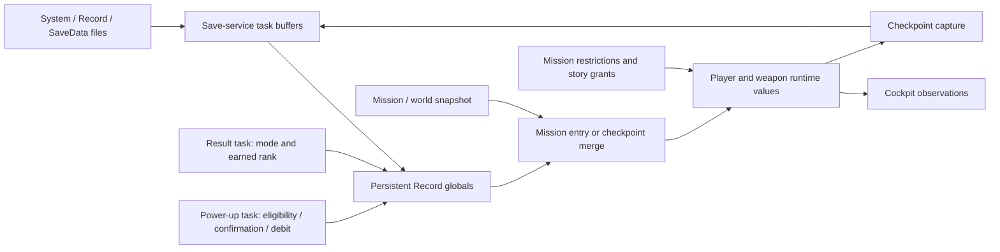

# Player progression rules and original owners

October 24, 2026. Source trace for the first authoritative-player-state slice.
This extends [the ownership audit](player-progression-state.md); it is not a
claim that gameplay admission, a power-up screen or checkpoint restoration is
implemented. The game installation remains read-only.

## Original ownership and publication

The original has distinct persistent, mission, player and screen/service state:

These labels describe responsibilities, not recovered C++ class names. Save I/O
(`0x4c2eb0`, `0x4c3050`) transfers the first 60 Record bytes between its retained
992-byte buffer and globals at `0x12f45d8`. The full file, including the remaining
opaque bytes, is persisted. The power-up task reads and mutates these persistent
values; it does not own an independent progression record. The result task
produces awards at its initialization boundary. Player construction and restore
apply progression into separate runtime state. The existing `Profile` byte owner
can preserve this separation without introducing a second writable mirror.

## Record fields and defaults

Offsets below are relative to the original Record file / globals `0x12f45d8`.
Defaults are the fresh-profile writes in `0x4bb800`, **not** One Shot Kill's
effective loadout. Original concept entry and its approved development-access
policy must be handled separately.

| Offset | Shape | Meaning / fresh default |
| --- | --- | --- |
| `+0` | byte | Current difficulty |
| `+1` | byte | Selected costume |
| `+2..+3` | two bytes | Player stat progression, default `1,1` |
| `+4..+7` | four bytes | Weapon progression, default `1,0,0,0` |
| `+8..+16` | nine bytes | Magic progression, default `0,1,0,0,1,0,0,0,0` |
| `+0x14` | little-endian u32 | Spendable upgrade points, default zero |
| `+0x18` | little-endian u32 | Separate cumulative result counter, default zero; not the point wallet |
| `+0x1c` onward | bit words | Persistent book/tutorial flags; fresh first word is one |

The first six magic slots correspond to `elemental_shot`, `ancient_wall`,
`rose_bomb`, `will_power`, `sacrifice`, and `raven_panice`. The last three are
`thunder`, `tornade`, and `meteor`. These exact spellings are original resource
paths: `0x613b40` loads them into the table at `0x1b8d5e8`, stride 12; magic
admission consumers index that table by magic identity and effective level.
Readable API names should describe the same abilities without carrying spelling
errors into public types. Spell mask bits are a separate compatibility mapping.

`0x603cc0` applies stat and weapon progression; weapon level occupies its low
nibble. It ensures at least one available weapon and repairs an unavailable
selected weapon. `0x604140` normalizes the first six magic levels to `0..3` and
the last three to `0..1`. Learned state, affordability in current magic energy,
mission-disabled masks and action-specific eligibility are distinct consumers:
`0x6001a0 -> 0x6139d0` checks a positive learned byte, whereas
`0x6001d0 -> 0x6139e0` compares the authored cost against current magic energy.

## Upgrade purchase

The category table at `0x962198`, stride 28, declares **two stats, four weapons
and six magic upgrades**. The three story spells are not purchase rows. The
table does not enable a learned-only filter for these categories, allowing
zero-to-one purchases where the price is nonzero.

`0x49eb10` reads the selected level. `0x49eb40` returns the next price from
u16 tables at `0x95bda2`, `0x95bdb2` or `0x95bdd2`, indexed by
`slot * 4 + current_level`, only when the current level is below three.
The fourth u16 stride slot is not another purchase. Do not decode adjacent
data as additional spell prices.

| Upgrade row | Level 0 → 1 | Level 1 → 2 | Level 2 → 3 |
| --- | ---: | ---: | ---: |
| Stat 0 | 1 | 50 | 200 |
| Stat 1 | 1 | 50 | 200 |
| Weapon 0 | 1 | 80 | 200 |
| Weapon 1 | 40 | 150 | 300 |
| Weapon 2 | 50 | 200 | 400 |
| Weapon 3 | 300 | 600 | 900 |
| Elemental Shot | 40 | 150 | 300 |
| Ancient Wall | 1 | 80 | 200 |
| Rose Bomb | 25 | 150 | 380 |
| Will Power | 20 | 180 | 400 |
| Sacrifice | 1 | 50 | 150 |
| Raven Panic | 30 | 150 | 380 |

Eligibility `0x49ebc0` requires current level below three, nonzero next price,
and unsigned wallet greater than or equal to the price. The purchase screen
`0x4d74f0` checks eligibility, requests confirmation, and only on acceptance
enters state `0xdde`: recompute cost, debit via `0x49eb00(-cost)`, increment via
`0x49ec80`, and publish its refresh. A reconstructed mutation should validate and
publish the same transaction together rather than expose unrestricted debit and
increment methods to callers.

When a purchase reaches level one, the screen uses category mapping `0x9621ac`
to set a persistent book/tutorial bit. Stats and weapons map to `0xffff` and do
not set a bit; purchasable magic slots zero through five set bits 9 through 14
in Record `+0x1c`. This is part of the purchase result, not optional UI polish.
`0x4d65f0` checks all two plus four plus six purchasable levels equal three;
the screen then enters the achievement-14 flow. Neither this check nor buying
an upgrade grants the three story spells.

## Result awards

`0x48f220` builds result-screen values. The upgrade award uses difficulty
clamped to `0..4` and a rank index derived from three already-produced rank
values at `0x134c1fc`, `0x134c204`, and `0x134c21c`:

`rank = min(6, ceil((rank_a + rank_b + rank_c) / 3))`.

This is unsigned integer arithmetic in the original. The table at `0x82fab0`
contains the following points; columns follow difficulty IDs zero through four.
Raw performance metrics and their rank-producing algorithms remain separate.

| Rank index | Easy | Normal | Hard | Chaos | Hell |
| --- | ---: | ---: | ---: | ---: | ---: |
| 0 | 200 | 300 | 450 | 650 | 750 |
| 1 | 180 | 250 | 350 | 550 | 600 |
| 2 | 150 | 200 | 250 | 450 | 500 |
| 3 | 100 | 150 | 200 | 350 | 400 |
| 4 | 90 | 120 | 180 | 300 | 350 |
| 5 | 80 | 100 | 150 | 250 | 300 |
| 6 | 70 | 90 | 120 | 200 | 250 |

Result initialization `0x48f590` awards these points only when both mission
`+0x61474` (stage-select) and `+0x6147c` (concept mode) are zero. Ordinary
campaign result points add to the wallet, capped at **99,999**. Stage-select
and concept results still calculate/display result data but skip this wallet
mutation. The source cap is proven in instructions `0x48f60e..0x48f632`;
the initial decompiler expression omits an intermediate store and must not be
copied literally.

The result task's lifecycle owns this publication. There is no recovered
persistent receipt ID in this audit. A typed result transaction may prevent
duplicate application within its owner, but must not invent receipt fields in
the original save layout. Record `+0x18` separately accumulates `0x134c148` in
`0x48f220`; it must not be treated as spendable or lifetime upgrade points.

## Save and checkpoint boundaries

Record load/store preserves the fields above through the original first-60-byte
copy and full-992-byte file I/O. The original loader checks read length, not all
individual progression bounds. A reconstruction rejecting malformed levels or
wallets must describe that as a safety policy and preserve the prior profile;
it is not evidence of the original loader's validation behavior. The 99,999
limit is established at award publication, not as an original file rejection.

`0x43c520` captures runtime player progression, selected weapon and current
health/magic into mission snapshot state. `0x43c1e0` either applies persistent
Record progression directly or takes its restore branch, where two stat, four
weapon and nine magic bytes are raised to the corresponding persistent value
when that value is greater. It then restores the remaining player/world state.
Do not apply that maximum operation indiscriminately to currency, current
health/magic or every save byte. Entry-mode eligibility and complete nested
world restoration belong to their source-backed mission contracts.

See [profile persistence](profile-persistence.md),
[save section layout](saves-and-progression.md), and
[mission-start admission](mission-start-admission.md). Completion provenance
must distinguish Steam achievement 13, base-save completion indicators and
Record upgrade fields; no all-completed profile can be inferred from loaded
costume flags.

## Evidence and verification

The source image SHA-256 is
`bdaff1746d3092215699b09eab11315c6adf8fb71eaa8f46c280b11b3cd448fd`.
Ghidra 12.1.4 ran against the existing project with `-readOnly -noanalysis`.
Ignored raw evidence is under
`research/evidence/reconstruction/progression/`:

- `ExportProgression.java` enumerates references to the persistent Record
  globals, records original table bytes, and calls `ExportEngineSlice.java`.
- `source/functions/`, `source/instructions/`, `source/data-xrefs.txt` and
  `source/references.tsv` retain the exported functions and their callers.
- `upgrade-costs.json` and `tables.json` record price/category/result tables;
  `read_image.py` reads the original PE sections without modifying them.
- `witness.py` executes literal original x86 helpers `0x49eb40`, `0x49ebc0`
  and `0x49ec80`, plus the wallet arithmetic block `0x48f60e..0x48f637`,
  using Unicorn with an initialized original image and synthetic stack/state.
  No function hooks are used. `witness.json` records 163 eligibility/cost
  observations and five wallet arithmetic cases, with zero mismatches.

These are independent original-code observations, not 168 separately authored
tests or a live result-screen validation. They do not execute the full menu,
mission, award lifecycle or disk save/reload path. Existing spell-path witnesses
are in `research/evidence/engine/pass-19-scene-light/` (`0x613b40`) and
`pass-134-magic-admission-states/` (magic-cost consumers).

The trace establishes fields, purchase behavior, award table and mode gating.
Raw result-rank production, complete upgrade effects on runtime stats,
achievement persistence/import, exceptional save states and full checkpoint
object reconstruction remain their explicit follow-on contracts. No production
code or game data was changed by this source-research task.
