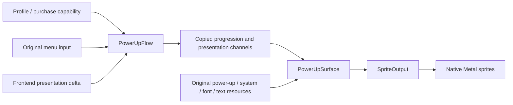

# Native power-up presentation

Status: work in progress. Included with the accepted pause commit at the user’s
request; Power Up itself has not been accepted. Native post-result gameplay and
confirmation edge cases require review before this is considered complete.

The post-result power-up task has dedicated art, localization, transition tracks,
level markers, skill-point digits and a shared native confirmation dialog. It is
not an options page. `PowerUpSurface` presents this task from an immutable
`PowerUpPresentation`; `PowerUpFlow` owns navigation and task timing and borrows
the restricted Profile purchase capability. Rendering cannot grant progression,
advance a clock, admit input or commit a purchase.

The original root only enters this task after campaign results and saves after
it exits. The reconstructed presentation does not create an in-mission or debug
purchase route. Root mission completion/save admission remains a separate owner.

## Recovered presentation

| Source boundary | Reconstructed responsibility |
|---|---|
| `49ece0`, `49ef00` | Request/release `sprite.powerup` and `sprite.text.pup`; shared font/system art remain prepared for the task. |
| `49f000` | Background and moving decorations, category art, total skill points and selected category description. |
| `49f640` | Outer task admission and UI response channels. |
| `4d6820`, `4d74f0` | Category-specific upgrade cards, learned level, next cost or maximum indicator, selected illustration, localized rows/description and purchase policy. |
| `572120`, `572300` | Source endpoint interpolation and maximum end time. |
| `4a80d0`, `4a7710`, `4a8340` | Shared confirmation/information dialog geometry, drawing and input gating. |
| `4c6280`, `4c6240`, `4c6230` | Retained category-selector row animation and observation. |
| `472b80`, `472c70`, `472d10`, `4725b0` | Independent bottom control-prompt owner; these are not row-opacity functions. |

The outer entry lasts 1.2 seconds. Upgrade card entry/exit lasts .7 seconds;
its detail, illustration and row tracks end at .67 seconds. Each track clamps
elapsed time to its own start/end, applies the original quintic remapping and,
where specified, its endpoint-tangent response. Two outer decoration tracks use
quintic remapping alone. The shared math helper retains the original operation
order. Exit samples the same tracks backwards. No animation timer lives inside
the resource surface.

The original text table supplies English language ID 200. The loader validates
STMANAGE record/group/language/pool offsets, resolves the authored four-digit
record keys, selects that language and converts
full-width Latin characters to the existing ASCII font-emission contract during
preparation. Labels and descriptions are read from the purchased asset instead
of authored English replacements. Category labels themselves are original image
art. Stat/weapon/spell pages have exactly 2/4/6 upgrade rows; there is no invented
Back row. Original cost and level digits use their atlases, and the selected
weapon/spell illustration comes from the power-up archive.

The native confirmation uses `pup0017`, yes/no text from `sys0001`/`sys0002`,
a full-width dark band and system border/button art. Insufficient points and
maximum level use `pup0018`/`pup0036`, with no yes/no selection. All three records
have one page; embedded newlines do not imply multiple pages. Navigation and
transaction completion belong to the flow, not the display.

The scalar publication distinguishes wallet opacity, category description
opacity, category selected tint and child highlight response. They are not
collapsed into one generic screen fade. The native child highlight adds a
uniform color before the original unsigned shader-color clamp; the prepared
sprite color performs the same uniform operation. Each category row also retains
its own displacement and kick response. The source updates displacement toward
the previous kick before damping the kick toward zero; navigation kicks the new
selected row with the original signed amplitude. Selected category bob uses the
original periodic sine response. Full PE operand-reference inspection found the
unusual coefficients are fixed data read by this selector, with no runtime
writer or random initializer; they are not frozen samples from one execution.

Outer and child control prompts have independent quarter-second opacity owners.
Both draw during their overlap. Labels `sys0027`/`sys0028` and the original icon
pack are prepared once. Controller hints use the original A/B images. The Mac
host binds Return/Escape, so keyboard hints use those corresponding original
images rather than claiming the PC mouse/Space and mouse/Shift bindings.
Input-layout selection is supplied by the host through a copied presentation;
the resource surface does not discover devices. Notice dialogs show the original
confirm glyph at the source position only after the flow publishes the source
input gate. This default mode is a control glyph, not the alternate animated
arrow mode in the shared native owner.

## Ownership and cost

The noncopyable/nonmovable surface retains only ResourceService and SpriteOutput
borrows plus an owned copy of the original input-icon pack. Both borrowed
services outlive it. Resource interests and leases belong to the surface;
the renderer owns the uploaded texture storage. The surface state uses the
ResourceService memory domain. Preparation retains 35 power-up images, five
system images, one font atlas, four input glyphs and a one-pixel white texture
for the original untextured dialog primitive: 46 texture identities. The published sprite list
and normalized English text use fixed arrays. `show` does no resource parsing,
loading, upload, allocation or persistence.

Failures in setup release partial texture/resource ownership. Repeated `end`
is harmless. Invalid enum values, indices, progression or nonfinite time/channel
values fail before publication. Profile changes are copied into a new snapshot;
the renderer never receives a mutable Profile or player reference.

Design consultation retrieved Core F.7 (`#rf-smart`) and performance MEM.9
(`guidelines/memory/MEM.9-embedded-allocate-at-init.md`). Implementation retrieved
Core E.6 (`#re-raii`), SL.con.3 (`#rsl-bounds`), MEM.9 and GPU.1
(`guidelines/gpu/GPU.1-keep-data-on-device.md`). Their application is explicit
nonowning parameters, RAII teardown, checked binary/command bounds, fixed frame
storage and retained device textures.

## Verification

The ignored `research/evidence/reconstruction/power-up/` directory contains the
literal x86 draw witnesses, native records and actual-content offscreen probe.
The witness executes outer draw `49f000` and child draw `4d6820`, intercepting
external rendering/text publication while retaining original sprite/template
math. It supplies controlled level/cost/selection observations and performs the
CRT assignment at `401ee0` required by the stat-description pointer table.
Ordinary and maximum-level cases identify exact positions, digit UVs, marker
spacing, preview offsets and localization IDs. A separate witness executes
shared dialog draw `4a7710` and checks its dark band, borders and centered choice
art.

The offscreen probe uses production resource loaders, original archives,
production texture allocation/mips and the compiled production Metal sprite
shader. It renders categories, all three upgrade pages, confirmation,
insufficient points, maximum level and a controller notice. The eight states
reached a peak of 46 textures and released every texture/device charge. The
probe also rejects nonfinite channels and invalid input-layout enums, checks
idempotent teardown and rejects drawing after retirement. All eight rendered states were visually inspected, including both input
glyph families and notice continuation. These are controlled presentation
snapshots; the prompt overlap channels are deliberately exercised independently
of a complete task history. A separate 50-frame literal selector witness covers
up/down wrap and the Back jump to Exit; four rows' displacement/kick values and
periodic bob match the shared production math within 2.87e-6. This verifies the resource/shader
presentation, not a visible-window post-mission walkthrough. No game assets,
raw decompiler output or captured images are added to Git.

The independent review and full repository gate remain integration checks; the
surface's isolated strict compilation and pinned fatal clang-tidy passed.
