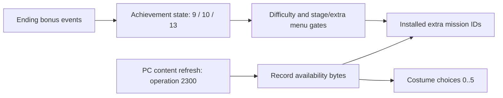

# Profiles and front-end persistence

October 22, 2026. Original PC compatibility fields below are recovered from
Ghidra 12.1.4 read-only exports of the already analyzed unpacked executable.
Generated pseudocode/instruction witnesses live under
`research/evidence/reconstruction/profile/`; they are not source code imports.
The original installation remains read-only.

## Structure and ownership

`game::Profile` owns the original 72-byte System and 992-byte Record payloads,
plus an optional 307,200-byte checkpoint file. Unknown bytes remain opaque and
survive writes unchanged. This is a bounded menu-facing interpretation, not a
complete world-object serializer. Checkpoints are never synthesized here.

| Payload / offset | Interpretation | Evidence |
|---|---|---|
| System +0, u16 | Preferred difficulty, default 1 | 0x4bb7f0, 0x4bb800 |
| System +2, u16 | Settings flags, defaults OR 3 | 0x4bb800 |
| System +4 / +8, u32 | Music / effects volume, default 256 | 0x4bb7c0, 0x4bb7e0, character-load volume consumers |
| System +12..71 | Control settings, scan-code defaults | 0x4bb900 |
| Record +0, byte | Current game difficulty | 0x4d2110, 0x493a20 |
| Record +1, byte | Selected costume ID (`pwN`) | 0x4c2cf0 |
| Record +0x3c..0x7b | Extra mission availability bytes | task +0x400, 0x470d70 |
| Record +0x7c..0x87 | Costume availability bytes | task +0x440, 0x470d90 |
| Checkpoint header +12 | Offset of 0x500-byte base data | 0x493a20 |
| Base +0 / +2 | Stage / difficulty | 0x47c080, 0x494210, 0x494020 |

Original Record I/O copies only its first 60 bytes to/from live global state;
the remaining bytes are still persisted in the same file. This distinction
explains why treating every menu flag as a global record field was incomplete.
System difficulty preference is distinct from the live difficulty selection.

The storage capability uses named bounded bytes with explicit missing, invalid,
and I/O outcomes. Profile load validates a candidate and publishes only after
all files succeed; a missing file retains recovered fresh defaults. Failure
never silently resets or overwrites a corrupt file. The screen owns retry or
continue-without-saving policy. Save clears dirty flags per successful file,
so an interrupted multi-file save can be retried; the files are not one atomic
transaction. Existing Steam save directories are never automatically imported.

## Established implementation comparison

Inspected Unreal Engine revision
`f45729c0b6f097038e72b52d366a62baeca3275b`,
`Engine/Source/Runtime/Engine/Public/SaveGameSystem.h`:
`ISaveGameSystem`, `FGenericSaveGameSystem::SaveGame`, `LoadGame`, and
`GetSaveGamePath`; and `Private/SaveGameSystem.cpp`, `LoadGameAsync`,
`SaveGameAsync`, `OnAsyncComplete`. The source was read from the local authorized
reference checkout; no Unreal source was incorporated.

Adopt the separation between a platform storage capability and game-owned
serialization, explicit existence/error outcomes, owned read buffers and an
application-specific saved-data location. Unreal's async wrapper serializes work
on a task pipe and publishes completion to the game thread. This bounded slice
uses synchronous I/O during front-end transitions, as the recovered game did;
no worker system or thread-safety is claimed. Moving storage off-thread later
must preserve owned buffers and game-thread publication.

The POSIX backend improves on the original truncating `fopen("wb")`: it writes
an exclusive sibling temporary, checks write/flush/fsync/close, then atomically
renames. A failed write leaves the prior file intact. Directory metadata is not
fsynced, so crash-proof persistence is not claimed. Mac chooses Application
Support through Foundation, outside the game directory. Common contracts carry
no Foundation/POSIX types.

## Verification boundary

In-process tests cover recovered defaults, original-size round trips, opaque-byte
retention, failed-load nonpublication, corrupt checkpoint rejection and write
retry. They do not establish complete original save compatibility, checkpoint
object reconstruction or native power-loss durability. Native storage is
verified separately in the front-end run. The follow-up below closes costume/extra installed flags and achievement
gates. Asset existence alone is not an unlock policy.

## Steam availability and progression: closed follow-up

The Steam build separates **installed extra content** from **achievement-based
menu gates**. Earlier research called the 0x470dc0 table generic content
availability. Its producer identifies it as an achievement snapshot.

`0x4c2950` handles successful UserStats receipt. The already mapped context
+0x14 is `SteamUserStats011`; the callback gets the achievement count (slot
+0x38), resolves each achievement name (+0x3c), and obtains its boolean (+0x18)
into bytes +0x24 onward. `0x4c25e0` reads the one-based ID at +0x23+ID;
`0x4c2c90` copies it into the save-service ID/value table; `0x470dc0` queries
that table. `0x4c27c0` sets an achievement through +0x1c and updates the same
byte. Valve's [UserStats documentation](https://partner.steamgames.com/doc/api/ISteamUserStats)
explains these operations; the exact version-011 offsets and call arguments are
local executable evidence, not inferred from current SDK ordering.

| One-based achievement ID | Recovered award event | Front-end consumer |
|---|---|---|
| 9 | Complete the game on difficulty 2 (Hard) | Include difficulty 3 (Chaos), 0x4d1910 |
| 10 | Complete the game on difficulty 3 (Chaos) | Include difficulty 4 (Hell), 0x4d1910 |
| 13 | Complete the game on any difficulty | Enable stage selection and extra missions, 0x49a690 |

The award source is the ending bonus task `0x4a4ab0`: state 500 queries and
queues achievement 13, then state 510 maps current difficulty 0..4 to IDs
7..11. Hard/Chaos first-completion messages use `net.0050` / `net.0051`;
the any-completion message uses `net.0052`. This establishes gameplay events
for eventual local progression without requiring a Steam dependency. It does
not prove that the Record bytes contain enough evidence to reconstruct an
existing player's complete achievement history. Fresh progression has these
three gates false; installed assets alone must never set them true.

`0x471aa0` requests save-service operation 2300; `0x4711c0` dispatches it to
`0x4c31b0`. That function unconditionally refreshes the PC content flags:

- Costume IDs 1..5 receive value 2. Costume 0 is always accepted separately.
- A 64-byte clear starts at extra index 1 and ends at costume index 0.
- Extra mission IDs 0..5, 16..21 and 32..37 receive value 2.
- Other costume bytes are untouched. The availability getters accept any
  nonzero value; the exact value 2 is retained rather than reduced to bool.

The options update `0x4d4c10`, state 2000, requests this operation before
continuing into its content-selection flow. The title-menu extra route uses
states 7510/7511 (`0x1d56`/`0x1d57`) to refresh and wait before checking its
extra count. The main extra entry has already passed achievement gate 13.
This matches the reported PC behavior: the five supplied costumes do not require
completion; reaching extra missions does. The refresh describes the supplied
PC content, not DLC ownership authentication or an asset existence heuristic.

`Profile::refresh_installed_content()` reproduces exactly these byte writes and
marks the Record dirty; the menu calls it at the original content-refresh
boundary. Constructor/load defaults remain distinct from this operation.

Reproduction uses `research/tools/ExportEngineSlice.java` against the existing
read-only analysis project. Follow-up seeds and outputs are recorded under
`research/evidence/reconstruction/profile/steam-seeds.txt` and `steam-export/`;
previous source witnesses include `pass-06j/004c31b0`, `pass-06s/0049b320`,
`pass-menu-01/004d4c10`, and `profile/export3/004a4ab0`. A later native run remains
necessary to establish original visual/interaction equivalence.

## Persistence implementation acceptance

The shared profile and character-load policy pass the strict host build,
in-process defaults/opaque-byte retention/failure/dirty-write/checkpoint
validation cases, and fatal clang-tidy. The desktop flow gates loading on
resource readiness and fades; retry and explicit continue-without-saving are
verified in process. Native file round trips are exercised by the existing
original-root integration when the front-end composition is connected.
No original-game save round-trip or full checkpoint object reconstruction is
claimed.
