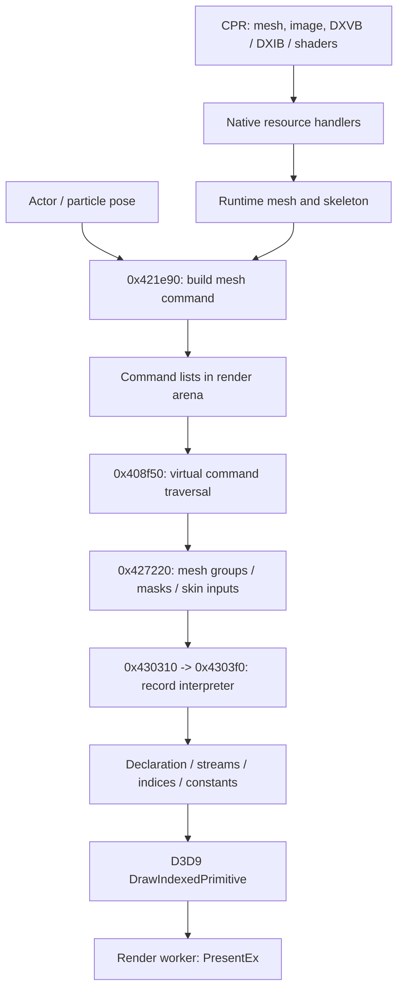

# Renderer, GPU resources and presentation

October 22, 2026. [Architecture](../ARCHITECTURE.md) ·
[Model data](model-data.md) · [Particle GPU path](particle-runtime-contracts.md).
This maps the original renderer; implementation and visual matching remain deferred.

## Resource-to-draw path

The PC renderer uses D3D9Ex, with device pointer 0xa0b6e0. CPR type handlers
create textures, buffers and shader objects; the mesh CALL handler assembles
those references with skeleton and draw metadata. See [resource dispatch](resource-dispatch.md).

Model command builder **0x421e90** allocates through 0x420280, which reserves
0x540-byte objects and initializes them with 0x4209b0. Their vtable at
0x827ff0 resolves execution to **0x427220**. The command retains mesh/model
references at +0x18/+0x1c, transform/material-related inputs and several copied
state blocks. Its tag is 0x56444330. The executor checks readiness, group masks
and optional deformation/skin paths before calling 0x430310 → **0x4303f0**.
The latter interprets nested render records and reaches the D3D API.

| Record tag (numeric spelling) | Observed executor behavior |
|---|---|
| CNKH (0x434e4b48) | Recurse into nested record bytes |
| DGRP (0x44475250) | Dispatch group through 0x4307d0 |
| DVOL (0x44564f4c) | Visibility/volume-related branch through 0x430850 |
| VDCL (0x5644434c) | SetVertexDeclaration, slot +0x15c |
| VTX / VTXS | SetStreamSource, slot +0x190; alternate stream/offset sources |
| IDX (0x49445820) | SetIndices, slot +0x1a0 |
| DIP (0x44495020) | DrawIndexedPrimitive, slot +0x148, or alternate helper 0x430810 |
| TANM / TRST / GENV | Texture-animation/reset/environment-related state paths |
| kns2 / knsC / knsS | Skin-related helpers 0x547e70 / 0x4308b0 |

The byte stream advances by `8 + payload_size` per record. The direct DIP branch
passes six 32-bit fields to DrawIndexedPrimitive in API order: primitive type,
base vertex, minimum vertex, vertex count, start index and primitive count.
The alternate renderer mode routes DIP through 0x430810 and must be retained.
The row names above spell the numeric tags as characters; original file byte
order remains little-endian.

Separate command families at vtables 0x828008 and 0x828010 execute through
0x4277b0 and 0x4276d0, uploading vertex constants. Model particles queue list
wrappers at vtable 0x83caa0; 0x408270 forwards to the contained command/list.
The particle-specific triangle path is already documented separately.

## All named shader variants resolved

The original open question connecting **766 named variant IDs** to embedded
bytecode is now resolved for the native registry. Table **0x954420** has
766 12-byte records: name pointer and four 16-bit shader IDs. The handlers derive
variant index from the character at name position 12 minus `'S'`. The two mapped
positions select S or T pairs:

| Record offset | Selection |
|---|---|
| +4 / +6 | S vertex / pixel shader IDs |
| +8 / +0xa | T vertex / pixel shader IDs |

0x41af00 creates vertex shaders; 0x41ae30 creates pixel shaders. Both reference
8-byte cache entries at **0x9534d0** (bytecode pointer, COM pointer), AddRef an
existing object or create/cache it on first use. Every referenced ID is in range
and has the expected stage. All **490** entries are used: **53 vertex shaders
and 437 pixel shaders**, all shader model 3.0, with 490 distinct bytecode hashes.

All 490 hashes match the earlier broad scan. That scan had 541 candidate
occurrences but 539 unique hashes, leaving **49 unique hashes outside this
registry**. These are additional shader paths/candidates, not missing mappings
for the 766 names. Particle shader pairs are mapped separately. Instruction-token
boundaries were checked through END; this is not GPU semantic validation.

[Complete variant/cache manifest](../../evidence/engine/pass-06/shader-registry.json) ·
[Reproducible audit](../../tools/shader_registry_audit.py).

## Render queue and presentation thread

The renderer uses a separate worker, not a single main-thread Present call.
0x40f890 initializes two command-list positions in an arena; 0x40fe10 sizes the
arena into aligned segments. The VSync task's active update 0x417440 calls
0x40f920, which waits on the completion event, publishes the filled list at
owner +0x70, signals the work event and advances/wraps the arena for the next list.
The list vtable 0x6c20f4 resolves to 0x408f50, which walks linked commands and
invokes each command's first virtual method.

Worker **0x40fbe0** waits for submitted work, invokes the list, applies a
performance-counter/Sleep pacing loop, calls **PresentEx** (device slot +0x1e4),
signals completion and waits again while its run flag remains set. Initial
PresentEx uses flag 1; repeated presentation uses flag 0. BeginScene/EndScene
wrappers are 0x408250 / 0x4084b0. Event ownership is +0x78/+0x80 interfaces
with handles at +0x7c/+0x84; their wait calls use 0xffffffff.

This establishes a producer/consumer handoff and a completion wait before arena
reuse. It does not establish frame rate on this Mac. Lost-device/reset behavior,
all error returns, every command type, render-target/postprocess ordering and
shader constant meanings remain bounded renderer questions.

## Evidence

[Mesh command](../../evidence/engine/pass-06j/functions/00421e90.c) ·
[Mesh execution](../../evidence/engine/pass-06m/functions/00427220.c) ·
[Render-record interpreter](../../evidence/engine/pass-06n/functions/004303f0.c) ·
[Queue publication](../../evidence/engine/pass-06m/functions/0040f920.c) ·
[Command traversal](../../evidence/engine/pass-06n/functions/00408f50.c) ·
[Worker / PresentEx](../../evidence/engine/pass-06n/functions/0040fbe0.c) ·
[Microsoft SDK header provenance](../../sources/directx-2010-reference/provenance.json).
