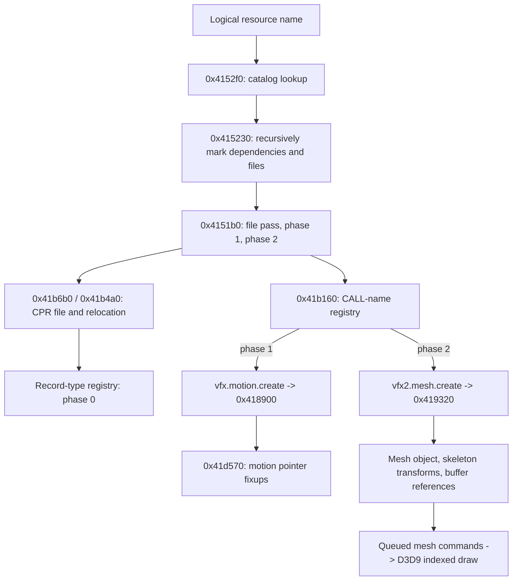

# Named resources, CPR loading and native handlers

October 22, 2026. [Architecture](../ARCHITECTURE.md) · [Model data](model-data.md).

## Request and dependency path

`0x4152f0(name)` lowercases the logical name and searches loaded resource catalogs
through `0x41ba60`. It returns the corresponding 12-byte runtime resource entry.
When neither of its low two state bits is set, `0x415230` marks it requested,
recursively requests dependencies, and marks its containing file requested.
Catalog entries referenced here have a 20-byte stride. Dotted-name traversal is
visible in `0x41ba60`, `0x41b9a0` and helpers; RAT ingestion/relocation is now connected below.

[Request](../../evidence/engine/pass-02/functions/004152f0.c) ·
[Dependency marking](../../evidence/engine/pass-02b/functions/00415230.c).

`0x4151b0(tag)` performs three passes across loaded catalogs:

1. `0x414dd0`: open requested, not-yet-loaded files through `0x41b6b0`.
2. `0x414e50`: dispatch phase 1 until its loaded files complete that phase.
3. `0x414ec0`: dispatch phase 2 similarly.

Physical file objects are opened by `0x41b4a0`: read a 0x60-byte header, allocate
sections, use a 0x30-byte record stride, relocate names/argument references, then
invoke registered record-type handlers. CALL records are deferred. These features
connect the native loader to the CPR layout already mapped from the files.
[CPR loader](../../evidence/engine/pass-02d/functions/0041b4a0.c).

The wrappers return 1 on their normal paths, including a file-pass branch that
sets a failure bit when opening returns null. Do not interpret their return as a
complete error result. Error propagation and failed-record visibility remain open.

## Two dispatch registries

Type dispatch uses table/count at `0xaf04f0 / 0xaf04d0`. Named CALL dispatch uses
`0xaf0530 / 0xaf04d4`, with 48-byte registration entries: name then callback at
`+0x2c`. `0x41b040` registers handlers. `0x41b160` compares each CALL record's name
and invokes `(phase, archive, record, existing-resource)`; record `+0x2c` tracks its
completed phase. Failed callbacks leave that phase incomplete for retry.

Registration `0x417f80`, called during application service initialization, installs:

| Name | Handler | Observed action |
|---|---|---|
| `vfx.motion.create` | `0x418900` | Phase 1 resolves `motion.a`, calls `0x41d570`, stores/publishes payload; phase 3 unregisters |
| `vfx2.mesh.create` | `0x419320` | Phase 2 assembles mesh and associated data; phase 3 releases mesh-related allocations and unregisters |

[Byte-checked registration witness](../../evidence/engine/pass-02/table-witnesses.json) ·
[CALL dispatcher](../../evidence/engine/pass-02d/functions/0041b160.c) ·
[Mesh handler](../../evidence/engine/pass-02d/functions/00419320.c) ·
[Motion handler](../../evidence/engine/pass-02d/functions/00418900.c).

## Mesh and animation implications

The mesh handler resolves header/texture/skeleton inputs and named optional inputs
`volume_clip`, `mat_table`, `table`; counts `vertex`, `shape_vertex`, `index` and
`shape_offset` references; creates a mesh object; allocates reference arrays; binds
the resolved records; and stores the constructed object at CALL record `+0x18`.
It expands 104-byte skeleton records into larger runtime records including derived
transforms. This now connects the prior file-level skeleton observation to code.
Buffer creation, ownership of all payloads and exact shader/draw contracts remain open.

`0x41d570` adjusts motion table/channel offsets into pointers and handles multiple
header cases. It is a **relocation/preparation routine**, not yet a recovered
animation sampling algorithm. Next trace its prepared structure into actor updates
and time-dependent sampling. No viewer or renderer was built during this pass.

## RAT ingestion, namespace precedence and publication

The application-specific startup hook 0x43a290 loads unstable/stable catalogs
through **0x414f30**, with sort keys 20 and 30. The shader catalog is requested
with key 55. The loader resolves `GAME:\` and `concept:\` prefixes, opens the
file, allocates a 0x90-byte catalog owner and a VirtualAlloc buffer, reads bytes,
and calls 0x41b910 → 0x41b880 to relocate the catalog.

| RAT header offset | Recovered role |
|---|---|
| +0x10 | Namespace-tree base |
| +0x18 | Resource count computed from +0x24 / 20 |
| +0x1c | File count computed from +0x34 / 8 |
| +0x20 / +0x24 | Resource records / byte size |
| +0x28 | Dependency area |
| +0x30 / +0x34 | File-name pairs / byte size |
| +0x38 | String pool |

0x41b820 recursively relocates namespace nodes; 0x41b920 relocates resource
names, namespace pointers, extra strings and dependency lists. File-name pairs
are two 32-bit pointers relative to the string pool (nullable directory plus
filename). 0x414a10 composes the retained catalog directory and file-name pair.
0x41ba60 traverses dotted components with 0x41bb60 and resolves the final name
through 0x41bad0.

Catalog owner +4 holds the relocated file; +8 and +0xc hold separate 12-byte
file/resource runtime entries. Registration appends the owner to 0xa0e3c0,
increments 0xa0e3b8 and sorts ascending by owner key using 0x414990. Name lookup
walks that order and returns the first match. Thus lower-key catalogs take
precedence; equal-key ordering is not guaranteed by this comparator.

A resource's requested/available bits are separate from file state. Publisher
0x415530 sets resource bit 1 and stores payload/record pointers. Lookup
0x415420 requires that availability bit; 0x4154b0 returns an entry regardless
of readiness. File states are:

| Mask | Meaning observed in consumers |
|---|---|
| 0x01 | Requested |
| 0x02 | Opened/loaded |
| 0x04 | CALL phase 1 complete |
| 0x08 | CALL phase 2 complete |
| 0x10 | File-open failure |

The file pass skips files with 0x02 or 0x10 already set. Phase loops 0x414e50
and 0x414ec0 retry eligible loaded files until every invoked handler reports
completion; no bounded retry is visible in those loops. A failed-open file is
excluded from these phase loops. Therefore a completed worker job does not
prove that every requested resource became available. This establishes the
failure boundary; exact script/UI outcomes for every failed asset remain
unresolved and must not be inferred from queue emptiness.

[Catalog loader](../../evidence/engine/pass-06m/functions/00414f30.c) ·
[Relocation](../../evidence/engine/pass-06n/functions/0041b880.c) ·
[Resource fixups](../../evidence/engine/pass-06n/functions/0041b920.c) ·
[Publisher](../../evidence/engine/pass-06n/functions/00415530.c).

## Native GPU resource consumers

Record registration 0x41b3c0 installs seven handlers: DDS, DDSC, DXIB, DXVB,
USER, DXVS and DXPS. DDS handler 0x41a6f0 decodes the embedded image through
D3DXLoadSurfaceFromFileInMemory, creates a texture and staging surface, copies
the first level and creates further mip levels. DXVB 0x41ac80 and DXIB 0x41aa70
create D3D buffers, lock/copy/unlock payloads and publish COM pointers. Index
format is selected from metadata bit 31 (D3DFMT_INDEX16/INDEX32). DXVS/DXPS
handlers 0x41ada0/0x41aba0 resolve named shader variants through the shared
shader cache. Their type-release branches Release the COM objects and clear
publication. Detailed drawing continues in [rendering](rendering.md).

## Tag unload and publication identity

0x415550(tag) scans each catalog's file-runtime entries. Matching +4 tags call
0x41b080 to unlink the CPR from the global loaded list, invoke 0x41b270, and
free the archive object. The file entry then clears its low five state bits,
pointer and tag. Concrete callers include world reset/setup and stage-resource
release; the tag selects file ownership rather than a global unload-all action.

0x41b270 walks the archive's 0x30-byte records. A named resource is passed to
release only when its published record pointer matches this record; this prevents
clearing a different publication with the same logical name. CALL records receive
phase 3, typed owned resources receive type-release phase 1, and alias-like
records clear publication when applicable. Section memory is freed after record
release. This closes normal unload through mesh/motion/GPU handlers. Pending-job
cancellation races and exceptional partial initialization remain unresolved.

[Tag release](../../evidence/engine/pass-06p/functions/00415550.c) ·
[Archive unlink](../../evidence/engine/pass-06o/functions/0041b080.c) ·
[Record teardown](../../evidence/engine/pass-06o/functions/0041b270.c).
