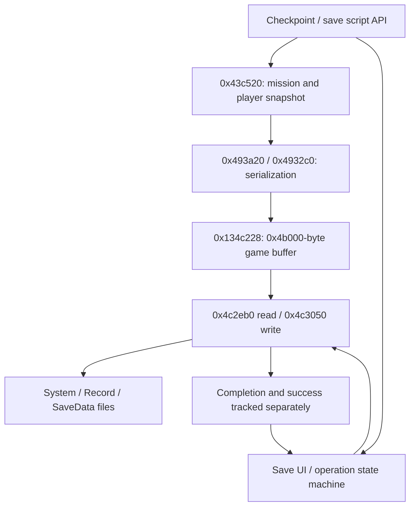

# Save, checkpoint and progression services

October 22, 2026. [Architecture](../ARCHITECTURE.md). Static map; no save files
were modified and the game installation remains untouched.

## Persistence boundary

The filename table at `0x95fc98` has three usable entries:

| Index | Relative Windows path | Payload |
|---|---|---|
| 0 | `savedata\BulletWitchSystem` | 72 bytes from task +0x334 |
| 1 | `savedata\BulletWitchRecord` | 992 bytes from task +0x3c4 |
| 2 | `savedata\BulletWitchSaveData` | Caller-provided buffer and length |

`0x4c2eb0` opens `rb`, reads the requested length and requires the exact byte
count. `0x4c3050` opens `wb`, writes the requested length and checks the exact
count before closing. Record save copies the global record state around
`0x12f45d8` into its buffer; system load reapplies controls/settings. Game data
uses pointer/length fields +0x32c/+0x328. The common getters return buffer
`0x134c228` and size `0x4b000` (307,200 bytes).

A failed write attempts `_mkdir("savedata")`. Successful directory creation
leaves the operation pending so a later invocation can retry. Failed directory
creation opens message `mem.0018` and advances the dialog state. The eventual
completion return and success field +0x84 are distinct: dialog completion may
return true with +0x84 equal to zero. Field +0x318 also permits an early-success
bypass; its policy must be preserved if this task is reimplemented.

## Scheduling and checkpoint data

Dispatcher `0x4711c0` uses operation field +0x70:

| Operation | Action |
|---|---|
| 200 / 300 | Load / save game (index 2) |
| 400 | File-existence path |
| 500 / 600 | Load / save system (index 0) |
| 700 / 800 | Load / save record (index 1) |

Completion clears +0x70; +0x84 carries the result. UI/task state machines provide
asynchronous script-facing behavior around synchronous CRT file operations.
Save UI constructors/updates include `0x4a4e00 / 0x4a4f70` and
`0x4a5640 / 0x4a6380`. Request `0x471930` supplies game buffer and size.

`_SetCheckPoint` (`0x47bae0`) stores the script argument in checkpoint state at
`0x1300898` and calls `0x43c520`. `_GetCheckPoint` (`0x478d20`) reads that state.
The snapshot gathers mission state, player health/equipment-related fields and
calls `0x493a20` / `0x4932c0`. Those writers begin the serialization buffer with
`0x00010001`. Copy helpers `0x493fa0` / `0x493fc0` move 0x4b000 bytes between
working storage at `0x1300c40` and the persistence buffer at `0x134c228`.
The writer exposes original section labels in its 0x30-byte header:

| Offset | Label / value |
|---|---|
| +0 | 0x00010001 |
| +4 | `size`: used serialization length |
| +8 / +0xc | 0x500 / `ofs_savedata` (0x30 in the base writer) |
| +0x10 / +0x14 | `sz_missiondata` / `ofs_missiondata` |
| +0x18 / +0x1c | `sz_bgobj` / `ofs_bgobj` |
| +0x20 / +0x24 | `sz_enemy` / `ofs_enemy` |
| +0x28 / +0x2c | `sz_enecb` / `ofs_enecb` |

0x493a20 writes the base saved-data section (0x500 bytes). 0x4932c0 preserves
that section and appends 0x3a4 bytes of mission state from 0x1300898, then
16-byte-aligned background-object, enemy and enemy-callback sections through
0x446e70, 0x447bb0 and 0x4823c0. Those names come from the writer's labels;
the exact nested object records and header version semantics remain unresolved.
The file write size (0x4b000) is distinct from the used-length header.
[Base writer](../../evidence/engine/pass-06k/functions/00493a20.c) ·
[Mission writer](../../evidence/engine/pass-06k/functions/004932c0.c).

## Remaining local contracts

- Interpret every serialized field, record count, validation/version path and
  load-side reconstruction before claiming a compatible save writer.
- Trace bonus/costume unlock policy from `_ExecBonusOpen` and menu consumers;
  presence of costume assets alone does not establish their unlock conditions.
- A Steam remote-storage interface name does not prove these CRT writes are
  uploaded by the executable. Cloud synchronization policy remains separate.
- Cover unusual operation states and malformed/short data paths explicitly.

## Native evidence

[0x4c2eb0](../../evidence/engine/pass-06j/functions/004c2eb0.c) · [0x4c3050](../../evidence/engine/pass-06j/functions/004c3050.c) · [0x4711c0](../../evidence/engine/pass-06j/functions/004711c0.c) · [0x493fe0](../../evidence/engine/pass-06j/functions/00493fe0.c) · [0x494000](../../evidence/engine/pass-06j/functions/00494000.c) · [0x43c520](../../evidence/engine/pass-06k/functions/0043c520.c)
