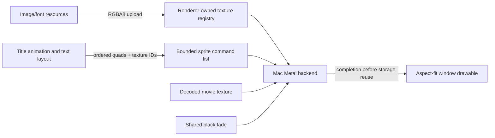

# Sprite presentation

The startup/title renderer uses ordered textured quads in a virtual 1280×720
canvas. Game code supplies positions, tint and alpha; the renderer owns uploaded
textures and native presentation. This is a reusable engine capability rather
than title-specific drawing in the platform host.

## Established implementation inspected

Doom 3 revision `a9c49da5afb18201d31e3f0a429a037e56ce2b9a`,
[`neo/renderer/GuiModel.cpp`](https://github.com/id-Software/DOOM-3/blob/a9c49da5afb18201d31e3f0a429a037e56ce2b9a/neo/renderer/GuiModel.cpp):
`Clear`, `SetColor`, both `DrawStretchPic` overloads, `EmitSurface`, and
`EmitFullScreen` establish ordered GUI surfaces, virtual screen coordinates,
quad position/UV/color submission, and frame-owned GPU submission lifetimes.
This project adopts those responsibilities and the virtual-coordinate model.
No reference source is copied. Doom's material batching, frame allocator and
world GUI paths are unnecessary for this bounded startup implementation.

## Contracts and departures

- Upload copies a bounded straight-alpha RGBA8 image into renderer-owned native
  storage. Callers retain no native handles. Texture IDs are unique during the
  host lifetime and release cannot alias a subsequently uploaded texture.
- A submission copies at most 511 ordered sprites into fixed storage. Up to 128
  textures (128 MiB total) can be resident. The 511-quad bound matches the
  recovered sprite-pool active limit; residency bounds are implementation budgets. Invalid rectangles, colors, UVs or stale handles fail
  explicitly; submissions validate entirely before replacing the prior frame.
- Native Metal performs source-over straight-alpha blending. Movie presentation
  precedes sprite commands; a common opacity multiplies the completed composition
  equivalently by multiplying all source RGB values before blending. Sprite alpha
  remains unchanged by the black fade, avoiding double fading of layers. Packed
  font textures select one R/G/B/A channel as white glyph coverage before tinting;
  this retains the original atlas once without four duplicated images.
- GPU completion remains synchronous, as in the existing host, so upload/release
  cannot race in-flight work. Texture allocations occur at resource setup; command
  collection uses fixed storage. This does not claim a completed engine allocator
  or eliminate allocations internal to Metal.
- The logical canvas is aspect-fit to drawable pixels and clips at its boundaries.
  Windowed size is a platform setting, default 1280×720 points clamped to the
  visible frame. Launch uses native full screen by default; game coordinates and
  media timing are independent of window mode.

Design consultation: C++ Core Guidelines `R.2` (`rr-use-ptr`) makes image/command
views explicit spans. Performance `MEM.9`
(`guidelines/memory/MEM.9-embedded-allocate-at-init.md`) motivates fixed command and
texture tables, with native allocation confined to upload/setup rather than
per-frame game submission.

Implementation consultation: C++ `SL.con.3` (`rsl-bounds`) validates all command
fields/handles before replacing the active command list; performance `GPU.1`
(`guidelines/gpu/GPU.1-keep-data-on-device.md`) retains textures across frames and
keeps uploads at the resource transition boundary.

## Original blend evidence

The original sprite default blend indices 4 and 5 resolve through the table at
`0x841050` to native values 5 and 6. The retained SDK's `D3DBLEND` enum identifies
these as source alpha and inverse source alpha. Thus normal source-over blending
is evidence-backed rather than an arbitrary preset. The packed-font channel
interpretation is recorded by the title asset investigation.

For a shared black fade `F`, a source sprite color `C` with local alpha `a` over
movie/background `V` produces `a·(F·C)+(1−a)·(F·V)`, equal to the complete
composition multiplied by `F`. The native shader therefore scales RGB by shared
fade while preserving local alpha. Applying shared fade to alpha as well would
incorrectly reveal the underlying layer during a fade.

Title draw instructions load the same two-word view pair (`+0x14`, `+0x18`) for
sprite and movie submission. These are not evidence of two independent layer
queues. The sprite batch is later published by `0x4ac9c0 → 0x569170`. The
`TaskOverlay` constructor at `0x4ac950` assigns priority `0x2002`, after the title
(`0x2000`) and root (`0x2001`) under ascending scheduler order. Its vtable at
`0x82bd50` has `0x4ac9c0` at slot `+0x1c`; thus movie command submission precedes
the global sprite flush. Movie-first composition follows this recovered ordering.
See [startup screen behavior](startup-screen-behavior.md) for the instruction
witness and the distinction between task draw and global overlay publication.

## Native full screen startup

SDL 2.32.10, revision `5d249570393f7a37e037abf22cd6012a4cc56a71`,
[`SDL_cocoawindow.m`](https://github.com/libsdl-org/SDL/blob/5d249570393f7a37e037abf22cd6012a4cc56a71/src/video/cocoa/SDL_cocoawindow.m),
was inspected at `setFullscreenSpace`, `windowDidEnterFullScreen`,
`windowDidFailToEnterFullScreen` and `Cocoa_SetWindowFullscreenSpace`. Its Cocoa
backend requests a native full screen Space, tracks transition completion through
window notifications, and pumps events until completion before returning from
mode changes. It bounds a stalled transition rather than assuming an animation
completed after a fixed delay.

The Mac host follows that lifecycle: mark the window FullScreenPrimary, request
native full screen after showing/activating it, and dispatch native events until
the delegate reports success or failure. A ten-second startup deadline reports a
failed transition; it is a hang bound, not a guessed playback delay. No movie
session exists before the host constructor completes, so the animation cannot
consume the beginning of a cinematic. The original windowed size is retained for
native exit. The green window control and Control-Command-F toggle native full
screen during execution. `--windowed` bypasses the startup transition.

The installed Apple SDK's NSWindow delegate declarations confirm failure is a
supported outcome (including conflicting animations/gestures). No SDL code is
copied, and this change does not replace AppKit's transition animation.
