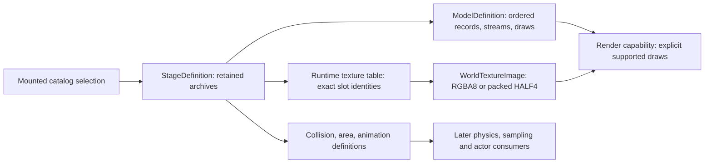

# Stage content decoding

October 23, 2026. One Shot Kill (`cm01_00`) uses `st04_c` stage
resources. This records the implemented CPU-definition boundary; it is not
native rendering or gameplay readiness acceptance.

## Evidence and selected source mechanisms

The native stage worker `0x4427a0` enumerates model namespaces by stage prefix,
excludes `dummy` names unless explicitly requested, and excludes names containing
four consecutive digits unless the requested prefix has them. The latter test is
`0x440560`. It deduplicates names and permits 80 primary models. The portable
loader rejects capacity overflow instead of silently truncating it. Catalog
resolution retains existing mount priorities and containment policy.

Mesh construction `0x419320`, vertex/index resource constructors `0x41ac80` /
`0x41aa70`, and ordered rendering `0x4303f0` establish the original source
contracts. Index width is selected by bit 31 of the record's separate metadata,
not guessed from payload divisibility. The direct indexed-draw fields remain
primitive type, signed base vertex, minimum vertex, vertex count, start index,
primitive count. Group and volume selectors are retained without interpreting
all groups as visible. Shape streams and unsupported declaration methods fail
explicitly in the current static decoder.

The inspected mature format implementation is Rich Whitehouse's Noesis 4.474
`plugins/python/fmt_bulletwitch_cpr.py`, particularly `parseModelHeader`,
`parseVDCL`, `parseKNS2`, `parseDGRP`, and `parseTexNameList`. The archive SHA-256
is `4a2f8f47aba7c6c277e7a197b6386a997d579e1bb29c332e995dba58cc8c3846`;
that source member is
`35bdaaf46807e7fcf34764b712ea8baf8c7938cf59d12cf828e6e80863c0ed88`.
[Source distribution](https://www.richwhitehouse.com/filemirror/noesisv4474.zip).
Its length-delimited nested-record traversal and active binding association are
useful cross-checks. Its big-endian console declaration interpretation and
convenience material construction are not adopted. The PC corpus uses eight-byte
D3D9 declaration elements. No Noesis code or proprietary bytes are vendored.

Both C++ MCP corpora were consulted during header design and again for
implementation: Core Guidelines `SL.con.3` and `R.2` require checked bounded spans;
performance `MEM.6` requires injected allocation. All new metadata/nested strings
retain the supplied domain. Archive payloads move into their owner without
additional vertex/index copies. Missing, malformed or unsupported required
associations unwind the provisional result before publication.

## Actual stage geometry and texture tables

The primary native prefix selects 15 model definitions. The separate `gm`
branch adds three falling-rock definitions. The main `st04_c` mesh has 16
vertex declarations/streams/index buffers, 150 material blocks and 1,228 indexed
draw records. All 15 models plus exact sky model `sky04_c` pass production bounded
CPU decoding, including validation of every referenced index and vertex range.

| Model | Draw records | Material blocks | Runtime texture slots |
|---|---:|---:|---:|
| st04_c | 1,228 | 150 | 128 |
| st04_c_background | 307 | 12 | 16 |
| st04_c_background2 | 359 | 1 | 1 |
| st04_c_detail1 | 431 | 28 | 74 |
| st04_c_detail2 | 934 | 50 | 91 |
| st04_c_detail3 | 394 | 32 | 36 |
| st04_c_doukutu | 444 | 22 | 22 |
| st04_c_ds01_doa | 2 | 2 | 4 |
| st04_c_en01_doa | 2 | 2 | 4 |
| st04_c_en02_fallingrock | 2 | 2 | 4 |
| st04_c_en03_fallingrock | 1 | 1 | 4 |
| st04_c_en04_fallingrock | 2 | 2 | 4 |
| st04_c_nosub | 1 | 1 | 0 |
| st04_c_sub | 1 | 1 | 0 |
| st04_c_water | 1 | 1 | 0 |

The first ordinary main-stage stream has stride 36: FLOAT3 POSITION0 at byte 0,
UBYTE4N COLOR2 at 12, SHORT4N NORMAL0 at 16, SHORT4N TANGENT0 at 24, and FLOAT16_2
TEXCOORD1 at 32. Other streams keep their actual declarations; this layout is not
made universal.

A consequential difference from the initial PW0 probe: `texlist.bin` is **not the
runtime texture-slot map**. Main `st04_c` TLST contains 122 names; its material
records refer to slots through 127. `texture/default.cpr` contains `table._tm`,
with count 128 and 40-byte records (word, 32-byte name, slot index). The order also
differs from TLST. Constructor `vfx.texture.create` at `0x418d30` passes that
count/table to `0x41f990` and fills texture arguments sequentially. The loader
uses the runtime table and exact selected catalog dependency publications; it
validates every material texture index against that table. Original TLST remains
available as original metadata and is never silently substituted.

The initial primary-stage census retained 130 distinct texture/auxiliary archives and 177 unique
texture publications. Encoded 2D images and `DDSC` cubemap data remain explicitly
distinct. Image decode/upload and shader selection belong to the native consumer;
retaining an encoded texture never reports GPU readiness. Required texture
archives are deduplicated by selected catalog/file identity, then referenced by
runtime slot. The first successful stage + sky + light probe, before typed CF1I
metadata was added, observed 138,830,683 live
domain bytes at the measured point and zero after teardown; this is not a
historical allocation budget or a decoded/GPU memory measurement.

## Material constants and packed world textures

`CF1I` stores an eight-byte prefix with count at byte 4, followed by 32-byte
entries: FourCC semantic, register-patch word, two retained source words, then
float4. The native resolver rewrites the word at entry byte 4 with packed
vertex/pixel register indices. The decoder preserves the original words and
the enclosing raw ordered record; its retained `binding` words at bytes 8/12
are opaque metadata, not resolved device register indices. Main-stage materials
include `CCOL`, `PARF`, `FRSA`, `FRSB`, `FRSR`, `LUMI`, `REFP`, `SPCC` and `ENVP`.
Uploader `0x546dc0` resolves the original vertex/pixel destinations and applies
owner scale/bias. Decoding stored values does not invent those runtime constants
or establish a complete material pass.

World texture constructor `0x41a6f0` reads metadata word `+0x20 & 0x3f`:
ordinary textures select D3D A8R8G8B8; `0x1d` selects A16B16G16R16F; `0x0f`
selects A4R4G4B4. The HDR path reads packed 13-bit width/height from `+0x24`,
rounds each up to even, decodes the source PNG into an A8R8G8B8 surface with
twice the declared width, then copies `width * 8` bytes per row into HALF4.
It is a packed byte container, not an ordinary image to normalize or resize.

`formats/world_texture` reproduces that CPU interpretation. It preserves original
little-endian B,G,R,A surface byte order for each source PNG pixel; each pair
then becomes one RGBA16Float texel. It performs no floating-point conversion.
Packed inputs with gamma/profile transforms, unsupported component layouts,
mismatched extents or truncated metadata fail. A4R4G4B4 quantization and odd
ordinary image dimensions remain explicit unsupported conversions. Device
allocation/upload remains behind the render capability. The original default
mip flag selects one level; no guessed mip filter is added here.

Actual `sky04c_hdr.dds` contains a 4096×512 RGBA PNG and becomes a 2048×512
RGBA16Float texture (8,388,608 bytes). The production decoder's output matches
an independent Pillow decode plus native channel-byte reconstruction exactly:
SHA-256 `bac4467521d176c45301f36d8f39a7c11f9d0fb89d9f1f35075b9311cc32f914`.
The domain returns to zero live bytes after teardown. The source image and
comparison output are local ignored evidence, not repository assets. A separate
production decoder census covers every stage texture: 176 two-dimensional
publications and one `DDSC` cube decode successfully, with no rejected publication.
The cube is 64×64 per face, six RGBA16Float faces, 196,608 output bytes. The domain returns to zero
after that full census as well.

## Supported selector and state census

After adding typed CF1I data, the production decoder still accepts every one of
the 15 stage models. Main `st04_c` contains 1,350 constants (150 × 9).
The candidate static normal-mapped selector `0x00420882` with low 16 bits of its
second word equal to 1 covers 25 materials and 164 indexed draws. Its upper
16 bits remain original metadata and are not mistaken for the variant number.
The other 1,064 main-model draws use different selectors.

Those 25 material blocks each include CF1I, MCTL, SSSM and TR records. Four also
contain SRS. Their SRS payload is one `BTNO` entry. Resolver `0x547370` patches
that semantic to operation kind 4 / table index 1. The direct x86 switch body
at `0x5472b6` indexes the packed blend table at `0x969108`; entry 1 is
`0x01220625`. `0x545db0` decodes this to enabled source-alpha / inverse-source-alpha
RGB blending with ADD, and disabled separate-alpha blending. These materials
must be excluded by an opaque-only consumer or rendered with that actual state;
selecting the same shader alone is insufficient. Their zero-based material
indices are 113 (12 draws), 116 (4), 124 (37) and 136 (7). Excluding these 60
draws leaves 21 materials / 104 draws before any further stream/constant gates.

All 25 selected SSSM entries are `LENV`. The resolver maps this to sampler 7;
executor `0x547120` sets its MAXMIPLEVEL to zero. The selected T221 shader does
not sample that slot, but the record is accounted for rather than discarded.
The full main-model census also retains 38 SRS, 150 SSSM, two TANM and two TRST
records. Their existence is not proof those broader state/animation mechanisms
are reconstructed. The full per-selector and material-state census and direct
switch disassembly are ignored evidence under `reconstruction/stage/`.

## Native load-call boundaries

`_LoadCharaLight` worker `0x441160` requests `charalight.<name>_cl` and `_el`, then
`0x568030` stores the raw USER pointer and scalar defaults. Retained USER
publication is therefore a genuine load-time owner; a lighting evaluator is a
later consumer. The `st04_c` files are SHLT version 1, 220,760 and 248,408 bytes.
Their light-sampling equations are not established by header validation.

`_LoadSky` worker `0x442520` selects the **exact** model name. `sky04_c` has mesh,
texture table, one texture, and default VFX resources. Its `.hit`, `.chit`, `.ehit`
and material-animation resources are absent, as permitted by optional native
requests. Required CALL constructors are `vfx2.mesh.create`, `vfx.texture.create`
and `vfx2.create.character`; their native device/publication work remains separate
from CPU definition loading.

The stage loader constructs bounded collision, material-animation and area
views and records `StageInput.definition_ready` separately from GPU residency.
An absent optional request is a completed lookup with no archive; a present,
unimplemented constructor remains unresolved. The `gm` branch is included with
its three falling-rock definitions and native optional motion lookups. Loading
all matching model definitions does not mean their background/destructible
instances can be drawn at an identity pose. Actor placement and simulation are
later consumers, not prerequisites of these pointer-rebasing constructors.

Ancillary lookup helpers `0x441dc0` (paths), `0x442190` (score), `0x442390`
(sound environment), `0x442410` (reverb), `0x442310` (magic), `0x441a00` (hide)
and `0x4410a0` (background) use `0x4ac480` to find a member in the mission package,
then retain its pointer and size. The selected concept package contains:

| Member | Bytes |
|---|---:|
| st04_c.bgb | 26,556 |
| st04_c_kakure.hide | 2,496 |
| cm01_00_0_ene.settbl | 30,560 |
| cm01_00.bin | 4,617 |
| cm01_00_0.settbl | 1,210 |
| score.settbl | 1,704 |
| cm01_00.lub | 3,255 |

Environment/reverb/magic/path members are absent from this selected package.
A missing package lookup alone does not establish a required-resource error.
Reset `0x440b70` explicitly zeroes all pointer/size pairs from owner `+0x80b4`
through `+0x8104` (text registration handle is reset separately). Both stage
teardown `0x444c40` and retained-package reset `0x444f00` invoke it. The optional
lookup workers only overwrite their pair when `0x4ac480` succeeds. Consequently
a missing environment/reverb/magic/path file after reset is a retained absent
definition, not an invented empty file. Consumers `0x482430` and `0x482160`
check the environment/reverb/magic pointer before interpreting it. Repeated loads
must preserve this reset and package lifetime ordering. Hide, background and placement adapters also
perform later registration/construction, so raw member retention alone does not
complete those load calls. Text loading additionally applies the Steam loose
`data/text/<name>.bin` override through `0x463f00`, then text registration through
`0x444d70`. Sound-bank construction remains a separate native audio owner.

## Completed load-time auxiliary constructors

Native `vfx.hit.create2` (`0x417d00`) binds its `cehit` USER argument and calls
`0x418a90` in mode 1. The top-level header has part count/directory at bytes
36/40. Each 96-byte part header retains bounds, name, vertex and triangle count;
its vertex/face offsets are relative to that part. Vertices are float3, faces
are three uint16 indices plus one uint16 flag. The portable view validates every
face index and never modifies source pointers. Main stage character/enemy hit
payloads are 484,368 / 831,072 bytes. No physics SDK scene is created here.

`vfx.phit.create` (`0x417e00`) calls `0x42eac0`; helpers `0x42e830`, `0x42e8d0`
and `0x42e7b0` rebase its pointer graph. `PhysicsCollisionDefinition` records
source-word/target-offset pairs and validates each referenced directory, shape,
geometry, root-relative child and child-relative payload. The selected version
is `0x20060411`; old version-zero form is a separate branch. This constructs
the same load-time associations without pretending to simulate collision.

`0x482970` retains AREA, section-table and FLAN inputs. The implemented AREA
version 1 view binds its offset directory and 96-byte records; STBL uses the
shared `SectionTable` parser. `0x4ac3f0` binds FLAN time/channel/value regions;
the portable view reproduces those associations without introducing a sampling
clock. Effect EMT is retained as the original owner does; emission is later.
Actual selected data is AREA 160 bytes, STBL 240, FLAN 1,716 and EMT 656.

`vfx.matanim.list.create` (`0x419be0`) resolves ordered `matanim.a` and
`matanim.i` argument lists. The portable owner preserves these two lists as
indices into retained typed inputs. MTAB initialization `0x41d700` rebases the
track directory and the two data references at track bytes 24/28; CILB retains
its count and 40-byte label records. Selected `lake_anim` has three tracks,
144,168 MTAB bytes and three labels in 128 CILB bytes. Animation playback is a
later owner. Required missing/wrong-type dependencies fail construction.

The three `gm04_c_*_fallingrock` definitions contain `CM1R` matrix references.
Resolver `0x547370` maps `JINT` to VS register 20. The decoder retains these
bounded ordered records; static inspection must not erase the required joint
binding. Their optional compressed/uncompressed motion-list and motion-parameter
requests are absent in the selected catalog, confirmed independently by the
mission dependency census.

## Cubemap and pass closure

Cube constructor `0x41a420` reads six offsets followed by six sizes in a 48-byte
envelope. Each face is an independent PNG, ordered by the original D3D cube face
index. The packed square edge comes from metadata; format `0x1d` uses the same
HALF4 byte-container conversion as 2D textures. The decoder validates face
bounds/non-overlap and uses one final six-face allocation with per-face scratch.
`WorldTextureImage.shape` distinguishes the cube from a 2D texture.

Stage worker `0x4427a0` requests sixteen `texture.<stage>_cubemap_%02d` resources
and retains them in owner slots starting at `+0x93b8`. The portable stage owner
preserves the same sparse slots. The selected catalog contains slots 04 and 05.
Selector `0x4407b0` first requires slot 0, then consults area selection `0x4828f0`
and validates the chosen slot; otherwise it returns global `0x00af14e4`.
Therefore those two present maps alone do not justify substituting either for
materials without an authored LENV binding. The fallback is now traced: renderer `0x430310` lazily creates a 1×1 cube in
D3DFMT_A8R8G8B8 and invokes D3DXFillCubeTexture with callback `0x42ffa0`.
That callback copies the float4 at `0x006c31b0`, verified directly from the
hash-bound PE as **(0, 0, 0, 1)**. Singleton base `0x00af14b8` stores its default
cube at `+0x2c` (`0x00af14e4`) and current cube at `+0x28` (`0x00af14e0`). Before
executing each selected model chunk, it explicitly binds current cube to sampler
7. Authored TR records can replace it. Consequently missing material LENV uses
the original opaque-black cube, not whichever previous material used sampler 7.
This also explains why BSS inspection alone was insufficient: device construction
writes this member indirectly. The Metal backend retains one accounted six-face
opaque-black cube, restores it before authored environment bindings, rejects
explicit wrong-shape bindings and retires it when the last model is released.
Native readback regression draws an authored red cube first, then an absent-LENV
material and verifies opaque black; repeated submissions reuse the allocation
and final teardown returns all device charges. Main materials 53, 115 and 149 require LENV but
have no authored LENV texture reference and use this exact default.

The main model has chunk 0 = 444 draws, chunk 1 = 287, chunk 3 = 497; all use
group 0. Every chunk-3 draw is under a `BTNO` SRS record, whereas the first two
chunks have none. The renderer must preserve the original pass split or declare
its inspection pass baseline; absence of SRS does not prove a per-material reset.
`ModelMaterial.render_states` and `.sampler_states` retain semantic, patch word,
value and auxiliary value. `LENV` SSSM resolves sampler 7 MAXMIPLEVEL=0.

Full original program-pair census for the main model (no-shadow/fog flags where
an exact native registry entry exists): 456/221 = 541 draws; 454/220 = 402;
456/301 = 55; 456/211 = 55; 454/300 = 44; 454/356 = 29; 456/356 = 18;
463/302 = 16; 454/210 = 15; 456/225 = 10; 458/226 = 3; 463/212 = 1.
The other 39 draws have only exact stored variants 463/82 (37) and 456/317 (2).
The native loader compiles an absent exact variant; it does not clear feature
bits as a fallback. The complete per-material census is durable ignored JSONL.
Sky uses original 448/362, stride 24, and raw bounds approximately
(-116.458, 1.13675, -116.458) through (116.458, 11.5858, 116.458).

## Files and verification

- `include/bw/formats/model.hpp`, `src/formats/model.cpp`: retained PC model
  records, typed declarations/material references and bounded indexed draws.
- `include/bw/content/stage.hpp`, `src/content/stage.cpp`: catalog-directed model
  sets, runtime texture bindings and explicit auxiliary input ownership.
- `include/bw/formats/stage_definitions.hpp`, `src/formats/stage_definitions.cpp`:
  bounded collision/PHIT/AREA/FLAN/MTAB/CILB constructor views.
- `tests/stage_definitions_test.cpp`: authored valid/malformed definition graphs
  in the existing resource-tests scenario, including domain cleanup.
- `include/bw/formats/world_texture.hpp`, `src/formats/world_texture.cpp`: original
  metadata-driven RGBA8/HALF4 CPU conversion with explicit unsupported cases.
- `tests/model_fixture.hpp`, `tests/model_test.cpp`: independent authored in-memory
  fixtures covering association, move lifetime, invalid ranges and allocation
  failure. They are added to the existing resource-tests executable.

Generated probes, local corpus metadata and logs live under ignored
`research/evidence/reconstruction/stage/`. The game installation is read-only.
The production decoder passed all 16 actual mesh inputs and the stage/sky/light
owner probe. Standalone probe execution is supporting acceptance evidence, not a
new registered integration scenario. Existing resource-tests and image-font-tests
pass, including authored indexed-draw and packed-texture cases. Targeted
clang-tidy passes for model/stage/world-texture and both affected test sources.
Full repository checks and renderer
acceptance must be reported separately by the integrating task.

## Authored scene settings and sky transform

The authored stage environment is stored in resource `customizer.default`,
USER `default.cst`, rather than a standalone scene file. Startup `0x6b5720`
loads this publication and passes it to `0x41d420`. That constructor rebases
CSTM header words 12/16 into the string/node regions. Each node has sibling,
child and name offsets at 0/4/8; `0xffffffff` means absent. Sibling/child offsets
are relative to the node region, names to the string region. Lookup `0x41d4d0`
walks the slash-separated path and returns the selected node plus 16, where its
inline value begins. Stage selection `0x45ae00` resolves `witch/stage/<name>`.
The new immutable decoder validates this graph without patching game bytes,
rejects cycles/shared nodes, bounds the selected payload by the next node and
returns typed lighting, sky and output settings. Only primary stage loading
retains this archive; dependency model loads do not duplicate it.

The first three environment floats are authored ambient RGB, `(1,1,1)` for
`st04_c`. The ordinary static-object render virtual creates uniform harmonic
lighting from this RGB and an explicit alpha one; the next CSTM float is a
separate field. `StageEnvironment::ambient_color` retains finite RGB unchanged,
including HDR values. See [world-renderer-state.md](world-renderer-state.md) for
the final subclass virtual, command ordering and shader-selector feature bit.

The selected `st04_c` entry has yaw/height 0, directional diffuse and specular
both `(1,1,1,1)` and authored vector `(0,1000,0)`. `0x460660` adds the executable
constant 0.001 to vector Z, normalizes and negates the result before queuing the
original directional-light command. Its light-color constructor `0x546510`
retains the supplied diffuse/specular without scaling when its final argument
is zero. These are source inputs, distinct from the character-light grid.

Stage output setup `0x461f00` reads enabled tone mapping at byte `0x134`,
exposure key/gamma at `0x138/0x13c`, bloom enable at `0x140`, and bloom
key/threshold/soft-knee at `0x144/0x148/0x14c`. The selected values are
`true, 0.18, 2.2, true, 0.18, 1, 10`. History window, adaptation slew and
luminance limits at `0x150/0x154/0x158/0x15c` are `64, 0.0005, 0.001, 64`.
The renderer's independent final-shader trace confirms the meaning of these
output values; decoding them alone does not establish output fidelity.

Sky construction uses the original sky-object vtable. Its render method
`0x5e3660` copies the authored basis and adds the render-context object's position
at `+0x80/+0x84/+0x88` to sky translation before submitting the matrix. Setup
`0x45e130` supplies yaw in degrees and height from scene bytes `0xc0/0xc4`.
`0x45f1f0` copies authored to current matrix before submission. No uniform scale
was found in this path. Context-object identity and complete original sky pass
composition remain separate evidence from the raw mesh bounds.

Read-only CSTM extraction/tree and selected values are recorded under ignored
`research/evidence/reconstruction/stage/customizer-*` and `scene-st04_c.bin`.
Original constructor/function exports are under engine passes 15–19 and 24.
The full selected stage texture corpus now includes 179 textures: all decode,
including three six-face HALF4 cubemaps, with zero domain bytes after teardown.
Control-point USER publications and character shape-position streams are retained
by their owning definitions. The native backend uploads/account both ordinary
and shape vertex buffers but rejects static drawing until a deformation owner
exists; no fallback reads positions from the wrong stream.

The independent actual CSTM probe passes and returns gamma 2.2, exposure key 0.18, history 64 and zero residual
domain bytes. Synthetic cases cover nested lookup, missing paths, cyclic links,
bad names, truncated payloads and invalid gamma; their suite execution is
reported with the integrated resource tests. Targeted clang-tidy passes for the parser, content integration and
existing auxiliary-definition test source. Full native output acceptance remains
with the integrating renderer work.

## Primary world object selection

Stage setup `0x45bdb0` iterates every primary name selected by `0x4427a0`.
It asks classifier `0x4eb2b0` whether an underscore token starts with `en`
or `ds` followed by two decimal digits. These select separate behavior
constructors; `dsNNb` is a further behavior subtype. Every other primary model
with a mesh is constructed as an ordinary static object by `0x5e0eb0`, with
optional material animation. There is no filename filter treating `detail` or
`background` as mutually exclusive LODs. Constructor `0x56a130` calls the common
base `0x56a190`; its authored transform copies the identity matrix at PE address
`0x969f20`. The ordinary render virtual delegates through `0x56b550`.

`StageModel::static_world_object` records this load-time constructor selection.
It is set only while enumerating the primary stage; exact model dependencies
and the separate gimmick namespace stay false. It does not imply material,
visibility-group or later behavior readiness. The classifier scans bounded,
normalized string views without allocations. Both design and implementation
consulted SL.con.3 and MEM.6; targeted clang-tidy passes for this loader change.

For `st04_c`, the ten ordinary models are the main world, background,
background2, detail1, detail2, detail3, doukutu, nosub, sub and water. The five
`enNN`/`dsNN` primary models require their separate behavior owners. The first
seven ordinary models contain 4,097 draws supported by the current original
material implementations. Independent CPU rays from the declared inspection
camera hit background draw154/material5 and detail2 draws772/774 where a
main-plus-cave-only view had no intersections. Thus those black exterior bands
were omitted authored geometry, rather than missing brightness or cull settings.
The integrating task verifies the native view and retains draw-group selection
as an explicit inspection policy.

The final three ordinary models each contain one two-triangle quad, x/z in
`[-4,4]`: nosub/sub have y=-18.611385, water has y=-10. Their position/normal
stream has stride20, no texture references, shader flags0 and low variant0.
The complete second selector words are respectively `0x24100000`,
`0x20ef0000`, and `0x23fe0000`; retained metadata must not be discarded when
investigating their eventual pass. They contain constant records, LENV sampler
state and GENV, but no supported color-material family. They remain three
explicitly unsupported draws; the evidence does not establish their complete
original rendering purpose. Their below-stage quads do not account for the
missing entrance surfaces. Original exports are in engine passes28–30; the
existing all-material census and exterior-pixel-ray evidence are retained under
ignored reconstruction/stage evidence.

## Initial-view audit: area overrides and omitted untextured quads

The ordinary static-object placement is confirmed at construction rather than
inferred from convenient mesh bounds. `0x45bdb0` passes the primary mesh and
optional material-animation inputs to `0x5e0eb0`. This reaches `0x56a130` and
`0x56a190`, which copies the 4×4 identity at PE address0x969f20 into its authored
transform. The source setup applies no per-model placement translation. Render
`0x56b550` forwards through `0x56a520`/`0x56a640`, submitting the four ordered
model chunks through the normal renderer queue. Sky is a separate constructor
and render owner; it is not one of these baked ordinary models.

The three omitted quads should be called **untextured material omissions**, not
assumed water/custom render passes. Their names alone do not establish a special
pass. Shader selector `0x42f970` uses the raw flag word and only the low two bytes
of the second word; the differing high words do not select a separate shader.
The embedded generic untextured baseline `00800000000` maps to color VS447/PS12
and shadow VS2/PS0. Color VS447 uses position and normal, applies the ordinary
position scale/offset and local screen/world matrices. PS12 evaluates authored
constant color/ambience/illumination, directional/local lighting, shadow and fog;
it does not sample an authored base texture. This identifies the family, not
its exact effective feature combination in every original pass. The effective
runtime feature variant and its full light/shadow ownership remain unresolved;
no plain-color replacement was invented.

An independent geometry witness sampled a9×9 grid across each actual quad at
the recovered initial eye. All81 points on each quad have earlier front-facing
`st04_c_doukutu` geometry. Nearest cave distances are6.68–7.55m for nosub/sub and
8.64–9.89m for water. This supports retaining those three explicit omissions for
the first static entrance view: they cannot explain missing entrance geometry,
its exposure or sky. This is a sampled geometry witness, not a blanket claim
about every later camera or material transparency. The authored quads remain
retained and must be implemented when their visible use is reached.

The initial eye lies inside the selected AREA record (id1), but the environment
update is **disabled by the authored stage setting**. `0x4829d0` performs the
AREA/table/FLAN-driven settings update only when stage byte0x24 is nonzero.
Instruction0x4829db explicitly compares `[EAX+0x24]` with zero; selected
`st04_c` byte0x24 is zero. This matters because the enabled branch can otherwise
change tone parameters, directional colors and global color-processing values.
Applying those FLAN values despite the gate would introduce behavior absent
from the original selected scene. The default CSTM environment remains the
correct input for this snapshot.

Area lookup for environment cubemaps is independent: `0x4828f0` selects table
column2 after `0x482910` maps the containing AREA id to its row. The two actual
rows select cubemaps4 and5. The outer `0x4407b0` still requires cubemap slot0,
which is absent for this stage, before using area selection. Therefore the
already recovered opaque-black fallback remains correct for absent material
LENV bindings; choosing cubemap5 merely because the eye is in area1 would be
another unsupported substitution.

Reproducible evidence is under ignored reconstruction/stage as
`stage-area-fidelity-audit.json`, `quad_visibility_audit.py` and
`quad-visibility-audit.json`; shader token listings are under world-renderer.
Native exports are engine passes44–45. No C++ behavior change was required by
this bounded audit. Initial visible fidelity still depends on the separately
owned sky transform and output/material validation; this audit does not mark
slice3 accepted.
