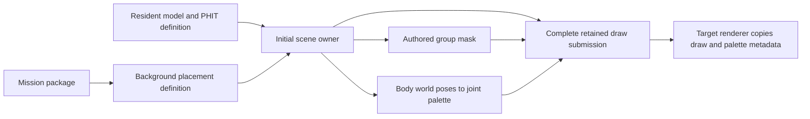

# Stage scene presentation

The scene separates immutable mesh definitions, retained background placement and
per-view submissions. Loading a background definition does not execute the
mission `start()` callback or simulate its destructible objects. Presentation
must consume the authored transforms and the original mesh palette equations;
applying one arbitrary transform to a multi-part prop is not a faithful port.

## Reference implementation and ownership

Inspected Unreal revision `f45729c0b6f097038e72b52d366a62baeca3275b`,
`Engine/Source/Runtime/Renderer/Private/PrimitiveSceneInfo.cpp`,
`FPrimitiveSceneInfo::AddStaticMeshes` and `AddToScene`. The source caches static
mesh batches at scene attachment and retains scene-owned state separately from
the primitive proxy and asset. The reconstruction adopts that separation and
setup-time construction. Its current single-threaded, completion-waiting host
needs no new render-thread queue; adding Unreal's concurrency machinery would
not establish original Bullet Witch behavior. No reference code is copied.

## Background placement schema

Native constructors `0x4ad360`, `0x449270` and `0x449460` decode the `BGOB`
header, name-offset directory and placement-offset directory. Version 1.1 uses
a 24-byte placement prefix: four authored state words, a uint16 name index, a signed
16-bit group identifier, a uint16 matrix count and two padding bytes. Each
matrix contains twelve floats, three basis rows followed by translation; the
constructor expands these to four homogeneous rows. Version 1.2 adds four
state words before the name index and uses a 40-byte prefix. Names and placement
offsets are file-relative. Unknown versions are not interpreted as these layouts.

`_LoadBgObj` preloads resources; `_SetBgObj` later registers placed objects.
The selected One Shot Kill file contains 28 names and 276 placements. All have
group identifier -1. The largest placement has six matrices. They include
lanterns, drums, containers, barriers and other destructible props. No name uses
the native `musi` exclusion. Source witnesses remain under ignored
`research/evidence/engine/pass-10-mission-definitions/` and `pass-02b/`.

Background meshes are not the ordinary static vertex layout. Sampled container,
streetlight and lantern definitions use blend-index/weight attributes and the
original skinned shader selectors. The authored matrix palette must therefore
reach the native renderer. A valid placement decoder alone does not claim
visible prop construction.

## Mesh group selection

Original `0x4307d0` reads the group's bit in the instance mask before descending
into a `DGRP` block. `0x430850` asks the optional visibility-volume owner before
descending into `DVOL`; no owner means visible. These are distinct contracts.
No volume visibility is inferred from a model's filename or its overlapping
bounds. `0x42a8f0` initializes all four 32-bit group-mask words to all ones.
`0x5f0080` copies the background state words into the object, then writes the
complement of primary word 2 to mask word zero when newly disabled bits appear.
The initial view follows this authored mask and rejects groups outside the
original 128-bit range. All 276 selected placements have zero primary words,
so all of their groups are initially visible. No damaged/alternate group is
hidden based on an intuitive interpretation of its name. Destruction and
runtime visibility changes still belong to their future behavior owners.

## World-pose palette and material inheritance

The original background factory `0x44a260` creates the model/physics owner and
passes the complete placement matrix array to `0x5ef420`. That function applies
matrix i to physics body i. The body's `PHIT` record at offset +8 selects the
model joint (`0x4f1c70`, `0x5ed1c0`). The reconstruction retains that signed
body-to-joint association in the immutable physics definition.

The decisive distinction is world-space joint ownership. `0x5f0e00` switches
the model to world-joint mode, while `0x5f1080` writes body-world transforms into
the model's joint array. `0x422d30` skips inverse-bind composition in this mode.
`0x42b9e0` transposes those rows for GPU upload, and the material `CM1R` executor
`0x547020` selects the source joint and destination palette slot. Thus each
placed draw uses its authored body-world matrix directly, transposed into the
renderer’s dot-product rows. Applying the first placement transform again or
multiplying the skeleton inverse bind would be incorrect.

Every joint referenced by the selected 28 prop definitions has a matching
physics body. The actual cached vertex families consume either one rigid index
or two indices with their normalized byte weights; the shader palette has
32 matrix slots. Missing associations, unsupported matrix semantics and holes
in a required palette fail scene construction. The temporary palette storage
is allocated once and remains stable through draw publication; the renderer
retains its own copy. No per-frame catalog search or matrix allocation occurs.

The original command interpreter `0x4303f0` routes both material blocks and
continuations to `0x547e70`, which executes only their listed operations. A
`knsC` block containing `CM1R` therefore inherits the previous material's
constants, textures and state. The decoder now snapshots these bindings and
replaces later writes to the same semantic. A standalone initial continuation
is valid and starts without inherited bindings. Record ranges remain local,
so future animation binding can distinguish authored operations from the
flattened effective material.

## Ownership and publication

`MissionLoading` retains package bytes, decoded definitions and device handles.
`StageInspection` builds the initial ordinary/sky/prop scene and publishes it
atomically after all selections validate. Its destruction clears the view
before mission cancellation releases device owners. This is still an initial
presentation snapshot: the Lua mission start callback, physics simulation,
destruction and actors have not been fabricated or marked complete.

Ordinary static owners register as shadow casters. The direct background
construction path does not set the separate prop caster bit required by
`0x5e8fa0`; initial props receive shadows but do not cast them. The scene fits
the explicitly authorized reference-based shadow projection to its selected
world-space surfaces. Projection policy and its original-source limitation
are detailed in [stage-shadow-presentation.md](stage-shadow-presentation.md).

## Verification and remaining scope

The read-only One Shot Kill corpus publishes 4,100 ordinary draws, 674
placed-prop draws and one sky draw, with zero unsupported draw omissions.
The prop count is independently obtained from placement multiplicity and each
referenced model's draw census. Existing in-process scenarios now cover
background versions/ranges/nonfinite transforms, physics body/joint mapping,
and material continuation inheritance with joint references. The full startup
corpus validates ownership and cancellation with zero domain bytes live after
teardown; native rendering acceptance is recorded by the integrating renderer
slice, not claimed by this CPU fixture.

Original evidence is retained under ignored engine passes 50, 53, 54, 59, 61
and 62 and the organized reconstruction/stage probes. Proprietary models,
physics files, placements and decompiled functions remain untracked.
[Material animation](stage-material-animation.md) now samples the authored clip
and updates the two named UV channels through retained draw constants. Dynamic
part visibility and live physics updates remain separate consumers; the initial
scene does not claim their execution merely because input records are retained.
