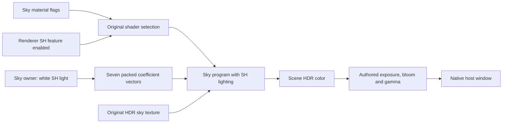

# Completing the first static stage view

October 23, 2026. The initial 104-draw inspection established a device path,
not completion of implementation slices 1–3. The continuation keeps the original
acceptance boundaries: owned mission execution, required content construction,
then a coherent textured view of the actual stage near the authored spawn.

Current status: slices 1–3 are implemented and verified for user review. The
final source-derived camera, stage ambient lighting, sky and native host output
produce a coherent cave and exterior view. Earlier failures below are retained
as diagnosis history; the final evidence and remaining scope are at the end.

## Ownership and presentation

The inspected Doom 3 reference remains commit
`a9c49da5afb18201d31e3f0a429a037e56ce2b9a`, `neo/framework/Session.cpp`.
`ExecuteMapChange` initializes render-world geometry before spawning game entities,
finishes resource loading before generating interactions, and publishes
`mapSpawned` only after setup. `UnloadMap` shuts down the game before clearing that
state. This is useful evidence for separate render-resource ownership and world
readiness, not permission to declare an unfinished Bullet Witch load complete.

The mission owns stage/sky CPU and device resources. The view should borrow those
stable resources and own its ordered draw submission, avoiding another upload of
the same stage. Teardown clears submitted draws before their resource owners
retire. Constructor failures release partial ownership. Original Lua readiness
is determined separately by each native operation's actual completion contract.

The previous independent inspection presentation is diagnostic. Retaining it
while a real dependency is unresolved must remain visible in status and evidence;
it cannot substitute for the full content-loading milestone.

## Material coverage

The main stage contains 1,228 indexed draws and 150 material blocks. The original
104-draw view selected one normal-mapped family and excluded blending. Expansion
must follow actual shader-feature combinations, declarations, texture semantics,
material constants and render states. Registry IDs belong in provenance; source
names and comments describe the material operation.

The next device acceptance must show the ground and coherent surrounding main
geometry. Sky is a separate original model and material, not a clear-color
replacement. Authored environment, visibility, animation, shadows, background
instances and gameplay retain their original later-slice boundaries unless they
are required to construct this static view. Record exact coverage and omissions;
a larger draw count alone is not visual acceptance.

## Guidance and verification

Design consultation retrieved Core Guidelines E.6 (`#re-raii`) and performance
GPU.1 (`guidelines/gpu/GPU.1-keep-data-on-device.md`). These require paired
acquisition/retirement and immutable device residency between draws. Implementation
consultation accompanies the concrete composition changes. No asynchronous
retirement or performance improvement is claimed by this ownership correction.

Verification combines independent material/asset census, native shader readback,
the existing original-root corpus and normal menu-to-stage visual observation.
Keep failures and generated evidence under ignored `research/evidence/`; do not
weaken an independent expected count to match an implementation defect.

## Continuation evidence

The original mission load now passes stage construction, text registration,
42 cover points, the stage audio bank, optional package inputs, background
preloads and path data. The final placement-table call additionally requests
character, weapon and animation definitions; those constructors must finish
before its completion is published. This is a load-time dependency, independent
of the later gameplay actor/simulation slice. No successful placeholder binding
is used to advance the original script.

The view now borrows the mission's single stage/sky device residency. The shared
material classifier covers the main static families, including source-alpha
blending and the original raw-UV cutout threshold. Two cached programs used by
39 draws explicitly evaluate only their recovered material/vertex contribution
under inspection policy, with scene light/shadow energy omitted. Their original
program identities are retained, rather than inventing an uncached variant.
The original pass creates an opaque black one-pixel cube and binds it before
material records. Materials without their own environment binding therefore
use that recovered default; the native backend preserves this behavior.

## Spawn-cave correction

The first expanded native capture selected all 1,228 main-model draws but looked
at a dark building wall. A fresh CPU geometry probe established why draw count
was insufficient: `st04_c` has no floor below the authored spawn. The separate
static `st04_c_doukutu` model contains the starting cave, including the floor
near Y=0.122 and ceiling near Y=5.388 at the authored X/Z. Its 444 indexed draws
and 22 materials use already reconstructed static shader families. This is
required starting-world geometry, distinct from later spawned background actors.

That intermediate inspection selected main world and spawn cave (1,672 draws), plus
the separately constructed sky. It retains the authored position plus the
declared 1.6-unit eye offset and looks down positive Z along the passage, rather
than toward global world bounds. This remains an inspection camera; neither
player orientation nor gameplay camera behavior is claimed. Open sky is not a
visual requirement from inside the cave. Other stage detail/background meshes were initially retained but not selected.
Overlapping bounds were not enough evidence to classify those meshes as duplicate
LOD alternatives. The subsequent native stage-construction trace below resolves
that initial uncertainty; that conservative selection was underinclusive.

Generated `all-materials.jsonl`, geometry probes, ray-clearance diagnostics and
`native-continuation-progress.png` live under the ignored stage evidence folder.
The screenshot records the failed main-only view, not final acceptance.

## Dark-image rejection and output-path closure

The next normal menu run completed the original mission load and selected all
1,672 main/cave draws, but `native-cave.png` remained nearly black. The user
rejected that presentation. This is not accepted slice-3 completion. An ignored
offscreen diagnostic now reproduces the same production loading, residency,
view and Metal path at 1,024×576 without opening a window; the initial capture
measured mean RGB 0.972/255. It does not replace normal-route acceptance.

Actual cave vertex illumination averages roughly 0.015–0.15 for the sampled
material blocks, with zero constant self-illumination. Those are source HDR
values, not display-ready brightness. The original output chain performs scene
luminance reduction and tone mapping; direct BGRA8 surface output omitted that
chain. Its reconstruction is required for this first useful view. Authored
stage settings are in the `customizer.default` hierarchy, including enabled
tone mapping and gamma. The fix must consume those values and the recovered
output equations rather than invent an exposure adjustment.

## Authored output integration

The first production HDR/output capture shows textured cave walls, ceiling and
floor clearly, with the building beyond the entrance visible. It consumes the
actual stage directional-light and tone/bloom settings and the recovered output
equations. Mean RGB changed from 0.972 to 108.074/255; that number records the
regression correction, not a target brightness or fidelity metric. The generated
`offscreen-stage-output.png` still exposes black exterior regions. Geometry
selection and contributing material/pass behavior were investigated before the
normal-route observation recorded below.

Stage construction enumerates the primary model list and constructs ordinary
stage objects for each accepted namespace. The original loop has no filename
filter that reduces it to only the exact main name and cave. Separate detail and
background model names therefore cannot be dismissed as LOD alternatives based
on bounds alone. The source-backed ordinary/destructible split below resolved
the selection.

## Ordinary static object selection

The corrected view selects the exact ordinary-object construction class from
the primary stage enumeration. This includes the main world, both background
models, three detail models and the cave. Three additional ordinary objects
(`nosub`, `sub`, `water`) each contain a below-stage quad using unresolved upper
shader-selector metadata; they remain explicit untextured-material omissions. Event and
destructible props retain their separate future behavior owners. The classifier
and original identity-transform construction are recorded in
[stage content](stage-content-decoding.md).

An independent material census establishes 4,097 supported draws, three untextured-material
omissions and one sky draw. Of the supported set, 139 use the declared restricted
material/vertex contribution policy. CPU rays through the previous black bands
hit background ground and detail entrance geometry that the main/cave-only view
had excluded. `offscreen-stage-all-world.png` now shows the textured cave entrance
structures and filled exterior gaps. It uses the production HDR and display
passes; no alternate diagnostic shader or exposure is used.

The outside ground remains very bright in this static inspection. Full shadows,
area-driven environment changes, sky placement and original-game image parity
are not established. This filled the identified geometry gaps, but the user subsequently rejected
the starting view as recorded below. The original mission load remains stopped
before actor setup; it is not gameplay. The normal
menu-route observation below follows the integrated checks.

## Integrated verification

The October 23 continuation passes `python3 scripts/check.py all`: strict host
build, six CTest scenarios, fatal clang-tidy across all 85 authored compilation
entries, formatting and repository content policy. The existing original-root
corpus also passes with the independently established ordinary-model census.
It completes the original mission load, verifies 54 dependency variants,
11 character support sets, 178 palette bindings and balanced cancellation.
Tracked CPU allocation returns to zero. These checks and the native offscreen
capture do not claim actor/gameplay execution or original-game image parity.
Generated full-check and corpus logs remain under ignored evidence directories.

## Normal menu-route observation

After the integrated checks, the user navigated the normal menu to One Shot Kill
and reported “it is there.” `native-full-world.log` confirms concept stage 1,
difficulty 0, costume 1, original load completion at `awaiting_world_setup`, and
4,097 selected draws with three omissions. This establishes that the static view
was observed through the normal route, not approval of visual fidelity. The
window capture attempt failed; no new GUI screenshot was saved. The earlier
offscreen image remains the recorded visual evidence.

The historical log incorrectly says authored light is omitted. The current host
message now identifies implemented base light/output and the remaining fog,
visibility and shadow gaps.

## Camera validation rejection

After confirming the normal menu route reached the stage, the user rejected the
view as a useful representation of the expected starting scene. Their route
confirmation is not approval of the camera or image. The rejected camera borrowed
Alicia's script-authored XYZ but added an inspection eye height, heading and
projection. A character spawn is not the third-person camera transform.

The original `cm01_00.start()` supplies both position and facing:
`_SetPlayerPosition(-61.91, 0.65, -97.57, -0.28)` for checkpoints below 10.
The fourth value is degrees, converted by the native player-position adapter.
The player constructor separately loads `witch/actor/pw0/behind_camera` from
`customizer.default`. That owner and its initial pose/view contract have now been traced and
implemented; see [initial player camera](player-camera-initialization.md).
Bright exterior output is also being checked against original pass semantics. The first-static-view acceptance
remains open pending that correction; recorded load completion remains valid.

## Source-derived initial view correction

The inspection now starts from the original fresh-mission position and facing,
parses the player's initial behind-camera preset, and resolves height, shoulder
and rear offsets through registered static collision. The production corpus
registers 2,150 collision parts and produces eye
`(-61.3953, 1.35, -100.568)`, forward `(-0.0048869, 0, 0.999988)`, vertical
FOV 44 degrees, near 0.01 and far 1000. This particular initial pose is not
clipped by the registered static geometry. The camera snapshot precedes actor
construction and does not pretend that the original start callback executed.

Shared view math preserves positive-forward-Z reverse depth and keeps material
vectors in camera-relative world axes. The Metal presentation path now matches
that convention with greater-equal comparison and depth clear zero. Surface
samplers use the recovered anisotropy-four override; fullscreen sampling uses
the original D3D9 sample-center correspondence. These changes replace previous
inspection assumptions, without changing authored light or exposure values.

`offscreen-stage-original-camera.png` shows the entrance, rock walls and ground
from this source-derived pose. The exterior remains visibly clipped. Independent
raw-HDR replay reproduces the displayed result within one byte per channel,
locating that result in the current exposure/bloom inputs and equations rather
than an unexplained final format conversion. It does not validate the original
full pass selection or temporal startup schedule; see
[output fidelity audit](world-output-fidelity-audit.md). No new native GUI run
or user acceptance is claimed.

The integrated camera correction passes `python3 scripts/check.py all`: strict
build, all six CTest executables/scenarios, fatal clang-tidy, pinned formatting
and repository content policy. The existing original-root corpus passes with
original mission load and balanced cancellation. Evidence is retained in
`stage/camera-final-checks.log` and `stage/camera-root-corpus/`. These checks
validate implementation contracts and loading; the bright exterior and native
visual acceptance remain explicitly unresolved. No commit or push was made.

## Camera-centered sky and diagnostic viewpoints

The original sky object is centered on the active camera each submission.
`pass-15-sky-transform/functions/0045e130.c` stores the active camera at world
owner+0x4150; object dispatch in `00457620.c` passes owner+0x4148. Therefore the
sky renderer's context+8 in `pass-18-sky-object/functions/005e3660.c` is that
camera. The renderer adds its world position at+0x80/+0x84/+0x88 to the authored
sky transform before submitting it through `0x42bb10`. Stage setup supplies yaw
in degrees and height from scene offsets0xc0/0xc4. The selected stage authors
zero for both. This closes the context-identity question in the earlier content
notes: treating the sky as a fixed object at world origin was incorrect.

`StageInspection` now composes the camera-centered sky transform into clip rows
and retains authored yaw/height in its camera-relative material rows. No mesh
scale or far-plane projection override was inferred. The recovered sky vertex
program448 directly evaluates the four clip-row dot products, including Z/W;
its pixel program362 samples the authored HDR base texture and applies its
material illumination/fog equations. Exact program dumps are ignored evidence
under reconstruction/world-renderer.

An optional explicit `render::ViewPose` enables diagnostic inspection from other
positions/orientations. Default construction still computes the original initial
camera and static clearance. Overrides retain authored perspective, do not mutate
the script/player pose and do not execute collision or actor movement. The
normal host and ignored probe consume the same view contract. The probe's
forward/upward viewpoints are declared offsets, not reconstructed player paths.
It warms the original view for90 frames and then renders180 exterior frames using
the production steady clock and retained exposure history. It neither resets
history when replacing draws nor supplies a diagnostic exposure/brightness.

Both MCP phases were consulted for the change: I.1 makes the optional policy and
coordinate conventions explicit; MEM.9 keeps composed transforms in fixed
storage. The existing original-root corpus observes camera-relative sky
translation, rather than adding another integration scenario. The all-target
strict build and six existing CTest entries passed after initial integration;
final snapshot lint/corpus/native diagnostics remain separately reported.

## Native host handoff and sky corrections

The previous offscreen captures exercised `WorldRenderer` directly. The actual
window used `StartupHost` through the `WorldOutput` interface, whose default
`set_world_output_parameters` implementation silently did nothing. The host
forwarded geometry and draws but omitted this setter. As a result, the stage's
authored tone/bloom policy never reached the window renderer. This explains why
offscreen appearance could not validate what the user saw. The interface now
requires an implementation, and the host explicitly forwards the policy to its
retained renderer. Missing adapters become compile errors. Actual native host
capture is required alongside the offscreen numerical checks.

The source sky owner also adds the active camera position to its authored yaw
and height. Applying ordinary world transforms left the sky fixed at the world
origin. The view now composes the original camera-centered sky transform, with
no arbitrary scale or exposure change. Forward and upward views exercise this
through the same production material path.

Sky depth policy is also distinct from the main world. Its submission helper
`0x56a7a0` uses the context+0x34 heap/list pair. World setup points that pair at
bucket+0x104; sky setup `0x460ed0` queues the preceding bucket+0xf0 state with
ZWRITEENABLE=0 and ZENABLE=0. The portable sky therefore uses `always` with no
depth write, while ordinary world geometry uses the recovered reversed-depth
comparison. Sky vertex projection is unchanged. An independent original-mesh
ray from its center hits the zenith at11.5858 and the45-degree direction at
approximately11 units, well inside far1000; the observed black sky is not an
out-of-range dome. Actual sky material illumination is zero and has no authored
ambient record. The original sky installs a constant-white spherical-harmonic
light before submission. Further trace shows those coefficients upload to pixel
registers 9–15; the currently selected program reads constant illumination and
ambience at 16/17 instead. The white-SH observation therefore does not justify
substituting an ambient value of one. Exact selected-program and material-input
behavior remains under investigation.

The actual-host diagnostic now confirms the repaired adapter. It constructs
`StartupHost`, loads through that public renderer capability, creates the same
`StageInspection` against the host and presents through `host.draw`. It neither
accesses `WorldRenderer` directly nor supplies separate tone settings. The
window capture `host-stage-initial.png`, taken after 60 submitted frames, shows
textured cave, gate and exterior building through the real window path. The
probe closed normally. This is presentation-path verification; normal menu/Lua
routing is covered independently by the existing original-root integration.
The bright cave opening and sky checks remain recorded separately below.

## Sky feature selection correction

The zero-light diagnosis above missed a renderer-global shader feature.
Constructor `0x42fb50` initializes the byte at owner+0x1adfd to one, and
`0x42f970` ORs `0x200` into each material selector when that byte is enabled.
For this sky the resulting key is `06e00200100`, selecting vertex program448
and pixel program363. The previous inspection selected `06e00000100` and
program362 instead. Program363 reads the seven packed spherical-harmonic
vectors at pixel registers9–15; program362 does not. This explains why the
white light already traced in the sky owner appeared irrelevant.

The repair preserves zero material illumination and ambient. It supplies the
original sky owner's constant-white spherical-harmonic light and evaluates the
selected program's polynomial. This is a missing draw-state input, not an
exposure adjustment. A read-only census of all eleven installed sky namespaces
found the same zero-illumination/absent-ambient pattern across their primary
materials, which helped identify the shared rendering contract. Exact shader
selection and coefficient witnesses are recorded in [sky presentation](sky-presentation.md).

Native captures and integrated verification of this correction are recorded
after implementation below; the source trace alone does not establish visual
acceptance.

## Final slice-3 verification

The ordinary static object's final subclass also supplies spherical-harmonic
lighting. Its draw callback consumes the stage environment's first three floats,
not the common base constructor's default. The decoded `st04_c` RGB is `(1,1,1)`;
the next float belongs to another field. Both sky and ordinary draws now carry
the correct runtime feature and original packed coefficients. Selected programs
add this contribution to baked vertex lighting and material illumination.
Restricted inspection families explicitly omit direct lighting, preserving
their material, baked and SH contributions. Exact source witnesses are in
[renderer state](world-renderer-state.md) and [sky presentation](sky-presentation.md).

The unchanged authored exposure, gamma and bloom now operate on the corrected
scene inputs. The previous clipped-white exterior ground is textured and
readable, the cave opening shows the building and ground beyond, and the exterior
sky shows its original cloud texture. No brightness normalization or substitute
sky color was introduced. Bright cloud regions can still clip under the original
output curve; this is not a claim that every display value is below saturation.

Final ignored evidence under `research/evidence/reconstruction/stage/`:

| Evidence | What was checked |
|---|---|
| `slice3-checkpoint10.png.initial090.png` | Authored fresh-start camera: textured cave, gate, exterior building and ground |
| `slice3-checkpoint10.png` | Exterior yard, buildings, mountain geometry and visible sky |
| `slice3-checkpoint20.png` | Second script-derived exterior pose, preserving scale and depth |
| `slice3-sky-upward.png` | Upward view of the camera-centered original sky |
| `slice3-host-checkpoint10.png` and `.log` | Actual StartupHost window, with authored settings crossing the public adapter; clean exit after 2,455 frames |
| `slice3-final-checks.log` | Strict all-target build, six CTest entries, fatal clang-tidy, pinned formatting and repository content policy |
| `slice3-root-corpus/` | Hash-bound original Lua routing/loading, coefficient and output handoff contracts, cancellation and zero retained domain allocation |

Offscreen exterior checks retain exposure history across 90 initial frames and
180 exterior frames. The native host capture verifies the production window
adapter separately, rather than treating direct renderer readback as window
acceptance. The existing root integration supplies the independent menu/Lua
route evidence. GPU cases cover constant, quadratic and transformed-normal SH,
additive baked lighting, reversed depth, output sampling and retirement. These
extend existing test executables; assertion counts are not separate tests.

This completes the first static-view boundary and is ready for user review.
It does not execute actor creation, mission `start()` or player movement. Three
untextured below-stage quads remain omitted. Original visibility, shadow passes,
generated texture mip chains, material animation and placed/dynamic objects
remain slice-4 presentation or later gameplay work. Distant texture aliasing is
not represented as finished filtering fidelity. Full original-game image parity
and user acceptance remain distinct from these implementation checks.
