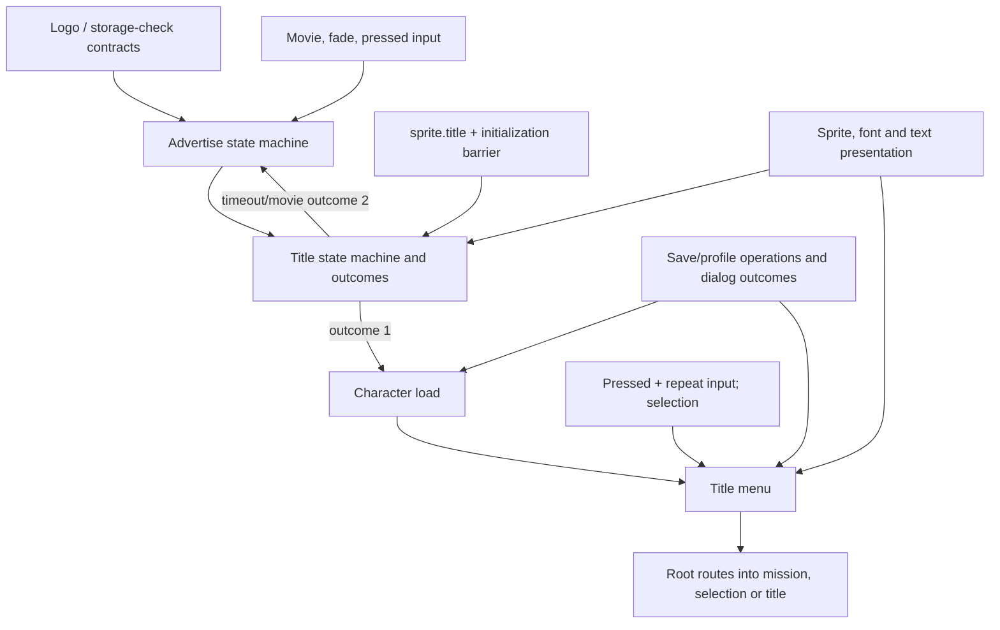

# Startup work after logos and storage check

October 22, 2026. Planning synthesis of existing recovered evidence; no new
native execution or backend validation. The concrete company-logo and
memory-card-check slice is separate. This document identifies its successors
without claiming that mapped screens have been implemented.

## Dependency order

The original root calls advertise, title, character load, then title menu.
Title outcome 1 enters character load/menu; other title outcomes return through
the title route. The first entry advertises unless the root's `demotype` gate
skips it. Menu status 1 selects stage 1 and sets global slot 0; 2 reads slot 0;
3 queries the latest selectable stage; 6 selects concept mission; 7 and other
values return to title. Preserve these exact compatibility values while using
descriptive names internally.

Source: [recovered root flow](../../evidence/startup/startup-flow.lua) and
[root/status accessor evidence](../../reports/2026-10-21-native-startup-mapping.md).
The root flow is explanatory reconstruction; the current runtime executes the
original bytecode.

| Next slice | Existing evidence | Contracts to close before claiming production behavior |
|---|---|---|
| Advertise | Start `0x49e610`, update `0x49e900`, draw `0x49e7d0`, destroy `0x49e750`; path `data\\movie\\advertise.ssu` | Movie-open failure/fallback timer, skip masks, fade completion, visibility, movie release and task removal; reuse the shared movie/fade/input capabilities established for logos |
| Title | Initialize `0x499a10`, start `0x499ae0`, update `0x499f10`, draw `0x499d00`, status `0x4999f0` | `sprite.title` readiness, the additional request/completion barrier, exact timer constants, sprite animation, input outcome 1 versus timeout/movie outcome 2, published status after cleanup |
| Character load | Create `0x4a1100`, update `0x4a1240`, destroy `0x4a49d0` | Save/profile request, completion versus success, localized retry/cancel/error dialogs, state changes and cleanup; the memory-card-check screen does not substitute for these operations |
| Title menu | Start `0x49a690`, update `0x49b320`, draw `0x49a990`, status `0x49a560` | Entry existence versus availability, selection wrapping/skipping, nested screens/dialogs, confirmed action/status mapping, persistent settings/save side effects |

Evidence: [screen task map](ui-and-screen-tasks.md),
[title initialization](../../evidence/engine/pass-06s/functions/00499a10.c),
[title update](../../evidence/engine/pass-06s/functions/00499f10.c),
[advertise update](../../evidence/engine/pass-06w/functions/0049e900.c),
[character-load update](../../evidence/engine/pass-06w/functions/004a1240.c),
[menu initialization](../../evidence/engine/pass-06r/functions/0049a690.c),
[menu update](../../evidence/engine/pass-06s/functions/0049b320.c).

This graph is dependency order, not a replacement for recovered per-frame state
transitions. Screen state, lifecycle completion and presentation completion stay
distinct.

## Shared contracts that make these slices reusable engine work

**Input.** The existing map establishes held, newly pressed and repeating masks
at `0x41cfd0`; pressed is `~previousHeld & newHeld`, repeat uses the recovered
0.5/0.125-second arithmetic. Advertise consumes pressed masks `0x1010` and
`0x2020`; title consumes `0x1010`; title menu also reads repeat masks for
navigation. Keep those observations distinct from a guessed physical button
label. Specify the host's input-before-screen phase and edge consumption when
connecting live devices. [Input evidence](input.md).

**Movie and fade.** Advertise update passes the literal float 0.25 to shared fade
operations `0x485930`/`0x485960`, polling `0x4859c0` independently of movie
completion. Title has its own fade/timing branches and cannot inherit one common
screen timeout. The movie wrapper starts at `0x562f00`, polls completion at
`0x562f60`, and stops/releases at `0x562f70`. Event consumption occurs inside
draw/event helper `0x562df0`. A replacement that only polls the completion flag
can stall if no component pumps events. Define event pumping, failed-open state,
audio/video time, final sample lifetime and stop behavior explicitly.
[Movie evidence](audio-and-movies.md).

**Resource readiness.** Title initialization requests `sprite.title` through
`0x4ac660` and waits at `0x4ac700`. It then separately calls through `0x43add0`,
`0x474830`, `0x475320`, and polls `0x475280` before completing initialization.
The reviewed screen map identifies further worker work, but its actual payload,
publication and failure contract still needs a focused trace. Do not equate this
second barrier with archive readiness or assume it is the separately mapped
background-resource queue solely from neighboring addresses. The current USER
publication service alone does not construct title textures or sprite objects.

**Sprite and text presentation.** `0x569620` registers sprite entries, including
stable insertion order for equal sort keys, with an observed 511-entry limit.
`0x569170` publishes them; `0x568f20` consumes ordinary quads and custom callbacks.
Text uses `0x4ba620`/`0x569760`, with font lookup `0x5692f0` and `sprite.font`
request `0x4ac8d0`. Recover the minimum needed sprite/font resource-construction
handlers and retained draw data before a visible title claim. Four native ring
buffers do not by themselves prove safe reuse; CPU consumption and device
retirement remain separate. [UI/render evidence](ui-and-screen-tasks.md).

**Profile and dialogs.** Character load invokes save helpers including
`0x471b30`, `0x471b60`, `0x471500` and polls `0x470e20`/`0x470e50`. Menu entry
availability also queries save/service state. Save dispatcher `0x4711c0` and
file helpers `0x4c2eb0`/`0x4c3050` distinguish completion from success. Translate
each request and dialog choice before giving it a semantic engine name; do not
silently return success, invent unlock policy, or overwrite existing saves to
prove the flow. [Save evidence](saves-and-progression.md).

## Implementation sequence and actual decision points

1. Reuse the concrete logo slice's shared inputs and ownership boundaries for
   advertise; close its own failure/timer paths from the existing evidence.
2. Close the title resource/worker barrier and required sprite/font construction
   contracts. Implement title state and result publication against explicit
   capabilities; keep deterministic capability implementations confined to
   verification until real adapters exist.
3. Implement the save/profile and dialog subset required by character load,
   followed by menu availability, navigation and action outcomes. Keep the root's
   global-value accessors tied to their actual owners and side effects.
4. Connect the selected live input, media and presentation adapters for the first
   visible startup path. Verify real content and timing; only then describe the
   whole startup flow as visually running. These adapters and resource handlers
   extend shared engine modules, while screen policy stays with game/session.

Steps can overlap where file ownership is independent. A screen state machine
tested with synthetic media is useful production logic, but is not actual video
playback. Existing architecture already supplies that separation; it does not
require a new framework for each screen.

No user decision is needed for descriptive naming, preserving recovered state
transitions, tracing a missing helper, keeping inputs read-only, or maintaining
these subsystem boundaries. Those are established work.

The material fork is the first live platform implementation: how much of the
initial device/input/media investment should target macOS specifically versus
the eventual Xbox-capable port. The current architecture deliberately selects
no graphics backend. Choosing one is meaningful before device code, shader
translation or platform-specific sample ownership becomes committed work;
screen and resource semantics can proceed meanwhile. See
[platform change axes](../../../docs/architecture/change-axes.md).

Media selection must preserve the actual inputs. Prior FFprobe inventory found
18 ASF movies, all 1280 x 720 with WMA Pro audio; 17 report WMV3 video and one
VC-1. Metadata inspection is not successful decode/playback. Select and validate
a decoder against the required startup files before integrating it. A proposal
to transcode local media or change the asset pipeline would be a separate user
decision; ordinary bounded decoding research is not.
[Media inventory](../../reports/2026-10-21-asset-layout.md#media-and-build-provenance).

This plan does not choose Metal, another graphics API, an input library or a
codec implementation. Their suitability needs concrete dependency/platform
evidence when the live-adapter slice begins. No blanket engine-mapping restart
is required.
