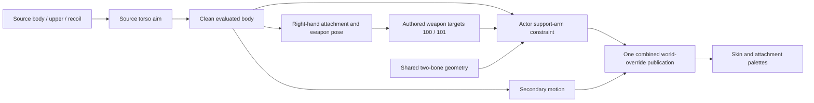

# Support-arm constraint

The user authorized an established solver after the bounded original-source
investigation reproduced the inspected PC pose stages without finding another
effective correction. This is an explicit behavior improvement over the PC
arm solver's empty body, not claimed original executable parity.

Original setup `603b40/5e43f0` names LeftArm, LeftForeArm and LeftHand and authored
target identifiers 100/101. Original callback `5e3840` obtains their bind lengths
and two target positions, but called solver `436ab0` immediately returns. The
existing firing investigation records literal original execution and its bounds.
Concrete target ownership/space and activation remain game-owned; reusable
triangle solving belongs to `bw::math`, with no access to actor state or time.

## Established algorithm and contracts

Reference: Unreal Engine revision
`f45729c0b6f097038e72b52d366a62baeca3275b`,
`Engine/Source/Runtime/AnimationCore/Private/TwoBoneIK.cpp`,
`AnimationCore::SolveTwoBoneIK` position and transform overloads. Read from the
local pinned source. No Unreal source text is incorporated into this repository.
The implementation independently expresses the standard law-of-cosines triangle,
pole-defined bend plane, and shortest-arc segment-frame corrections. The original
hand rotation is retained; only the two limb frame deltas and endpoint positions
are solved. There are no weapon offsets, scene constants or smoothing state.

The solver clamps both the outer and inner reachable radii. The explicit inner
clamp is a deliberate robustness difference from the inspected Unreal overload,
which clamps its cosine but leaves a too-close requested endpoint. It preserves
both limb lengths without stretching. Collinear poles first retain the current
elbow plane, then choose a deterministic perpendicular; coincident targets use
the existing chain direction. Invalid or overflowing input yields no result.
Fixed value inputs/outputs keep ownership and failure atomic and allocate no
steady-state memory. Core I.1 and F.20 and performance MEM.9 were retrieved independently for
header design and implementation; their applications are recorded in the header.

The actor integration evaluates authored targets from the current source
pose before applying the constraint, then publishes a completed pose. The target
cannot depend on the already-corrected left hand. The right-hand weapon
attachment remains authoritative. Activation follows supported original raised
posture and releases for actions that own the arm. Exact target data and action
boundaries are verified by the integrating actor implementation.

## Authored target and publication boundary

The target bank is the selected weapon's control-point asset, not Alicia's body
control-point bank. All four inspected weapon banks publish IDs 100 and 101,
weighted solely to weapon root zero. Their evaluated locations place 100 near
the left hand and 101 toward the elbow plane. That geometry supports using 100
as the hand effector and 101 as the pole; the empty original solver cannot
independently prove those parameter names. This inference is explicit and the
coordinates come from the assets rather than weapon-specific tuning constants.

`AliciaSupportArm` prepares the selected weapon's control metadata and scratch.
It borrows clean body/weapon poses and returns three owned world overrides;
it cannot mutate the pose, controller, resource owner or clock. Current posed
segment lengths retain character scale. Existing aim weight interpolates both
target and pole from the current hand/elbow, so a small activation weight does
not instantly change the elbow plane. Ordinary raised action permission is
separate from that visual weight: exclusive actions release the constraint even
when torso aim is still fading. Non-discharge upper owners release the arm for
their authored reload/change/raise/lower motions.

The actor evaluates body and right-hand weapon attachment, then gathers arm and
secondary-motion overrides and publishes one combined batch. Sequential batches
would recompose unmodified bones from local matrices and discard an earlier
batch. Source secondary outputs are bones 85–124; their sampled anchors and body
contacts do not depend on the corrected left-arm chain. Therefore both owners
can consume the same clean evaluated pose without a dependency cycle. The
intermediate forearm-roll bone and fingers recompose through the pose system;
the explicit hand override retains its authored world orientation. Final body
and weapon palettes publish only after the combined pose is complete.

## Verification

The focused shared math tests cover independent right-triangle solutions,
mirrored poles, inner/outer unreachable targets, equal-length folding, collinear
poles, reverse-direction rotations and invalid inputs. An independent reviewer
also checked 4,000 deterministic geometric cases using length and rotated-axis
invariants rather than duplicating the solver formula. Maximum double-precision
length and direction errors were `5.56e-15` and `7.97e-15` respectively.

Actual Stage verification covers all four weapons, stationary and moving,
with and without targeting. Every case admits fire through the real resource
owner. At full activation, the final hand stays within `0.0001` world units of
the authored reachable weapon target. Actual-asset checks also verify preserved
limb lengths and hand orientation, zero-weight behavior, no retained frame
allocation, and simultaneous costume/arm publication. The first integrated run
exposed a missing immutable weapon-control span in `PlayerWeapon::view()`;
the view now exposes its already-resident data, matching the body view contract.

The independent action-transition capture completes 20,816 actual Stage
evaluations across those 16 cases. Reload, melee, evade and ordinary lowering
release the constraint, leaving the final hand at its authored unconstrained
pose. The right-hand weapon attachment and costume corrections remain unchanged.
All memory charges return to zero. The capture pins its own pre-lint-cleanup
binary; subsequent named-borrow/style changes are reviewed separately.

Reach clamping is a real limit: moving weapon class 2 can put its authored grip
outside the arm's reachable sphere. The largest captured residual is `0.114786`
world units, reduced from `0.473031` before the constraint on that frame.
Stationary firing for all four weapons reaches the authored target in captured
settled frames. The implementation preserves limb lengths; it does not stretch
the skeleton or introduce weapon offsets to conceal unreachable geometry.

The final repository gate passes: formatting, build, six CTest suites, fatal
clang-tidy across 203 translation units and repository content checks. The
complete original-content corpus passes with texture-mip construction enabled
in 252.977 seconds on the frozen final binary; CPU charges return to zero.
Final executable SHA-256:
`7e7b3c46f25ba34e015f89185fcfc5a5225b0fcdba4638a412233be18d758e6c`.
Gate and corpus evidence are under
`research/evidence/reconstruction/support-arm/`; the corpus summary binds source
hashes, original root bytes and executable identity. This final run supersedes
intermediate lint-failure and pre-final-API runs.
The user subsequently confirmed that the repair works and accepted the HUD
scope. The pause menu was explicitly excluded from that acceptance. Numerical
verification and the known moving class-2 reach limit remain separately recorded.
