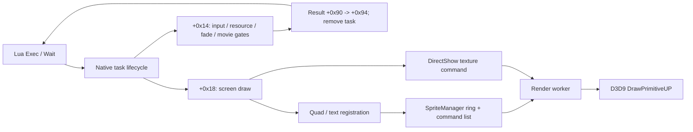

# UI, screen tasks and sprite submission

Updated October 22, 2026. Parents: [execution/scripts](execution-and-scripts.md),
[rendering](rendering.md), [input](input.md), [audio/movies](audio-and-movies.md).

The startup UI is a family of native tasks driven by recovered Lua Exec/Wait
calls. Its lifecycle, selected screen transitions, text/sprite submission and
GPU consumers are connected. Original debug names identify `TaskTitle`,
`TaskTitleMenu` and `SpriteManager`; descriptive field names below are recovered
roles rather than original declarations.

## Task contract

Exec calls vtable **+0x20 = 0x4745d0**, inserting the task through 0x40b670.
Wait checks task state through 0x40b5c0 and finishes through **+0x24 = 0x4745e0**.
`_WaitTitle` first records phase 0x213 and yields before its later status check.
As established by the task dispatcher, **+0x14 is the active update** and
**+0x18 is the later draw pass** for these screens. Input and VSync use +0x14.

| Task | Vtable | Create +4 | Start +8 | Destroy +0x10 | Update +0x14 | Draw +0x18 |
|---|---|---|---|---|---|---|
| Title | 0x82a144 | 0x499ba0 | 0x499ae0 | 0x499c60 | 0x499f10 | 0x499d00 |
| TitleMenu | 0x82a170 | 0x49a800 | 0x49a690 | 0x49a8d0 | 0x49b320 | 0x49a990 |
| CompanyLogo | 0x82a1f4 | 0x49e0c0 | 0x49e070 | 0x49e170 | 0x49e320 | 0x49e200 |
| Advertise | 0x82a220 | 0x49e6b0 | 0x49e610 | 0x49e750 | 0x49e900 | 0x49e7d0 |
| MemoryCardCheck | 0x82a2a4 | 0x4a0e50 | 0x4a0e20 | 0x4a0e70 | 0x4a0f20 | 0x4a0e80 |
| CharacterLoad | 0x82a2d0 | 0x4a1100 | 0x4a10e0 | 0x4a49d0 | 0x4a1240 | 0x4a11a0 |

The [task table](../../evidence/native-startup/mapping.json) is rechecked against
raw pointers by the pass-06 audit. Shared slots are interfaces; task-specific
state numbers must not be treated as a universal screen state machine.

## Title and menu ownership

**0x499ba0** allocates a 0x1f0-byte title component at task **+0x8c**.
**0x499ae0** resets state/flags and opens `data\movie\witchLOGO.ssu` through
0x562f00; failure logs a movie initialization error and invokes stop/release.
**0x499a10** requests `sprite.title`, waits for its resource group, and then waits
for a further loading-screen sprite resource group before marking initialization
ready. The [title follow-up](startup-title-followup.md) corrects the earlier
worker-barrier interpretation using the selector and polling instructions.

In **0x499f10**, state 100 checks pressed action bits **0x1010**. Input selects
the 500/501/502 fade path; timeout selects 2000 and subsequent movie/fade handling.
The input path sets outcome **1**; the completed timeout/movie path sets **2**.
State 10000 hides the screen, stops the movie and copies outcome **+0x90 to +0x94**;
10001 removes the task through 0x40b690. Fade completion and movie completion
are separate checks. Exact timer constants and input interpretation remain
consumer-specific rather than guessed button labels.

**0x499d00** submits sprites, movie texture via 0x562df0 and the original text
`Version 1.0.5`. This is a displayed version string, not a Steam app build ID.
**0x499c60** releases the resource group via 0x4ac740 and destroys/frees the
component at +0x8c.

**0x49a800** allocates the 0x5c0-byte title-menu component. **0x49a690** initializes
up to six selectable entries, with separate existence/availability flags and
save/service queries. **0x4c6570** wraps selection and skips disabled entries;
**0x4c6430** is a related selection operation. **0x49b320** handles input and
outcomes; **0x49a990** draws selection/highlight sprites and localized strings
from 0x412000. **0x49a8d0** tears down child objects, releases resource groups and
frees +0x8c. These availability checks do not establish the five costume unlock
conditions; that remains a progression-policy question.

## Other startup screens

- **CompanyLogo:** 0x49e320 iterates a table rooted at 0x95bd88/0x95bd8c,
  opens its movie path, fades in, waits for completion or pressed masks
  0x1010/0x2020, fades out, and advances the table index. The final path hides
  the screen, stops an active movie, sets result +0xec to 1 and removes the task.
  Failed movie initialization clears visibility but increments the current
  primary state from 500 to 501, rather than entering final cleanup state 8001.
  Its subsequent continuation remains unresolved; see the corrected
  [source contract](../../../docs/startup-runtime.md#reconstructed-startup-update-policies).
- **Advertise:** 0x49e610 opens `data\movie\advertise.ssu`; 0x49e900 separately
  handles fade-in, movie completion or input skip, fade-out, visibility clear,
  result +0x90 = 1, movie stop and task removal.
- **MemoryCardCheck:** the mapped PC update 0x4a0f20 advances UI/timer phases,
  toggles visibility at +0xec, sets +0xe8 to 1 and removes the task. Its name
  alone does not establish physical memory-card access; this function contains
  no direct file read/write call.
- **CharacterLoad:** 0x4a1100 owns an eight-byte wrapper and a 0x180-byte dialog
  component constructed by 0x4c9e30. The 0x4a1240 state machine reaches save
  dispatcher helpers 0x471b30/0x471b60/0x471500 and polls 0x470e20/0x470e50;
  localized `mem.*` dialogs introduce retry/cancel/error branches. Destroy
  0x4a49d0 calls 0x4c9f80, invokes the child's deleting destructor, frees the
  wrapper and clears +0x8c. Full dialog choice semantics remain bounded work
  shared with save/error handling.

The graph connects producers and consumers; it does not imply Wait completes
only after the final frame has been presented.

## Sprites, fonts and ring lifetime

**0x564460 -> 0x563110** prepares texture/UV/crop state, quad transforms and
screen-to-clip coordinates. **0x44b660** returns the shared SpriteManager at
global **0xdf8394**, constructing it through **0x568e60**. The constructor creates
**four buffers**, each **0x16130 bytes**, beginning at manager **+0x1010**.

**0x569620** registers into `(manager[+0x100c]-1) mod 4`. It rejects an append
when **count + 1 > 0x1ff**, logs `SpriteManager::regist()`, and returns zero.
Thus with a zero initial count this path accepts at most **511 entries**.
Entries have **0xb0-byte stride** and form a linked list sorted by the unsigned
key at **+0x90**. Equal keys retain insertion order in the recovered traversal.
The return value zero also represents the first successful entry, so it must not
be treated as an unambiguous failure code by a replacement.

**0x4ba620** handles multiline wide-character text, alignment/spacing and glyph
submission through **0x569760**; **0x5692f0** resolves font resources.
**0x4ac8d0** requests `sprite.font`. Glyph/layout details are separate from the
screen task's selection and completion state.

**0x4ac9c0 -> 0x569170** publishes the list when the manager's enable byte is set.
It calls **0x568cc0 -> 0x568d20**, allocating **0xdc-byte commands** in the shared
render arena through 0x40f7f0 and linking them through 0x40f1a0. The command
constructor installs vtable **0x841044 -> 0x5692d0 -> 0x568f20**. The selected
sprite-list head is captured at command +0x14. Publication then advances the ring
index modulo four, clears the next registration buffer's list/count fields and
updates six associated command/storage views.

The renderer's command-list completion events are mapped separately. Four ring
buffers alone do not prove safety under every unusual task cadence or failure.
Their reuse contract must preserve both publication and render completion.

## GPU consumers and video

**0x568f20** walks the captured sprite list between D3D **BeginScene / EndScene**.
Ordinary entries bind vertex/pixel shaders, constants, declaration and texture,
then use device vtable **+0x14c = DrawPrimitiveUP** with primitive type **5**
(triangle strip), **2 primitives**, and **0x18-byte vertex stride**. Entries with
nonzero +0xa0 instead invoke the selected custom command callback. The shared
consumer therefore handles both ordinary quads and custom draw commands.

Movie command vtable **0x841f1c -> 0x569970** reaches the same D3D draw API with a
four-vertex strip. It binds the queued texture, computes viewport-relative size
and position, selects among display shader modes and sets filtering/color/alpha
state. This completes the static connection from DirectShow's two texture
buffers to GPU submission. It does not validate playback codecs or video timing.

## Evidence and remaining contracts

Pseudocode, instructions and references are in slices
[06r](../../evidence/engine/pass-06r/status.tsv),
[06s](../../evidence/engine/pass-06s/status.tsv),
[06u](../../evidence/engine/pass-06u/status.tsv),
[06v](../../evidence/engine/pass-06v/status.tsv) and
[06w](../../evidence/engine/pass-06w/status.tsv).
The [native index](../../evidence/engine/pass-06/FUNCTIONS.md) links accepted exports.
D3D method identities use the preserved Microsoft
[header](../../sources/directx-2010-reference/d3d9.h).

Local work: full localized text/layout interpretation, every menu/error screen,
exact fade/timing behavior, all-disabled selection behavior, overflow handling
and ring reuse under unusual cadence. Costume/bonus policy remains in the
[save map](saves-and-progression.md). The screen-to-render architecture is connected.
