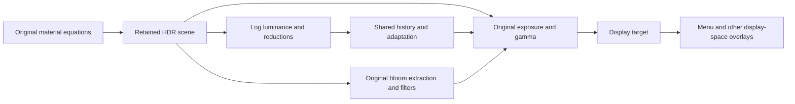

# World color to display output

October 23, 2026. The first cave inspection exposed a missing output boundary:
original material shaders produce scene HDR values, while the host wrote them
straight into an eight-bit display target. A valid mesh/material submission did
not establish a usable scene image.

## Original source

Scene composition `0x461f00` enables tone mapping from stage settings `+0x134`.
The actual `witch/stage/st04_c` customization record enables it. Its exposure
key is 0.18, gamma 2.2 and bloom is enabled. These are authored values, not
brightness chosen to make an inspection image look plausible.

Builder `0x56d6a0` schedules scene luminance, downsampling, luminance reduction,
bloom extraction and filtering, then final display mapping. The final pixel
program at `0x844bc8` computes:

```
exposed = scene_rgb * exposure_key / (adapted_luminance + 0.001)
display_rgb = pow(abs(exposed), 1 / gamma) + optional_bloom
```

There is no Reinhard/ACES curve in that program. The gamma exponent is explicit;
an additional sRGB render-target transform would apply another transfer.
Luminance begins with `log(dot(scene_rgb, (0.299, 0.587, 0.114)) + 0.0001)`.
The original reduces that logarithm and uses its exponential as geometric mean
luminance. The CPU exposure controller samples a bounded history at 30 Hz,
then limits adaptation speed; source `0x5712f0` and helpers establish the exact
ordering. Its authored history, speed and bounds belong to scene configuration.

Bloom extraction at `0x844020` uses the original distinct placement of the
0.001 offset inside the logarithmic exponent, then a threshold and soft knee.
It is not a generic threshold-plus-Gaussian approximation. Sampling footprints,
filter weights and output target precision are part of the native pass contract.

Generated source, instruction witnesses and shader disassembly remain under
`research/evidence/engine/pass-20-tone-output` through `pass-25-output-gauss`
and `research/evidence/reconstruction/world-output/`.

## Established implementation and chosen boundary

Inspected Unreal Engine commit `f45729c0b6f097038e72b52d366a62baeca3275b`,
`Engine/Source/Runtime/Renderer/Private/PostProcess/PostProcessTonemap.cpp`,
`AddTonemapPass`: it takes scene color and exposure separately, defines an output
viewport/format, and schedules a screen pass with explicit borrowed resources.
We adopt that separation and explicit HDR-to-display ownership. Unreal's tone
curve and adaptation equations do not replace the recovered Bullet Witch ones.

The native owner retains a bounded set of scene/intermediate textures. Existing
completion waits establish when their contents/storage may be reused; no frame
count is treated as GPU completion. Common parameters and adaptation arithmetic
remain reusable across targets. A full render graph and transient aliasing are
not required for this fixed pass chain. The retained pool keeps steady-state
texture allocation out of the frame loop.

Both C++ guidance corpora were queried for this design. Core Guidelines I.11
(`#ri-raw`) keeps borrowed Metal encoders/textures distinct from retained owners.
Performance GPU.9 (`guidelines/gpu/GPU.9-suballocate-and-alias-transient-gpu-memory.md`)
supports explicit lifetimes and bounded retained transient resources; aliasing
requires a proven lifetime schedule and is not assumed here.



The native pass chain is implemented and verified below. This document does not
claim user visual acceptance or complete original postprocessing parity.

## Implemented native pass contract

Target setup `0x56e990` establishes a 512×512 RGBA16Float log/color image,
a 256×256 RGBA16Float color result plus R32Float luminance, then R32Float
64×64, 16×16, 4×4 and 1×1 reductions. Bloom uses 256×256 and 128×128
RGBA16Float targets. The native owner now retains these formats/sizes. The
original multiple-render-target downsample is encoded as two passes reading
the same source and computing the same average; color half conversion does not
feed the full-precision luminance output.

The reduction footprint is unusual but confirmed by raw instructions:
`0x56dabf`/`0x56dac5` take **destination** dimensions from target `+0x210/+0x214`
and write command `+0x18/+0x1c`. Helper `0x5788b0` divides by those fields and
constructs offsets −1.5, −0.5, 0.5, 1.5. The final 4→1 reduction consequently
samples clamped corners. Fullscreen interpolation also follows the recovered
D3D9 sample centers: `(pixel + 0.25) / destination_extent`. Metal uses a
quarter-pixel right/down quad displacement to reproduce those UVs, rather
than copying D3D9 clip coordinates across APIs. The fitted display viewport
and HDR target use matching pixel-aligned extents. See
[the output fidelity audit](world-output-fidelity-audit.md) for the raw quad,
API convention and native sample-position witnesses.

Replacing this with source-normalized box reduction
would change the recovered behavior. The native numerical test uses a 4×4 field
whose interior differs strongly from its corners and checks this distinction.

Bloom uses the recovered thirteen-tap radius-two diamond with normalized
Gaussian weights, then fifteen-tap horizontal/vertical sigma-three filters with
multiplier two. Original threshold and soft-knee equations, clamp samplers and
point/linear distinctions are preserved. Output key, gamma and bloom key/knee
use native setter range 0.01–64; bloom threshold uses 0.01–16.

The first submission has no previous completed luminance readback. It explicitly
uses the current GPU reduction rather than inventing a brightness constant.
Subsequent submissions pass the completed logarithmic measurement to the common
controller before encoding the next frame. This initial-frame policy and the
native steady-clock interval are inspection integration choices: original
paused/time-scaled game-clock wiring is not reconstructed. The existing GPU
completion wait protects target reuse and the one-float CPU readback.

## Verification and limits

The strict native build and existing in-process memory suite pass. New numerical
cases check the nonuniform reduction footprint and exposure/gamma output within
one quantization step, alongside existing geometry/material cases. A production
headless stage capture follows the same HDR/output methods as the window host:
its textured cave is visible after the recovered transfer, whereas direct raw
HDR display was nearly black. Captures and statistics remain ignored evidence.

This is not a matched original-game image or bit-identical shader claim. Native
floating-point transcendental/accumulation precision, full stage draw selection,
local lights/shadows, visibility, other postprocess families and game-clock
integration remain separate fidelity boundaries. User-facing acceptance remains
with the integrated scene view, not an assertion count or a synthetic shader test.
