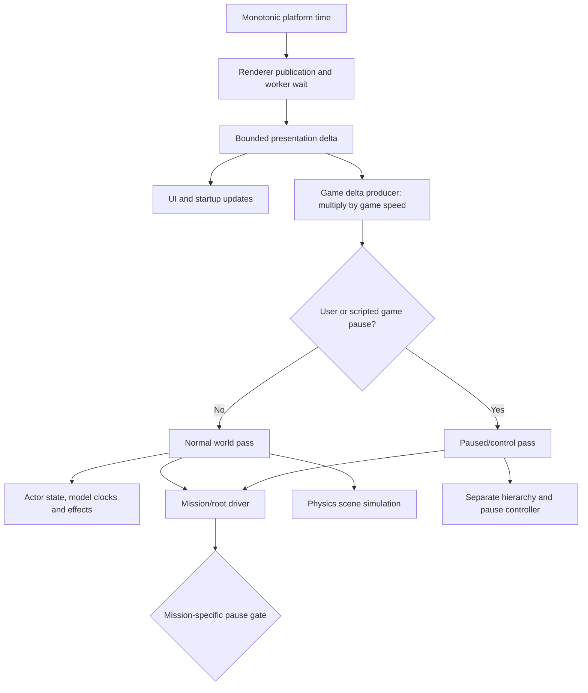

# World timing, pause admission and local animation clocks

The Steam executable has one game-owned delta for the normal world pass. It is
measured presentation elapsed time, capped before applying game speed. Pausing
selects a different update path; it does not stop the wall clock or overwrite the
shared delta with zero. Animation cursors consume admitted update intervals and
remain local playback state, not competing authorities for world time.

This is a read-only trace of the existing unpacked Steam executable, SHA-256
`bdaff1746d3092215699b09eab11315c6adf8fb71eaa8f46c280b11b3cd448fd`.
Addresses identify compatibility evidence, not proposed public engine names.
The findings below describe inspected native behavior. They do not assert an
original-game FPS measurement or a complete implementation of every mission mode.

## Clock ownership

| Owner | Producer and value | Consumers and limit |
| --- | --- | --- |
| Raw platform timer | `0x40eab0`: successive QueryPerformanceCounter differences | Host/task timing; no game-speed scale or clamp here |
| Renderer publication | `0x40f920`: measure elapsed, wait for preceding render worker, measure again; publish `min(elapsed, 0.1f)` at renderer `0xa0b730 + 0x88` | Startup/UI and the game-delta producer; worker backpressure is included |
| Game/world delta | `0x460010`, instructions `0x460117..0x460132`: renderer delta at `0xa0b7b8` multiplied by game `+0x4124`, stored at game `+0x414c` | Normal world dispatch and the separate paused/control route |
| Local animation | `0x42aec0(dt)` visits active clip owners; `0x41e440(dt)` applies each owner's playback speed | Local cursors, blend intervals, root extraction and event crossings; no wall-time read in these functions |
| PhysX scene | `0x461770 → 0x4e9660 → 0x4fc050` forwards game `+0x414c` | Solver timing configuration has its own bound; simulation receives the original game delta |
| Media playback | Existing timestamp/audio-clock contract | The renderer cap does not establish a cap for video timestamps or audio consumption |

The raw timer and renderer handoff were already established in
[bootstrap and tasks](bootstrap-and-tasks.md#startup-clock-and-presentation-pacing).
The new connection is the explicit multiply/store in `0x460010`. Therefore the
normal world inherits the renderer's 100 ms cap **before** time scaling; there is
no second clamp in this producer. At speed one, a long host interval advances the
world by at most 100 ms. This path does not preserve the discarded interval in a
catch-up accumulator.

Game construction `0x44fde0` writes float `1.0` to `+0x4124` at `0x44fe47`.
The inspected curve writer `0x6a3e20` samples authored time/value pairs and writes
the result to that field at `0x6a3f11`; outside an eligible interval it uses one.
Another writer at `0x6a0fbc` restores one. No general validated scale setter or
universal numeric range was established. Adding finite/nonnegative validation to
a reconstructed public API is a safety contract, not evidence of a native clamp.
A scale written during a world pass affects the next producer invocation, because
that pass already has its published delta.

## Admission and normal update order

The base game vtable at `0x82c6b4` resolves these slots directly from executable
bytes:

| Slot | Target | Responsibility in this trace |
| --- | --- | --- |
| `+0x10` | `0x460010` | Handle pause request, publish delta, return user-pause state |
| `+0x14` | `0x45ef10` | Paused/control update |
| `+0x18` | `0x4617e0` | Normal world update |
| `+0x68` | `0x4377c0` | Read user-pause byte at game `+9` |
| `+0xa0` | `0x45f070` | Actor/service/hierarchy/effect pass |
| `+0xa8` | `0x4587a0` | Additional world pass; full responsibility not named here |
| `+0xac` | `0x45eff0` | Physics-related queued mutation pass |
| `+0xb0` | `0x461770` | Physics scene advancement |
| `+0xb4` | `0x45f850` | Admit hardware input or publish neutral player input |

After initialization, the game task `0x43b890` invokes `+0x10`. It takes `+0x18`
only when the returned user-pause value is false **and** game byte `+0xa` is zero.
Otherwise it takes `+0x14`. The delta producer executes before this decision and
publishes a nonzero interval even while paused when elapsed time and speed are
nonzero.

Normal `0x4617e0` runs `+0xa0`, then `+0xa8`, then `+0xac`, then the mission/root
driver `0x43ecf0`, then physics `+0xb0`. A separate flag can request another
`+0xa8` pass afterward. It does not loop these complete world phases until a
fixed-step accumulator is exhausted.

Within `0x45f070`, the input handoff precedes actor state/service work. The parent
hierarchy update precedes child model clock/pose publication; registered object,
effect and retirement passes follow as mapped in
[actor lifecycle](actor-lifecycle.md) and
[actor/model clock order](actor-model-clock-order.md). Actor hierarchy context
contains the parent transform at game `+0x4148` and the same published delta at
`+0x414c`. The effect call `0x608890` and physics dispatch also receive that delta.
This establishes a common producer for these consumers, not independent host
samples per subsystem.

The paused/control route `0x45ef10` still updates controller `0x4996f0`, walks the
separate hierarchy returned by `0x45cde0`, calls mission/root `0x43ecf0`, and
processes retirement. Its hierarchy is not the normal actor hierarchy returned
by `0x45ce80`. It does not call the normal full-world or physics dispatch.

`0x4996f0` explicitly retains **both** its game-delta argument at controller
`+0x2c4` and unscaled renderer delta at `+0x2c8`, then calls `0x4cc7f0`.
The pause-menu update `0x4cd020` directly reads renderer delta and UI input from
`0x474570`. Consequently menu animation/input can continue while normal world
advancement is withheld.

### Environment publication has two call paths

The lighting audit prompted a check of AREA producer cadence. Direct image reads
of derived vtable `0x82e068` show `+0xa0 = 0x475600`, with the same producer,
paused/control and normal route targets as the base game. Constructor `0x4754e0`
installs that table at `0x47550e`. Its camera-to-AREA call at `0x47563f` therefore
belongs to normal-world dispatch and is absent from the paused/control route.
The bounded table read is retained in ignored `world-timing/derived-game-vtable.json`.

The ordinary mission selects mode 7 through `0x43f13f → 0x40b670 →
0x43b701 → 0x43a6c0`, whose base table has `+0xa0 = 0x45f070`, without the
derived AREA call. The lighting audit retains this constructor-chain witness
under ignored `lighting-source-fidelity/area-cadence.json`. There is no supported
double smoothing from the two modes.

The ordinary camera-to-AREA call at `0x43fa0a` belongs to `0x43eea0`. Ordinary
user pause gates this coroutine before reaching that call; mission/transition
exceptions and active-state flags remain significant. Scripted game pause alone
does not apply that user-pause gate, so an active root path can still update AREA
while normal actors are withheld. Its per-call smoothing is not a scaled-delta
interpolation. Current Stage user-pause suppression is supported, but blanket
suppression during future live script pause is not established parity. Genuine
script-pause/root integration must preserve this separate publication phase;
the present native witness only proves the implemented owner/consumer behavior.

## Distinct pause and input state

| Game field | Established meaning | Effect |
| --- | --- | --- |
| Byte `+8` | Pause-request admission | `0x460010` skips the user-pause request checks when zero |
| Byte `+9` | User-pause state | Selects paused/control route; exposed by virtual `+0x68` |
| Byte `+0xa` | Scripted game-pause state | Also selects paused/control route |
| Byte `+0xb` | Scripted pad restriction | Suppresses normal hardware input without selecting the paused world route by itself |
| Byte `+0xc` | Additional input restriction | Participates in input admission; broader ownership remains outside this trace |
| Byte `+0xf` | Computed input admission | Published by `0x45f850` from the relevant restriction bytes |

The base constructor `0x44fde0` writes the four-byte value `1` at game `+8`
(instruction `0x44fe0a`). In the little-endian executable this initializes
pause-request admission to true and user pause, scripted game pause, and pad
restriction to false. Menu admission therefore comes from construction, not an
inferred later activation step. The adjacent write `0x44fe11` sets `+0xc` to
`0x00010000`, so the additional input-restriction byte `+0xc` starts false too.

There is a constructor-tail qualification: `0x44ff59..0x44ff66` obtains the
mission owner, tests its byte `+0x74`, and sets game `+0xa` to true if that byte
is nonzero. The existing mission lifecycle trace establishes `+0x74` as the
root/mission-driver admission gate (`0x43ecf0` returns immediately when it is
zero). Consequently the base defaults alone do not establish an unpaused
world for every startup configuration. A mission/root-driven startup may enter
scripted pause before construction returns; its later script transitions own
release. This branch does not alter menu admission, user pause or pad restriction.
The reconstructed default control object represents the unrestricted baseline;
faithful full root/world startup must preserve the mission-conditioned scripted
pause rather than treating that baseline as every activation path.

User pause `0x460010` checks request admission, player state and active transition
conditions before toggling byte `+9`. On entering pause it starts the pause
controller and clears byte `+8`. The paused/control route detects completion,
restores the relevant audio state, finalizes the pause controller and writes
bytes `+8/+9` back to enabled/not-paused. These are frame-phase transitions, not
a second clock.

The mission coroutine path `0x43eea0` has its own early user-pause gate through
virtual `+0x68`. Three explicit mission/transition bytes can bypass that gate.
Scripted game pause is not the same predicate: the paused/control route still
calls the root owner, and this user-pause test alone does not stop the script.
Also, `0x43ecf0` has auxiliary updates outside that coroutine path, including the
fade service. A blanket rule that pauses every Lua task because world movement
is paused is not supported by these functions.

Script callbacks `_GamePause` (`0x478a70`) and `_PadPause` (`0x47a4f0`) share one
stack at `0x12f6144`, depth at `0x12f6188`, with eight saved entries. Each entry
stores pause-request admission, scripted game pause and pad restriction in bits
0, 1 and 2. User pause is not part of this snapshot.

- Game pause saves those bits, disables pause requests and sets scripted game
  pause; it also requests the corresponding audio pauses.
- Pad pause saves the same bits, disables pause requests and sets pad restriction.
  It calls player helper `0x6043e0(1)` when a player exists.
- Game resume (`0x478ba0`) and pad resume (`0x47a560`) pop and restore all three
  fields. Their subsequent side effects consult the restored snapshot when
  nesting remains, or use zero when depth reaches zero. Game resume conditionally
  resumes audio and player input; pad resume conditionally restores player input.

The native overflow path still changes pause flags when depth is already eight
and cannot save another snapshot. Do not describe a checked/rejected ninth push
in a new API as recovered native behavior. Similarly, this evidence establishes
balanced nesting under valid script use; it is not a reason to reproduce unsafe
null-world or malformed-stack behavior.

## Player input has an explicit neutral path

The normal actor pass invokes game virtual `+0xb4`. Its base implementation
`0x45f850` admits hardware only if bytes `+9`, `+0xc` and `+0xb` are all zero.
It constructs the real input event through `0x5fc3f0` when admitted and a neutral
input event through `0x5fcf30` otherwise. Both use the same actor delivery route
`0x44f920`. Thus an input-only restriction does not mean skipping the actor or
letting its last input persist indefinitely.

The player helper `0x6043e0` also updates the component at player `+0x1228`.
Its helper `0x688580` sets component `+0x27` bit 1 when paused; the caller clears
bit 0 at the same time and reverses those settings when resumed. Existing action
consumers test bit 0 before admitting behavior, including the branch at
`0x6884a7`. These are action admission flags, separate from local clip elapsed
seconds and from global world advancement.

This trace does not establish that every input edge should be replayed after
resume. A reconstruction must preserve an explicit boundary between UI input,
admitted gameplay input and local action lifetime, rather than converting all
three into a single paused boolean.

## UI repeat timing uses the renderer interval

Input finalization `0x41cfd0` receives the device/input owner in `ECX`; it has no
elapsed-time argument. Instruction `0x41cfef` reads `0xa0b7b8` directly into
`xmm6`. Device paths invoke it at `0x41c7ae`, `0x41ca5e`, `0x41cc58`,
`0x41cd8a` and `0x41cf75`, after updating the device's axis/button state. These
calls use the shared input owner at `0xaf1150`. This establishes presentation
delta, not a separate timer, as repeat advancement's input.

The owner retains two banks of 32 float repeat timers at `+0x154` and `+0x1d4`.
Released bits clear their timer. Held bits add the renderer delta, including the
first held sample. At a timer value of at least 0.5 seconds, the method emits
one repeat bit and subtracts 0.125 seconds. There is no catch-up loop emitting
several repeat events in one input finalization. The two constants were decoded
directly from `0x6c1398` and `0x6c31c0`. Press edges remain separate and are ORed
with repeat bits into outputs `+0x14` and `+0x20`.

Consequently user/game pause or a zero world speed must not stop UI repeats.
Input repeat should consume the explicitly supplied presentation interval;
an independent monotonic sample in the Mac input owner is not the traced
algorithm. Likewise, excluding elapsed time on the first held sample is a
reconstruction policy difference, not a property recovered from this function.
The raw instruction witnesses and decoded constants are retained as
`input-repeat-instructions.txt` and `input-repeat-constants.json` under the same
ignored world-timing evidence directory. Existing Ghidra exports in `pass-06f`
confirm both timer banks; instruction reads establish the elapsed producer.

## Local animation and solver intervals

`0x42aec0` advances the active animation-owner lists with the supplied context
delta. `0x41e440` decrements its blend interval with that delta and advances its
local animation through `0x41f0a0` using `playback_speed × delta`. These values
are legitimate local playback state. An animation can restart, loop or vary its
playback rate without resetting or replacing world time.

Parent movement consumes the previous model publication before the child model
publishes the next root interval. See
[actor/model clock order](actor-model-clock-order.md) for that retained interval,
event order and pose publication. The reconstruction's existing balanced actor
subdivision and explicit retained-root producer duration are documented
adaptations using a pinned Unreal movement reference. They were not recovered as
a universal Bullet Witch fixed world tick. This timing work does not authorize
silently moving every subsystem into those subdivisions.

PhysX `0x4fc050` configures its scene timing with a bounded interval and an
iteration count, then submits the **original game delta** to simulation. The
configuration is not evidence that every engine subsystem runs four substeps.
The exact instruction correction and call order are recorded in
[physics and collision](physics-and-collision.md).

## Evidence and remaining boundaries

This pass read existing Ghidra exports and the existing full instruction listing,
then decoded the base-game vtable directly from the PE image. It did not execute
the original Windows game, change the game installation, or infer behavior from
current reconstruction output. Authored findings are here; raw witnesses remain
ignored under `research/evidence/reconstruction/world-timing/`:

- `provenance.json`: image hash, inspected address intervals and decoded vtable.
- `instruction-witnesses.txt`: bounded excerpts for the producer, dispatch,
  script pause callbacks, input flags and scale writer.

Existing exports used include `pass-04c` (`0x43b890`), `pass-02` (`0x4617e0`),
`pass-05f` (`0x45ef10`), `pass-02e` (`0x43ecf0`, `0x43eea0`, `0x4996f0`),
`pass-105-pause-menu` (`0x4cd020`), `pass-89-alicia-hardware-action`
(`0x45f850`), `pass-64-material-phase` (`0x42aec0`, `0x41e440`), and the
existing native-decompilation exports for the four script pause callbacks.
Raw pseudocode is not the implementation or publication artifact.

The normal/base route, delta producer, pause split and player input admission are
closed for this timing slice. Full contents of the paused hierarchy, the meaning
of every additional mode/transition flag, exact all-mode presentation cadence,
and every specialized game subclass remain bounded follow-up research. These
unknowns do not justify inventing a universal fixed step, allowing animation
cursors to drive the world, or disabling all script control when simulation is
paused. Reference-based design should address only the remaining ownership and
API gaps, with those departures named explicitly.
